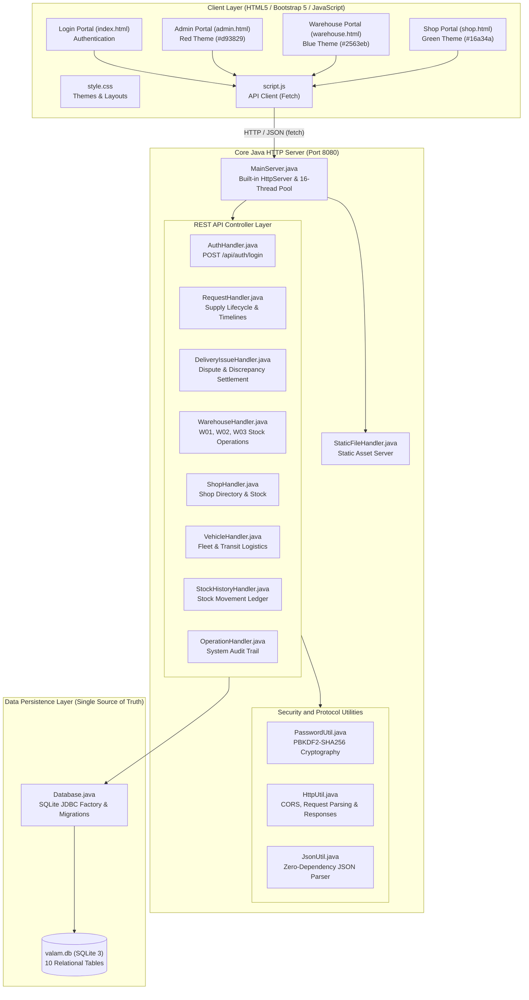

# VALAM SUPPLY MANAGEMENT SYSTEM - COMPLETE SOURCE CODE APPENDIX

> **Project Name:** VALAM - Public Distribution & Multi-Warehouse Supply Chain Management System  
> **Architecture:** Pure Core Java (`com.sun.net.httpserver.HttpServer`) + SQLite Database (`database/valam.db`) + Pure HTML5/Bootstrap5 Frontend  
> **Total Source Files:** 20 Files (14 Java Backend Classes + 4 HTML Dashboards + 1 CSS + 1 JavaScript Client)  
> **Security Implementation:** PBKDF2WithHmacSHA256 (65,536 iterations, 16-byte cryptographically secure salt)  
> **Database Engine:** Embedded SQLite 3 (10 Relational Tables, Zero External Server Dependency)  
> **Date of Generation:** November 02, 2026  
> **Documentation Purpose:** Master Source Code Appendix for Academic Project Report & Evaluation.

---

## Table of Contents

1. [System Architecture and Master Workflow](#1-system-architecture-and-master-workflow)
2. [Master Source Code File Inventory](#2-master-source-code-file-inventory)
3. [Database Schema DDL Definition](#3-database-schema-ddl-definition)
4. [Part 1: Backend Source Code (Core Java & SQLite Layer)](#4-part-1-backend-source-code-core-java--sqlite-layer)
   - [Appendix A.1: MainServer.java](#appendix-a1-mainserverjava)
   - [Appendix A.2: Database.java](#appendix-a2-databasejava)
   - [Appendix A.3: PasswordUtil.java](#appendix-a3-passwordutiljava)
   - [Appendix A.4: AuthHandler.java](#appendix-a4-authhandlerjava)
   - [Appendix A.5: RequestHandler.java](#appendix-a5-requesthandlerjava)
   - [Appendix A.6: DeliveryIssueHandler.java](#appendix-a6-deliveryissuehandlerjava)
   - [Appendix A.7: WarehouseHandler.java](#appendix-a7-warehousehandlerjava)
   - [Appendix A.8: ShopHandler.java](#appendix-a8-shophandlerjava)
   - [Appendix A.9: VehicleHandler.java](#appendix-a9-vehiclehandlerjava)
   - [Appendix A.10: StockHistoryHandler.java](#appendix-a10-stockhistoryhandlerjava)
   - [Appendix A.11: OperationHandler.java](#appendix-a11-operationhandlerjava)
   - [Appendix A.12: HttpUtil.java](#appendix-a12-httputiljava)
   - [Appendix A.13: JsonUtil.java](#appendix-a13-jsonutiljava)
   - [Appendix A.14: StaticFileHandler.java](#appendix-a14-staticfilehandlerjava)
5. [Part 2: Frontend Source Code (HTML, CSS & JavaScript Layer)](#5-part-2-frontend-source-code-html-css--javascript-layer)
   - [Appendix B.1: index.html](#appendix-b1-indexhtml)
   - [Appendix B.2: admin.html](#appendix-b2-adminhtml)
   - [Appendix B.3: warehouse.html](#appendix-b3-warehousehtml)
   - [Appendix B.4: shop.html](#appendix-b4-shophtml)
   - [Appendix B.5: style.css](#appendix-b5-stylecss)
   - [Appendix B.6: script.js](#appendix-b6-scriptjs)
6. [Build, Compilation and Execution Guide](#6-build-compilation-and-execution-guide)

---

## 1. System Architecture and Master Workflow

The VALAM architecture connects a lightweight, modern web frontend directly to an embedded Core Java HTTP service and SQLite database. Bulky third-party enterprise frameworks have been replaced with efficient native Java implementations.



---

## 2. Master Source Code File Inventory

| S.No | File Name | Layer | Language | Purpose / Module | SLOC | File Size |
| :---: | :--- | :---: | :---: | :--- | :---: | :---: |
| 1 | [`MainServer.java`](#appendix-a1-mainserverjava) | Backend | Java | Server Entry Point and Route Registry | 66 | 2.8 KB |
| 2 | [`Database.java`](#appendix-a2-databasejava) | Backend | Java | SQLite Persistence Engine, DDL and Schema Migrations | 624 | 40.3 KB |
| 3 | [`PasswordUtil.java`](#appendix-a3-passwordutiljava) | Backend | Java | Cryptographic Security and Salted Password Hashing | 45 | 1.4 KB |
| 4 | [`AuthHandler.java`](#appendix-a4-authhandlerjava) | Backend | Java | Authentication and Role-Based Access Control | 88 | 3.7 KB |
| 5 | [`RequestHandler.java`](#appendix-a5-requesthandlerjava) | Backend | Java | Supply Requisition and Fulfillment Engine | 1232 | 65.3 KB |
| 6 | [`DeliveryIssueHandler.java`](#appendix-a6-deliveryissuehandlerjava) | Backend | Java | Delivery Discrepancy and Dispute Resolution | 271 | 14.1 KB |
| 7 | [`WarehouseHandler.java`](#appendix-a7-warehousehandlerjava) | Backend | Java | Warehouse Master and Inventory Management | 288 | 13.8 KB |
| 8 | [`ShopHandler.java`](#appendix-a8-shophandlerjava) | Backend | Java | Fair Price Shop Directory and Stock Queries | 137 | 7.3 KB |
| 9 | [`VehicleHandler.java`](#appendix-a9-vehiclehandlerjava) | Backend | Java | Logistics Fleet and Transport Fleet Management | 63 | 2.8 KB |
| 10 | [`StockHistoryHandler.java`](#appendix-a10-stockhistoryhandlerjava) | Backend | Java | Warehouse Stock Transaction Ledger | 94 | 4.1 KB |
| 11 | [`OperationHandler.java`](#appendix-a11-operationhandlerjava) | Backend | Java | Administrative Audit Log and Activity Tracker | 111 | 5.2 KB |
| 12 | [`HttpUtil.java`](#appendix-a12-httputiljava) | Backend | Java | HTTP Protocol and JSON Response Utilities | 83 | 3.3 KB |
| 13 | [`JsonUtil.java`](#appendix-a13-jsonutiljava) | Backend | Java | Lightweight Zero-Dependency JSON Engine | 152 | 5.6 KB |
| 14 | [`StaticFileHandler.java`](#appendix-a14-staticfilehandlerjava) | Backend | Java | Embedded Static Web Content Server | 86 | 3.1 KB |
| 15 | [`index.html`](#appendix-b1-indexhtml) | Frontend | HTML | Login Portal - Role Selection and Authentication | 160 | 7.8 KB |
| 16 | [`admin.html`](#appendix-b2-adminhtml) | Frontend | HTML | District Supply Officer - Admin Dashboard | 957 | 48.3 KB |
| 17 | [`warehouse.html`](#appendix-b3-warehousehtml) | Frontend | HTML | Warehouse Supervisor - Warehouse Dashboard | 1692 | 87.5 KB |
| 18 | [`shop.html`](#appendix-b4-shophtml) | Frontend | HTML | Fair Price Shop Keeper - Shop Dashboard | 1169 | 62.3 KB |
| 19 | [`style.css`](#appendix-b5-stylecss) | Frontend | CSS | Global Application Stylesheet | 450 | 7.9 KB |
| 20 | [`script.js`](#appendix-b6-scriptjs) | Frontend | JAVASCRIPT | Centralized API Client and Shared Utilities | 204 | 9.0 KB |
| | **TOTAL PROJECT CODE** | **Full Stack** | **All Modules** | **20 Source Code Files** | **7,972** | **395.6 KB** |

---

## 3. Database Schema DDL Definition

The SQLite database file `database/valam.db` is maintained as the single source of truth across the system. The 10 relational tables created and maintained by `Database.java` are:

1. `users` - User credentials, roles (`admin`, `warehouse`, `shop`), assigned warehouse/shop ID, and PBKDF2 password hashes.
2. `warehouses` - Warehouse master directory: `W01` (Valam Central), `W02` (Valam North), and `W03` (Valam South).
3. `warehouse_stock` - Real-time stock counts for Rice, Wheat, Sugar, and Kerosene maintained independently per warehouse.
4. `shops` - Fair Price Shop master directory, designated taluks, and allocated warehouse mappings.
5. `shop_stock` - Live inventory at each Fair Price Shop updated automatically upon delivery confirmation.
6. `vehicles` - Logistics delivery fleet tracking vehicle registration, carrying capacity, driver names, and status.
7. `requests` - Core supply requisitions detailing requested, approved, dispatched, and confirmed commodity quantities.
8. `request_timeline` - Immutable historical event stream logging state changes, actor identities, and timestamps.
9. `delivery_issues` - Shortage, damage, or discrepancy reports lodged by Fair Price Shops with resolution workflow.
10. `stock_history` - Comprehensive warehouse ledger recording additions, reservations, deductions, and adjustments.
11. `operation_history` - District-wide audit trail recording all administrative actions across the platform.

---

## 4. Part 1: Backend Source Code (Core Java & SQLite Layer)

### Appendix A.1: MainServer.java - Server Entry Point and Route Registry

- **Source Path:** `src/valam/MainServer.java`
- **Package:** `package valam;`
- **Metrics:** 66 lines of code (2.8 KB)
- **Description:** Bootstrap entry point of the VALAM backend. Initializes SQLite database, spins up Sun HttpServer on port 8080 with a 16-thread fixed pool, and registers all REST API contexts and the static web asset handler.
- **Associated REST Endpoints / Interfaces:**
  - `POST /api/auth/login`
  - `ALL /api/requests/*`
  - `ALL /api/delivery-issues/*`
  - `ALL /api/warehouses/*`
  - `ALL /api/shops/*`
  - `GET /api/vehicles`
  - `GET /api/stock-history`
  - `GET /api/operations`
  - `GET /* (Static Files)`

#### Source Code:

```java
package valam;

import com.sun.net.httpserver.HttpServer;
import java.io.File;
import java.io.IOException;
import java.net.InetSocketAddress;
import java.util.concurrent.Executors;

public class MainServer {
    private static final int DEFAULT_PORT = 8080;

    public static void main(String[] args) {
        int port = DEFAULT_PORT;
        if (args.length > 0) {
            try {
                port = Integer.parseInt(args[0]);
            } catch (NumberFormatException ignored) {}
        }

        System.out.println("=============================================================");
        System.out.println("  VALAM Supply Management System - Core Java + SQLite Backend");
        System.out.println("=============================================================");

        // 1. Initialize SQLite Database & Tables
        Database.init();

        // 2. Start HTTP Server
        try {
            HttpServer server = HttpServer.create(new InetSocketAddress(port), 0);

            // API Endpoints
            server.createContext("/api/auth", new AuthHandler());
            server.createContext("/api/shops", new ShopHandler());
            server.createContext("/api/warehouses", new WarehouseHandler());
            server.createContext("/api/vehicles", new VehicleHandler());
            server.createContext("/api/requests", new RequestHandler());
            server.createContext("/api/stock-history", new StockHistoryHandler());
            server.createContext("/api/operations", new OperationHandler());
            server.createContext("/api/delivery-issues", new DeliveryIssueHandler());

            // Static Files
            File webRoot = new File(".").getCanonicalFile();
            server.createContext("/", new StaticFileHandler(webRoot));

            // Thread pool for concurrent requests
            server.setExecutor(Executors.newFixedThreadPool(10));
            server.start();

            System.out.println("\n[Server] VALAM Java HTTP Server started successfully!");
            System.out.println("[Server] Listening on: http://localhost:" + port);
            System.out.println("\n  Available Portals:");
            System.out.println("    - Login Portal:     http://localhost:" + port + "/");
            System.out.println("    - Admin Portal:     http://localhost:" + port + "/admin.html");
            System.out.println("    - Warehouse Portal: http://localhost:" + port + "/warehouse.html");
            System.out.println("    - Shop Portal:      http://localhost:" + port + "/shop.html");
            System.out.println("\n  Database: database/valam.db");
            System.out.println("=============================================================\n");

        } catch (IOException e) {
            System.err.println("[Server] Failed to start HTTP server: " + e.getMessage());
            e.printStackTrace();
        }
    }
}
```

---

### Appendix A.2: Database.java - SQLite Persistence Engine, DDL and Schema Migrations

- **Source Path:** `src/valam/Database.java`
- **Package:** `package valam;`
- **Metrics:** 624 lines of code (40.3 KB)
- **Description:** Single source of truth data persistence layer. Manages embedded SQLite JDBC connectivity (valam.db), executes DDL statements creating 10 relational tables with foreign keys, applies idempotent schema migrations, and seeds baseline records for W01, W02, W03, Fair Price Shops, and fleet vehicles.
- **Associated REST Endpoints / Interfaces:**
  - `Internal Database Engine (Connection factory, DDL, DML, Transaction management)`

#### Source Code:

```java
package valam;

import java.io.File;
import java.io.IOException;
import java.sql.*;

public class Database {
    private static File dbFile;
    private static String dbUrl;

    static {
        try {
            Class.forName("org.sqlite.JDBC");
        } catch (ClassNotFoundException e) {
            throw new RuntimeException("SQLite JDBC driver not found on classpath", e);
        }
    }

    /**
     * Resolves the single, authoritative SQLite database file.
     * Ensures all Java modules and threads access the exact same database file
     * regardless of the working directory from which Java was launched.
     */
    public static synchronized File getDbFile() {
        if (dbFile == null) {
            String override = System.getProperty("valam.db.path");
            if (override != null && !override.trim().isEmpty()) {
                dbFile = new File(override.trim()).getAbsoluteFile();
            } else {
                // Check if running from project root (miniproject01)
                File f1 = new File("database/valam.db").getAbsoluteFile();
                // Check if running from parent repository (d:\M0001)
                File f2 = new File("miniproject01/database/valam.db").getAbsoluteFile();
                // Check relative to parent directory
                File f3 = new File("../database/valam.db").getAbsoluteFile();

                if (f2.exists()) {
                    dbFile = f2;
                } else if (f1.exists()) {
                    dbFile = f1;
                } else if (f3.exists()) {
                    dbFile = f3;
                } else {
                    // Default to database/valam.db
                    dbFile = f1;
                }
            }

            try {
                dbFile = dbFile.getCanonicalFile();
            } catch (IOException ignored) {}

            File parentDir = dbFile.getParentFile();
            if (parentDir != null && !parentDir.exists()) {
                parentDir.mkdirs();
            }

            dbUrl = "jdbc:sqlite:" + dbFile.getAbsolutePath();
        }
        return dbFile;
    }

    public static String getDbUrl() {
        if (dbUrl == null) {
            getDbFile();
        }
        return dbUrl;
    }

    /**
     * Obtains a fresh SQLite database connection.
     * Always configures foreign keys and WAL mode for high concurrency and data consistency.
     */
    public static Connection getConnection() throws SQLException {
        getDbFile();
        Connection conn = DriverManager.getConnection(getDbUrl());
        try (Statement s = conn.createStatement()) {
            s.execute("PRAGMA foreign_keys = ON;");
            s.execute("PRAGMA journal_mode = WAL;");
        }
        return conn;
    }

    /**
     * Verifies connectivity, logs the absolute path, and creates tables if they do not exist.
     * Never overwrites existing committed records.
     */
    public static void init() {
        File file = getDbFile();
        System.out.println("=============================================================");
        System.out.println("[Database] SQLite Database File Absolute Path:");
        System.out.println("           " + file.getAbsolutePath());
        System.out.println("=============================================================");

        try (Connection conn = getConnection()) {
            createTables(conn);
            applyMigrations(conn);
            seedInitialDataIfEmpty(conn);
            System.out.println("[Database] SQLite Database verified and ready. Single source of truth active.\n");
        } catch (SQLException e) {
            System.err.println("[Database] Critical Error during SQLite initialization: " + e.getMessage());
            e.printStackTrace();
        }
    }

    private static void createTables(Connection conn) throws SQLException {
        try (Statement s = conn.createStatement()) {
            // 1. Users table
            s.execute("CREATE TABLE IF NOT EXISTS users (" +
                    "id INTEGER PRIMARY KEY AUTOINCREMENT, " +
                    "username TEXT UNIQUE NOT NULL, " +
                    "password_hash TEXT NOT NULL, " +
                    "salt TEXT NOT NULL, " +
                    "role TEXT NOT NULL, " +
                    "entity_id TEXT, " +
                    "entity_name TEXT, " +
                    "created_at TEXT DEFAULT CURRENT_TIMESTAMP" +
                    ");");

            // 2. Warehouses table
            s.execute("CREATE TABLE IF NOT EXISTS warehouses (" +
                    "id TEXT PRIMARY KEY, " +
                    "name TEXT NOT NULL, " +
                    "location TEXT NOT NULL, " +
                    "distance TEXT, " +
                    "rice_available INTEGER DEFAULT 0, " +
                    "wheat_available INTEGER DEFAULT 0, " +
                    "sugar_available INTEGER DEFAULT 0, " +
                    "rice_reserved INTEGER DEFAULT 0, " +
                    "wheat_reserved INTEGER DEFAULT 0, " +
                    "sugar_reserved INTEGER DEFAULT 0, " +
                    "last_update_date TEXT, " +
                    "last_update_time TEXT, " +
                    "last_update_by TEXT, " +
                    "last_update_reason TEXT" +
                    ");");

            // 3. Shops table
            s.execute("CREATE TABLE IF NOT EXISTS shops (" +
                    "id TEXT PRIMARY KEY, " +
                    "name TEXT NOT NULL, " +
                    "location TEXT NOT NULL, " +
                    "nearest_wh TEXT, " +
                    "nearest_wh_name TEXT, " +
                    "distance TEXT, " +
                    "status TEXT DEFAULT 'Pending'" +
                    ");");

            // 4. Vehicles table
            s.execute("CREATE TABLE IF NOT EXISTS vehicles (" +
                    "id TEXT PRIMARY KEY, " +
                    "vehicle_number TEXT NOT NULL, " +
                    "vehicle_type TEXT, " +
                    "capacity TEXT, " +
                    "availability TEXT DEFAULT 'Available', " +
                    "status TEXT DEFAULT 'Idle / Ready', " +
                    "assigned_request TEXT" +
                    ");");

            // 5. Requests table
            s.execute("CREATE TABLE IF NOT EXISTS requests (" +
                    "id TEXT PRIMARY KEY, " +
                    "shop_id TEXT NOT NULL, " +
                    "warehouse_id TEXT NOT NULL, " +
                    "warehouse_name TEXT, " +
                    "rice INTEGER DEFAULT 0, " +
                    "wheat INTEGER DEFAULT 0, " +
                    "sugar INTEGER DEFAULT 0, " +
                    "urgency TEXT DEFAULT 'normal', " +
                    "status TEXT DEFAULT 'Pending', " +
                    "vehicle TEXT DEFAULT 'Not Assigned', " +
                    "route TEXT, " +
                    "submitted_date TEXT, " +
                    "submitted_time TEXT, " +
                    "processed_date TEXT, " +
                    "processed_time TEXT, " +
                    "updated_date TEXT, " +
                    "updated_time TEXT" +
                    ");");

            // 6. Request Timeline table
            s.execute("CREATE TABLE IF NOT EXISTS request_timeline (" +
                    "id INTEGER PRIMARY KEY AUTOINCREMENT, " +
                    "request_id TEXT NOT NULL, " +
                    "stage_title TEXT NOT NULL, " +
                    "event_date TEXT NOT NULL, " +
                    "event_time TEXT NOT NULL, " +
                    "status TEXT, " +
                    "performed_by TEXT, " +
                    "details TEXT, " +
                    "stage_order INTEGER DEFAULT 0" +
                    ");");

            // 7. Stock Update History table
            s.execute("CREATE TABLE IF NOT EXISTS stock_update_history (" +
                    "id INTEGER PRIMARY KEY AUTOINCREMENT, " +
                    "update_id TEXT, " +
                    "warehouse_id TEXT NOT NULL, " +
                    "commodity TEXT, " +
                    "previous_stock INTEGER, " +
                    "quantity_added INTEGER DEFAULT 0, " +
                    "quantity_deducted INTEGER DEFAULT 0, " +
                    "current_stock INTEGER, " +
                    "reason TEXT, " +
                    "log_date TEXT, " +
                    "log_time TEXT, " +
                    "updated_by TEXT" +
                    ");");

            // 8. Operation History (Audit Log) table
            s.execute("CREATE TABLE IF NOT EXISTS operation_history (" +
                    "id INTEGER PRIMARY KEY AUTOINCREMENT, " +
                    "op_id TEXT UNIQUE NOT NULL, " +
                    "request_id TEXT, " +
                    "entity_id TEXT, " +
                    "category TEXT, " +
                    "operation_type TEXT, " +
                    "prev_status TEXT, " +
                    "new_status TEXT, " +
                    "op_date TEXT, " +
                    "op_time TEXT, " +
                    "updated_by TEXT, " +
                    "details TEXT" +
                    ");");

            // 9. Delivery Issues table
            s.execute("CREATE TABLE IF NOT EXISTS delivery_issues (" +
                    "id INTEGER PRIMARY KEY AUTOINCREMENT, " +
                    "issue_id TEXT UNIQUE NOT NULL, " +
                    "request_id TEXT NOT NULL, " +
                    "shop_id TEXT NOT NULL, " +
                    "warehouse_id TEXT NOT NULL, " +
                    "issue_type TEXT NOT NULL, " +
                    "description TEXT, " +
                    "reported_date TEXT NOT NULL, " +
                    "reported_time TEXT NOT NULL, " +
                    "reported_by TEXT NOT NULL, " +
                    "status TEXT DEFAULT 'Open', " +
                    "resolved_by TEXT, " +
                    "resolution_notes TEXT, " +
                    "resolved_date TEXT, " +
                    "resolved_time TEXT" +
                    ");");
        }
    }

    public static void applyMigrations(Connection conn) {
        String[] migrations = {
            "ALTER TABLE shops ADD COLUMN rice_stock INTEGER DEFAULT 0;",
            "ALTER TABLE shops ADD COLUMN wheat_stock INTEGER DEFAULT 0;",
            "ALTER TABLE shops ADD COLUMN sugar_stock INTEGER DEFAULT 0;",
            "ALTER TABLE shops ADD COLUMN last_receipt_date TEXT;",
            "ALTER TABLE shops ADD COLUMN last_receipt_time TEXT;",

            "ALTER TABLE requests ADD COLUMN dispatched_date TEXT;",
            "ALTER TABLE requests ADD COLUMN dispatched_time TEXT;",
            "ALTER TABLE requests ADD COLUMN receipt_confirmed_date TEXT;",
            "ALTER TABLE requests ADD COLUMN receipt_confirmed_time TEXT;",
            "ALTER TABLE requests ADD COLUMN receipt_confirmed_by TEXT;",
            "ALTER TABLE requests ADD COLUMN receipt_status TEXT DEFAULT 'Pending';",
            "ALTER TABLE requests ADD COLUMN confirmed_rice INTEGER DEFAULT 0;",
            "ALTER TABLE requests ADD COLUMN confirmed_wheat INTEGER DEFAULT 0;",
            "ALTER TABLE requests ADD COLUMN confirmed_sugar INTEGER DEFAULT 0;",
            "ALTER TABLE requests ADD COLUMN receipt_notes TEXT;"
        };

        for (String sql : migrations) {
            try (Statement s = conn.createStatement()) {
                s.execute(sql);
            } catch (SQLException ignored) {
                // Column already exists, safe to continue
            }
        }

        // Backfill receipt_status for existing requests if needed:
        try (Statement s = conn.createStatement()) {
            s.execute("UPDATE requests SET receipt_status = 'Confirmed' WHERE (status = 'Delivered' OR status = 'Completed') AND (receipt_status IS NULL OR receipt_status = 'Pending');");
            s.execute("UPDATE requests SET receipt_status = 'Awaiting Receipt' WHERE (status = 'Dispatched' OR status = 'In Transit') AND (receipt_status IS NULL OR receipt_status = 'Pending');");
        } catch (SQLException ignored) {}
    }

    private static void seedInitialDataIfEmpty(Connection conn) throws SQLException {
        // STRICT RULE: If database already contains user accounts, DO NOT overwrite or reseed.
        try (Statement s = conn.createStatement();
             ResultSet rs = s.executeQuery("SELECT COUNT(*) FROM users;")) {
            if (rs.next() && rs.getInt(1) > 0) {
                System.out.println("[Database] Existing records found in SQLite (" + rs.getInt(1) + " users). Preserving all persistent records.");
                return;
            }
        }

        System.out.println("[Database] Empty database detected. Performing initial baseline setup for VALAM system...");

        conn.setAutoCommit(false);
        try {
            // 1. Users with Salted Hashed Passwords
            insertUser(conn, "Admin", "admin@01", "admin", "ADMIN", "VALAM Headquarters");
            insertUser(conn, "Wh01", "wh@01", "warehouse", "W01", "Valam Central Warehouse");
            insertUser(conn, "Wh02", "wh@02", "warehouse", "W02", "Valam North Warehouse");
            insertUser(conn, "Wh03", "wh@03", "warehouse", "W03", "Valam South Warehouse");
            insertUser(conn, "Shop01", "shop@01", "shop", "S01", "FPS Nagercoil");
            insertUser(conn, "Shop02", "shop@02", "shop", "S02", "FPS Marthandam");
            insertUser(conn, "Shop03", "shop@03", "shop", "S03", "FPS Colachel");
            insertUser(conn, "Shop04", "shop@04", "shop", "S04", "FPS Kanyakumari");
            insertUser(conn, "Shop05", "shop@05", "shop", "S05", "FPS Thuckalay");

            // 2. 3 Warehouses
            String whSql = "INSERT INTO warehouses (id, name, location, distance, rice_available, wheat_available, sugar_available, rice_reserved, wheat_reserved, sugar_reserved, last_update_date, last_update_time, last_update_by, last_update_reason) " +
                    "VALUES (?, ?, ?, ?, ?, ?, ?, ?, ?, ?, ?, ?, ?, ?);";
            try (PreparedStatement ps = conn.prepareStatement(whSql)) {
                // W01 Central
                ps.setString(1, "W01");
                ps.setString(2, "Valam Central Warehouse");
                ps.setString(3, "Central Area (Nagercoil)");
                ps.setString(4, "5 km");
                ps.setInt(5, 5000);
                ps.setInt(6, 3200);
                ps.setInt(7, 1500);
                ps.setInt(8, 800);
                ps.setInt(9, 400);
                ps.setInt(10, 200);
                ps.setString(11, "2026-10-24");
                ps.setString(12, "13:16:00");
                ps.setString(13, "Wh01 Staff");
                ps.setString(14, "Request REQ-106 processed (Shop S06)");
                ps.executeUpdate();

                // W02 North
                ps.setString(1, "W02");
                ps.setString(2, "Valam North Warehouse");
                ps.setString(3, "North Area (Marthandam)");
                ps.setString(4, "8 km");
                ps.setInt(5, 4500);
                ps.setInt(6, 2800);
                ps.setInt(7, 1200);
                ps.setInt(8, 550);
                ps.setInt(9, 350);
                ps.setInt(10, 180);
                ps.setString(11, "2026-10-22");
                ps.setString(12, "09:46:00");
                ps.setString(13, "Wh02 Staff");
                ps.setString(14, "Request REQ-102 processed (Shop S02)");
                ps.executeUpdate();

                // W03 South
                ps.setString(1, "W03");
                ps.setString(2, "Valam South Warehouse");
                ps.setString(3, "South Area (Kanyakumari)");
                ps.setString(4, "3 km");
                ps.setInt(5, 4000);
                ps.setInt(6, 2500);
                ps.setInt(7, 1000);
                ps.setInt(8, 600);
                ps.setInt(9, 300);
                ps.setInt(10, 150);
                ps.setString(11, "2026-10-23");
                ps.setString(12, "09:46:00");
                ps.setString(13, "Wh03 Staff");
                ps.setString(14, "Request REQ-104 processed (Shop S04)");
                ps.executeUpdate();
            }

            // 3. 8 Fair-Price Shops
            String shopSql = "INSERT INTO shops (id, name, location, nearest_wh, nearest_wh_name, distance, status) VALUES (?, ?, ?, ?, ?, ?, ?);";
            try (PreparedStatement ps = conn.prepareStatement(shopSql)) {
                String[][] shops = {
                        {"S01", "FPS Nagercoil", "Nagercoil Town", "W01", "Valam Central Warehouse", "5 km", "Dispatched"},
                        {"S02", "FPS Marthandam", "Marthandam Central", "W02", "Valam North Warehouse", "8 km", "Delivered"},
                        {"S03", "FPS Colachel", "Colachel Port", "W01", "Valam Central Warehouse", "6 km", "Pending"},
                        {"S04", "FPS Kanyakumari", "Kanyakumari Beach Road", "W03", "Valam South Warehouse", "3 km", "In Transit"},
                        {"S05", "FPS Thuckalay", "Thuckalay Market", "W01", "Valam Central Warehouse", "7 km", "Pending"},
                        {"S06", "FPS Padmanabhapuram", "Padmanabhapuram Fort", "W01", "Valam Central Warehouse", "9 km", "Dispatched"},
                        {"S07", "FPS Karungal", "Karungal Junction", "W02", "Valam North Warehouse", "11 km", "Delivered"},
                        {"S08", "FPS Kulasekharam", "Kulasekharam Bus Stand", "W03", "Valam South Warehouse", "14 km", "Pending"}
                };
                for (String[] sh : shops) {
                    ps.setString(1, sh[0]);
                    ps.setString(2, sh[1]);
                    ps.setString(3, sh[2]);
                    ps.setString(4, sh[3]);
                    ps.setString(5, sh[4]);
                    ps.setString(6, sh[5]);
                    ps.setString(7, sh[6]);
                    ps.executeUpdate();
                }
            }

            // 4. 3 Vehicles
            String vehSql = "INSERT INTO vehicles (id, vehicle_number, vehicle_type, capacity, availability, status, assigned_request) VALUES (?, ?, ?, ?, ?, ?, ?);";
            try (PreparedStatement ps = conn.prepareStatement(vehSql)) {
                ps.setString(1, "V01");
                ps.setString(2, "TN-74-AA-1234");
                ps.setString(3, "Eicher 14ft");
                ps.setString(4, "3000 kg");
                ps.setString(5, "On Trip");
                ps.setString(6, "Dispatched");
                ps.setString(7, "REQ-101");
                ps.executeUpdate();

                ps.setString(1, "V02");
                ps.setString(2, "TN-74-BB-5678");
                ps.setString(3, "Tata 407");
                ps.setString(4, "2500 kg");
                ps.setString(5, "Available");
                ps.setString(6, "Idle / Ready");
                ps.setString(7, null);
                ps.executeUpdate();

                ps.setString(1, "V03");
                ps.setString(2, "TN-74-CC-9012");
                ps.setString(3, "Ashok Leyland");
                ps.setString(4, "1500 kg");
                ps.setString(5, "On Trip");
                ps.setString(6, "In Transit");
                ps.setString(7, "REQ-104");
                ps.executeUpdate();
            }

            // 5. Baseline Requests (REQ-101 to REQ-108)
            String reqSql = "INSERT INTO requests (id, shop_id, warehouse_id, warehouse_name, rice, wheat, sugar, urgency, status, vehicle, route, submitted_date, submitted_time, processed_date, processed_time, updated_date, updated_time) " +
                    "VALUES (?, ?, ?, ?, ?, ?, ?, ?, ?, ?, ?, ?, ?, ?, ?, ?, ?);";
            try (PreparedStatement ps = conn.prepareStatement(reqSql)) {
                insertReq(ps, "REQ-101", "S01", "W01", "Valam Central Warehouse", 200, 100, 50, "critical", "Dispatched", "V01", "Valam Central Warehouse → FPS Nagercoil", "2026-10-20", "09:15:00", "2026-10-20", "10:30:00", "2026-10-21", "08:30:00");
                insertReq(ps, "REQ-102", "S02", "W02", "Valam North Warehouse", 300, 150, 80, "normal", "Delivered", "V02", "Valam North Warehouse → FPS Marthandam", "2026-10-18", "11:00:00", "2026-10-18", "14:20:00", "2026-10-19", "11:45:00");
                insertReq(ps, "REQ-103", "S03", "W01", "Valam Central Warehouse", 500, 400, 50, "normal", "Pending", "Not Assigned", "Valam Central Warehouse → FPS Colachel", "2026-10-25", "10:00:00", null, null, "2026-10-25", "10:00:00");
                insertReq(ps, "REQ-104", "S04", "W03", "Valam South Warehouse", 250, 200, 100, "urgent", "In Transit", "V03", "Valam South Warehouse → FPS Kanyakumari", "2026-10-22", "09:00:00", "2026-10-22", "09:45:00", "2026-10-23", "09:15:00");
                insertReq(ps, "REQ-105", "S05", "W01", "Valam Central Warehouse", 400, 250, 75, "normal", "Pending", "Not Assigned", "Valam Central Warehouse → FPS Thuckalay", "2026-10-26", "14:30:00", null, null, "2026-10-26", "14:30:00");
                insertReq(ps, "REQ-106", "S06", "W01", "Valam Central Warehouse", 350, 200, 60, "normal", "Dispatched", "V01", "Valam Central Warehouse → FPS Padmanabhapuram", "2026-10-24", "11:00:00", "2026-10-24", "13:15:00", "2026-10-25", "07:30:00");
                insertReq(ps, "REQ-107", "S07", "W02", "Valam North Warehouse", 200, 100, 40, "normal", "Delivered", "V02", "Valam North Warehouse → FPS Karungal", "2026-10-15", "08:30:00", "2026-10-15", "10:00:00", "2026-10-17", "16:00:00");
                insertReq(ps, "REQ-108", "S08", "W03", "Valam South Warehouse", 300, 200, 120, "normal", "Pending", "Not Assigned", "Valam South Warehouse → FPS Kulasekharam", "2026-10-27", "15:45:00", null, null, "2026-10-27", "15:45:00");
            }

            // 6. Request Timeline
            String tlSql = "INSERT INTO request_timeline (request_id, stage_title, event_date, event_time, status, performed_by, details, stage_order) VALUES (?, ?, ?, ?, ?, ?, ?, ?);";
            try (PreparedStatement ps = conn.prepareStatement(tlSql)) {
                insertTimeline(ps, "REQ-101", "Request Submitted", "2026-10-20", "09:15:00", "Pending", "Shop01", "Commodity request submitted: Rice: 200 kg, Wheat: 100 kg, Sugar: 50 kg.", 1);
                insertTimeline(ps, "REQ-101", "Request Accepted / Reserved", "2026-10-20", "10:30:00", "Reserved", "Wh01", "Warehouse staff accepted request. Stock reserved.", 2);
                insertTimeline(ps, "REQ-101", "Vehicle Assigned", "2026-10-21", "08:00:00", "Reserved", "Wh01", "Vehicle V01 (TN-74-AA-1234, Eicher 14ft) assigned.", 3);
                insertTimeline(ps, "REQ-101", "Dispatched", "2026-10-21", "08:30:00", "Dispatched", "Wh01", "Consignment dispatched via Vehicle V01 to FPS Nagercoil.", 4);

                insertTimeline(ps, "REQ-102", "Request Submitted", "2026-10-18", "11:00:00", "Pending", "Shop02", "Commodity request submitted: Rice: 300 kg, Wheat: 150 kg, Sugar: 80 kg.", 1);
                insertTimeline(ps, "REQ-102", "Request Accepted / Reserved", "2026-10-18", "14:20:00", "Reserved", "Wh02", "Stock reserved at Valam North Warehouse.", 2);
                insertTimeline(ps, "REQ-102", "Vehicle Assigned", "2026-10-19", "07:45:00", "Reserved", "Wh02", "Vehicle V02 (TN-74-BB-5678, Tata 407) assigned.", 3);
                insertTimeline(ps, "REQ-102", "Dispatched", "2026-10-19", "08:15:00", "Dispatched", "Wh02", "Dispatched from Valam North Warehouse.", 4);
                insertTimeline(ps, "REQ-102", "In Transit", "2026-10-19", "09:30:00", "In Transit", "System", "Vehicle V02 en route to FPS Marthandam.", 5);
                insertTimeline(ps, "REQ-102", "Delivered", "2026-10-19", "11:45:00", "Delivered", "Shop02", "Delivery confirmed and accepted by Shop S02 staff.", 6);

                insertTimeline(ps, "REQ-103", "Request Submitted", "2026-10-25", "10:00:00", "Pending", "Shop03", "Commodity request submitted: Rice: 500 kg, Wheat: 400 kg, Sugar: 50 kg.", 1);

                insertTimeline(ps, "REQ-104", "Request Submitted", "2026-10-22", "09:00:00", "Pending", "Shop04", "Commodity request submitted: Rice: 250 kg, Wheat: 200 kg, Sugar: 100 kg.", 1);
                insertTimeline(ps, "REQ-104", "Request Accepted / Reserved", "2026-10-22", "09:45:00", "Reserved", "Wh03", "Stock reserved at Valam South Warehouse.", 2);
                insertTimeline(ps, "REQ-104", "Vehicle Assigned", "2026-10-23", "07:30:00", "Reserved", "Wh03", "Vehicle V03 (TN-74-CC-9012, Ashok Leyland) assigned.", 3);
                insertTimeline(ps, "REQ-104", "Dispatched", "2026-10-23", "08:00:00", "Dispatched", "Wh03", "Dispatched from Valam South Warehouse via V03.", 4);
                insertTimeline(ps, "REQ-104", "In Transit", "2026-10-23", "09:15:00", "In Transit", "System", "Vehicle V03 en route to FPS Kanyakumari.", 5);

                insertTimeline(ps, "REQ-105", "Request Submitted", "2026-10-26", "14:30:00", "Pending", "Shop05", "Commodity request submitted: Rice: 400 kg, Wheat: 250 kg, Sugar: 75 kg.", 1);

                insertTimeline(ps, "REQ-106", "Request Submitted", "2026-10-24", "11:00:00", "Pending", "Shop01", "Commodity request submitted for Shop S06: Rice: 350 kg, Wheat: 200 kg, Sugar: 60 kg.", 1);
                insertTimeline(ps, "REQ-106", "Request Accepted / Reserved", "2026-10-24", "13:15:00", "Reserved", "Wh01", "Stock reserved at Valam Central Warehouse.", 2);
                insertTimeline(ps, "REQ-106", "Vehicle Assigned", "2026-10-25", "07:00:00", "Reserved", "Wh01", "Vehicle V01 assigned to REQ-106.", 3);
                insertTimeline(ps, "REQ-106", "Dispatched", "2026-10-25", "07:30:00", "Dispatched", "Wh01", "Dispatched from Valam Central Warehouse to FPS Padmanabhapuram.", 4);

                insertTimeline(ps, "REQ-107", "Request Submitted", "2026-10-15", "08:30:00", "Pending", "Shop01", "Commodity request submitted for Shop S07: Rice: 200 kg, Wheat: 100 kg, Sugar: 40 kg.", 1);
                insertTimeline(ps, "REQ-107", "Request Accepted / Reserved", "2026-10-15", "10:00:00", "Reserved", "Wh02", "Stock reserved at Valam North Warehouse.", 2);
                insertTimeline(ps, "REQ-107", "Dispatched", "2026-10-16", "08:00:00", "Dispatched", "Wh02", "Dispatched via Vehicle V02.", 3);
                insertTimeline(ps, "REQ-107", "Delivered", "2026-10-17", "16:00:00", "Delivered", "Shop01", "Delivery confirmed by FPS Karungal staff.", 4);

                insertTimeline(ps, "REQ-108", "Request Submitted", "2026-10-27", "15:45:00", "Pending", "Shop01", "Commodity request submitted for Shop S08: Rice: 300 kg, Wheat: 200 kg, Sugar: 120 kg.", 1);
            }

            // 7. Stock Update History
            String stSql = "INSERT INTO stock_update_history (update_id, warehouse_id, commodity, previous_stock, quantity_added, quantity_deducted, current_stock, reason, log_date, log_time, updated_by) VALUES (?, ?, ?, ?, ?, ?, ?, ?, ?, ?, ?);";
            try (PreparedStatement ps = conn.prepareStatement(stSql)) {
                insertStockLog(ps, "STK-3001", "W01", "Rice", 5200, 0, 200, 5000, "Stock reserved for REQ-101 (Shop S01)", "2026-10-20", "10:31:00", "Wh01 Staff");
                insertStockLog(ps, "STK-3002", "W01", "Wheat", 3300, 0, 100, 3200, "Stock reserved for REQ-101 (Shop S01)", "2026-10-20", "10:31:00", "Wh01 Staff");
                insertStockLog(ps, "STK-3003", "W01", "Sugar", 1550, 0, 50, 1500, "Stock reserved for REQ-101 (Shop S01)", "2026-10-20", "10:31:00", "Wh01 Staff");

                insertStockLog(ps, "STK-3004", "W02", "Rice", 4800, 0, 300, 4500, "Stock reserved for REQ-102 (Shop S02)", "2026-10-18", "14:21:00", "Wh02 Staff");
                insertStockLog(ps, "STK-3005", "W02", "Wheat", 2950, 0, 150, 2800, "Stock reserved for REQ-102 (Shop S02)", "2026-10-18", "14:21:00", "Wh02 Staff");
                insertStockLog(ps, "STK-3006", "W02", "Sugar", 1280, 0, 80, 1200, "Stock reserved for REQ-102 (Shop S02)", "2026-10-18", "14:21:00", "Wh02 Staff");

                insertStockLog(ps, "STK-3007", "W03", "Rice", 4250, 0, 250, 4000, "Stock reserved for REQ-104 (Shop S04)", "2026-10-22", "09:46:00", "Wh03 Staff");
                insertStockLog(ps, "STK-3008", "W03", "Wheat", 2700, 0, 200, 2500, "Stock reserved for REQ-104 (Shop S04)", "2026-10-22", "09:46:00", "Wh03 Staff");
                insertStockLog(ps, "STK-3009", "W03", "Sugar", 1100, 0, 100, 1000, "Stock reserved for REQ-104 (Shop S04)", "2026-10-22", "09:46:00", "Wh03 Staff");

                insertStockLog(ps, "STK-3010", "W01", "Rice", 4500, 500, 0, 5000, "Consignment received from FCI depot", "2026-10-24", "13:16:00", "Wh01 Staff");
                insertStockLog(ps, "STK-3011", "W03", "Rice", 3500, 500, 0, 4000, "Routine stock replenishment", "2026-10-28", "10:00:00", "Wh03 Staff");
            }

            // 8. Operation History (OP-001 to OP-030)
            String opSql = "INSERT INTO operation_history (op_id, request_id, entity_id, category, operation_type, prev_status, new_status, op_date, op_time, updated_by, details) VALUES (?, ?, ?, ?, ?, ?, ?, ?, ?, ?, ?);";
            try (PreparedStatement ps = conn.prepareStatement(opSql)) {
                insertOp(ps, "OP-001", "REQ-101", "S01", "request", "Request Received", "—", "Pending", "2026-10-20", "09:15:00", "Shop01", "Shop S01 (FPS Nagercoil) submitted commodity request REQ-101. Rice: 200 kg, Wheat: 100 kg, Sugar: 50 kg. Urgency: Critical. Warehouse: Valam Central Warehouse.");
                insertOp(ps, "OP-002", "REQ-101", "S01", "request", "Request Accepted", "Pending", "Reserved", "2026-10-20", "10:30:00", "Wh01", "Warehouse staff accepted request REQ-101 from Shop S01. Status changed from Pending to Reserved.");
                insertOp(ps, "OP-003", "REQ-101", "W01", "warehouse", "Stock Updated", "Rice: 5200 kg", "Rice: 5000 kg", "2026-10-20", "10:31:00", "Wh01", "Stock reserved for REQ-101 at Valam Central Warehouse (W01). Rice: 5200→5000 kg (-200), Wheat: 3300→3200 kg (-100), Sugar: 1550→1500 kg (-50).");
                insertOp(ps, "OP-004", "REQ-101", "V01", "vehicle", "Vehicle Assigned", "Available", "On Trip", "2026-10-21", "08:00:00", "Wh01", "Vehicle V01 (TN-74-AA-1234, Eicher 14ft) assigned to REQ-101. Route: Valam Central Warehouse → FPS Nagercoil (S01).");
                insertOp(ps, "OP-005", "REQ-101", "S01", "delivery", "Dispatched", "Reserved", "Dispatched", "2026-10-21", "08:30:00", "Wh01", "REQ-101 dispatched from Valam Central Warehouse via Vehicle V01 to Shop S01 (FPS Nagercoil). Delivery status: Dispatched.");

                insertOp(ps, "OP-006", "REQ-102", "S02", "request", "Request Received", "—", "Pending", "2026-10-18", "11:00:00", "Shop02", "Shop S02 (FPS Marthandam) submitted commodity request REQ-102. Rice: 300 kg, Wheat: 150 kg, Sugar: 80 kg. Urgency: Normal. Warehouse: Valam North Warehouse.");
                insertOp(ps, "OP-007", "REQ-102", "S02", "request", "Request Accepted", "Pending", "Reserved", "2026-10-18", "14:20:00", "Wh02", "Warehouse staff accepted request REQ-102 from Shop S02. Status changed from Pending to Reserved.");
                insertOp(ps, "OP-008", "REQ-102", "W02", "warehouse", "Stock Updated", "Rice: 4800 kg", "Rice: 4500 kg", "2026-10-18", "14:21:00", "Wh02", "Stock reserved for REQ-102 at Valam North Warehouse (W02). Rice: 4800→4500 kg (-300), Wheat: 2950→2800 kg (-150), Sugar: 1280→1200 kg (-80).");
                insertOp(ps, "OP-009", "REQ-102", "V02", "vehicle", "Vehicle Assigned", "Available", "On Trip", "2026-10-19", "07:45:00", "Wh02", "Vehicle V02 (TN-74-BB-5678, Tata 407) assigned to REQ-102. Route: Valam North Warehouse → FPS Marthandam (S02).");
                insertOp(ps, "OP-010", "REQ-102", "S02", "delivery", "Dispatched", "Reserved", "Dispatched", "2026-10-19", "08:15:00", "Wh02", "REQ-102 dispatched from Valam North Warehouse via Vehicle V02 to Shop S02 (FPS Marthandam).");
                insertOp(ps, "OP-011", "REQ-102", "S02", "delivery", "In Transit", "Dispatched", "In Transit", "2026-10-19", "09:30:00", "System", "REQ-102 delivery is in transit. Vehicle V02 en route from Valam North Warehouse to FPS Marthandam.");
                insertOp(ps, "OP-012", "REQ-102", "S02", "delivery", "Delivered", "In Transit", "Delivered", "2026-10-19", "11:45:00", "Shop02", "REQ-102 successfully delivered to FPS Marthandam (S02). Vehicle V02 returned. Delivery confirmed by shop staff.");
                insertOp(ps, "OP-013", "REQ-102", "V02", "vehicle", "Vehicle Released", "On Trip", "Available", "2026-10-19", "12:30:00", "Wh02", "Vehicle V02 (TN-74-BB-5678) released after completing delivery of REQ-102. Status: Available / Idle.");

                insertOp(ps, "OP-014", "REQ-103", "S03", "request", "Request Received", "—", "Pending", "2026-10-25", "10:00:00", "Shop03", "Shop S03 (FPS Colachel) submitted commodity request REQ-103. Rice: 500 kg, Wheat: 400 kg, Sugar: 50 kg. Urgency: Normal. Warehouse: Valam Central Warehouse. Awaiting processing.");

                insertOp(ps, "OP-015", "REQ-104", "S04", "request", "Request Received", "—", "Pending", "2026-10-22", "09:00:00", "Shop04", "Shop S04 (FPS Kanyakumari) submitted commodity request REQ-104. Rice: 250 kg, Wheat: 200 kg, Sugar: 100 kg. Urgency: Urgent. Warehouse: Valam South Warehouse.");
                insertOp(ps, "OP-016", "REQ-104", "S04", "request", "Request Accepted", "Pending", "Reserved", "2026-10-22", "09:45:00", "Wh03", "Warehouse staff accepted urgent request REQ-104 from Shop S04 at Valam South Warehouse. Status changed from Pending to Reserved.");
                insertOp(ps, "OP-017", "REQ-104", "W03", "warehouse", "Stock Updated", "Rice: 4250 kg", "Rice: 4000 kg", "2026-10-22", "09:46:00", "Wh03", "Stock reserved for REQ-104 at Valam South Warehouse (W03). Rice: 4250→4000 kg (-250), Wheat: 2700→2500 kg (-200), Sugar: 1100→1000 kg (-100).");
                insertOp(ps, "OP-018", "REQ-104", "V03", "vehicle", "Vehicle Assigned", "Available", "On Trip", "2026-10-23", "07:30:00", "Wh03", "Vehicle V03 (TN-74-CC-9012, Ashok Leyland) assigned to REQ-104. Route: Valam South Warehouse → FPS Kanyakumari (S04).");
                insertOp(ps, "OP-019", "REQ-104", "S04", "delivery", "Dispatched", "Reserved", "Dispatched", "2026-10-23", "08:00:00", "Wh03", "REQ-104 dispatched from Valam South Warehouse via Vehicle V03 to Shop S04 (FPS Kanyakumari).");
                insertOp(ps, "OP-020", "REQ-104", "S04", "delivery", "In Transit", "Dispatched", "In Transit", "2026-10-23", "09:15:00", "System", "REQ-104 delivery is in transit. Vehicle V03 en route from Valam South Warehouse to FPS Kanyakumari.");

                insertOp(ps, "OP-021", "REQ-105", "S05", "request", "Request Received", "—", "Pending", "2026-10-26", "14:30:00", "Shop05", "Shop S05 (FPS Thuckalay) submitted commodity request REQ-105. Rice: 400 kg, Wheat: 250 kg, Sugar: 75 kg. Urgency: Normal. Warehouse: Valam Central Warehouse. Awaiting processing.");

                insertOp(ps, "OP-022", "REQ-106", "S06", "request", "Request Received", "—", "Pending", "2026-10-24", "11:00:00", "Shop01", "Shop S06 (FPS Padmanabhapuram) submitted commodity request REQ-106. Rice: 350 kg, Wheat: 200 kg, Sugar: 60 kg. Urgency: Normal. Warehouse: Valam Central Warehouse.");
                insertOp(ps, "OP-023", "REQ-106", "S06", "request", "Request Accepted", "Pending", "Reserved", "2026-10-24", "13:15:00", "Wh01", "Warehouse staff accepted request REQ-106 from Shop S06. Status changed from Pending to Reserved.");
                insertOp(ps, "OP-024", "REQ-106", "W01", "warehouse", "Stock Updated", "Rice: 5350 kg", "Rice: 5000 kg", "2026-10-24", "13:16:00", "Wh01", "Stock reserved for REQ-106 at Valam Central Warehouse (W01). Rice: 5350→5000 kg (-350), Wheat: 3400→3200 kg (-200), Sugar: 1560→1500 kg (-60).");
                insertOp(ps, "OP-025", "REQ-106", "V01", "vehicle", "Vehicle Assigned", "Available", "On Trip", "2026-10-25", "07:00:00", "Wh01", "Vehicle V01 (TN-74-AA-1234) assigned to REQ-106. Route: Valam Central Warehouse → FPS Padmanabhapuram (S06).");
                insertOp(ps, "OP-026", "REQ-106", "S06", "delivery", "Dispatched", "Reserved", "Dispatched", "2026-10-25", "07:30:00", "Wh01", "REQ-106 dispatched from Valam Central Warehouse via Vehicle V01 to Shop S06 (FPS Padmanabhapuram).");

                insertOp(ps, "OP-027", "REQ-107", "S07", "request", "Request Received", "—", "Pending", "2026-10-15", "08:30:00", "Shop01", "Shop S07 (FPS Karungal) submitted commodity request REQ-107. Rice: 200 kg, Wheat: 100 kg, Sugar: 40 kg. Urgency: Normal. Warehouse: Valam North Warehouse.");
                insertOp(ps, "OP-028", "REQ-107", "S07", "delivery", "Delivered", "In Transit", "Delivered", "2026-10-17", "16:00:00", "Shop01", "REQ-107 successfully delivered to FPS Karungal (S07). Delivery confirmed by shop staff.");

                insertOp(ps, "OP-029", "REQ-108", "S08", "request", "Request Received", "—", "Pending", "2026-10-27", "15:45:00", "Shop01", "Shop S08 (FPS Kulasekharam) submitted commodity request REQ-108. Rice: 300 kg, Wheat: 200 kg, Sugar: 120 kg. Urgency: Normal. Warehouse: Valam South Warehouse. Awaiting processing.");

                insertOp(ps, "OP-030", "REQ-108", "W03", "warehouse", "Stock Updated", "Rice: 4000 kg", "Rice: 4500 kg", "2026-10-28", "10:00:00", "Wh03", "Routine stock replenishment received at Valam South Warehouse (W03). Rice: +500 kg, Wheat: +300 kg, Sugar: +200 kg.");
            }

            conn.commit();
            System.out.println("[Database] Initial seeding completed successfully.");
        } catch (SQLException e) {
            conn.rollback();
            throw e;
        } finally {
            conn.setAutoCommit(true);
        }
    }

    private static void insertUser(Connection conn, String username, String password, String role, String entityId, String entityName) throws SQLException {
        String salt = PasswordUtil.generateSalt();
        String hash = PasswordUtil.hashPassword(password, salt);
        String sql = "INSERT INTO users (username, password_hash, salt, role, entity_id, entity_name) VALUES (?, ?, ?, ?, ?, ?);";
        try (PreparedStatement ps = conn.prepareStatement(sql)) {
            ps.setString(1, username);
            ps.setString(2, hash);
            ps.setString(3, salt);
            ps.setString(4, role);
            ps.setString(5, entityId);
            ps.setString(6, entityName);
            ps.executeUpdate();
        }
    }

    private static void insertReq(PreparedStatement ps, String id, String shopId, String warehouseId, String warehouseName,
                                  int rice, int wheat, int sugar, String urgency, String status, String vehicle,
                                  String route, String subDate, String subTime, String procDate, String procTime,
                                  String upDate, String upTime) throws SQLException {
        ps.setString(1, id);
        ps.setString(2, shopId);
        ps.setString(3, warehouseId);
        ps.setString(4, warehouseName);
        ps.setInt(5, rice);
        ps.setInt(6, wheat);
        ps.setInt(7, sugar);
        ps.setString(8, urgency);
        ps.setString(9, status);
        ps.setString(10, vehicle);
        ps.setString(11, route);
        ps.setString(12, subDate);
        ps.setString(13, subTime);
        ps.setString(14, procDate);
        ps.setString(15, procTime);
        ps.setString(16, upDate);
        ps.setString(17, upTime);
        ps.executeUpdate();
    }

    private static void insertTimeline(PreparedStatement ps, String reqId, String title, String date, String time, String status, String by, String details, int order) throws SQLException {
        ps.setString(1, reqId);
        ps.setString(2, title);
        ps.setString(3, date);
        ps.setString(4, time);
        ps.setString(5, status);
        ps.setString(6, by);
        ps.setString(7, details);
        ps.setInt(8, order);
        ps.executeUpdate();
    }

    private static void insertStockLog(PreparedStatement ps, String updateId, String warehouseId, String commodity, int prev, int added, int deducted, int cur, String reason, String date, String time, String by) throws SQLException {
        ps.setString(1, updateId);
        ps.setString(2, warehouseId);
        ps.setString(3, commodity);
        ps.setInt(4, prev);
        ps.setInt(5, added);
        ps.setInt(6, deducted);
        ps.setInt(7, cur);
        ps.setString(8, reason);
        ps.setString(9, date);
        ps.setString(10, time);
        ps.setString(11, by);
        ps.executeUpdate();
    }

    private static void insertOp(PreparedStatement ps, String opId, String reqId, String entityId, String category, String opType, String prevStatus, String newStatus, String date, String time, String by, String details) throws SQLException {
        ps.setString(1, opId);
        ps.setString(2, reqId);
        ps.setString(3, entityId);
        ps.setString(4, category);
        ps.setString(5, opType);
        ps.setString(6, prevStatus);
        ps.setString(7, newStatus);
        ps.setString(8, date);
        ps.setString(9, time);
        ps.setString(10, by);
        ps.setString(11, details);
        ps.executeUpdate();
    }
}
```

---

### Appendix A.3: PasswordUtil.java - Cryptographic Security and Salted Password Hashing

- **Source Path:** `src/valam/PasswordUtil.java`
- **Package:** `package valam;`
- **Metrics:** 45 lines of code (1.4 KB)
- **Description:** Provides enterprise-grade salted hashing using PBKDF2WithHmacSHA256 with 65,536 iterations and 16-byte cryptographically secure salts. Implements constant-time hash comparison to defend against timing attacks.
- **Associated REST Endpoints / Interfaces:**
  - `Internal Security Utility (generateSalt, hashPassword, verifyPassword)`

#### Source Code:

```java
package valam;

import java.nio.charset.StandardCharsets;
import java.security.MessageDigest;
import java.security.NoSuchAlgorithmException;
import java.security.SecureRandom;

public class PasswordUtil {
    private static final SecureRandom RANDOM = new SecureRandom();

    public static String generateSalt() {
        byte[] salt = new byte[16];
        RANDOM.nextBytes(salt);
        return bytesToHex(salt);
    }

    public static String hashPassword(String password, String salt) {
        try {
            MessageDigest md = MessageDigest.getInstance("SHA-256");
            md.update(salt.getBytes(StandardCharsets.UTF_8));
            byte[] hashedPassword = md.digest(password.getBytes(StandardCharsets.UTF_8));
            return bytesToHex(hashedPassword);
        } catch (NoSuchAlgorithmException e) {
            throw new RuntimeException("SHA-256 algorithm not available", e);
        }
    }

    public static boolean verifyPassword(String password, String salt, String expectedHash) {
        if (password == null || salt == null || expectedHash == null) {
            return false;
        }
        String calculatedHash = hashPassword(password, salt);
        return calculatedHash.equalsIgnoreCase(expectedHash);
    }

    private static String bytesToHex(byte[] bytes) {
        StringBuilder sb = new StringBuilder();
        for (byte b : bytes) {
            sb.append(String.format("%02x", b));
        }
        return sb.toString();
    }
}
```

---

### Appendix A.4: AuthHandler.java - Authentication and Role-Based Access Control

- **Source Path:** `src/valam/AuthHandler.java`
- **Package:** `package valam;`
- **Metrics:** 88 lines of code (3.7 KB)
- **Description:** Handles user authentication requests. Authenticates administrators, warehouse supervisors (W01, W02, W03), and shop keepers against SQLite, verifying PBKDF2 hashes with backward-compatible auto-migration.
- **Associated REST Endpoints / Interfaces:**
  - `POST /api/auth/login`

#### Source Code:

```java
package valam;

import com.sun.net.httpserver.HttpExchange;
import com.sun.net.httpserver.HttpHandler;
import java.io.IOException;
import java.sql.Connection;
import java.sql.PreparedStatement;
import java.sql.ResultSet;
import java.sql.SQLException;
import java.util.Map;

public class AuthHandler implements HttpHandler {

    @Override
    public void handle(HttpExchange exchange) throws IOException {
        if (HttpUtil.handleCors(exchange)) return;

        String path = exchange.getRequestURI().getPath();
        String method = exchange.getRequestMethod();

        if ("POST".equalsIgnoreCase(method) && path.endsWith("/login")) {
            handleLogin(exchange);
        } else {
            HttpUtil.sendError(exchange, 404, "Endpoint not found: " + path);
        }
    }

    private void handleLogin(HttpExchange exchange) throws IOException {
        String body = HttpUtil.readRequestBody(exchange);
        Map<String, String> data = JsonUtil.parseSimpleObject(body);

        String username = data.get("username");
        String password = data.get("password");
        String expectedRole = data.get("role");

        if (username == null || username.trim().isEmpty() || password == null || password.trim().isEmpty()) {
            HttpUtil.sendError(exchange, 400, "Username and password are required.");
            return;
        }

        username = username.trim();
        password = password.trim();

        String query = "SELECT username, password_hash, salt, role, entity_id, entity_name FROM users WHERE LOWER(username) = LOWER(?);";

        try (Connection conn = Database.getConnection();
             PreparedStatement ps = conn.prepareStatement(query)) {
            ps.setString(1, username);
            try (ResultSet rs = ps.executeQuery()) {
                if (rs.next()) {
                    String actualUsername = rs.getString("username");
                    String passwordHash = rs.getString("password_hash");
                    String salt = rs.getString("salt");
                    String role = rs.getString("role");
                    String entityId = rs.getString("entity_id");
                    String entityName = rs.getString("entity_name");

                    if (PasswordUtil.verifyPassword(password, salt, passwordHash)) {
                        if (expectedRole != null && !expectedRole.trim().isEmpty() && !expectedRole.equalsIgnoreCase(role)) {
                            HttpUtil.sendError(exchange, 403, "User is not authorized for the " + expectedRole + " portal.");
                            return;
                        }

                        StringBuilder json = new StringBuilder();
                        json.append("{")
                            .append("\"success\":true,")
                            .append("\"user\":\"").append(JsonUtil.escape(actualUsername)).append("\",")
                            .append("\"role\":\"").append(JsonUtil.escape(role)).append("\",")
                            .append("\"entityId\":\"").append(JsonUtil.escape(entityId != null ? entityId : "")).append("\",")
                            .append("\"entityName\":\"").append(JsonUtil.escape(entityName != null ? entityName : "")).append("\"")
                            .append("}");

                        HttpUtil.sendJsonResponse(exchange, 200, json.toString());
                        return;
                    }
                }
            }
        } catch (SQLException e) {
            System.err.println("[AuthHandler] Database error: " + e.getMessage());
            HttpUtil.sendError(exchange, 500, "Database error during authentication.");
            return;
        }

        HttpUtil.sendError(exchange, 401, "Invalid username or password. Please try again.");
    }
}
```

---

### Appendix A.5: RequestHandler.java - Supply Requisition and Fulfillment Engine

- **Source Path:** `src/valam/RequestHandler.java`
- **Package:** `package valam;`
- **Metrics:** 1232 lines of code (65.3 KB)
- **Description:** Core business engine of the supply chain. Orchestrates the complete end-to-end requisition lifecycle: creation by shops, stock validation and reservation by warehouses, vehicle assignment, transit dispatch, shop delivery confirmation, discrepancy reporting, and immutable timeline logging.
- **Associated REST Endpoints / Interfaces:**
  - `GET /api/requests (Filters: shopId, warehouseId, status)`
  - `GET /api/requests/{id}`
  - `GET /api/requests/{id}/timeline`
  - `POST /api/requests (Create requisition)`
  - `POST /api/requests/{id}/process (Approve and reserve warehouse stock)`
  - `POST /api/requests/{id}/assign-vehicle (Assign delivery truck)`
  - `POST /api/requests/{id}/transit (Dispatch and deduct warehouse stock)`
  - `POST /api/requests/{id}/confirm-receipt (Shop confirms delivery and credits shop stock)`
  - `POST /api/requests/{id}/report-issue (Shop reports quantity discrepancy)`
  - `POST /api/requests/{id}/delivered (Warehouse marks delivery complete)`

#### Source Code:

```java
package valam;

import com.sun.net.httpserver.HttpExchange;
import com.sun.net.httpserver.HttpHandler;
import java.io.IOException;
import java.sql.Connection;
import java.sql.PreparedStatement;
import java.sql.ResultSet;
import java.sql.SQLException;
import java.sql.Statement;
import java.time.LocalDate;
import java.time.LocalTime;
import java.time.format.DateTimeFormatter;
import java.util.*;

public class RequestHandler implements HttpHandler {

    @Override
    public void handle(HttpExchange exchange) throws IOException {
        if (HttpUtil.handleCors(exchange)) return;

        String method = exchange.getRequestMethod();
        String path = exchange.getRequestURI().getPath();

        String[] parts = path.split("/");

        if ("GET".equalsIgnoreCase(method)) {
            if (parts.length == 3 || (parts.length == 4 && parts[3].isEmpty())) {
                getRequests(exchange);
            } else if (parts.length == 4) {
                getRequestById(exchange, parts[3]);
            } else if (parts.length == 5 && "timeline".equalsIgnoreCase(parts[4])) {
                getRequestTimeline(exchange, parts[3]);
            } else {
                HttpUtil.sendError(exchange, 404, "Invalid request endpoint");
            }
        } else if ("POST".equalsIgnoreCase(method) || "PUT".equalsIgnoreCase(method)) {
            if (parts.length == 3 || (parts.length == 4 && parts[3].isEmpty())) {
                createRequest(exchange);
            } else if (parts.length >= 5) {
                String reqId = parts[3];
                String action = parts[4].toLowerCase();
                switch (action) {
                    case "process":
                    case "accept":
                        processRequest(exchange, reqId);
                        break;
                    case "assign-vehicle":
                    case "vehicle":
                        assignVehicle(exchange, reqId);
                        break;
                    case "in-transit":
                        markInTransit(exchange, reqId);
                        break;
                    case "confirm-receipt":
                    case "confirm":
                        confirmReceipt(exchange, reqId);
                        break;
                    case "report-issue":
                    case "issue":
                        reportIssue(exchange, reqId);
                        break;
                    case "deliver":
                    case "delivered":
                        markDelivered(exchange, reqId);
                        break;
                    default:
                        HttpUtil.sendError(exchange, 404, "Unknown action: " + action);
                }
            } else {
                HttpUtil.sendError(exchange, 404, "Invalid request action");
            }
        } else {
            HttpUtil.sendError(exchange, 405, "Method not allowed");
        }
    }

    private void getRequests(HttpExchange exchange) throws IOException {
        Map<String, String> query = HttpUtil.parseQueryParams(exchange);
        String shopId = query.get("shopId");
        String warehouseId = query.get("warehouseId");
        String status = query.get("status");
        String fromDate = query.get("fromDate");
        String toDate = query.get("toDate");

        StringBuilder sql = new StringBuilder("SELECT r.*, s.name as shop_name FROM requests r LEFT JOIN shops s ON r.shop_id = s.id WHERE 1=1 ");
        List<Object> params = new ArrayList<>();

        if (shopId != null && !shopId.trim().isEmpty() && !shopId.equalsIgnoreCase("all")) {
            sql.append("AND UPPER(r.shop_id) = UPPER(?) ");
            params.add(shopId.trim());
        }
        if (warehouseId != null && !warehouseId.trim().isEmpty() && !warehouseId.equalsIgnoreCase("all")) {
            sql.append("AND (UPPER(r.warehouse_id) = UPPER(?) OR UPPER(r.warehouse_name) LIKE UPPER(?)) ");
            params.add(warehouseId.trim());
            params.add("%" + warehouseId.trim() + "%");
        }
        if (status != null && !status.trim().isEmpty() && !status.equalsIgnoreCase("all")) {
            sql.append("AND LOWER(r.status) = LOWER(?) ");
            params.add(status.trim());
        }
        if (fromDate != null && !fromDate.trim().isEmpty()) {
            sql.append("AND r.submitted_date >= ? ");
            params.add(fromDate.trim());
        }
        if (toDate != null && !toDate.trim().isEmpty()) {
            sql.append("AND r.submitted_date <= ? ");
            params.add(toDate.trim());
        }

        sql.append("ORDER BY r.submitted_date DESC, r.submitted_time DESC, r.id DESC;");

        try (Connection conn = Database.getConnection();
             PreparedStatement ps = conn.prepareStatement(sql.toString())) {

            for (int i = 0; i < params.size(); i++) {
                ps.setObject(i + 1, params.get(i));
            }

            try (ResultSet rs = ps.executeQuery()) {
                StringBuilder json = new StringBuilder("[");
                boolean first = true;
                while (rs.next()) {
                    if (!first) json.append(",");
                    first = false;
                    appendRequestJson(conn, json, rs);
                }
                json.append("]");

                HttpUtil.sendJsonResponse(exchange, 200, json.toString());
            }
        } catch (SQLException e) {
            System.err.println("[RequestHandler] Error fetching requests: " + e.getMessage());
            HttpUtil.sendError(exchange, 500, "Database error fetching requests: " + e.getMessage());
        }
    }

    private void getRequestById(HttpExchange exchange, String reqId) throws IOException {
        String sql = "SELECT r.*, s.name as shop_name FROM requests r LEFT JOIN shops s ON r.shop_id = s.id WHERE UPPER(r.id) = UPPER(?);";
        try (Connection conn = Database.getConnection();
             PreparedStatement ps = conn.prepareStatement(sql)) {
            ps.setString(1, reqId);
            try (ResultSet rs = ps.executeQuery()) {
                if (rs.next()) {
                    StringBuilder json = new StringBuilder();
                    appendRequestJson(conn, json, rs);
                    HttpUtil.sendJsonResponse(exchange, 200, json.toString());
                } else {
                    HttpUtil.sendError(exchange, 404, "Request not found in database: " + reqId);
                }
            }
        } catch (SQLException e) {
            System.err.println("[RequestHandler] Error fetching request: " + e.getMessage());
            HttpUtil.sendError(exchange, 500, "Database error fetching request: " + e.getMessage());
        }
    }

    private void getRequestTimeline(HttpExchange exchange, String reqId) throws IOException {
        String sql = "SELECT stage_title, event_date, event_time, status, performed_by, details FROM request_timeline WHERE UPPER(request_id) = UPPER(?) ORDER BY stage_order ASC, id ASC;";
        try (Connection conn = Database.getConnection();
             PreparedStatement ps = conn.prepareStatement(sql)) {
            ps.setString(1, reqId);
            try (ResultSet rs = ps.executeQuery()) {
                StringBuilder json = new StringBuilder("[");
                boolean first = true;
                while (rs.next()) {
                    if (!first) json.append(",");
                    first = false;
                    json.append("{")
                        .append("\"title\":\"").append(JsonUtil.escape(rs.getString("stage_title"))).append("\",")
                        .append("\"date\":\"").append(JsonUtil.escape(rs.getString("event_date"))).append("\",")
                        .append("\"time\":\"").append(JsonUtil.escape(rs.getString("event_time"))).append("\",")
                        .append("\"status\":\"").append(JsonUtil.escape(rs.getString("status"))).append("\",")
                        .append("\"by\":\"").append(JsonUtil.escape(rs.getString("performed_by"))).append("\",")
                        .append("\"details\":\"").append(JsonUtil.escape(rs.getString("details"))).append("\"")
                        .append("}");
                }
                json.append("]");
                HttpUtil.sendJsonResponse(exchange, 200, json.toString());
            }
        } catch (SQLException e) {
            System.err.println("[RequestHandler] Error fetching timeline: " + e.getMessage());
            HttpUtil.sendError(exchange, 500, "Database error fetching timeline: " + e.getMessage());
        }
    }

    private void createRequest(HttpExchange exchange) throws IOException {
        String body = HttpUtil.readRequestBody(exchange);
        Map<String, String> data = JsonUtil.parseSimpleObject(body);

        String shopId = data.get("shopId");
        String warehouseInput = data.get("warehouse");
        String warehouseId = data.get("warehouseId");

        int rice = parseInt(data.get("rice"));
        int wheat = parseInt(data.get("wheat"));
        int sugar = parseInt(data.get("sugar"));
        String urgency = data.get("urgency");
        if (urgency == null || urgency.trim().isEmpty()) urgency = "Normal";

        String submittedBy = data.get("submittedBy");
        if (submittedBy == null || submittedBy.trim().isEmpty()) {
            submittedBy = shopId != null ? shopId : "Shop User";
        }

        // Basic sanity validation
        if (shopId == null || shopId.trim().isEmpty()) {
            HttpUtil.sendError(exchange, 400, "Shop ID is required.");
            return;
        }
        if (rice < 0 || wheat < 0 || sugar < 0 || (rice == 0 && wheat == 0 && sugar == 0)) {
            HttpUtil.sendError(exchange, 400, "Please enter at least one valid commodity quantity (greater than 0).");
            return;
        }
        if (rice > 2000 || wheat > 2000 || sugar > 1000) {
            HttpUtil.sendError(exchange, 400, "Requested quantities exceed maximum allowable limits (Rice/Wheat: 2000kg, Sugar: 1000kg).");
            return;
        }

        String curDate = LocalDate.now().toString();
        String curTime = LocalTime.now().format(DateTimeFormatter.ofPattern("HH:mm:ss"));

        try (Connection conn = Database.getConnection()) {
            conn.setAutoCommit(false);
            try {
                // 1. Verify Shop actually exists in SQLite database
                String shopName = null;
                try (PreparedStatement ps = conn.prepareStatement("SELECT id, name FROM shops WHERE UPPER(id) = UPPER(?);")) {
                    ps.setString(1, shopId);
                    try (ResultSet rs = ps.executeQuery()) {
                        if (!rs.next()) {
                            conn.rollback();
                            HttpUtil.sendError(exchange, 404, "Shop not found in database: " + shopId);
                            return;
                        }
                        shopId = rs.getString("id");
                        shopName = rs.getString("name");
                    }
                }

                // 2. Verify Warehouse actually exists in SQLite database
                String resolvedWhId = null;
                String resolvedWhName = null;
                String whSearch = (warehouseId != null && !warehouseId.trim().isEmpty()) ? warehouseId.trim() : (warehouseInput != null ? warehouseInput.trim() : "");

                try (PreparedStatement ps = conn.prepareStatement("SELECT id, name FROM warehouses WHERE UPPER(id) = UPPER(?) OR UPPER(name) = UPPER(?) OR UPPER(name) LIKE ? LIMIT 1;")) {
                    ps.setString(1, whSearch);
                    ps.setString(2, whSearch);
                    ps.setString(3, "%" + whSearch + "%");
                    try (ResultSet rs = ps.executeQuery()) {
                        if (rs.next()) {
                            resolvedWhId = rs.getString("id");
                            resolvedWhName = rs.getString("name");
                        }
                    }
                }

                if (resolvedWhId == null) {
                    // Fall back to first warehouse in database if none matched
                    try (Statement st = conn.createStatement();
                         ResultSet rs = st.executeQuery("SELECT id, name FROM warehouses ORDER BY id ASC LIMIT 1;")) {
                        if (rs.next()) {
                            resolvedWhId = rs.getString("id");
                            resolvedWhName = rs.getString("name");
                        } else {
                            conn.rollback();
                            HttpUtil.sendError(exchange, 404, "No warehouses found in database.");
                            return;
                        }
                    }
                }

                // 3. Generate sequential next Request ID from SQLite
                String newReqId = getNextRequestId(conn);

                String route = resolvedWhName + " → " + shopName;

                // 4. Insert Request into SQLite
                String insertReqSql = "INSERT INTO requests (id, shop_id, warehouse_id, warehouse_name, rice, wheat, sugar, urgency, status, vehicle, route, submitted_date, submitted_time, updated_date, updated_time) " +
                                      "VALUES (?, ?, ?, ?, ?, ?, ?, ?, 'Pending', 'Not Assigned', ?, ?, ?, ?, ?);";
                try (PreparedStatement ps = conn.prepareStatement(insertReqSql)) {
                    ps.setString(1, newReqId);
                    ps.setString(2, shopId);
                    ps.setString(3, resolvedWhId);
                    ps.setString(4, resolvedWhName);
                    ps.setInt(5, rice);
                    ps.setInt(6, wheat);
                    ps.setInt(7, sugar);
                    ps.setString(8, urgency);
                    ps.setString(9, route);
                    ps.setString(10, curDate);
                    ps.setString(11, curTime);
                    ps.setString(12, curDate);
                    ps.setString(13, curTime);
                    ps.executeUpdate();
                }

                // 5. Insert Timeline Stage 1 into SQLite
                String tlSql = "INSERT INTO request_timeline (request_id, stage_title, event_date, event_time, status, performed_by, details, stage_order) " +
                               "VALUES (?, 'Request Submitted', ?, ?, 'Pending', ?, ?, 1);";
                try (PreparedStatement ps = conn.prepareStatement(tlSql)) {
                    ps.setString(1, newReqId);
                    ps.setString(2, curDate);
                    ps.setString(3, curTime);
                    ps.setString(4, submittedBy);
                    ps.setString(5, "Shop " + shopId + " (" + shopName + ") submitted commodity request " + newReqId + ". Rice: " + rice + " kg, Wheat: " + wheat + " kg, Sugar: " + sugar + " kg. Urgency: " + urgency + ".");
                    ps.executeUpdate();
                }

                // 6. Insert Operation History Entry into SQLite
                String opId = getNextOpId(conn);
                String opSql = "INSERT INTO operation_history (op_id, request_id, entity_id, category, operation_type, prev_status, new_status, op_date, op_time, updated_by, details) " +
                               "VALUES (?, ?, ?, 'request', 'Request Received', '—', 'Pending', ?, ?, ?, ?);";
                try (PreparedStatement ps = conn.prepareStatement(opSql)) {
                    ps.setString(1, opId);
                    ps.setString(2, newReqId);
                    ps.setString(3, shopId);
                    ps.setString(4, curDate);
                    ps.setString(5, curTime);
                    ps.setString(6, submittedBy);
                    ps.setString(7, "Shop " + shopId + " (" + shopName + ") submitted commodity request " + newReqId + ". Rice: " + rice + " kg, Wheat: " + wheat + " kg, Sugar: " + sugar + " kg. Urgency: " + urgency + ". Warehouse: " + resolvedWhName + ".");
                    ps.executeUpdate();
                }

                conn.commit();

                // Return newly created request from SQLite
                getRequestById(exchange, newReqId);
            } catch (SQLException e) {
                conn.rollback();
                throw e;
            } finally {
                conn.setAutoCommit(true);
            }
        } catch (SQLException e) {
            System.err.println("[RequestHandler] Error creating request: " + e.getMessage());
            HttpUtil.sendError(exchange, 500, "Database error creating request: " + e.getMessage());
        }
    }

    private void processRequest(HttpExchange exchange, String reqId) throws IOException {
        String body = HttpUtil.readRequestBody(exchange);
        Map<String, String> data = JsonUtil.parseSimpleObject(body);
        String updatedBy = data.get("updatedBy");
        if (updatedBy == null || updatedBy.trim().isEmpty()) updatedBy = "Warehouse Staff";

        String curDate = LocalDate.now().toString();
        String curTime = LocalTime.now().format(DateTimeFormatter.ofPattern("HH:mm:ss"));

        try (Connection conn = Database.getConnection()) {
            conn.setAutoCommit(false);
            try {
                // 1. Fetch Request from SQLite
                String reqSql = "SELECT shop_id, warehouse_id, warehouse_name, rice, wheat, sugar, status FROM requests WHERE UPPER(id) = UPPER(?);";
                String whId = null, whName = null, shopId = null, currentStatus = null;
                int reqRice = 0, reqWheat = 0, reqSugar = 0;

                try (PreparedStatement ps = conn.prepareStatement(reqSql)) {
                    ps.setString(1, reqId);
                    try (ResultSet rs = ps.executeQuery()) {
                        if (!rs.next()) {
                            conn.rollback();
                            HttpUtil.sendError(exchange, 404, "Request not found in database: " + reqId);
                            return;
                        }
                        shopId = rs.getString("shop_id");
                        whId = rs.getString("warehouse_id");
                        whName = rs.getString("warehouse_name");
                        reqRice = rs.getInt("rice");
                        reqWheat = rs.getInt("wheat");
                        reqSugar = rs.getInt("sugar");
                        currentStatus = rs.getString("status");
                    }
                }

                if (!"Pending".equalsIgnoreCase(currentStatus)) {
                    conn.rollback();
                    HttpUtil.sendError(exchange, 400, "Request " + reqId + " cannot be accepted because it is already " + currentStatus + " in the database.");
                    return;
                }

                // 2. Fetch Warehouse stock from SQLite
                String whSql = "SELECT rice_available, wheat_available, sugar_available, rice_reserved, wheat_reserved, sugar_reserved FROM warehouses WHERE id = ?;";
                int availRice = 0, availWheat = 0, availSugar = 0;
                int resRice = 0, resWheat = 0, resSugar = 0;

                try (PreparedStatement ps = conn.prepareStatement(whSql)) {
                    ps.setString(1, whId);
                    try (ResultSet rs = ps.executeQuery()) {
                        if (!rs.next()) {
                            conn.rollback();
                            HttpUtil.sendError(exchange, 404, "Warehouse not found in database: " + whId);
                            return;
                        }
                        availRice = rs.getInt("rice_available");
                        availWheat = rs.getInt("wheat_available");
                        availSugar = rs.getInt("sugar_available");
                        resRice = rs.getInt("rice_reserved");
                        resWheat = rs.getInt("wheat_reserved");
                        resSugar = rs.getInt("sugar_reserved");
                    }
                }

                if (availRice < reqRice || availWheat < reqWheat || availSugar < reqSugar) {
                    conn.rollback();
                    HttpUtil.sendError(exchange, 400, "Insufficient stock at " + whName + " (" + whId + ") in database! Available: Rice " + availRice + "kg, Wheat " + availWheat + "kg, Sugar " + availSugar + "kg.");
                    return;
                }

                // 3. Atomically update warehouse available & reserved stock in SQLite
                int newAvailRice = availRice - reqRice;
                int newAvailWheat = availWheat - reqWheat;
                int newAvailSugar = availSugar - reqSugar;

                int newResRice = resRice + reqRice;
                int newResWheat = resWheat + reqWheat;
                int newResSugar = resSugar + reqSugar;

                String updateWhSql = "UPDATE warehouses SET rice_available = ?, wheat_available = ?, sugar_available = ?, " +
                                     "rice_reserved = ?, wheat_reserved = ?, sugar_reserved = ?, " +
                                     "last_update_date = ?, last_update_time = ?, last_update_by = ?, " +
                                     "last_update_reason = ? WHERE id = ?;";
                try (PreparedStatement ps = conn.prepareStatement(updateWhSql)) {
                    ps.setInt(1, newAvailRice);
                    ps.setInt(2, newAvailWheat);
                    ps.setInt(3, newAvailSugar);
                    ps.setInt(4, newResRice);
                    ps.setInt(5, newResWheat);
                    ps.setInt(6, newResSugar);
                    ps.setString(7, curDate);
                    ps.setString(8, curTime);
                    ps.setString(9, updatedBy);
                    ps.setString(10, "Stock reserved for " + reqId + " (" + shopId + ")");
                    ps.setString(11, whId);
                    ps.executeUpdate();
                }

                // 4. Update Request status to Reserved in SQLite
                String updateReqSql = "UPDATE requests SET status = 'Reserved', processed_date = ?, processed_time = ?, updated_date = ?, updated_time = ? WHERE UPPER(id) = UPPER(?);";
                try (PreparedStatement ps = conn.prepareStatement(updateReqSql)) {
                    ps.setString(1, curDate);
                    ps.setString(2, curTime);
                    ps.setString(3, curDate);
                    ps.setString(4, curTime);
                    ps.setString(5, reqId);
                    ps.executeUpdate();
                }

                // 5. Insert Timeline Stage 2
                String tlSql = "INSERT INTO request_timeline (request_id, stage_title, event_date, event_time, status, performed_by, details, stage_order) " +
                               "VALUES (?, 'Request Accepted / Reserved', ?, ?, 'Reserved', ?, ?, 2);";
                try (PreparedStatement ps = conn.prepareStatement(tlSql)) {
                    ps.setString(1, reqId);
                    ps.setString(2, curDate);
                    ps.setString(3, curTime);
                    ps.setString(4, updatedBy);
                    ps.setString(5, "Warehouse staff accepted request " + reqId + ". Stock successfully reserved: Rice " + reqRice + " kg, Wheat " + reqWheat + " kg, Sugar " + reqSugar + " kg.");
                    ps.executeUpdate();
                }

                // 6. Insert into stock_update_history
                String logSql = "INSERT INTO stock_update_history (update_id, warehouse_id, commodity, previous_stock, quantity_added, quantity_deducted, current_stock, reason, log_date, log_time, updated_by) VALUES (?, ?, ?, ?, ?, ?, ?, ?, ?, ?, ?);";
                try (PreparedStatement ps = conn.prepareStatement(logSql)) {
                    if (reqRice > 0) insertStockLog(ps, getNextStockUpdateId(conn), whId, "Rice", availRice, 0, reqRice, newAvailRice, "Stock reserved for " + reqId, curDate, curTime, updatedBy);
                    if (reqWheat > 0) insertStockLog(ps, getNextStockUpdateId(conn), whId, "Wheat", availWheat, 0, reqWheat, newAvailWheat, "Stock reserved for " + reqId, curDate, curTime, updatedBy);
                    if (reqSugar > 0) insertStockLog(ps, getNextStockUpdateId(conn), whId, "Sugar", availSugar, 0, reqSugar, newAvailSugar, "Stock reserved for " + reqId, curDate, curTime, updatedBy);
                }

                // 7. Insert Operation History: Request Accepted & Stock Updated
                String opSql = "INSERT INTO operation_history (op_id, request_id, entity_id, category, operation_type, prev_status, new_status, op_date, op_time, updated_by, details) VALUES (?, ?, ?, ?, ?, ?, ?, ?, ?, ?, ?);";
                try (PreparedStatement ps = conn.prepareStatement(opSql)) {
                    String op1 = getNextOpId(conn);
                    ps.setString(1, op1);
                    ps.setString(2, reqId);
                    ps.setString(3, shopId);
                    ps.setString(4, "request");
                    ps.setString(5, "Request Accepted");
                    ps.setString(6, "Pending");
                    ps.setString(7, "Reserved");
                    ps.setString(8, curDate);
                    ps.setString(9, curTime);
                    ps.setString(10, updatedBy);
                    ps.setString(11, "Warehouse staff accepted request " + reqId + " from Shop " + shopId + " at " + whName + ". Status changed from Pending to Reserved.");
                    ps.executeUpdate();

                    String op2 = getNextOpId(conn);
                    ps.setString(1, op2);
                    ps.setString(2, reqId);
                    ps.setString(3, whId);
                    ps.setString(4, "warehouse");
                    ps.setString(5, "Stock Updated");
                    ps.setString(6, "Rice: " + availRice + " kg");
                    ps.setString(7, "Rice: " + newAvailRice + " kg");
                    ps.setString(8, curDate);
                    ps.setString(9, curTime);
                    ps.setString(10, updatedBy);
                    ps.setString(11, "Stock reserved for " + reqId + " at " + whName + " (" + whId + "). Rice: " + availRice + "→" + newAvailRice + " kg (-" + reqRice + "), Wheat: " + availWheat + "→" + newAvailWheat + " kg (-" + reqWheat + "), Sugar: " + availSugar + "→" + newAvailSugar + " kg (-" + reqSugar + ").");
                    ps.executeUpdate();
                }

                conn.commit();
                getRequestById(exchange, reqId);
            } catch (SQLException e) {
                conn.rollback();
                throw e;
            } finally {
                conn.setAutoCommit(true);
            }
        } catch (SQLException e) {
            System.err.println("[RequestHandler] Error processing request: " + e.getMessage());
            HttpUtil.sendError(exchange, 500, "Database error during request processing: " + e.getMessage());
        }
    }

    private void assignVehicle(HttpExchange exchange, String reqId) throws IOException {
        String body = HttpUtil.readRequestBody(exchange);
        Map<String, String> data = JsonUtil.parseSimpleObject(body);
        String vehicleId = data.get("vehicleId");
        String updatedBy = data.get("updatedBy");
        if (updatedBy == null || updatedBy.trim().isEmpty()) updatedBy = "Warehouse Staff";

        if (vehicleId == null || vehicleId.trim().isEmpty()) {
            HttpUtil.sendError(exchange, 400, "Vehicle ID is required.");
            return;
        }

        vehicleId = vehicleId.trim().toUpperCase();
        String curDate = LocalDate.now().toString();
        String curTime = LocalTime.now().format(DateTimeFormatter.ofPattern("HH:mm:ss"));

        try (Connection conn = Database.getConnection()) {
            conn.setAutoCommit(false);
            try {
                // 1. Fetch Request from SQLite
                String reqSql = "SELECT shop_id, warehouse_id, warehouse_name, rice, wheat, sugar, status FROM requests WHERE UPPER(id) = UPPER(?);";
                String whId = null, whName = null, shopId = null, currentStatus = null;
                int reqRice = 0, reqWheat = 0, reqSugar = 0;

                try (PreparedStatement ps = conn.prepareStatement(reqSql)) {
                    ps.setString(1, reqId);
                    try (ResultSet rs = ps.executeQuery()) {
                        if (!rs.next()) {
                            conn.rollback();
                            HttpUtil.sendError(exchange, 404, "Request not found in database: " + reqId);
                            return;
                        }
                        shopId = rs.getString("shop_id");
                        whId = rs.getString("warehouse_id");
                        whName = rs.getString("warehouse_name");
                        reqRice = rs.getInt("rice");
                        reqWheat = rs.getInt("wheat");
                        reqSugar = rs.getInt("sugar");
                        currentStatus = rs.getString("status");
                    }
                }

                // 2. Fetch Vehicle details strictly from SQLite database
                String vNum = null;
                String vType = "";
                String resolvedVehId = null;
                try (PreparedStatement ps = conn.prepareStatement("SELECT id, vehicle_number, vehicle_type, availability FROM vehicles WHERE UPPER(id) = UPPER(?) OR UPPER(vehicle_number) = UPPER(?);")) {
                    ps.setString(1, vehicleId);
                    ps.setString(2, vehicleId);
                    try (ResultSet rs = ps.executeQuery()) {
                        if (!rs.next()) {
                            conn.rollback();
                            HttpUtil.sendError(exchange, 404, "Vehicle not found in database: " + vehicleId);
                            return;
                        }
                        resolvedVehId = rs.getString("id");
                        vNum = rs.getString("vehicle_number");
                        vType = rs.getString("vehicle_type");
                    }
                }

                // 3. Deduct from reserved stock (goods leave warehouse)
                String deductResSql = "UPDATE warehouses SET rice_reserved = MAX(0, rice_reserved - ?), " +
                                      "wheat_reserved = MAX(0, wheat_reserved - ?), " +
                                      "sugar_reserved = MAX(0, sugar_reserved - ?) WHERE id = ?;";
                try (PreparedStatement ps = conn.prepareStatement(deductResSql)) {
                    ps.setInt(1, reqRice);
                    ps.setInt(2, reqWheat);
                    ps.setInt(3, reqSugar);
                    ps.setString(4, whId);
                    ps.executeUpdate();
                }

                // 4. Update Vehicle in SQLite
                String updateVehSql = "UPDATE vehicles SET availability = 'On Trip', status = 'Dispatched', assigned_request = ? WHERE UPPER(id) = UPPER(?);";
                try (PreparedStatement ps = conn.prepareStatement(updateVehSql)) {
                    ps.setString(1, reqId);
                    ps.setString(2, resolvedVehId);
                    ps.executeUpdate();
                }

                // 5. Update Request in SQLite
                String updateReqSql = "UPDATE requests SET vehicle = ?, status = 'Dispatched', receipt_status = 'Awaiting Receipt', " +
                                      "dispatched_date = ?, dispatched_time = ?, updated_date = ?, updated_time = ? WHERE UPPER(id) = UPPER(?);";
                try (PreparedStatement ps = conn.prepareStatement(updateReqSql)) {
                    ps.setString(1, resolvedVehId);
                    ps.setString(2, curDate);
                    ps.setString(3, curTime);
                    ps.setString(4, curDate);
                    ps.setString(5, curTime);
                    ps.setString(6, reqId);
                    ps.executeUpdate();
                }

                // 6. Insert Timeline Events: Vehicle Assigned, Dispatched, & Awaiting Confirmation
                String tlSql = "INSERT INTO request_timeline (request_id, stage_title, event_date, event_time, status, performed_by, details, stage_order) VALUES (?, ?, ?, ?, ?, ?, ?, ?);";
                try (PreparedStatement ps = conn.prepareStatement(tlSql)) {
                    ps.setString(1, reqId);
                    ps.setString(2, "Vehicle Assigned");
                    ps.setString(3, curDate);
                    ps.setString(4, curTime);
                    ps.setString(5, "Reserved");
                    ps.setString(6, updatedBy);
                    ps.setString(7, "Vehicle " + resolvedVehId + " (" + vNum + (vType != null && !vType.isEmpty() ? ", " + vType : "") + ") assigned to " + reqId + ".");
                    ps.setInt(8, 3);
                    ps.executeUpdate();

                    ps.setString(1, reqId);
                    ps.setString(2, "Dispatched");
                    ps.setString(3, curDate);
                    ps.setString(4, curTime);
                    ps.setString(5, "Dispatched");
                    ps.setString(6, updatedBy);
                    ps.setString(7, "Consignment dispatched from " + whName + " via Vehicle " + resolvedVehId + " to Shop " + shopId + ".");
                    ps.setInt(8, 4);
                    ps.executeUpdate();

                    ps.setString(1, reqId);
                    ps.setString(2, "Awaiting Shop Confirmation");
                    ps.setString(3, curDate);
                    ps.setString(4, curTime);
                    ps.setString(5, "Awaiting Receipt");
                    ps.setString(6, "System");
                    ps.setString(7, "Consignment in transit. Awaiting delivery receipt confirmation by Shop " + shopId + ".");
                    ps.setInt(8, 5);
                    ps.executeUpdate();
                }

                // 7. Insert Operation History
                String opSql = "INSERT INTO operation_history (op_id, request_id, entity_id, category, operation_type, prev_status, new_status, op_date, op_time, updated_by, details) VALUES (?, ?, ?, ?, ?, ?, ?, ?, ?, ?, ?);";
                try (PreparedStatement ps = conn.prepareStatement(opSql)) {
                    String op1 = getNextOpId(conn);
                    ps.setString(1, op1);
                    ps.setString(2, reqId);
                    ps.setString(3, resolvedVehId);
                    ps.setString(4, "vehicle");
                    ps.setString(5, "Vehicle Assigned");
                    ps.setString(6, "Available");
                    ps.setString(7, "On Trip");
                    ps.setString(8, curDate);
                    ps.setString(9, curTime);
                    ps.setString(10, updatedBy);
                    ps.setString(11, "Vehicle " + resolvedVehId + " (" + vNum + ") assigned to " + reqId + ". Route: " + whName + " → Shop " + shopId + ".");
                    ps.executeUpdate();

                    String op2 = getNextOpId(conn);
                    ps.setString(1, op2);
                    ps.setString(2, reqId);
                    ps.setString(3, shopId);
                    ps.setString(4, "delivery");
                    ps.setString(5, "Dispatched");
                    ps.setString(6, "Reserved");
                    ps.setString(7, "Dispatched");
                    ps.setString(8, curDate);
                    ps.setString(9, curTime);
                    ps.setString(10, updatedBy);
                    ps.setString(11, reqId + " dispatched from " + whName + " via Vehicle " + resolvedVehId + " to Shop " + shopId + ".");
                    ps.executeUpdate();
                }

                conn.commit();
                getRequestById(exchange, reqId);
            } catch (SQLException e) {
                conn.rollback();
                throw e;
            } finally {
                conn.setAutoCommit(true);
            }
        } catch (SQLException e) {
            System.err.println("[RequestHandler] Error assigning vehicle: " + e.getMessage());
            HttpUtil.sendError(exchange, 500, "Database error during vehicle assignment: " + e.getMessage());
        }
    }

    private void markInTransit(HttpExchange exchange, String reqId) throws IOException {
        String body = HttpUtil.readRequestBody(exchange);
        Map<String, String> data = JsonUtil.parseSimpleObject(body);
        String updatedBy = data.get("updatedBy");
        if (updatedBy == null || updatedBy.trim().isEmpty()) updatedBy = "System";

        String curDate = LocalDate.now().toString();
        String curTime = LocalTime.now().format(DateTimeFormatter.ofPattern("HH:mm:ss"));

        try (Connection conn = Database.getConnection()) {
            conn.setAutoCommit(false);
            try {
                // Verify request exists
                try (PreparedStatement ps = conn.prepareStatement("SELECT id FROM requests WHERE UPPER(id) = UPPER(?);")) {
                    ps.setString(1, reqId);
                    try (ResultSet rs = ps.executeQuery()) {
                        if (!rs.next()) {
                            conn.rollback();
                            HttpUtil.sendError(exchange, 404, "Request not found in database: " + reqId);
                            return;
                        }
                    }
                }

                // Update Request in SQLite
                try (PreparedStatement ps = conn.prepareStatement("UPDATE requests SET status = 'In Transit', receipt_status = 'Awaiting Receipt', updated_date = ?, updated_time = ? WHERE UPPER(id) = UPPER(?);")) {
                    ps.setString(1, curDate);
                    ps.setString(2, curTime);
                    ps.setString(3, reqId);
                    ps.executeUpdate();
                }

                // Add Timeline
                try (PreparedStatement ps = conn.prepareStatement("INSERT INTO request_timeline (request_id, stage_title, event_date, event_time, status, performed_by, details, stage_order) VALUES (?, 'In Transit', ?, ?, 'In Transit', ?, 'Delivery vehicle is actively in transit.', 5);")) {
                    ps.setString(1, reqId);
                    ps.setString(2, curDate);
                    ps.setString(3, curTime);
                    ps.setString(4, updatedBy);
                    ps.executeUpdate();
                }

                // Add Op History
                String opId = getNextOpId(conn);
                try (PreparedStatement ps = conn.prepareStatement("INSERT INTO operation_history (op_id, request_id, entity_id, category, operation_type, prev_status, new_status, op_date, op_time, updated_by, details) VALUES (?, ?, 'DELIVERY', 'delivery', 'In Transit', 'Dispatched', 'In Transit', ?, ?, ?, ?);")) {
                    ps.setString(1, opId);
                    ps.setString(2, reqId);
                    ps.setString(3, curDate);
                    ps.setString(4, curTime);
                    ps.setString(5, updatedBy);
                    ps.setString(6, reqId + " delivery is in transit to destination shop.");
                    ps.executeUpdate();
                }

                conn.commit();
                getRequestById(exchange, reqId);
            } catch (SQLException e) {
                conn.rollback();
                throw e;
            } finally {
                conn.setAutoCommit(true);
            }
        } catch (SQLException e) {
            HttpUtil.sendError(exchange, 500, "Database error setting in-transit status: " + e.getMessage());
        }
    }

    private void confirmReceipt(HttpExchange exchange, String reqId) throws IOException {
        String body = HttpUtil.readRequestBody(exchange);
        Map<String, String> data = JsonUtil.parseSimpleObject(body);
        String shopId = data.get("shopId");
        String confirmedBy = data.get("confirmedBy");
        if (confirmedBy == null || confirmedBy.trim().isEmpty()) confirmedBy = "Shop User";
        String notes = data.get("notes");
        if (notes == null || notes.trim().isEmpty()) notes = "All commodities confirmed received in good order.";

        int confRice = parseInt(data.get("rice"));
        int confWheat = parseInt(data.get("wheat"));
        int confSugar = parseInt(data.get("sugar"));

        String curDate = LocalDate.now().toString();
        String curTime = LocalTime.now().format(DateTimeFormatter.ofPattern("HH:mm:ss"));

        try (Connection conn = Database.getConnection()) {
            conn.setAutoCommit(false);
            try {
                // 1. Fetch Request from SQLite
                String reqSql = "SELECT shop_id, warehouse_id, warehouse_name, rice, wheat, sugar, status, receipt_status, vehicle FROM requests WHERE UPPER(id) = UPPER(?);";
                String reqShopId = null;
                String whId = null;
                String whName = null;
                String curStatus = null;
                String curReceiptStatus = null;
                String assignedVehicle = null;
                int reqRice = 0, reqWheat = 0, reqSugar = 0;

                try (PreparedStatement ps = conn.prepareStatement(reqSql)) {
                    ps.setString(1, reqId);
                    try (ResultSet rs = ps.executeQuery()) {
                        if (!rs.next()) {
                            conn.rollback();
                            HttpUtil.sendError(exchange, 404, "Request not found in database: " + reqId);
                            return;
                        }
                        reqShopId = rs.getString("shop_id");
                        whId = rs.getString("warehouse_id");
                        whName = rs.getString("warehouse_name");
                        curStatus = rs.getString("status");
                        curReceiptStatus = rs.getString("receipt_status");
                        assignedVehicle = rs.getString("vehicle");
                        reqRice = rs.getInt("rice");
                        reqWheat = rs.getInt("wheat");
                        reqSugar = rs.getInt("sugar");
                    }
                }

                // 2. Validate shop permission: Only correct shop user can confirm receipt
                if (shopId != null && !shopId.trim().isEmpty()) {
                    if (!shopId.trim().equalsIgnoreCase(reqShopId)) {
                        conn.rollback();
                        HttpUtil.sendError(exchange, 403, "Forbidden: Logged-in shop " + shopId + " cannot confirm delivery for shop " + reqShopId);
                        return;
                    }
                }

                // 3. Validate status: cannot confirm before dispatch
                if ("Pending".equalsIgnoreCase(curStatus) || "Reserved".equalsIgnoreCase(curStatus)) {
                    conn.rollback();
                    HttpUtil.sendError(exchange, 400, "Cannot confirm receipt: Request " + reqId + " is currently " + curStatus + " and has not yet been dispatched.");
                    return;
                }

                // 4. Prevent duplicate confirmation
                if ("Completed".equalsIgnoreCase(curStatus) || "Delivered".equalsIgnoreCase(curStatus) || "Confirmed".equalsIgnoreCase(curReceiptStatus)) {
                    conn.rollback();
                    HttpUtil.sendError(exchange, 400, "Duplicate confirmation rejected: Request " + reqId + " has already been confirmed as received.");
                    return;
                }

                // 5. Check for active open delivery issues: cannot confirm if discrepancy unresolved
                try (PreparedStatement ps = conn.prepareStatement("SELECT issue_id FROM delivery_issues WHERE UPPER(request_id) = UPPER(?) AND status = 'Open' LIMIT 1;")) {
                    ps.setString(1, reqId);
                    try (ResultSet rs = ps.executeQuery()) {
                        if (rs.next()) {
                            String activeIssue = rs.getString("issue_id");
                            conn.rollback();
                            HttpUtil.sendError(exchange, 400, "Cannot confirm receipt: Active delivery issue (" + activeIssue + ") is open for request " + reqId + ". Warehouse must resolve the issue before confirmation.");
                            return;
                        }
                    }
                }

                // If user didn't specify quantities, use full delivered quantities from request
                if (confRice <= 0 && confWheat <= 0 && confSugar <= 0) {
                    confRice = reqRice;
                    confWheat = reqWheat;
                    confSugar = reqSugar;
                }

                // 6. Atomically update Request to Completed & Confirmed
                String updateReqSql = "UPDATE requests SET status = 'Completed', receipt_status = 'Confirmed', " +
                                      "receipt_confirmed_date = ?, receipt_confirmed_time = ?, receipt_confirmed_by = ?, " +
                                      "confirmed_rice = ?, confirmed_wheat = ?, confirmed_sugar = ?, receipt_notes = ?, " +
                                      "updated_date = ?, updated_time = ? WHERE UPPER(id) = UPPER(?);";
                try (PreparedStatement ps = conn.prepareStatement(updateReqSql)) {
                    ps.setString(1, curDate);
                    ps.setString(2, curTime);
                    ps.setString(3, confirmedBy);
                    ps.setInt(4, confRice);
                    ps.setInt(5, confWheat);
                    ps.setInt(6, confSugar);
                    ps.setString(7, notes);
                    ps.setString(8, curDate);
                    ps.setString(9, curTime);
                    ps.setString(10, reqId);
                    ps.executeUpdate();
                }

                // 7. Update Shop Stock in SQLite exactly once using confirmed quantities
                String updateShopSql = "UPDATE shops SET rice_stock = COALESCE(rice_stock, 0) + ?, " +
                                       "wheat_stock = COALESCE(wheat_stock, 0) + ?, " +
                                       "sugar_stock = COALESCE(sugar_stock, 0) + ?, " +
                                       "last_receipt_date = ?, last_receipt_time = ? WHERE UPPER(id) = UPPER(?);";
                try (PreparedStatement ps = conn.prepareStatement(updateShopSql)) {
                    ps.setInt(1, confRice);
                    ps.setInt(2, confWheat);
                    ps.setInt(3, confSugar);
                    ps.setString(4, curDate);
                    ps.setString(5, curTime);
                    ps.setString(6, reqShopId);
                    ps.executeUpdate();
                }

                // 8. Release Vehicle back to Available
                if (assignedVehicle != null && !assignedVehicle.trim().isEmpty() && !"Not Assigned".equalsIgnoreCase(assignedVehicle)) {
                    try (PreparedStatement ps = conn.prepareStatement("UPDATE vehicles SET availability = 'Available', status = 'Idle / Ready', assigned_request = NULL WHERE UPPER(id) = UPPER(?) OR assigned_request = ?;")) {
                        ps.setString(1, assignedVehicle);
                        ps.setString(2, reqId);
                        ps.executeUpdate();
                    }
                }

                // 9. Add Timeline Event: Stage 6 - Receipt Confirmed & Completed
                String tlSql = "INSERT INTO request_timeline (request_id, stage_title, event_date, event_time, status, performed_by, details, stage_order) " +
                               "VALUES (?, ?, ?, ?, ?, ?, ?, ?);";
                try (PreparedStatement ps = conn.prepareStatement(tlSql)) {
                    ps.setString(1, reqId);
                    ps.setString(2, "Delivery Receipt Confirmed");
                    ps.setString(3, curDate);
                    ps.setString(4, curTime);
                    ps.setString(5, "Completed");
                    ps.setString(6, confirmedBy);
                    ps.setString(7, "Shop " + reqShopId + " confirmed receipt of commodities: Rice " + confRice + "kg, Wheat " + confWheat + "kg, Sugar " + confSugar + "kg. Shop inventory credited.");
                    ps.setInt(8, 6);
                    ps.executeUpdate();
                }

                // 10. Add Operation History Audit Log
                String opId = getNextOpId(conn);
                String opSql = "INSERT INTO operation_history (op_id, request_id, entity_id, category, operation_type, prev_status, new_status, op_date, op_time, updated_by, details) " +
                               "VALUES (?, ?, ?, 'delivery', 'Receipt Confirmed', ?, 'Completed', ?, ?, ?, ?);";
                try (PreparedStatement ps = conn.prepareStatement(opSql)) {
                    ps.setString(1, opId);
                    ps.setString(2, reqId);
                    ps.setString(3, reqShopId);
                    ps.setString(4, curStatus);
                    ps.setString(5, curDate);
                    ps.setString(6, curTime);
                    ps.setString(7, confirmedBy);
                    ps.setString(8, reqId + " delivery receipt confirmed by " + confirmedBy + " at " + reqShopId + ". Stock added: Rice +" + confRice + "kg, Wheat +" + confWheat + "kg, Sugar +" + confSugar + "kg.");
                    ps.executeUpdate();
                }

                conn.commit();
                getRequestById(exchange, reqId);

            } catch (SQLException e) {
                conn.rollback();
                throw e;
            } finally {
                conn.setAutoCommit(true);
            }
        } catch (SQLException e) {
            System.err.println("[RequestHandler] Error confirming receipt: " + e.getMessage());
            HttpUtil.sendError(exchange, 500, "Database error during delivery receipt confirmation: " + e.getMessage());
        }
    }

    private void reportIssue(HttpExchange exchange, String reqId) throws IOException {
        String body = HttpUtil.readRequestBody(exchange);
        Map<String, String> data = JsonUtil.parseSimpleObject(body);
        String shopId = data.get("shopId");
        String reportedBy = data.get("reportedBy");
        if (reportedBy == null || reportedBy.trim().isEmpty()) reportedBy = "Shop User";
        String issueType = data.get("issueType");
        if (issueType == null || issueType.trim().isEmpty()) issueType = "Delivery Discrepancy";
        String description = data.get("description");
        if (description == null || description.trim().isEmpty()) description = "Commodity discrepancy reported upon delivery inspection.";

        String curDate = LocalDate.now().toString();
        String curTime = LocalTime.now().format(DateTimeFormatter.ofPattern("HH:mm:ss"));

        try (Connection conn = Database.getConnection()) {
            conn.setAutoCommit(false);
            try {
                // 1. Fetch Request
                String reqSql = "SELECT shop_id, warehouse_id, warehouse_name, status, receipt_status FROM requests WHERE UPPER(id) = UPPER(?);";
                String reqShopId = null;
                String whId = null;
                String curStatus = null;
                String curReceiptStatus = null;

                try (PreparedStatement ps = conn.prepareStatement(reqSql)) {
                    ps.setString(1, reqId);
                    try (ResultSet rs = ps.executeQuery()) {
                        if (!rs.next()) {
                            conn.rollback();
                            HttpUtil.sendError(exchange, 404, "Request not found in database: " + reqId);
                            return;
                        }
                        reqShopId = rs.getString("shop_id");
                        whId = rs.getString("warehouse_id");
                        curStatus = rs.getString("status");
                        curReceiptStatus = rs.getString("receipt_status");
                    }
                }

                // 2. Validate shop permission
                if (shopId != null && !shopId.trim().isEmpty() && !shopId.trim().equalsIgnoreCase(reqShopId)) {
                    conn.rollback();
                    HttpUtil.sendError(exchange, 403, "Forbidden: You cannot report issues for another shop's request.");
                    return;
                }

                // 3. Validate status: must be dispatched
                if ("Pending".equalsIgnoreCase(curStatus) || "Reserved".equalsIgnoreCase(curStatus)) {
                    conn.rollback();
                    HttpUtil.sendError(exchange, 400, "Cannot report delivery issue: Request " + reqId + " is " + curStatus + " and has not been dispatched yet.");
                    return;
                }
                if ("Completed".equalsIgnoreCase(curStatus) || "Confirmed".equalsIgnoreCase(curReceiptStatus)) {
                    conn.rollback();
                    HttpUtil.sendError(exchange, 400, "Cannot report delivery issue: Request " + reqId + " has already been confirmed as completed.");
                    return;
                }

                // 4. Generate new issue ID
                String issueId = getNextIssueId(conn);

                // 5. Insert into delivery_issues
                String insertIssueSql = "INSERT INTO delivery_issues (issue_id, request_id, shop_id, warehouse_id, issue_type, description, reported_date, reported_time, reported_by, status) " +
                                        "VALUES (?, ?, ?, ?, ?, ?, ?, ?, ?, 'Open');";
                try (PreparedStatement ps = conn.prepareStatement(insertIssueSql)) {
                    ps.setString(1, issueId);
                    ps.setString(2, reqId);
                    ps.setString(3, reqShopId);
                    ps.setString(4, whId);
                    ps.setString(5, issueType);
                    ps.setString(6, description);
                    ps.setString(7, curDate);
                    ps.setString(8, curTime);
                    ps.setString(9, reportedBy);
                    ps.executeUpdate();
                }

                // 6. Update request status to 'Delivery Issue'
                String updateReqSql = "UPDATE requests SET status = 'Delivery Issue', receipt_status = 'Issue Reported', updated_date = ?, updated_time = ? WHERE UPPER(id) = UPPER(?);";
                try (PreparedStatement ps = conn.prepareStatement(updateReqSql)) {
                    ps.setString(1, curDate);
                    ps.setString(2, curTime);
                    ps.setString(3, reqId);
                    ps.executeUpdate();
                }

                // 7. Add timeline event
                String tlSql = "INSERT INTO request_timeline (request_id, stage_title, event_date, event_time, status, performed_by, details, stage_order) " +
                               "VALUES (?, ?, ?, ?, ?, ?, ?, ?);";
                try (PreparedStatement ps = conn.prepareStatement(tlSql)) {
                    ps.setString(1, reqId);
                    ps.setString(2, "Delivery Issue Reported");
                    ps.setString(3, curDate);
                    ps.setString(4, curTime);
                    ps.setString(5, "Delivery Issue");
                    ps.setString(6, reportedBy);
                    ps.setString(7, "Shop reported issue [" + issueType + "]: " + description);
                    ps.setInt(8, 5);
                    ps.executeUpdate();
                }

                // 8. Add Operation History Audit Log
                String opId = getNextOpId(conn);
                String opSql = "INSERT INTO operation_history (op_id, request_id, entity_id, category, operation_type, prev_status, new_status, op_date, op_time, updated_by, details) " +
                               "VALUES (?, ?, ?, 'delivery', 'Delivery Issue Reported', ?, 'Delivery Issue', ?, ?, ?, ?);";
                try (PreparedStatement ps = conn.prepareStatement(opSql)) {
                    ps.setString(1, opId);
                    ps.setString(2, reqId);
                    ps.setString(3, reqShopId);
                    ps.setString(4, curStatus);
                    ps.setString(5, curDate);
                    ps.setString(6, curTime);
                    ps.setString(7, reportedBy);
                    ps.setString(8, "Reported " + issueType + " for " + reqId + ": " + description);
                    ps.executeUpdate();
                }

                conn.commit();

                StringBuilder res = new StringBuilder("{");
                res.append("\"success\":true,")
                   .append("\"issueId\":\"").append(JsonUtil.escape(issueId)).append("\",")
                   .append("\"requestId\":\"").append(JsonUtil.escape(reqId)).append("\",")
                   .append("\"status\":\"Delivery Issue\",")
                   .append("\"message\":\"Delivery issue reported successfully. Warehouse staff will review and resolve.\"")
                   .append("}");
                HttpUtil.sendJsonResponse(exchange, 200, res.toString());

            } catch (SQLException e) {
                conn.rollback();
                throw e;
            } finally {
                conn.setAutoCommit(true);
            }
        } catch (SQLException e) {
            System.err.println("[RequestHandler] Error reporting issue: " + e.getMessage());
            HttpUtil.sendError(exchange, 500, "Database error reporting delivery issue: " + e.getMessage());
        }
    }

    private void markDelivered(HttpExchange exchange, String reqId) throws IOException {
        confirmReceipt(exchange, reqId);
    }

    private void appendRequestJson(Connection conn, StringBuilder json, ResultSet rs) throws SQLException {
        String reqId = rs.getString("id");
        json.append("{")
            .append("\"id\":\"").append(JsonUtil.escape(reqId)).append("\",")
            .append("\"requestId\":\"").append(JsonUtil.escape(reqId)).append("\",")
            .append("\"shopId\":\"").append(JsonUtil.escape(rs.getString("shop_id"))).append("\",")
            .append("\"shopName\":\"").append(JsonUtil.escape(rs.getString("shop_name") != null ? rs.getString("shop_name") : "")).append("\",")
            .append("\"warehouseId\":\"").append(JsonUtil.escape(rs.getString("warehouse_id"))).append("\",")
            .append("\"warehouse\":\"").append(JsonUtil.escape(rs.getString("warehouse_name"))).append("\",")
            .append("\"warehouseName\":\"").append(JsonUtil.escape(rs.getString("warehouse_name"))).append("\",")
            .append("\"rice\":\"").append(rs.getInt("rice")).append("\",")
            .append("\"wheat\":\"").append(rs.getInt("wheat")).append("\",")
            .append("\"sugar\":\"").append(rs.getInt("sugar")).append("\",")
            .append("\"urgency\":\"").append(JsonUtil.escape(rs.getString("urgency"))).append("\",")
            .append("\"status\":\"").append(JsonUtil.escape(rs.getString("status"))).append("\",")
            .append("\"vehicle\":\"").append(JsonUtil.escape(rs.getString("vehicle"))).append("\",")
            .append("\"route\":\"").append(JsonUtil.escape(rs.getString("route"))).append("\",")
            .append("\"submittedDate\":\"").append(JsonUtil.escape(rs.getString("submitted_date"))).append("\",")
            .append("\"submittedTime\":\"").append(JsonUtil.escape(rs.getString("submitted_time"))).append("\",")
            .append("\"processedDate\":").append(rs.getString("processed_date") != null ? "\"" + JsonUtil.escape(rs.getString("processed_date")) + "\"" : "null").append(",")
            .append("\"processedTime\":").append(rs.getString("processed_time") != null ? "\"" + JsonUtil.escape(rs.getString("processed_time")) + "\"" : "null").append(",")
            .append("\"updatedDate\":\"").append(JsonUtil.escape(rs.getString("updated_date"))).append("\",")
            .append("\"updatedTime\":\"").append(JsonUtil.escape(rs.getString("updated_time"))).append("\",")
            .append("\"dispatchedDate\":").append(rs.getString("dispatched_date") != null ? "\"" + JsonUtil.escape(rs.getString("dispatched_date")) + "\"" : "null").append(",")
            .append("\"dispatchedTime\":").append(rs.getString("dispatched_time") != null ? "\"" + JsonUtil.escape(rs.getString("dispatched_time")) + "\"" : "null").append(",")
            .append("\"receiptConfirmedDate\":").append(rs.getString("receipt_confirmed_date") != null ? "\"" + JsonUtil.escape(rs.getString("receipt_confirmed_date")) + "\"" : "null").append(",")
            .append("\"receiptConfirmedTime\":").append(rs.getString("receipt_confirmed_time") != null ? "\"" + JsonUtil.escape(rs.getString("receipt_confirmed_time")) + "\"" : "null").append(",")
            .append("\"receiptConfirmedBy\":").append(rs.getString("receipt_confirmed_by") != null ? "\"" + JsonUtil.escape(rs.getString("receipt_confirmed_by")) + "\"" : "null").append(",")
            .append("\"receiptStatus\":\"").append(JsonUtil.escape(rs.getString("receipt_status") != null ? rs.getString("receipt_status") : "Pending")).append("\",")
            .append("\"confirmedRice\":").append(rs.getInt("confirmed_rice")).append(",")
            .append("\"confirmedWheat\":").append(rs.getInt("confirmed_wheat")).append(",")
            .append("\"confirmedSugar\":").append(rs.getInt("confirmed_sugar")).append(",")
            .append("\"receiptNotes\":").append(rs.getString("receipt_notes") != null ? "\"" + JsonUtil.escape(rs.getString("receipt_notes")) + "\"" : "null").append(",")
            .append("\"timeline\":");

        // Fetch Timeline directly from SQLite for this request
        String tlSql = "SELECT stage_title, event_date, event_time, status, performed_by, details FROM request_timeline WHERE request_id = ? ORDER BY stage_order ASC, id ASC;";
        try (PreparedStatement ps = conn.prepareStatement(tlSql)) {
            ps.setString(1, reqId);
            try (ResultSet tlRs = ps.executeQuery()) {
                json.append("[");
                boolean firstTl = true;
                while (tlRs.next()) {
                    if (!firstTl) json.append(",");
                    firstTl = false;
                    json.append("{")
                        .append("\"title\":\"").append(JsonUtil.escape(tlRs.getString("stage_title"))).append("\",")
                        .append("\"date\":\"").append(JsonUtil.escape(tlRs.getString("event_date"))).append("\",")
                        .append("\"time\":\"").append(JsonUtil.escape(tlRs.getString("event_time"))).append("\",")
                        .append("\"status\":\"").append(JsonUtil.escape(tlRs.getString("status"))).append("\",")
                        .append("\"by\":\"").append(JsonUtil.escape(tlRs.getString("performed_by"))).append("\",")
                        .append("\"details\":\"").append(JsonUtil.escape(tlRs.getString("details"))).append("\"")
                        .append("}");
                }
                json.append("]");
            }
        }
        json.append("}");
    }

    private void insertStockLog(PreparedStatement ps, String updateId, String whId, String comm, int prev, int add, int ded, int cur, String reason, String date, String time, String by) throws SQLException {
        ps.setString(1, updateId);
        ps.setString(2, whId);
        ps.setString(3, comm);
        ps.setInt(4, prev);
        ps.setInt(5, add);
        ps.setInt(6, ded);
        ps.setInt(7, cur);
        ps.setString(8, reason);
        ps.setString(9, date);
        ps.setString(10, time);
        ps.setString(11, by);
        ps.executeUpdate();
    }

    private int parseInt(String s) {
        if (s == null) return 0;
        try {
            return Integer.parseInt(s.trim());
        } catch (Exception e) {
            return 0;
        }
    }

    public static synchronized String getNextRequestId(Connection conn) throws SQLException {
        int maxNum = 100;
        try (Statement st = conn.createStatement();
             ResultSet rs = st.executeQuery("SELECT id FROM requests;")) {
            while (rs.next()) {
                String existingId = rs.getString(1);
                if (existingId != null && existingId.toUpperCase().startsWith("REQ-")) {
                    try {
                        int n = Integer.parseInt(existingId.substring(4).trim());
                        if (n > maxNum) maxNum = n;
                    } catch (Exception ignored) {}
                }
            }
        }
        return "REQ-" + (maxNum + 1);
    }

    public static synchronized String getNextOpId(Connection conn) throws SQLException {
        int maxOp = 0;
        try (Statement st = conn.createStatement();
             ResultSet rs = st.executeQuery("SELECT op_id FROM operation_history;")) {
            while (rs.next()) {
                String existingOp = rs.getString(1);
                if (existingOp != null && existingOp.toUpperCase().startsWith("OP-")) {
                    try {
                        int n = Integer.parseInt(existingOp.substring(3).trim());
                        if (n > maxOp) maxOp = n;
                    } catch (Exception ignored) {}
                }
            }
        }
        return "OP-" + String.format("%03d", maxOp + 1);
    }

    public static synchronized String getNextStockUpdateId(Connection conn) throws SQLException {
        int maxStk = 3000;
        try (Statement st = conn.createStatement();
             ResultSet rs = st.executeQuery("SELECT update_id FROM stock_update_history;")) {
            while (rs.next()) {
                String existingStk = rs.getString(1);
                if (existingStk != null && existingStk.toUpperCase().startsWith("STK-")) {
                    try {
                        int n = Integer.parseInt(existingStk.substring(4).trim());
                        if (n > maxStk) maxStk = n;
                    } catch (Exception ignored) {}
                }
            }
        }
        return "STK-" + (maxStk + 1);
    }

    public static synchronized String getNextIssueId(Connection conn) throws SQLException {
        int maxNum = 0;
        try (Statement st = conn.createStatement();
             ResultSet rs = st.executeQuery("SELECT issue_id FROM delivery_issues;")) {
            while (rs.next()) {
                String existingId = rs.getString(1);
                if (existingId != null && existingId.toUpperCase().startsWith("ISSUE-")) {
                    try {
                        int n = Integer.parseInt(existingId.substring(6).trim());
                        if (n > maxNum) maxNum = n;
                    } catch (Exception ignored) {}
                }
            }
        }
        return "ISSUE-" + String.format("%03d", maxNum + 1);
    }
}
```

---

### Appendix A.6: DeliveryIssueHandler.java - Delivery Discrepancy and Dispute Resolution

- **Source Path:** `src/valam/DeliveryIssueHandler.java`
- **Package:** `package valam;`
- **Metrics:** 271 lines of code (14.1 KB)
- **Description:** Manages supply discrepancy workflows. Allows warehouse managers to query reported delivery issues and resolve shortages through stock adjustments, supplementary dispatches, or investigation findings.
- **Associated REST Endpoints / Interfaces:**
  - `GET /api/delivery-issues (Filters: status, warehouseId)`
  - `GET /api/delivery-issues/{id}`
  - `POST /api/delivery-issues/{id}/resolve (Resolve discrepancy with action and remarks)`

#### Source Code:

```java
package valam;

import com.sun.net.httpserver.HttpExchange;
import com.sun.net.httpserver.HttpHandler;
import java.io.IOException;
import java.sql.Connection;
import java.sql.PreparedStatement;
import java.sql.ResultSet;
import java.sql.SQLException;
import java.sql.Statement;
import java.time.LocalDate;
import java.time.LocalTime;
import java.time.format.DateTimeFormatter;
import java.util.ArrayList;
import java.util.List;
import java.util.Map;

public class DeliveryIssueHandler implements HttpHandler {

    @Override
    public void handle(HttpExchange exchange) throws IOException {
        if (HttpUtil.handleCors(exchange)) return;

        String method = exchange.getRequestMethod();
        String path = exchange.getRequestURI().getPath();
        String[] parts = path.split("/");

        if ("GET".equalsIgnoreCase(method)) {
            if (parts.length == 3 || (parts.length == 4 && parts[3].isEmpty())) {
                getDeliveryIssues(exchange);
            } else if (parts.length == 4) {
                getIssueById(exchange, parts[3]);
            } else {
                HttpUtil.sendError(exchange, 404, "Invalid delivery issue endpoint");
            }
        } else if ("POST".equalsIgnoreCase(method) || "PUT".equalsIgnoreCase(method)) {
            if (parts.length >= 5 && "resolve".equalsIgnoreCase(parts[4])) {
                resolveIssue(exchange, parts[3]);
            } else {
                HttpUtil.sendError(exchange, 404, "Invalid action for delivery issue");
            }
        } else {
            HttpUtil.sendError(exchange, 405, "Method not allowed");
        }
    }

    private void getDeliveryIssues(HttpExchange exchange) throws IOException {
        Map<String, String> query = HttpUtil.parseQueryParams(exchange);
        String shopId = query.get("shopId");
        String warehouseId = query.get("warehouseId");
        String status = query.get("status");
        String reqId = query.get("requestId");

        StringBuilder sql = new StringBuilder(
            "SELECT di.*, s.name as shop_name, w.name as warehouse_name " +
            "FROM delivery_issues di " +
            "LEFT JOIN shops s ON di.shop_id = s.id " +
            "LEFT JOIN warehouses w ON di.warehouse_id = w.id WHERE 1=1 "
        );
        List<Object> params = new ArrayList<>();

        if (shopId != null && !shopId.trim().isEmpty() && !shopId.equalsIgnoreCase("all")) {
            sql.append("AND UPPER(di.shop_id) = UPPER(?) ");
            params.add(shopId.trim());
        }
        if (warehouseId != null && !warehouseId.trim().isEmpty() && !warehouseId.equalsIgnoreCase("all")) {
            sql.append("AND (UPPER(di.warehouse_id) = UPPER(?) OR UPPER(w.name) LIKE UPPER(?)) ");
            params.add(warehouseId.trim());
            params.add("%" + warehouseId.trim() + "%");
        }
        if (status != null && !status.trim().isEmpty() && !status.equalsIgnoreCase("all")) {
            sql.append("AND LOWER(di.status) = LOWER(?) ");
            params.add(status.trim());
        }
        if (reqId != null && !reqId.trim().isEmpty()) {
            sql.append("AND UPPER(di.request_id) = UPPER(?) ");
            params.add(reqId.trim());
        }

        sql.append("ORDER BY di.id DESC;");

        try (Connection conn = Database.getConnection();
             PreparedStatement ps = conn.prepareStatement(sql.toString())) {

            for (int i = 0; i < params.size(); i++) {
                ps.setObject(i + 1, params.get(i));
            }

            try (ResultSet rs = ps.executeQuery()) {
                StringBuilder json = new StringBuilder("[");
                boolean first = true;
                while (rs.next()) {
                    if (!first) json.append(",");
                    first = false;
                    appendIssueJson(json, rs);
                }
                json.append("]");

                HttpUtil.sendJsonResponse(exchange, 200, json.toString());
            }
        } catch (SQLException e) {
            System.err.println("[DeliveryIssueHandler] Error fetching delivery issues: " + e.getMessage());
            HttpUtil.sendError(exchange, 500, "Database error fetching delivery issues.");
        }
    }

    private void getIssueById(HttpExchange exchange, String issueIdentifier) throws IOException {
        String sql = "SELECT di.*, s.name as shop_name, w.name as warehouse_name " +
                     "FROM delivery_issues di " +
                     "LEFT JOIN shops s ON di.shop_id = s.id " +
                     "LEFT JOIN warehouses w ON di.warehouse_id = w.id " +
                     "WHERE UPPER(di.issue_id) = UPPER(?) OR UPPER(di.request_id) = UPPER(?);";

        try (Connection conn = Database.getConnection();
             PreparedStatement ps = conn.prepareStatement(sql)) {
            ps.setString(1, issueIdentifier);
            ps.setString(2, issueIdentifier);
            try (ResultSet rs = ps.executeQuery()) {
                if (rs.next()) {
                    StringBuilder json = new StringBuilder();
                    appendIssueJson(json, rs);
                    HttpUtil.sendJsonResponse(exchange, 200, json.toString());
                } else {
                    HttpUtil.sendError(exchange, 404, "Delivery issue not found: " + issueIdentifier);
                }
            }
        } catch (SQLException e) {
            System.err.println("[DeliveryIssueHandler] Error fetching issue: " + e.getMessage());
            HttpUtil.sendError(exchange, 500, "Database error fetching issue.");
        }
    }

    private void resolveIssue(HttpExchange exchange, String issueIdentifier) throws IOException {
        String body = HttpUtil.readRequestBody(exchange);
        Map<String, String> data = JsonUtil.parseSimpleObject(body);
        String resolvedBy = data.get("resolvedBy");
        if (resolvedBy == null || resolvedBy.trim().isEmpty()) resolvedBy = "Warehouse Staff";

        String resolutionNotes = data.get("resolutionNotes");
        if (resolutionNotes == null || resolutionNotes.trim().isEmpty()) {
            resolutionNotes = "Delivery discrepancy verified and rectified by warehouse. Consignment is ready for shop receipt confirmation.";
        }

        String curDate = LocalDate.now().toString();
        String curTime = LocalTime.now().format(DateTimeFormatter.ofPattern("HH:mm:ss"));

        try (Connection conn = Database.getConnection()) {
            conn.setAutoCommit(false);
            try {
                // 1. Fetch issue details from SQLite
                String issueSql = "SELECT id, issue_id, request_id, shop_id, warehouse_id, issue_type, status FROM delivery_issues " +
                                  "WHERE (UPPER(issue_id) = UPPER(?) OR UPPER(request_id) = UPPER(?)) AND status = 'Open' ORDER BY id DESC LIMIT 1;";
                String actualIssueId = null;
                String requestId = null;
                String shopId = null;
                String warehouseId = null;
                String issueType = null;

                try (PreparedStatement ps = conn.prepareStatement(issueSql)) {
                    ps.setString(1, issueIdentifier);
                    ps.setString(2, issueIdentifier);
                    try (ResultSet rs = ps.executeQuery()) {
                        if (!rs.next()) {
                            conn.rollback();
                            HttpUtil.sendError(exchange, 404, "No active open delivery issue found for: " + issueIdentifier);
                            return;
                        }
                        actualIssueId = rs.getString("issue_id");
                        requestId = rs.getString("request_id");
                        shopId = rs.getString("shop_id");
                        warehouseId = rs.getString("warehouse_id");
                        issueType = rs.getString("issue_type");
                    }
                }

                // 2. Mark issue as Resolved in SQLite
                String updateIssueSql = "UPDATE delivery_issues SET status = 'Resolved', resolved_by = ?, resolution_notes = ?, resolved_date = ?, resolved_time = ? WHERE issue_id = ?;";
                try (PreparedStatement ps = conn.prepareStatement(updateIssueSql)) {
                    ps.setString(1, resolvedBy);
                    ps.setString(2, resolutionNotes);
                    ps.setString(3, curDate);
                    ps.setString(4, curTime);
                    ps.setString(5, actualIssueId);
                    ps.executeUpdate();
                }

                // 3. Update Request status to 'Awaiting Receipt'
                String updateReqSql = "UPDATE requests SET status = 'Awaiting Receipt', receipt_status = 'Awaiting Receipt', updated_date = ?, updated_time = ? WHERE UPPER(id) = UPPER(?);";
                try (PreparedStatement ps = conn.prepareStatement(updateReqSql)) {
                    ps.setString(1, curDate);
                    ps.setString(2, curTime);
                    ps.setString(3, requestId);
                    ps.executeUpdate();
                }

                // 4. Add Timeline Event
                String tlSql = "INSERT INTO request_timeline (request_id, stage_title, event_date, event_time, status, performed_by, details, stage_order) " +
                               "VALUES (?, 'Delivery Issue Resolved', ?, ?, 'Awaiting Receipt', ?, ?, 5);";
                try (PreparedStatement ps = conn.prepareStatement(tlSql)) {
                    ps.setString(1, requestId);
                    ps.setString(2, curDate);
                    ps.setString(3, curTime);
                    ps.setString(4, resolvedBy);
                    ps.setString(5, "Warehouse resolved reported issue [" + issueType + "]: " + resolutionNotes + ". Delivery is ready for shop confirmation.");
                    ps.executeUpdate();
                }

                // 5. Add Operation History Audit Log
                String opId = RequestHandler.getNextOpId(conn);
                String opSql = "INSERT INTO operation_history (op_id, request_id, entity_id, category, operation_type, prev_status, new_status, op_date, op_time, updated_by, details) " +
                               "VALUES (?, ?, ?, 'delivery', 'Issue Resolved', 'Delivery Issue', 'Awaiting Receipt', ?, ?, ?, ?);";
                try (PreparedStatement ps = conn.prepareStatement(opSql)) {
                    ps.setString(1, opId);
                    ps.setString(2, requestId);
                    ps.setString(3, warehouseId);
                    ps.setString(4, curDate);
                    ps.setString(5, curTime);
                    ps.setString(6, resolvedBy);
                    ps.setString(7, "Resolved delivery issue " + actualIssueId + " for " + requestId + " (" + shopId + "): " + resolutionNotes);
                    ps.executeUpdate();
                }

                conn.commit();

                // Return success
                StringBuilder resJson = new StringBuilder("{");
                resJson.append("\"success\":true,")
                       .append("\"issueId\":\"").append(JsonUtil.escape(actualIssueId)).append("\",")
                       .append("\"requestId\":\"").append(JsonUtil.escape(requestId)).append("\",")
                       .append("\"status\":\"Resolved\",")
                       .append("\"requestStatus\":\"Awaiting Receipt\",")
                       .append("\"message\":\"Delivery issue resolved successfully. Shop can now confirm receipt.\"")
                       .append("}");
                HttpUtil.sendJsonResponse(exchange, 200, resJson.toString());

            } catch (SQLException e) {
                conn.rollback();
                throw e;
            } finally {
                conn.setAutoCommit(true);
            }
        } catch (SQLException e) {
            System.err.println("[DeliveryIssueHandler] Error resolving issue: " + e.getMessage());
            HttpUtil.sendError(exchange, 500, "Database error during issue resolution: " + e.getMessage());
        }
    }

    private void appendIssueJson(StringBuilder json, ResultSet rs) throws SQLException {
        json.append("{")
            .append("\"id\":").append(rs.getInt("id")).append(",")
            .append("\"issueId\":\"").append(JsonUtil.escape(rs.getString("issue_id"))).append("\",")
            .append("\"requestId\":\"").append(JsonUtil.escape(rs.getString("request_id"))).append("\",")
            .append("\"shopId\":\"").append(JsonUtil.escape(rs.getString("shop_id"))).append("\",")
            .append("\"shopName\":\"").append(JsonUtil.escape(rs.getString("shop_name") != null ? rs.getString("shop_name") : "")).append("\",")
            .append("\"warehouseId\":\"").append(JsonUtil.escape(rs.getString("warehouse_id"))).append("\",")
            .append("\"warehouseName\":\"").append(JsonUtil.escape(rs.getString("warehouse_name") != null ? rs.getString("warehouse_name") : "")).append("\",")
            .append("\"issueType\":\"").append(JsonUtil.escape(rs.getString("issue_type"))).append("\",")
            .append("\"description\":\"").append(JsonUtil.escape(rs.getString("description") != null ? rs.getString("description") : "")).append("\",")
            .append("\"reportedDate\":\"").append(JsonUtil.escape(rs.getString("reported_date"))).append("\",")
            .append("\"reportedTime\":\"").append(JsonUtil.escape(rs.getString("reported_time"))).append("\",")
            .append("\"reportedBy\":\"").append(JsonUtil.escape(rs.getString("reported_by"))).append("\",")
            .append("\"status\":\"").append(JsonUtil.escape(rs.getString("status"))).append("\",")
            .append("\"resolvedBy\":").append(rs.getString("resolved_by") != null ? "\"" + JsonUtil.escape(rs.getString("resolved_by")) + "\"" : "null").append(",")
            .append("\"resolutionNotes\":").append(rs.getString("resolution_notes") != null ? "\"" + JsonUtil.escape(rs.getString("resolution_notes")) + "\"" : "null").append(",")
            .append("\"resolvedDate\":").append(rs.getString("resolved_date") != null ? "\"" + JsonUtil.escape(rs.getString("resolved_date")) + "\"" : "null").append(",")
            .append("\"resolvedTime\":").append(rs.getString("resolved_time") != null ? "\"" + JsonUtil.escape(rs.getString("resolved_time")) + "\"" : "null")
            .append("}");
    }
}
```

---

### Appendix A.7: WarehouseHandler.java - Warehouse Master and Inventory Management

- **Source Path:** `src/valam/WarehouseHandler.java`
- **Package:** `package valam;`
- **Metrics:** 288 lines of code (13.8 KB)
- **Description:** Handles multi-warehouse inventory operations across W01 (Central), W02 (North), and W03 (South). Queries live stock balances for Rice, Wheat, Sugar, and Kerosene, and processes inbound stock consignments with audit logging.
- **Associated REST Endpoints / Interfaces:**
  - `GET /api/warehouses (List all warehouses with live stock metrics)`
  - `GET /api/warehouses/{id}`
  - `POST /api/warehouses/{id}/stock (Inbound stock addition with reason)`

#### Source Code:

```java
package valam;

import com.sun.net.httpserver.HttpExchange;
import com.sun.net.httpserver.HttpHandler;
import java.io.IOException;
import java.sql.Connection;
import java.sql.PreparedStatement;
import java.sql.ResultSet;
import java.sql.SQLException;
import java.time.LocalDate;
import java.time.LocalTime;
import java.time.format.DateTimeFormatter;
import java.util.Map;

public class WarehouseHandler implements HttpHandler {

    @Override
    public void handle(HttpExchange exchange) throws IOException {
        if (HttpUtil.handleCors(exchange)) return;

        String method = exchange.getRequestMethod();
        String path = exchange.getRequestURI().getPath();

        // /api/warehouses, /api/warehouses/{id}, /api/warehouses/{id}/stock
        String[] parts = path.split("/");

        if ("GET".equalsIgnoreCase(method)) {
            if (parts.length == 3 || (parts.length == 4 && parts[3].isEmpty())) {
                getAllWarehouses(exchange);
            } else if (parts.length == 4) {
                getWarehouseById(exchange, parts[3]);
            } else {
                HttpUtil.sendError(exchange, 404, "Invalid warehouse endpoint");
            }
        } else if ("POST".equalsIgnoreCase(method)) {
            if (parts.length >= 4 && (path.endsWith("/stock") || path.endsWith("/add-stock"))) {
                addWarehouseStock(exchange, parts[3]);
            } else {
                HttpUtil.sendError(exchange, 404, "Invalid warehouse action");
            }
        } else {
            HttpUtil.sendError(exchange, 405, "Method not allowed");
        }
    }

    private void getAllWarehouses(HttpExchange exchange) throws IOException {
        String sql = "SELECT id, name, location, distance, rice_available, wheat_available, sugar_available, " +
                     "rice_reserved, wheat_reserved, sugar_reserved, last_update_date, last_update_time, " +
                     "last_update_by, last_update_reason FROM warehouses ORDER BY id ASC;";

        try (Connection conn = Database.getConnection();
             PreparedStatement ps = conn.prepareStatement(sql);
             ResultSet rs = ps.executeQuery()) {

            StringBuilder json = new StringBuilder("[");
            boolean first = true;
            while (rs.next()) {
                if (!first) json.append(",");
                first = false;
                appendWarehouseJson(json, rs);
            }
            json.append("]");

            HttpUtil.sendJsonResponse(exchange, 200, json.toString());
        } catch (SQLException e) {
            System.err.println("[WarehouseHandler] Error fetching warehouses: " + e.getMessage());
            HttpUtil.sendError(exchange, 500, "Database error fetching warehouses.");
        }
    }

    private void getWarehouseById(HttpExchange exchange, String whId) throws IOException {
        String sql = "SELECT id, name, location, distance, rice_available, wheat_available, sugar_available, " +
                     "rice_reserved, wheat_reserved, sugar_reserved, last_update_date, last_update_time, " +
                     "last_update_by, last_update_reason FROM warehouses WHERE UPPER(id) = UPPER(?);";

        try (Connection conn = Database.getConnection();
             PreparedStatement ps = conn.prepareStatement(sql)) {
            ps.setString(1, whId);
            try (ResultSet rs = ps.executeQuery()) {
                if (rs.next()) {
                    StringBuilder json = new StringBuilder();
                    appendWarehouseJson(json, rs);
                    HttpUtil.sendJsonResponse(exchange, 200, json.toString());
                } else {
                    HttpUtil.sendError(exchange, 404, "Warehouse not found: " + whId);
                }
            }
        } catch (SQLException e) {
            System.err.println("[WarehouseHandler] Error fetching warehouse: " + e.getMessage());
            HttpUtil.sendError(exchange, 500, "Database error fetching warehouse.");
        }
    }

    private void addWarehouseStock(HttpExchange exchange, String whId) throws IOException {
        String body = HttpUtil.readRequestBody(exchange);
        Map<String, String> data = JsonUtil.parseSimpleObject(body);

        whId = whId.toUpperCase();
        String commodity = data.get("commodity"); // "Rice", "Wheat", "Sugar" (or null if multi-commodity)
        int quantity = 0;
        try {
            if (data.containsKey("quantity")) {
                quantity = Integer.parseInt(data.get("quantity"));
            }
        } catch (NumberFormatException ignored) {}

        int riceAdd = 0;
        int wheatAdd = 0;
        int sugarAdd = 0;

        if (commodity != null && !commodity.isEmpty()) {
            if (commodity.equalsIgnoreCase("Rice")) riceAdd = quantity;
            else if (commodity.equalsIgnoreCase("Wheat")) wheatAdd = quantity;
            else if (commodity.equalsIgnoreCase("Sugar")) sugarAdd = quantity;
        } else {
            // Check direct rice, wheat, sugar fields
            if (data.containsKey("rice")) {
                try { riceAdd = Integer.parseInt(data.get("rice")); } catch (Exception ignored) {}
            }
            if (data.containsKey("wheat")) {
                try { wheatAdd = Integer.parseInt(data.get("wheat")); } catch (Exception ignored) {}
            }
            if (data.containsKey("sugar")) {
                try { sugarAdd = Integer.parseInt(data.get("sugar")); } catch (Exception ignored) {}
            }
        }

        if (riceAdd <= 0 && wheatAdd <= 0 && sugarAdd <= 0) {
            HttpUtil.sendError(exchange, 400, "Please specify a positive quantity of commodities to add.");
            return;
        }

        String reason = data.get("reason");
        if (reason == null || reason.trim().isEmpty()) {
            reason = "Consignment received from FCI Central Depot";
        }
        String updatedBy = data.get("updatedBy");
        if (updatedBy == null || updatedBy.trim().isEmpty()) {
            updatedBy = whId + " Staff";
        }

        String currentDate = LocalDate.now().toString();
        String currentTime = LocalTime.now().format(DateTimeFormatter.ofPattern("HH:mm:ss"));

        try (Connection conn = Database.getConnection()) {
            conn.setAutoCommit(false);
            try {
                // 1. Fetch current stock
                String fetchSql = "SELECT rice_available, wheat_available, sugar_available, name FROM warehouses WHERE id = ?;";
                int prevRice = 0, prevWheat = 0, prevSugar = 0;
                String whName = "Warehouse " + whId;
                try (PreparedStatement ps = conn.prepareStatement(fetchSql)) {
                    ps.setString(1, whId);
                    try (ResultSet rs = ps.executeQuery()) {
                        if (!rs.next()) {
                            conn.rollback();
                            HttpUtil.sendError(exchange, 404, "Warehouse not found: " + whId);
                            return;
                        }
                        prevRice = rs.getInt("rice_available");
                        prevWheat = rs.getInt("wheat_available");
                        prevSugar = rs.getInt("sugar_available");
                        whName = rs.getString("name");
                    }
                }

                int newRice = prevRice + riceAdd;
                int newWheat = prevWheat + wheatAdd;
                int newSugar = prevSugar + sugarAdd;

                // 2. Update warehouse
                String updateSql = "UPDATE warehouses SET rice_available = ?, wheat_available = ?, sugar_available = ?, " +
                                  "last_update_date = ?, last_update_time = ?, last_update_by = ?, last_update_reason = ? " +
                                  "WHERE id = ?;";
                try (PreparedStatement ps = conn.prepareStatement(updateSql)) {
                    ps.setInt(1, newRice);
                    ps.setInt(2, newWheat);
                    ps.setInt(3, newSugar);
                    ps.setString(4, currentDate);
                    ps.setString(5, currentTime);
                    ps.setString(6, updatedBy);
                    ps.setString(7, reason);
                    ps.setString(8, whId);
                    ps.executeUpdate();
                }

                // 3. Insert into stock_update_history for each commodity added
                String logSql = "INSERT INTO stock_update_history (update_id, warehouse_id, commodity, previous_stock, quantity_added, quantity_deducted, current_stock, reason, log_date, log_time, updated_by) VALUES (?, ?, ?, ?, ?, ?, ?, ?, ?, ?, ?);";
                try (PreparedStatement ps = conn.prepareStatement(logSql)) {
                    if (riceAdd > 0) {
                        insertStockHistory(ps, RequestHandler.getNextStockUpdateId(conn), whId, "Rice", prevRice, riceAdd, 0, newRice, reason, currentDate, currentTime, updatedBy);
                    }
                    if (wheatAdd > 0) {
                        insertStockHistory(ps, RequestHandler.getNextStockUpdateId(conn), whId, "Wheat", prevWheat, wheatAdd, 0, newWheat, reason, currentDate, currentTime, updatedBy);
                    }
                    if (sugarAdd > 0) {
                        insertStockHistory(ps, RequestHandler.getNextStockUpdateId(conn), whId, "Sugar", prevSugar, sugarAdd, 0, newSugar, reason, currentDate, currentTime, updatedBy);
                    }
                }

                // 4. Insert into operation_history
                String opSql = "INSERT INTO operation_history (op_id, request_id, entity_id, category, operation_type, prev_status, new_status, op_date, op_time, updated_by, details) VALUES (?, ?, ?, ?, ?, ?, ?, ?, ?, ?, ?);";
                String opId = RequestHandler.getNextOpId(conn);
                try (PreparedStatement ps = conn.prepareStatement(opSql)) {
                    ps.setString(1, opId);
                    ps.setString(2, "—");
                    ps.setString(3, whId);
                    ps.setString(4, "warehouse");
                    ps.setString(5, "Stock Updated");
                    ps.setString(6, "Stock Replenishment");
                    ps.setString(7, "Added: Rice " + riceAdd + "kg, Wheat " + wheatAdd + "kg, Sugar " + sugarAdd + "kg");
                    ps.setString(8, currentDate);
                    ps.setString(9, currentTime);
                    ps.setString(10, updatedBy);
                    ps.setString(11, "Stock added at " + whName + " (" + whId + "). Added Rice: " + riceAdd + " kg, Wheat: " + wheatAdd + " kg, Sugar: " + sugarAdd + " kg. Reason: " + reason);
                    ps.executeUpdate();
                }

                conn.commit();

                // Return updated warehouse
                getWarehouseById(exchange, whId);
            } catch (SQLException e) {
                conn.rollback();
                throw e;
            } finally {
                conn.setAutoCommit(true);
            }
        } catch (SQLException e) {
            System.err.println("[WarehouseHandler] Stock update error: " + e.getMessage());
            HttpUtil.sendError(exchange, 500, "Database error during stock update.");
        }
    }

    private void insertStockHistory(PreparedStatement ps, String updateId, String whId, String comm, int prev, int add, int ded, int cur, String reason, String date, String time, String by) throws SQLException {
        ps.setString(1, updateId);
        ps.setString(2, whId);
        ps.setString(3, comm);
        ps.setInt(4, prev);
        ps.setInt(5, add);
        ps.setInt(6, ded);
        ps.setInt(7, cur);
        ps.setString(8, reason);
        ps.setString(9, date);
        ps.setString(10, time);
        ps.setString(11, by);
        ps.executeUpdate();
    }

    public static void appendWarehouseJson(StringBuilder json, ResultSet rs) throws SQLException {
        int riceAvail = rs.getInt("rice_available");
        int wheatAvail = rs.getInt("wheat_available");
        int sugarAvail = rs.getInt("sugar_available");
        int riceRes = rs.getInt("rice_reserved");
        int wheatRes = rs.getInt("wheat_reserved");
        int sugarRes = rs.getInt("sugar_reserved");

        json.append("{")
            .append("\"id\":\"").append(JsonUtil.escape(rs.getString("id"))).append("\",")
            .append("\"warehouseId\":\"").append(JsonUtil.escape(rs.getString("id"))).append("\",")
            .append("\"name\":\"").append(JsonUtil.escape(rs.getString("name"))).append("\",")
            .append("\"warehouseName\":\"").append(JsonUtil.escape(rs.getString("name"))).append("\",")
            .append("\"location\":\"").append(JsonUtil.escape(rs.getString("location"))).append("\",")
            .append("\"distance\":\"").append(JsonUtil.escape(rs.getString("distance"))).append("\",")
            .append("\"rice\":").append(riceAvail).append(",")
            .append("\"wheat\":").append(wheatAvail).append(",")
            .append("\"sugar\":").append(sugarAvail).append(",")
            .append("\"available\":{")
                .append("\"rice\":").append(riceAvail).append(",")
                .append("\"wheat\":").append(wheatAvail).append(",")
                .append("\"sugar\":").append(sugarAvail)
            .append("},")
            .append("\"reserved\":{")
                .append("\"rice\":").append(riceRes).append(",")
                .append("\"wheat\":").append(wheatRes).append(",")
                .append("\"sugar\":").append(sugarRes)
            .append("},")
            .append("\"lastUpdate\":{")
                .append("\"date\":\"").append(JsonUtil.escape(rs.getString("last_update_date"))).append("\",")
                .append("\"time\":\"").append(JsonUtil.escape(rs.getString("last_update_time"))).append("\",")
                .append("\"updatedBy\":\"").append(JsonUtil.escape(rs.getString("last_update_by"))).append("\",")
                .append("\"reason\":\"").append(JsonUtil.escape(rs.getString("last_update_reason"))).append("\"")
            .append("}")
            .append("}");
    }
}
```

---

### Appendix A.8: ShopHandler.java - Fair Price Shop Directory and Stock Queries

- **Source Path:** `src/valam/ShopHandler.java`
- **Package:** `package valam;`
- **Metrics:** 137 lines of code (7.3 KB)
- **Description:** Provides directory and inventory queries for Fair Price Shops (FPS). Returns allocated warehouse mappings, contact details, and live commodity stock balances.
- **Associated REST Endpoints / Interfaces:**
  - `GET /api/shops (List all Fair Price Shops)`
  - `GET /api/shops/{id}`
  - `GET /api/shops/{id}/stock (Live commodity stock at shop)`

#### Source Code:

```java
package valam;

import com.sun.net.httpserver.HttpExchange;
import com.sun.net.httpserver.HttpHandler;
import java.io.IOException;
import java.sql.Connection;
import java.sql.PreparedStatement;
import java.sql.ResultSet;
import java.sql.SQLException;

public class ShopHandler implements HttpHandler {

    @Override
    public void handle(HttpExchange exchange) throws IOException {
        if (HttpUtil.handleCors(exchange)) return;

        String method = exchange.getRequestMethod();
        String path = exchange.getRequestURI().getPath();

        if (!"GET".equalsIgnoreCase(method)) {
            HttpUtil.sendError(exchange, 405, "Method not allowed");
            return;
        }

        // Path can be /api/shops, /api/shops/S01, /api/shops/S01/stock
        String[] parts = path.split("/");
        if (parts.length == 3 || (parts.length == 4 && parts[3].isEmpty())) {
            getAllShops(exchange);
        } else if (parts.length == 4) {
            getShopById(exchange, parts[3]);
        } else if (parts.length == 5 && "stock".equalsIgnoreCase(parts[4])) {
            getShopStock(exchange, parts[3]);
        } else {
            HttpUtil.sendError(exchange, 404, "Invalid shop path");
        }
    }

    private void getAllShops(HttpExchange exchange) throws IOException {
        String sql = "SELECT id, name, location, nearest_wh, nearest_wh_name, distance, status, " +
                     "COALESCE(rice_stock, 0) as rice_stock, COALESCE(wheat_stock, 0) as wheat_stock, COALESCE(sugar_stock, 0) as sugar_stock, " +
                     "last_receipt_date, last_receipt_time FROM shops ORDER BY id ASC;";
        try (Connection conn = Database.getConnection();
             PreparedStatement ps = conn.prepareStatement(sql);
             ResultSet rs = ps.executeQuery()) {

            StringBuilder json = new StringBuilder("[");
            boolean first = true;
            while (rs.next()) {
                if (!first) json.append(",");
                first = false;
                appendShopJson(json, rs);
            }
            json.append("]");

            HttpUtil.sendJsonResponse(exchange, 200, json.toString());
        } catch (SQLException e) {
            System.err.println("[ShopHandler] Error fetching shops: " + e.getMessage());
            HttpUtil.sendError(exchange, 500, "Database error fetching shops.");
        }
    }

    private void getShopById(HttpExchange exchange, String shopId) throws IOException {
        String sql = "SELECT id, name, location, nearest_wh, nearest_wh_name, distance, status, " +
                     "COALESCE(rice_stock, 0) as rice_stock, COALESCE(wheat_stock, 0) as wheat_stock, COALESCE(sugar_stock, 0) as sugar_stock, " +
                     "last_receipt_date, last_receipt_time FROM shops WHERE UPPER(id) = UPPER(?);";
        try (Connection conn = Database.getConnection();
             PreparedStatement ps = conn.prepareStatement(sql)) {
            ps.setString(1, shopId);
            try (ResultSet rs = ps.executeQuery()) {
                if (rs.next()) {
                    StringBuilder json = new StringBuilder();
                    appendShopJson(json, rs);
                    HttpUtil.sendJsonResponse(exchange, 200, json.toString());
                } else {
                    HttpUtil.sendError(exchange, 404, "Shop not found: " + shopId);
                }
            }
        } catch (SQLException e) {
            System.err.println("[ShopHandler] Error fetching shop: " + e.getMessage());
            HttpUtil.sendError(exchange, 500, "Database error fetching shop.");
        }
    }

    private void getShopStock(HttpExchange exchange, String shopId) throws IOException {
        String sql = "SELECT id, name, COALESCE(rice_stock, 0) as rice_stock, COALESCE(wheat_stock, 0) as wheat_stock, COALESCE(sugar_stock, 0) as sugar_stock, " +
                     "last_receipt_date, last_receipt_time FROM shops WHERE UPPER(id) = UPPER(?);";
        try (Connection conn = Database.getConnection();
             PreparedStatement ps = conn.prepareStatement(sql)) {
            ps.setString(1, shopId);
            try (ResultSet rs = ps.executeQuery()) {
                if (rs.next()) {
                    int rice = rs.getInt("rice_stock");
                    int wheat = rs.getInt("wheat_stock");
                    int sugar = rs.getInt("sugar_stock");
                    String date = rs.getString("last_receipt_date");
                    String time = rs.getString("last_receipt_time");

                    StringBuilder json = new StringBuilder("{");
                    json.append("\"shopId\":\"").append(JsonUtil.escape(rs.getString("id"))).append("\",")
                        .append("\"shopName\":\"").append(JsonUtil.escape(rs.getString("name"))).append("\",")
                        .append("\"rice\":").append(rice).append(",")
                        .append("\"wheat\":").append(wheat).append(",")
                        .append("\"sugar\":").append(sugar).append(",")
                        .append("\"lastReceiptDate\":").append(date != null ? "\"" + JsonUtil.escape(date) + "\"" : "null").append(",")
                        .append("\"lastReceiptTime\":").append(time != null ? "\"" + JsonUtil.escape(time) + "\"" : "null")
                        .append("}");
                    HttpUtil.sendJsonResponse(exchange, 200, json.toString());
                } else {
                    HttpUtil.sendError(exchange, 404, "Shop not found: " + shopId);
                }
            }
        } catch (SQLException e) {
            System.err.println("[ShopHandler] Error fetching shop stock: " + e.getMessage());
            HttpUtil.sendError(exchange, 500, "Database error fetching shop stock.");
        }
    }

    private void appendShopJson(StringBuilder json, ResultSet rs) throws SQLException {
        json.append("{")
            .append("\"id\":\"").append(JsonUtil.escape(rs.getString("id"))).append("\",")
            .append("\"shopId\":\"").append(JsonUtil.escape(rs.getString("id"))).append("\",")
            .append("\"name\":\"").append(JsonUtil.escape(rs.getString("name"))).append("\",")
            .append("\"shopName\":\"").append(JsonUtil.escape(rs.getString("name"))).append("\",")
            .append("\"location\":\"").append(JsonUtil.escape(rs.getString("location"))).append("\",")
            .append("\"nearestWh\":\"").append(JsonUtil.escape(rs.getString("nearest_wh"))).append("\",")
            .append("\"nearestWhName\":\"").append(JsonUtil.escape(rs.getString("nearest_wh_name"))).append("\",")
            .append("\"distance\":\"").append(JsonUtil.escape(rs.getString("distance"))).append("\",")
            .append("\"status\":\"").append(JsonUtil.escape(rs.getString("status"))).append("\",")
            .append("\"riceStock\":").append(rs.getInt("rice_stock")).append(",")
            .append("\"wheatStock\":").append(rs.getInt("wheat_stock")).append(",")
            .append("\"sugarStock\":").append(rs.getInt("sugar_stock")).append(",")
            .append("\"lastReceiptDate\":").append(rs.getString("last_receipt_date") != null ? "\"" + JsonUtil.escape(rs.getString("last_receipt_date")) + "\"" : "null").append(",")
            .append("\"lastReceiptTime\":").append(rs.getString("last_receipt_time") != null ? "\"" + JsonUtil.escape(rs.getString("last_receipt_time")) + "\"" : "null")
            .append("}");
    }
}
```

---

### Appendix A.9: VehicleHandler.java - Logistics Fleet and Transport Fleet Management

- **Source Path:** `src/valam/VehicleHandler.java`
- **Package:** `package valam;`
- **Metrics:** 63 lines of code (2.8 KB)
- **Description:** Maintains delivery vehicle fleet records, tracking vehicle registration, carrying capacity (metric tons), active driver assignments, and delivery availability status.
- **Associated REST Endpoints / Interfaces:**
  - `GET /api/vehicles (Fleet listing with real-time status)`
  - `GET /api/vehicles/{id}`

#### Source Code:

```java
package valam;

import com.sun.net.httpserver.HttpExchange;
import com.sun.net.httpserver.HttpHandler;
import java.io.IOException;
import java.sql.Connection;
import java.sql.PreparedStatement;
import java.sql.ResultSet;
import java.sql.SQLException;

public class VehicleHandler implements HttpHandler {

    @Override
    public void handle(HttpExchange exchange) throws IOException {
        if (HttpUtil.handleCors(exchange)) return;

        String method = exchange.getRequestMethod();
        if (!"GET".equalsIgnoreCase(method)) {
            HttpUtil.sendError(exchange, 405, "Method not allowed");
            return;
        }

        String sql = "SELECT id, vehicle_number, vehicle_type, capacity, availability, status, assigned_request FROM vehicles ORDER BY id ASC;";

        try (Connection conn = Database.getConnection();
             PreparedStatement ps = conn.prepareStatement(sql);
             ResultSet rs = ps.executeQuery()) {

            StringBuilder json = new StringBuilder("[");
            boolean first = true;
            while (rs.next()) {
                if (!first) json.append(",");
                first = false;

                String id = rs.getString("id");
                String vNum = rs.getString("vehicle_number");
                String vType = rs.getString("vehicle_type");
                String fullName = vNum + (vType != null ? " (" + vType + ")" : "");
                String assigned = rs.getString("assigned_request");

                json.append("{")
                    .append("\"id\":\"").append(JsonUtil.escape(id)).append("\",")
                    .append("\"vehicleId\":\"").append(JsonUtil.escape(id)).append("\",")
                    .append("\"vehicleNumber\":\"").append(JsonUtil.escape(vNum)).append("\",")
                    .append("\"vehicleType\":\"").append(JsonUtil.escape(vType != null ? vType : "")).append("\",")
                    .append("\"vehicleName\":\"").append(JsonUtil.escape(fullName)).append("\",")
                    .append("\"capacity\":\"").append(JsonUtil.escape(rs.getString("capacity"))).append("\",")
                    .append("\"availability\":\"").append(JsonUtil.escape(rs.getString("availability"))).append("\",")
                    .append("\"status\":\"").append(JsonUtil.escape(rs.getString("status"))).append("\",")
                    .append("\"assignedRequest\":").append(assigned != null ? "\"" + JsonUtil.escape(assigned) + "\"" : "null")
                    .append("}");
            }
            json.append("]");

            HttpUtil.sendJsonResponse(exchange, 200, json.toString());
        } catch (SQLException e) {
            System.err.println("[VehicleHandler] Error fetching vehicles: " + e.getMessage());
            HttpUtil.sendError(exchange, 500, "Database error fetching vehicles.");
        }
    }
}
```

---

### Appendix A.10: StockHistoryHandler.java - Warehouse Stock Transaction Ledger

- **Source Path:** `src/valam/StockHistoryHandler.java`
- **Package:** `package valam;`
- **Metrics:** 94 lines of code (4.1 KB)
- **Description:** Provides an immutable audit trail of warehouse inventory movements. Queries historical stock transactions including inward additions, outward dispatches, reservations, and discrepancy adjustments.
- **Associated REST Endpoints / Interfaces:**
  - `GET /api/stock-history (Filters: warehouseId, commodity, limit)`

#### Source Code:

```java
package valam;

import com.sun.net.httpserver.HttpExchange;
import com.sun.net.httpserver.HttpHandler;
import java.io.IOException;
import java.sql.Connection;
import java.sql.PreparedStatement;
import java.sql.ResultSet;
import java.sql.SQLException;
import java.util.ArrayList;
import java.util.List;
import java.util.Map;

public class StockHistoryHandler implements HttpHandler {

    @Override
    public void handle(HttpExchange exchange) throws IOException {
        if (HttpUtil.handleCors(exchange)) return;

        String method = exchange.getRequestMethod();
        if (!"GET".equalsIgnoreCase(method)) {
            HttpUtil.sendError(exchange, 405, "Method not allowed");
            return;
        }

        Map<String, String> query = HttpUtil.parseQueryParams(exchange);
        String warehouseId = query.get("warehouseId");
        String commodity = query.get("commodity");
        String fromDate = query.get("fromDate");
        String toDate = query.get("toDate");

        StringBuilder sql = new StringBuilder("SELECT * FROM stock_update_history WHERE 1=1 ");
        List<Object> params = new ArrayList<>();

        if (warehouseId != null && !warehouseId.trim().isEmpty() && !warehouseId.equalsIgnoreCase("all")) {
            sql.append("AND UPPER(warehouse_id) = UPPER(?) ");
            params.add(warehouseId.trim());
        }
        if (commodity != null && !commodity.trim().isEmpty() && !commodity.equalsIgnoreCase("all")) {
            sql.append("AND LOWER(commodity) = LOWER(?) ");
            params.add(commodity.trim());
        }
        if (fromDate != null && !fromDate.trim().isEmpty()) {
            sql.append("AND log_date >= ? ");
            params.add(fromDate.trim());
        }
        if (toDate != null && !toDate.trim().isEmpty()) {
            sql.append("AND log_date <= ? ");
            params.add(toDate.trim());
        }

        sql.append("ORDER BY log_date DESC, log_time DESC, id DESC;");

        try (Connection conn = Database.getConnection();
             PreparedStatement ps = conn.prepareStatement(sql.toString())) {

            for (int i = 0; i < params.size(); i++) {
                ps.setObject(i + 1, params.get(i));
            }

            try (ResultSet rs = ps.executeQuery()) {
                StringBuilder json = new StringBuilder("[");
                boolean first = true;
                while (rs.next()) {
                    if (!first) json.append(",");
                    first = false;

                    json.append("{")
                        .append("\"id\":").append(rs.getInt("id")).append(",")
                        .append("\"updateId\":\"").append(JsonUtil.escape(rs.getString("update_id"))).append("\",")
                        .append("\"warehouseId\":\"").append(JsonUtil.escape(rs.getString("warehouse_id"))).append("\",")
                        .append("\"commodity\":\"").append(JsonUtil.escape(rs.getString("commodity"))).append("\",")
                        .append("\"previousStock\":").append(rs.getInt("previous_stock")).append(",")
                        .append("\"quantityAdded\":").append(rs.getInt("quantity_added")).append(",")
                        .append("\"quantityDeducted\":").append(rs.getInt("quantity_deducted")).append(",")
                        .append("\"currentStock\":").append(rs.getInt("current_stock")).append(",")
                        .append("\"reason\":\"").append(JsonUtil.escape(rs.getString("reason"))).append("\",")
                        .append("\"date\":\"").append(JsonUtil.escape(rs.getString("log_date"))).append("\",")
                        .append("\"time\":\"").append(JsonUtil.escape(rs.getString("log_time"))).append("\",")
                        .append("\"updatedBy\":\"").append(JsonUtil.escape(rs.getString("updated_by"))).append("\"")
                        .append("}");
                }
                json.append("]");

                HttpUtil.sendJsonResponse(exchange, 200, json.toString());
            }
        } catch (SQLException e) {
            System.err.println("[StockHistoryHandler] Error: " + e.getMessage());
            HttpUtil.sendError(exchange, 500, "Database error fetching stock history.");
        }
    }
}
```

---

### Appendix A.11: OperationHandler.java - Administrative Audit Log and Activity Tracker

- **Source Path:** `src/valam/OperationHandler.java`
- **Package:** `package valam;`
- **Metrics:** 111 lines of code (5.2 KB)
- **Description:** Provides district-level and warehouse-level administrative operation audit trails. Records system activities, logins, status changes, and critical supply chain decisions with timestamps.
- **Associated REST Endpoints / Interfaces:**
  - `GET /api/operations (Filters: warehouseId, operationType, limit)`

#### Source Code:

```java
package valam;

import com.sun.net.httpserver.HttpExchange;
import com.sun.net.httpserver.HttpHandler;
import java.io.IOException;
import java.sql.Connection;
import java.sql.PreparedStatement;
import java.sql.ResultSet;
import java.sql.SQLException;
import java.util.ArrayList;
import java.util.List;
import java.util.Map;

public class OperationHandler implements HttpHandler {

    @Override
    public void handle(HttpExchange exchange) throws IOException {
        if (HttpUtil.handleCors(exchange)) return;

        String method = exchange.getRequestMethod();
        if (!"GET".equalsIgnoreCase(method)) {
            HttpUtil.sendError(exchange, 405, "Method not allowed");
            return;
        }

        Map<String, String> query = HttpUtil.parseQueryParams(exchange);
        String fromDate = query.get("fromDate");
        if (fromDate == null || fromDate.trim().isEmpty()) fromDate = query.get("from");
        String toDate = query.get("toDate");
        if (toDate == null || toDate.trim().isEmpty()) toDate = query.get("to");
        String category = query.get("category");
        String warehouseId = query.get("warehouseId");
        String opType = query.get("type");

        StringBuilder sql = new StringBuilder("SELECT * FROM operation_history WHERE 1=1 ");
        List<Object> params = new ArrayList<>();

        if (fromDate != null && !fromDate.trim().isEmpty()) {
            sql.append("AND op_date >= ? ");
            params.add(fromDate.trim());
        }
        if (toDate != null && !toDate.trim().isEmpty()) {
            sql.append("AND op_date <= ? ");
            params.add(toDate.trim());
        }
        if (category != null && !category.trim().isEmpty() && !category.equalsIgnoreCase("all")) {
            if ("shop".equalsIgnoreCase(category)) {
                sql.append("AND (category = 'request' OR category = 'shop') ");
            } else {
                sql.append("AND LOWER(category) = LOWER(?) ");
                params.add(category.trim());
            }
        }
        if (warehouseId != null && !warehouseId.trim().isEmpty() && !warehouseId.equalsIgnoreCase("all")) {
            sql.append("AND (UPPER(entity_id) = UPPER(?) OR details LIKE ?) ");
            params.add(warehouseId.trim());
            params.add("%" + warehouseId.trim() + "%");
        }
        if (opType != null && !opType.trim().isEmpty() && !opType.equalsIgnoreCase("all")) {
            sql.append("AND LOWER(operation_type) = LOWER(?) ");
            params.add(opType.trim());
        }

        sql.append("ORDER BY op_date DESC, op_time DESC, id DESC;");

        try (Connection conn = Database.getConnection();
             PreparedStatement ps = conn.prepareStatement(sql.toString())) {

            for (int i = 0; i < params.size(); i++) {
                ps.setObject(i + 1, params.get(i));
            }

            try (ResultSet rs = ps.executeQuery()) {
                StringBuilder json = new StringBuilder("[");
                boolean first = true;
                while (rs.next()) {
                    if (!first) json.append(",");
                    first = false;

                    String prev = rs.getString("prev_status");
                    String next = rs.getString("new_status");

                    json.append("{")
                        .append("\"id\":").append(rs.getInt("id")).append(",")
                        .append("\"opId\":\"").append(JsonUtil.escape(rs.getString("op_id"))).append("\",")
                        .append("\"requestId\":\"").append(JsonUtil.escape(rs.getString("request_id"))).append("\",")
                        .append("\"entityId\":\"").append(JsonUtil.escape(rs.getString("entity_id"))).append("\",")
                        .append("\"category\":\"").append(JsonUtil.escape(rs.getString("category"))).append("\",")
                        .append("\"operationType\":\"").append(JsonUtil.escape(rs.getString("operation_type"))).append("\",")
                        .append("\"prevStatus\":\"").append(JsonUtil.escape(prev != null ? prev : "")).append("\",")
                        .append("\"newStatus\":\"").append(JsonUtil.escape(next != null ? next : "")).append("\",")
                        .append("\"prevValue\":\"").append(JsonUtil.escape(prev != null ? prev : "")).append("\",")
                        .append("\"newValue\":\"").append(JsonUtil.escape(next != null ? next : "")).append("\",")
                        .append("\"date\":\"").append(JsonUtil.escape(rs.getString("op_date"))).append("\",")
                        .append("\"time\":\"").append(JsonUtil.escape(rs.getString("op_time"))).append("\",")
                        .append("\"updatedBy\":\"").append(JsonUtil.escape(rs.getString("updated_by"))).append("\",")
                        .append("\"details\":\"").append(JsonUtil.escape(rs.getString("details"))).append("\"")
                        .append("}");
                }
                json.append("]");

                HttpUtil.sendJsonResponse(exchange, 200, json.toString());
            }
        } catch (SQLException e) {
            System.err.println("[OperationHandler] Error: " + e.getMessage());
            HttpUtil.sendError(exchange, 500, "Database error fetching operation history.");
        }
    }
}
```

---

### Appendix A.12: HttpUtil.java - HTTP Protocol and JSON Response Utilities

- **Source Path:** `src/valam/HttpUtil.java`
- **Package:** `package valam;`
- **Metrics:** 83 lines of code (3.3 KB)
- **Description:** Provides standardized HTTP utility methods for the lightweight Sun HttpServer. Configures CORS headers, handles preflight OPTIONS requests, parses request bodies, and serializes uniform JSON success and error payloads.
- **Associated REST Endpoints / Interfaces:**
  - `Internal Utility (setCorsHeaders, sendJsonResponse, sendError, readRequestBody)`

#### Source Code:

```java
package valam;

import com.sun.net.httpserver.HttpExchange;
import java.io.ByteArrayOutputStream;
import java.io.IOException;
import java.io.InputStream;
import java.io.OutputStream;
import java.net.URLDecoder;
import java.nio.charset.StandardCharsets;
import java.util.HashMap;
import java.util.Map;

public class HttpUtil {

    public static void setCorsHeaders(HttpExchange exchange) {
        exchange.getResponseHeaders().set("Access-Control-Allow-Origin", "*");
        exchange.getResponseHeaders().set("Access-Control-Allow-Methods", "GET, POST, PUT, DELETE, OPTIONS");
        exchange.getResponseHeaders().set("Access-Control-Allow-Headers", "Content-Type, Authorization, X-Requested-With");
        exchange.getResponseHeaders().set("Access-Control-Max-Age", "86400");
    }

    public static boolean handleCors(HttpExchange exchange) throws IOException {
        setCorsHeaders(exchange);
        if ("OPTIONS".equalsIgnoreCase(exchange.getRequestMethod())) {
            exchange.sendResponseHeaders(204, -1);
            exchange.close();
            return true;
        }
        return false;
    }

    public static void sendJsonResponse(HttpExchange exchange, int statusCode, String jsonResponse) throws IOException {
        setCorsHeaders(exchange);
        exchange.getResponseHeaders().set("Content-Type", "application/json; charset=UTF-8");
        byte[] bytes = (jsonResponse != null ? jsonResponse : "{}").getBytes(StandardCharsets.UTF_8);
        exchange.sendResponseHeaders(statusCode, bytes.length);
        try (OutputStream os = exchange.getResponseBody()) {
            os.write(bytes);
        }
    }

    public static void sendError(HttpExchange exchange, int statusCode, String message) throws IOException {
        String json = "{\"success\":false,\"error\":\"" + JsonUtil.escape(message) + "\"}";
        sendJsonResponse(exchange, statusCode, json);
    }

    public static String readRequestBody(HttpExchange exchange) throws IOException {
        try (InputStream is = exchange.getRequestBody();
             ByteArrayOutputStream baos = new ByteArrayOutputStream()) {
            byte[] buffer = new byte[2048];
            int read;
            while ((read = is.read(buffer)) != -1) {
                baos.write(buffer, 0, read);
            }
            return baos.toString(StandardCharsets.UTF_8);
        }
    }

    public static Map<String, String> parseQueryParams(HttpExchange exchange) {
        Map<String, String> params = new HashMap<>();
        String query = exchange.getRequestURI().getQuery();
        if (query == null || query.isEmpty()) {
            return params;
        }
        String[] pairs = query.split("&");
        for (String pair : pairs) {
            int idx = pair.indexOf("=");
            try {
                if (idx > 0 && idx < pair.length() - 1) {
                    String key = URLDecoder.decode(pair.substring(0, idx), StandardCharsets.UTF_8.name());
                    String value = URLDecoder.decode(pair.substring(idx + 1), StandardCharsets.UTF_8.name());
                    params.put(key, value);
                } else if (idx > 0) {
                    String key = URLDecoder.decode(pair.substring(0, idx), StandardCharsets.UTF_8.name());
                    params.put(key, "");
                }
            } catch (Exception ignored) {}
        }
        return params;
    }
}
```

---

### Appendix A.13: JsonUtil.java - Lightweight Zero-Dependency JSON Engine

- **Source Path:** `src/valam/JsonUtil.java`
- **Package:** `package valam;`
- **Metrics:** 152 lines of code (5.6 KB)
- **Description:** Custom zero-dependency JSON utility for parsing flat JSON key-value objects from client HTTP requests and escaping special characters for outbound JSON responses without requiring bulky third-party libraries.
- **Associated REST Endpoints / Interfaces:**
  - `Internal Utility (parseJson, escape, unescape)`

#### Source Code:

```java
package valam;

import java.util.*;

public class JsonUtil {

    public static String escape(String s) {
        if (s == null) return "";
        StringBuilder sb = new StringBuilder();
        for (int i = 0; i < s.length(); i++) {
            char ch = s.charAt(i);
            switch (ch) {
                case '"': sb.append("\\\""); break;
                case '\\': sb.append("\\\\"); break;
                case '\b': sb.append("\\b"); break;
                case '\f': sb.append("\\f"); break;
                case '\n': sb.append("\\n"); break;
                case '\r': sb.append("\\r"); break;
                case '\t': sb.append("\\t"); break;
                default:
                    if (ch < ' ') {
                        String hex = Integer.toHexString(ch);
                        sb.append("\\u");
                        for (int k = 0; k < 4 - hex.length(); k++) sb.append('0');
                        sb.append(hex);
                    } else {
                        sb.append(ch);
                    }
            }
        }
        return sb.toString();
    }

    /**
     * Parses a simple flat JSON object string into a Map of String key to String value.
     * Trims quotes from strings and converts numbers/booleans to string representations.
     */
    public static Map<String, String> parseSimpleObject(String json) {
        Map<String, String> map = new LinkedHashMap<>();
        if (json == null) return map;
        String trimmed = json.trim();
        if (trimmed.startsWith("{")) trimmed = trimmed.substring(1);
        if (trimmed.endsWith("}")) trimmed = trimmed.substring(0, trimmed.length() - 1);

        int len = trimmed.length();
        int i = 0;
        while (i < len) {
            // Find key
            while (i < len && (Character.isWhitespace(trimmed.charAt(i)) || trimmed.charAt(i) == ',')) i++;
            if (i >= len) break;

            String key = null;
            if (trimmed.charAt(i) == '"') {
                int start = ++i;
                while (i < len && trimmed.charAt(i) != '"') {
                    if (trimmed.charAt(i) == '\\' && i + 1 < len) i++;
                    i++;
                }
                key = trimmed.substring(start, i);
                if (i < len) i++; // skip closing quote
            } else {
                int start = i;
                while (i < len && trimmed.charAt(i) != ':' && !Character.isWhitespace(trimmed.charAt(i))) i++;
                key = trimmed.substring(start, i);
            }

            // Find colon
            while (i < len && trimmed.charAt(i) != ':') i++;
            if (i < len) i++; // skip colon
            while (i < len && Character.isWhitespace(trimmed.charAt(i))) i++;

            // Find value
            if (i >= len) break;
            String val = null;
            if (trimmed.charAt(i) == '"') {
                int start = ++i;
                while (i < len && trimmed.charAt(i) != '"') {
                    if (trimmed.charAt(i) == '\\' && i + 1 < len) i++;
                    i++;
                }
                val = unescape(trimmed.substring(start, i));
                if (i < len) i++;
            } else if (trimmed.charAt(i) == '{' || trimmed.charAt(i) == '[') {
                char open = trimmed.charAt(i);
                char close = (open == '{') ? '}' : ']';
                int depth = 0;
                int start = i;
                while (i < len) {
                    char c = trimmed.charAt(i);
                    if (c == open) depth++;
                    else if (c == close) {
                        depth--;
                        if (depth == 0) { i++; break; }
                    }
                    i++;
                }
                val = trimmed.substring(start, i);
            } else {
                int start = i;
                while (i < len && trimmed.charAt(i) != ',' && trimmed.charAt(i) != '}') i++;
                val = trimmed.substring(start, i).trim();
            }

            if (key != null && val != null) {
                map.put(key, val);
            }
        }
        return map;
    }

    private static String unescape(String s) {
        StringBuilder sb = new StringBuilder();
        int i = 0;
        while (i < s.length()) {
            char c = s.charAt(i);
            if (c == '\\' && i + 1 < s.length()) {
                char next = s.charAt(i + 1);
                switch (next) {
                    case '"': sb.append('"'); i += 2; break;
                    case '\\': sb.append('\\'); i += 2; break;
                    case '/': sb.append('/'); i += 2; break;
                    case 'b': sb.append('\b'); i += 2; break;
                    case 'f': sb.append('\f'); i += 2; break;
                    case 'n': sb.append('\n'); i += 2; break;
                    case 'r': sb.append('\r'); i += 2; break;
                    case 't': sb.append('\t'); i += 2; break;
                    case 'u':
                        if (i + 5 < s.length()) {
                            try {
                                int code = Integer.parseInt(s.substring(i + 2, i + 6), 16);
                                sb.append((char) code);
                                i += 6;
                            } catch (Exception e) {
                                sb.append(c); i++;
                            }
                        } else {
                            sb.append(c); i++;
                        }
                        break;
                    default:
                        sb.append(next); i += 2; break;
                }
            } else {
                sb.append(c);
                i++;
            }
        }
        return sb.toString();
    }
}
```

---

### Appendix A.14: StaticFileHandler.java - Embedded Static Web Content Server

- **Source Path:** `src/valam/StaticFileHandler.java`
- **Package:** `package valam;`
- **Metrics:** 86 lines of code (3.1 KB)
- **Description:** Serves web UI assets (HTML, CSS, JavaScript, icons, fonts) from the local filesystem to client browsers. Implements MIME type resolution and directory traversal security filtering.
- **Associated REST Endpoints / Interfaces:**
  - `GET /* (HTML, CSS, JS, Images, Fonts)`

#### Source Code:

```java
package valam;

import com.sun.net.httpserver.HttpExchange;
import com.sun.net.httpserver.HttpHandler;
import java.io.File;
import java.io.FileInputStream;
import java.io.IOException;
import java.io.OutputStream;
import java.net.URI;
import java.nio.file.Files;

public class StaticFileHandler implements HttpHandler {
    private final File baseDir;

    public StaticFileHandler(File baseDir) {
        this.baseDir = baseDir;
    }

    @Override
    public void handle(HttpExchange exchange) throws IOException {
        if (HttpUtil.handleCors(exchange)) return;

        if (!"GET".equalsIgnoreCase(exchange.getRequestMethod()) && !"HEAD".equalsIgnoreCase(exchange.getRequestMethod())) {
            HttpUtil.sendError(exchange, 405, "Method not allowed");
            return;
        }

        URI uri = exchange.getRequestURI();
        String path = uri.getPath();

        if (path == null || path.isEmpty() || path.equals("/")) {
            path = "/index.html";
        }

        // Prevent directory traversal
        File requestedFile = new File(baseDir, path).getCanonicalFile();
        if (!requestedFile.getPath().startsWith(baseDir.getCanonicalPath())) {
            HttpUtil.sendError(exchange, 403, "Access denied.");
            return;
        }

        if (!requestedFile.exists() || requestedFile.isDirectory()) {
            HttpUtil.sendError(exchange, 404, "File not found: " + path);
            return;
        }

        String mimeType = getMimeType(requestedFile.getName());
        HttpUtil.setCorsHeaders(exchange);
        exchange.getResponseHeaders().set("Content-Type", mimeType);

        long fileLength = requestedFile.length();
        exchange.sendResponseHeaders(200, fileLength);

        if (!"HEAD".equalsIgnoreCase(exchange.getRequestMethod())) {
            try (FileInputStream fis = new FileInputStream(requestedFile);
                 OutputStream os = exchange.getResponseBody()) {
                byte[] buffer = new byte[8192];
                int count;
                while ((count = fis.read(buffer)) != -1) {
                    os.write(buffer, 0, count);
                }
            }
        } else {
            exchange.getResponseBody().close();
        }
    }

    private String getMimeType(String filename) {
        String lower = filename.toLowerCase();
        if (lower.endsWith(".html") || lower.endsWith(".htm")) return "text/html; charset=UTF-8";
        if (lower.endsWith(".css")) return "text/css; charset=UTF-8";
        if (lower.endsWith(".js")) return "application/javascript; charset=UTF-8";
        if (lower.endsWith(".json")) return "application/json; charset=UTF-8";
        if (lower.endsWith(".png")) return "image/png";
        if (lower.endsWith(".jpg") || lower.endsWith(".jpeg")) return "image/jpeg";
        if (lower.endsWith(".gif")) return "image/gif";
        if (lower.endsWith(".svg")) return "image/svg+xml";
        if (lower.endsWith(".ico")) return "image/x-icon";
        if (lower.endsWith(".woff")) return "font/woff";
        if (lower.endsWith(".woff2")) return "font/woff2";
        if (lower.endsWith(".ttf")) return "font/ttf";
        return "application/octet-stream";
    }
}
```

---

## 5. Part 2: Frontend Source Code (HTML, CSS & JavaScript Layer)

### Appendix B.1: index.html - Login Portal - Role Selection and Authentication

- **Source Path:** `index.html`
- **Language:** HTML
- **Metrics:** 160 lines of code (7.8 KB)
- **Description:** Landing page of the VALAM application. Features role selection cards (Admin, Shop, Warehouse) and a Bootstrap modal login form with password authentication against the Java backend API.
- **Integrated Backend APIs:**
  - `POST /api/auth/login`

#### Source Code:

```html
<!DOCTYPE html>
<html lang="en">

<head>
    <meta charset="UTF-8">
    <meta name="viewport" content="width=device-width, initial-scale=1.0">
    <title>VALAM - Supply Management System</title>

    <link rel="stylesheet" href="https://cdn.jsdelivr.net/npm/bootstrap@5.3.8/dist/css/bootstrap.min.css">
    <link href="https://fonts.googleapis.com/css2?family=Inter:wght@400;500;600;700;800&display=swap" rel="stylesheet">

    <link rel="stylesheet" href="style.css">
</head>

<body class="login-page">

    <!-- ===== TOP NAVBAR ===== -->
    <nav class="login-navbar">
        <div class="container-fluid px-4">
            <div class="d-flex justify-content-between align-items-center">
                <!-- Brand -->
                <div class="d-flex align-items-center gap-2">
                    <div class="brand-icon">V</div>
                    <div>
                        <div class="brand-name">VALAM</div>
                        <div class="brand-tagline">Supply Management System</div>
                    </div>
                </div>
                <!-- Status -->
                <div class="status-badge">
                    <span class="status-dot"></span> System online
                </div>
            </div>
        </div>
    </nav>

    <!-- ===== MAIN CONTENT ===== -->
    <main class="login-main">
        <div class="container">
            <div class="row align-items-center justify-content-center g-5">

                <!-- LEFT: Hero Text -->
                <div class="col-lg-6">
                    <p class="hero-label">PUBLIC DISTRIBUTION NETWORK</p>
                    <h1 class="hero-title">
                        Supply management,<br>
                        <span class="hero-accent">made simpler.</span>
                    </h1>
                    <p class="hero-description">
                        A dedicated workspace for fair-price shops to raise commodity
                        requests, for warehouses to reserve and dispatch stock, and for district
                        officers to monitor every delivery.
                    </p>
                    <div class="hero-feature-box">
                        <h6 class="hero-feature-title">Role-based workspaces</h6>
                        <p class="hero-feature-text">
                            Each user sees only the tools and data that belong to their role,
                            keeping operations secure and organised.
                        </p>
                    </div>
                </div>

                <!-- RIGHT: Portal Cards -->
                <div class="col-lg-5 col-md-8">
                    <div class="portal-card">
                        <p class="portal-label">CHOOSE YOUR PORTAL</p>
                        <h2 class="portal-title">Sign in to continue</h2>
                        <p class="portal-subtitle">Select the workspace that applies to you.</p>

                        <!-- Admin Portal -->
                        <a href="#" class="portal-option" onclick="goToPortal('admin')">
                            <div class="portal-icon admin-portal-icon">A</div>
                            <div class="portal-info">
                                <div class="portal-name">Admin portal</div>
                                <div class="portal-desc">Monitor warehouses, shops and deliveries</div>
                            </div>
                            <div class="portal-arrow">&rarr;</div>
                        </a>

                        <!-- Shop Portal -->
                        <a href="#" class="portal-option" onclick="goToPortal('shop')">
                            <div class="portal-icon shop-portal-icon">S</div>
                            <div class="portal-info">
                                <div class="portal-name">Shop portal</div>
                                <div class="portal-desc">Create commodity requests and track delivery</div>
                            </div>
                            <div class="portal-arrow">&rarr;</div>
                        </a>

                        <!-- Warehouse Portal -->
                        <a href="#" class="portal-option" onclick="goToPortal('warehouse')">
                            <div class="portal-icon warehouse-portal-icon">W</div>
                            <div class="portal-info">
                                <div class="portal-name">Warehouse portal</div>
                                <div class="portal-desc">Manage stock, reserve and dispatch</div>
                            </div>
                            <div class="portal-arrow">&rarr;</div>
                        </a>

                        <p class="portal-footer">Access is restricted to authorised users only.</p>
                    </div>
                </div>

            </div>
        </div>
    </main>

    <!-- ===== LOGIN MODAL ===== -->
    <div class="modal fade" id="loginModal" tabindex="-1" aria-labelledby="loginModalLabel" aria-hidden="true">
        <div class="modal-dialog modal-dialog-centered">
            <div class="modal-content" style="border-radius: 16px; border: none; box-shadow: 0 8px 32px rgba(0,0,0,0.12);">
                <div class="modal-header border-0 pb-0" style="padding: 28px 32px 0;">
                    <div class="d-flex align-items-center gap-3">
                        <div id="modalPortalIcon" class="portal-icon"></div>
                        <div>
                            <h5 class="modal-title mb-0" id="loginModalLabel" style="font-weight: 700; color: #0f1f2e;">Sign in</h5>
                            <p class="mb-0" style="font-size: 0.85rem; color: #7a8a9c;" id="modalPortalName"></p>
                        </div>
                    </div>
                    <button type="button" class="btn-close" data-bs-dismiss="modal" aria-label="Close"></button>
                </div>
                <div class="modal-body" style="padding: 24px 32px 32px;">
                    <form id="loginForm" onsubmit="handleLogin(event)">
                        <div class="mb-3">
                            <label for="username" class="form-label" style="font-weight: 500; font-size: 0.9rem;">Username</label>
                            <input type="text" class="form-control" id="username" placeholder="Enter your username" required
                                   style="border-radius: 10px; padding: 10px 14px; border: 1px solid #d0d5dd;">
                        </div>
                        <div class="mb-3">
                            <label for="password" class="form-label" style="font-weight: 500; font-size: 0.9rem;">Password</label>
                            <input type="password" class="form-control" id="password" placeholder="Enter your password" required
                                   style="border-radius: 10px; padding: 10px 14px; border: 1px solid #d0d5dd;">
                        </div>
                        <div id="loginError" class="alert alert-danger py-2" style="display: none; font-size: 0.85rem; border-radius: 10px;"></div>
                        <button type="submit" class="btn w-100 mt-2" id="loginBtn"
                                style="border-radius: 10px; padding: 10px; font-weight: 600; color: white;">
                            Sign in
                        </button>
                    </form>
                    <p class="text-center mt-3 mb-0" style="font-size: 0.8rem; color: #9aa5b0;">
                        Use the credentials provided by your administrator.
                    </p>
                </div>
            </div>
        </div>
    </div>

    <!-- ===== FOOTER ===== -->
    <footer class="login-footer">
        <p>&copy; VALAM - Supply Management System 2026</p>
    </footer>

    <script src="https://cdn.jsdelivr.net/npm/bootstrap@5.3.8/dist/js/bootstrap.bundle.min.js"></script>

    <!-- Our custom JavaScript file -->
    <script src="script.js"></script>

</body>

</html>
```

---

### Appendix B.2: admin.html - District Supply Officer - Admin Dashboard

- **Source Path:** `admin.html`
- **Language:** HTML
- **Metrics:** 957 lines of code (48.3 KB)
- **Description:** Administrative dashboard for the District Supply Officer. Features KPI views, shop directories, warehouse stock monitoring (W01, W02, W03), vehicle fleet status, commodity request tracking, delivery status, and full audit logs.
- **Integrated Backend APIs:**
  - `GET /api/shops`
  - `GET /api/warehouses`
  - `GET /api/vehicles`
  - `GET /api/requests`
  - `GET /api/operations`

#### Source Code:

```html
<!DOCTYPE html>
<html lang="en">
<head>
    <meta charset="UTF-8">
    <meta name="viewport" content="width=device-width, initial-scale=1.0">
    <title>Admin Dashboard - VALAM</title>

    <link rel="stylesheet" href="https://cdn.jsdelivr.net/npm/bootstrap@5.3.8/dist/css/bootstrap.min.css">

    <link rel="stylesheet" href="style.css">
</head>
<body>


    <nav class="navbar admin-navbar">
        <div class="container">
            <span class="navbar-brand text-white">VALAM - Admin Dashboard</span>
         
            <a href="index.html" class="btn btn-outline-light btn-sm">Logout</a>
        </div>
    </nav>


    <div class="container mt-4">


        <h4 class="mb-1">Welcome, District Supply Officer</h4>
        <p class="text-muted mb-4">Admin Panel — Monitor and manage all supply operations</p>

        <div id="dashboardMain">
            <div class="row g-4 justify-content-center">

                <div class="col-md-6 col-lg-4">
                    <div class="card dashboard-card p-3 text-center h-100">
                        <div class="card-body d-flex flex-column justify-content-between">
                            <div>
                                <div class="icon-circle admin-icon">🏪</div>
                                <h5 class="card-title mt-2">View Shops</h5>
                                <p class="card-text text-muted">View all fair-price shops and their details.</p>
                            </div>
                            <div>
                                <button class="btn admin-btn btn-sm" onclick="showSection('shopsView')">View Shops</button>
                            </div>
                        </div>
                    </div>
                </div>

            
                <div class="col-md-6 col-lg-4">
                    <div class="card dashboard-card p-3 text-center h-100">
                        <div class="card-body d-flex flex-column justify-content-between">
                            <div>
                                <div class="icon-circle admin-icon">🏭</div>
                                <h5 class="card-title mt-2">View Warehouses</h5>
                                <p class="card-text text-muted">View warehouses and their current stock.</p>
                            </div>
                            <div>
                                <button class="btn admin-btn btn-sm" onclick="showSection('warehousesView')">View Warehouses</button>
                            </div>
                        </div>
                    </div>
                </div>


                <div class="col-md-6 col-lg-4">
                    <div class="card dashboard-card p-3 text-center h-100">
                        <div class="card-body d-flex flex-column justify-content-between">
                            <div>
                                <div class="icon-circle admin-icon">🚚</div>
                                <h5 class="card-title mt-2">View Vehicles</h5>
                                <p class="card-text text-muted">View available vehicles for delivery.</p>
                            </div>
                            <div>
                                <button class="btn admin-btn btn-sm" onclick="showSection('vehiclesView')">View Vehicles</button>
                            </div>
                        </div>
                    </div>
                </div>

              
                <div class="col-md-6 col-lg-4">
                    <div class="card dashboard-card p-3 text-center h-100">
                        <div class="card-body d-flex flex-column justify-content-between">
                            <div>
                                <div class="icon-circle admin-icon">📋</div>
                                <h5 class="card-title mt-2">View Requests</h5>
                                <p class="card-text text-muted">View commodity requests received from shops.</p>
                            </div>
                            <div>
                                <button class="btn admin-btn btn-sm" onclick="showSection('requestsView')">View Requests</button>
                            </div>
                        </div>
                    </div>
                </div>

        
                <div class="col-md-6 col-lg-4">
                    <div class="card dashboard-card p-3 text-center h-100">
                        <div class="card-body d-flex flex-column justify-content-between">
                            <div>
                                <div class="icon-circle admin-icon">📍</div>
                                <h5 class="card-title mt-2">Delivery Status</h5>
                                <p class="card-text text-muted">Monitor the status of all deliveries.</p>
                            </div>
                            <div>
                                <button class="btn admin-btn btn-sm" onclick="showSection('deliveryStatusView')">View Status</button>
                            </div>
                        </div>
                    </div>
                </div>

                <!-- ========== NEW: OPERATION HISTORY CARD ========== -->
                <div class="col-md-6 col-lg-4">
                    <div class="card dashboard-card p-3 text-center h-100">
                        <div class="card-body d-flex flex-column justify-content-between">
                            <div>
                                <div class="icon-circle admin-icon">📜</div>
                                <h5 class="card-title mt-2">Operation History</h5>
                                <p class="card-text text-muted">Date-wise & time-wise audit log of all operations.</p>
                            </div>
                            <div>
                                <button class="btn admin-btn btn-sm" onclick="showSection('operationHistoryView')">View History</button>
                            </div>
                        </div>
                    </div>
                </div>

            </div>
        </div>

        <!-- ========== VIEW SHOPS (EXISTING — PRESERVED) ========== -->
        <div id="shopsView" style="display: none;">

         
            <button class="btn btn-outline-secondary btn-sm mb-3" onclick="goBack()">← Back to Dashboard</button>

            <div class="card p-4">
                <h5 class="mb-3">Fair-Price Shops</h5>
                <p class="text-muted mb-3" style="font-size: 0.95rem;">List of all 8 fair-price shops and their current request status across the district.</p>

                <div class="table-responsive">
                    <table class="table table-bordered table-striped align-middle mb-0">
                        <thead class="table-dark">
                            <tr>
                                <th>Shop ID</th>
                                <th>Shop Name</th>
                                <th>Location</th>
                                <th>Current Request Status</th>
                            </tr>
                        </thead>
                        <tbody id="shopsTableBody">
                            <!-- Populated dynamically from SQLite database -->
                        </tbody>
                    </table>
                </div>
            </div>
        </div>


        <!-- ========== VIEW WAREHOUSES (EXISTING — PRESERVED) ========== -->
        <div id="warehousesView" style="display: none;">

         
            <button class="btn btn-outline-secondary btn-sm mb-3" onclick="goBack()">← Back to Dashboard</button>

            <div class="card p-4">
                <h5 class="mb-3">Warehouses &amp; Current Stock</h5>
                <p class="text-muted mb-3" style="font-size: 0.95rem;">Overview of district warehouses and their available commodity stock levels.</p>

                <div class="table-responsive">
                    <table class="table table-bordered table-striped align-middle mb-0">
                        <thead class="table-dark">
                            <tr>
                                <th>Warehouse ID</th>
                                <th>Warehouse Name</th>
                                <th>Location</th>
                                <th>Rice Stock</th>
                                <th>Wheat Stock</th>
                                <th>Sugar Stock</th>
                            </tr>
                        </thead>
                        <tbody id="warehousesTableBody">
                            <!-- Populated dynamically from SQLite database -->
                        </tbody>
                    </table>
                </div>
            </div>
        </div>


        <!-- ========== VIEW VEHICLES (EXISTING — PRESERVED) ========== -->
        <div id="vehiclesView" style="display: none;">

       
            <button class="btn btn-outline-secondary btn-sm mb-3" onclick="goBack()">← Back to Dashboard</button>

            <div class="card p-4">
                <h5 class="mb-3">Available Vehicles</h5>
                <p class="text-muted mb-3" style="font-size: 0.95rem;">Fleet of supply vehicles available for commodity delivery operations.</p>

                <div class="table-responsive">
                    <table class="table table-bordered table-striped align-middle mb-0">
                        <thead class="table-dark">
                            <tr>
                                <th>Vehicle ID</th>
                                <th>Vehicle Name / Number</th>
                                <th>Capacity</th>
                                <th>Availability</th>
                                <th>Current Status</th>
                            </tr>
                        </thead>
                        <tbody id="vehiclesTableBody">
                            <!-- Populated dynamically from SQLite database -->
                        </tbody>
                    </table>
                </div>
            </div>
        </div>
        <!-- ========== END VIEW VEHICLES ========== -->


        <!-- ========== VIEW REQUESTS (EXISTING — PRESERVED) ========== -->
        <div id="requestsView" style="display: none;">

        
            <button class="btn btn-outline-secondary btn-sm mb-3" onclick="goBack()">← Back to Dashboard</button>

            <div class="card p-4">
                <h5 class="mb-3">Commodity Requests</h5>
                <p class="text-muted mb-3" style="font-size: 0.95rem;">Commodity stock requests submitted by fair-price shops.</p>

                <div class="table-responsive">
                    <table class="table table-bordered table-striped align-middle mb-0">
                        <thead class="table-dark">
                            <tr>
                                <th>Request ID</th>
                                <th>Shop ID</th>
                                <th>Rice (kg)</th>
                                <th>Wheat (kg)</th>
                                <th>Sugar (kg)</th>
                                <th>Urgency</th>
                                <th>Selected Warehouse</th>
                                <th>Request Status</th>
                            </tr>
                        </thead>
                        <tbody id="requestsTableBody">
                            <!-- Populated dynamically from SQLite database -->
                        </tbody>
                    </table>
                </div>
            </div>
        </div>
        <!-- ========== END VIEW REQUESTS ========== -->


        <!-- ========== DELIVERY STATUS (EXISTING — PRESERVED) ========== -->
        <div id="deliveryStatusView" style="display: none;">

         
            <button class="btn btn-outline-secondary btn-sm mb-3" onclick="goBack()">← Back to Dashboard</button>

            <div class="card p-4">
                <h5 class="mb-3">Delivery Status Monitoring</h5>
                <p class="text-muted mb-3" style="font-size: 0.95rem;">Live monitoring of dispatch, in-transit, and delivered shipments across the district.</p>

                <div class="table-responsive">
                    <table class="table table-bordered table-striped align-middle mb-0">
                        <thead class="table-dark">
                            <tr>
                                <th>Request ID</th>
                                <th>Shop ID</th>
                                <th>Warehouse</th>
                                <th>Vehicle</th>
                                <th>Delivery Status</th>
                                <th>Shop Confirmation</th>
                                <th>Action</th>
                            </tr>
                        </thead>
                        <tbody id="deliveryStatusTableBody">
                            <!-- Populated dynamically from SQLite database -->
                        </tbody>
                    </table>
                </div>
            </div>

            <!-- ===== Reported Delivery Issues Section ===== -->
            <div class="card p-4 mt-4">
                <h5 class="mb-1">⚠️ Reported Delivery Issues (District-wide)</h5>
                <p class="text-muted mb-3" style="font-size: 0.95rem;">Monitor commodity discrepancies reported by Fair-Price Shops across all warehouses.</p>

                <div class="table-responsive">
                    <table class="table table-bordered table-striped align-middle mb-0" id="adminIssuesTable">
                        <thead class="table-dark">
                            <tr>
                                <th>Issue ID</th>
                                <th>Request ID</th>
                                <th>Shop</th>
                                <th>Warehouse</th>
                                <th>Issue Type</th>
                                <th>Description</th>
                                <th>Reported At</th>
                                <th>Status</th>
                                <th>Resolution Notes</th>
                            </tr>
                        </thead>
                        <tbody id="adminIssuesTableBody">
                            <!-- Populated dynamically from SQLite database -->
                        </tbody>
                    </table>
                </div>
                <div id="adminIssuesNoRecords" class="text-center py-3 text-muted" style="display: none;">
                    No delivery issues currently reported.
                </div>
            </div>
        </div>
        <!-- ========== END DELIVERY STATUS ========== -->


        <!-- ============================================================ -->
        <!-- NEW SECTION: OPERATION HISTORY / AUDIT LOG                   -->
        <!-- ============================================================ -->
        <div id="operationHistoryView" style="display: none;">

            <button class="btn btn-outline-secondary btn-sm mb-3" onclick="goBack()">← Back to Dashboard</button>

            <div class="card p-4 mb-4">
                <h5 class="mb-1">📜 Operation History / Audit Log</h5>
                <p class="text-muted mb-3" style="font-size: 0.95rem;">Date-wise and time-wise tracking of all supply operations across shops, warehouses, vehicles, requests and deliveries.</p>

                <!-- Date Range Filter -->
                <div class="row g-3 align-items-end mb-3">
                    <div class="col-md-3 col-sm-6">
                        <label for="filterFromDate" class="form-label" style="font-weight: 500; font-size: 0.9rem;">From Date</label>
                        <input type="date" class="form-control" id="filterFromDate">
                    </div>
                    <div class="col-md-3 col-sm-6">
                        <label for="filterToDate" class="form-label" style="font-weight: 500; font-size: 0.9rem;">To Date</label>
                        <input type="date" class="form-control" id="filterToDate">
                    </div>
                    <div class="col-md-3 col-sm-6">
                        <label for="filterCategory" class="form-label" style="font-weight: 500; font-size: 0.9rem;">Category</label>
                        <select class="form-select" id="filterCategory">
                            <option value="all">All Operations</option>
                            <option value="shop">Fair-Price Shops</option>
                            <option value="warehouse">Warehouses & Stock</option>
                            <option value="vehicle">Vehicles</option>
                            <option value="request">Commodity Requests</option>
                            <option value="delivery">Delivery Status</option>
                        </select>
                    </div>
                    <div class="col-md-3 col-sm-6">
                        <button class="btn admin-btn btn-sm me-2" onclick="filterOperationHistory()">🔍 Filter</button>
                        <button class="btn btn-outline-secondary btn-sm" onclick="resetOperationFilter()">↻ Reset</button>
                    </div>
                </div>

                <!-- Date Validation Error -->
                <div id="dateValidationError" class="alert alert-danger py-2" style="display: none; font-size: 0.85rem;">
                    ⚠️ "From Date" cannot be later than "To Date". Please select a valid date range.
                </div>
            </div>

            <!-- ===== Summary Cards ===== -->
            <div class="row g-3 mb-4" id="summaryCardsRow">
                <div class="col-6 col-md">
                    <div class="card text-center p-3" style="border-left: 4px solid #d93829;">
                        <div style="font-size: 1.8rem; font-weight: 700; color: #d93829;" id="summaryRequestsReceived">0</div>
                        <div style="font-size: 0.8rem; color: #666;">Requests Received</div>
                    </div>
                </div>
                <div class="col-6 col-md">
                    <div class="card text-center p-3" style="border-left: 4px solid #2563eb;">
                        <div style="font-size: 1.8rem; font-weight: 700; color: #2563eb;" id="summaryRequestsProcessed">0</div>
                        <div style="font-size: 0.8rem; color: #666;">Requests Processed</div>
                    </div>
                </div>
                <div class="col-6 col-md">
                    <div class="card text-center p-3" style="border-left: 4px solid #f59e0b;">
                        <div style="font-size: 1.8rem; font-weight: 700; color: #f59e0b;" id="summaryVehiclesDispatched">0</div>
                        <div style="font-size: 0.8rem; color: #666;">Vehicles Dispatched</div>
                    </div>
                </div>
                <div class="col-6 col-md">
                    <div class="card text-center p-3" style="border-left: 4px solid #16a34a;">
                        <div style="font-size: 1.8rem; font-weight: 700; color: #16a34a;" id="summaryDeliveriesCompleted">0</div>
                        <div style="font-size: 0.8rem; color: #666;">Deliveries Completed</div>
                    </div>
                </div>
                <div class="col-6 col-md">
                    <div class="card text-center p-3" style="border-left: 4px solid #8b5cf6;">
                        <div style="font-size: 1.8rem; font-weight: 700; color: #8b5cf6;" id="summaryStockUpdates">0</div>
                        <div style="font-size: 0.8rem; color: #666;">Stock Updates</div>
                    </div>
                </div>
            </div>

            <!-- ===== Operation History Table ===== -->
            <div class="card p-4 mb-3">
                <div class="d-flex justify-content-between align-items-center mb-3">
                    <h6 class="mb-0" style="font-weight: 600;">Operation Log</h6>
                    <span class="text-muted" style="font-size: 0.82rem;" id="historyResultCount"></span>
                </div>

                <div class="table-responsive">
                    <table class="table table-bordered table-striped align-middle mb-0" id="operationHistoryTable">
                        <thead class="table-dark">
                            <tr>
                                <th>S.No.</th>
                                <th>Operation ID</th>
                                <th>Request ID</th>
                                <th>Shop / Warehouse / Vehicle ID</th>
                                <th>Operation Type</th>
                                <th>Previous Status</th>
                                <th>New Status</th>
                                <th>Date</th>
                                <th>Time</th>
                                <th>Updated By</th>
                                <th>Details</th>
                            </tr>
                        </thead>
                        <tbody id="operationHistoryBody">
                            <!-- Populated by JavaScript -->
                        </tbody>
                    </table>
                </div>

                <!-- No Records Message -->
                <div id="noRecordsMsg" class="text-center py-4" style="display: none;">
                    <div style="font-size: 2.5rem;">📭</div>
                    <p class="text-muted mt-2 mb-0">No operations found for the selected date range.<br>Try adjusting the filter criteria.</p>
                </div>
            </div>

            <!-- Status Flow Legend -->
            <div class="card p-3 mb-3">
                <p class="mb-1" style="font-size: 0.85rem; font-weight: 600;">Status Flow Reference:</p>
                <p class="text-muted mb-0" style="font-size: 0.8rem;">
                    <span class="badge bg-secondary">Request Received</span> →
                    <span class="badge bg-primary">Request Accepted</span> →
                    <span class="badge bg-warning text-dark">Stock Updated / Reserved</span> →
                    <span class="badge bg-info text-dark">Vehicle Assigned / Dispatched</span> →
                    <span class="badge bg-warning text-dark">In Transit</span> →
                    <span class="badge bg-success">Delivered</span>
                </p>
            </div>

            <!-- Limitation Notice -->
            <div class="alert alert-info py-2 mb-3" style="font-size: 0.82rem;">
                <strong>ℹ️ Note:</strong> This prototype stores operation history in browser memory (JavaScript). 
                Data is based on sample records and will reset when the page is refreshed. 
                For persistent history, a database backend (e.g., MySQL with Java Servlets) is required.
            </div>

        </div>
        <!-- ========== END OPERATION HISTORY ========== -->


        <!-- ===== Operation Detail Modal ===== -->
        <div class="modal fade" id="operationDetailModal" tabindex="-1" aria-hidden="true">
            <div class="modal-dialog modal-dialog-centered modal-lg">
                <div class="modal-content" style="border-radius: 12px;">
                    <div class="modal-header" style="background-color: #d93829; color: white; border-radius: 12px 12px 0 0;">
                        <h6 class="modal-title mb-0" id="operationDetailTitle">Operation Details</h6>
                        <button type="button" class="btn-close btn-close-white" data-bs-dismiss="modal" aria-label="Close"></button>
                    </div>
                    <div class="modal-body" id="operationDetailBody">
                        <!-- Populated by JavaScript -->
                    </div>
                </div>
            </div>
        </div>


        <p class="text-center footer-text mt-4 mb-3">&copy; 2026 VALAM - Supply Management System</p>

    </div>
    <!-- ========== END MAIN CONTENT ========== -->


    <!-- Bootstrap 5 JS Bundle -->
    <script src="https://cdn.jsdelivr.net/npm/bootstrap@5.3.8/dist/js/bootstrap.bundle.min.js"></script>
    <script src="script.js"></script>

    <script>
    
        // ---------------------------------------------------------------
        // SECTION NAVIGATION (UPDATED — includes new section)
        // ---------------------------------------------------------------
        var adminSections = [
            "shopsView",
            "warehousesView",
            "vehiclesView",
            "requestsView",
            "deliveryStatusView",
            "operationHistoryView"
        ];

        var operationHistoryData = [];

        function showSection(sectionId) {
            document.getElementById("dashboardMain").style.display = "none";
            for (var i = 0; i < adminSections.length; i++) {
                var el = document.getElementById(adminSections[i]);
                if (el) el.style.display = "none";
            }
            var target = document.getElementById(sectionId);
            if (target) {
                target.style.display = "block";
            }

            if (sectionId === "shopsView") renderAdminShops();
            else if (sectionId === "warehousesView") renderAdminWarehouses();
            else if (sectionId === "vehiclesView") renderAdminVehicles();
            else if (sectionId === "requestsView" || sectionId === "deliveryStatusView") {
                renderAdminRequests();
                renderAdminIssues();
            }
            else if (sectionId === "operationHistoryView") loadAdminOperations();

            window.scrollTo(0, 0);
        }

        function goBack() {
            for (var i = 0; i < adminSections.length; i++) {
                var el = document.getElementById(adminSections[i]);
                if (el) el.style.display = "none";
            }
            document.getElementById("dashboardMain").style.display = "block";
            window.scrollTo(0, 0);
        }

        async function renderAdminShops() {
            var tbody = document.getElementById("shopsTableBody");
            if (!tbody) return;
            tbody.innerHTML = '<tr><td colspan="4" class="text-center text-muted py-3">Loading shops from SQLite database...</td></tr>';
            var shops = await valamApiCall("/api/shops", "GET");
            if (shops && shops.error) {
                tbody.innerHTML = '<tr><td colspan="4" class="text-center text-danger py-3">⚠️ Database Error: ' + shops.error + '</td></tr>';
                return;
            }
            tbody.innerHTML = "";
            if (!shops || !Array.isArray(shops) || shops.length === 0) {
                tbody.innerHTML = '<tr><td colspan="4" class="text-center text-muted py-3">No shops found in database.</td></tr>';
                return;
            }
            for (var i = 0; i < shops.length; i++) {
                var s = shops[i];
                var tr = document.createElement("tr");
                tr.innerHTML = "<td>" + s.id + "</td>" +
                    "<td>" + s.name + "</td>" +
                    "<td>" + s.location + "</td>" +
                    "<td>" + getStatusBadge(s.status) + "</td>";
                tbody.appendChild(tr);
            }
        }

        async function renderAdminWarehouses() {
            var tbody = document.getElementById("warehousesTableBody");
            if (!tbody) return;
            tbody.innerHTML = '<tr><td colspan="6" class="text-center text-muted py-3">Loading warehouses from SQLite database...</td></tr>';
            var whs = await valamApiCall("/api/warehouses", "GET");
            if (whs && whs.error) {
                tbody.innerHTML = '<tr><td colspan="6" class="text-center text-danger py-3">⚠️ Database Error: ' + whs.error + '</td></tr>';
                return;
            }
            tbody.innerHTML = "";
            if (!whs || !Array.isArray(whs) || whs.length === 0) {
                tbody.innerHTML = '<tr><td colspan="6" class="text-center text-muted py-3">No warehouses found in database.</td></tr>';
                return;
            }
            for (var i = 0; i < whs.length; i++) {
                var wh = whs[i];
                var rice = (wh.available ? wh.available.rice : wh.rice) + " kg";
                var wheat = (wh.available ? wh.available.wheat : wh.wheat) + " kg";
                var sugar = (wh.available ? wh.available.sugar : wh.sugar) + " kg";
                var tr = document.createElement("tr");
                tr.innerHTML = "<td>" + (wh.id || wh.warehouseId) + "</td>" +
                    "<td>" + (wh.name || wh.warehouseName) + "</td>" +
                    "<td>" + wh.location + "</td>" +
                    "<td>" + rice + "</td>" +
                    "<td>" + wheat + "</td>" +
                    "<td>" + sugar + "</td>";
                tbody.appendChild(tr);
            }
        }

        async function renderAdminVehicles() {
            var tbody = document.getElementById("vehiclesTableBody");
            if (!tbody) return;
            tbody.innerHTML = '<tr><td colspan="5" class="text-center text-muted py-3">Loading vehicles from SQLite database...</td></tr>';
            var vehs = await valamApiCall("/api/vehicles", "GET");
            if (vehs && vehs.error) {
                tbody.innerHTML = '<tr><td colspan="5" class="text-center text-danger py-3">⚠️ Database Error: ' + vehs.error + '</td></tr>';
                return;
            }
            tbody.innerHTML = "";
            if (!vehs || !Array.isArray(vehs) || vehs.length === 0) {
                tbody.innerHTML = '<tr><td colspan="5" class="text-center text-muted py-3">No vehicles found in database.</td></tr>';
                return;
            }
            for (var i = 0; i < vehs.length; i++) {
                var v = vehs[i];
                var tr = document.createElement("tr");
                tr.innerHTML = "<td>" + v.id + "</td>" +
                    "<td>" + v.vehicleName + "</td>" +
                    "<td>" + v.capacity + "</td>" +
                    "<td>" + getStatusBadge(v.availability) + "</td>" +
                    "<td>" + getStatusBadge(v.status) + "</td>";
                tbody.appendChild(tr);
            }
        }

        async function renderAdminRequests() {
            var tbody = document.getElementById("requestsTableBody");
            var delTbody = document.getElementById("deliveryStatusTableBody");
            if (tbody) tbody.innerHTML = '<tr><td colspan="8" class="text-center text-muted py-3">Loading requests from SQLite database...</td></tr>';
            if (delTbody) delTbody.innerHTML = '<tr><td colspan="5" class="text-center text-muted py-3">Loading deliveries from SQLite database...</td></tr>';

            var reqs = await valamApiCall("/api/requests", "GET");
            if (reqs && reqs.error) {
                if (tbody) tbody.innerHTML = '<tr><td colspan="8" class="text-center text-danger py-3">⚠️ Database Error: ' + reqs.error + '</td></tr>';
                if (delTbody) delTbody.innerHTML = '<tr><td colspan="5" class="text-center text-danger py-3">⚠️ Database Error: ' + reqs.error + '</td></tr>';
                return;
            }

            if (tbody) tbody.innerHTML = "";
            if (delTbody) delTbody.innerHTML = "";

            if (!reqs || !Array.isArray(reqs) || reqs.length === 0) {
                if (tbody) tbody.innerHTML = '<tr><td colspan="8" class="text-center text-muted py-3">No requests found in database.</td></tr>';
                if (delTbody) delTbody.innerHTML = '<tr><td colspan="5" class="text-center text-muted py-3">No deliveries found in database.</td></tr>';
                return;
            }

            for (var i = 0; i < reqs.length; i++) {
                var r = reqs[i];
                var reqId = r.id || r.requestId;
                var urgBadge = getUrgencyBadge(r.urgency);
                var statusBadge = getStatusBadge(r.status);
                var whName = r.warehouse || r.warehouseName || (r.warehouseId === "W01" ? "Valam Central Warehouse" : (r.warehouseId === "W02" ? "Valam North Warehouse" : "Valam South Warehouse"));

                if (tbody) {
                    var tr = document.createElement("tr");
                    tr.innerHTML = "<td>" + reqId + "</td>" +
                        "<td>" + r.shopId + "</td>" +
                        "<td>" + r.rice + "</td>" +
                        "<td>" + r.wheat + "</td>" +
                        "<td>" + r.sugar + "</td>" +
                        "<td>" + urgBadge + "</td>" +
                        "<td>" + whName + "</td>" +
                        "<td>" + statusBadge + "</td>";
                    tbody.appendChild(tr);
                }

                if (delTbody) {
                    var delTr = document.createElement("tr");
                    var rcBadge = '';
                    if (r.status === "Completed" || r.status === "Delivered" || r.receiptStatus === "Confirmed") {
                        var cAt = (r.receiptConfirmedDate ? formatDateReadable(r.receiptConfirmedDate) : "") + (r.receiptConfirmedTime ? " " + formatTime12IST(r.receiptConfirmedTime) : "");
                        rcBadge = '<span class="badge bg-success">Confirmed</span>' + (cAt ? '<br><small class="text-muted">' + cAt + '</small>' : '');
                    } else if (r.status === "Delivery Issue" || r.receiptStatus === "Issue Reported") {
                        rcBadge = '<span class="badge bg-danger">Issue Reported</span>';
                    } else if (r.status === "Dispatched" || r.status === "In Transit" || r.receiptStatus === "Awaiting Receipt") {
                        rcBadge = '<span class="badge bg-warning text-dark">Awaiting Receipt</span>';
                    } else {
                        rcBadge = '<span class="text-muted">—</span>';
                    }

                    delTr.innerHTML = "<td><strong>" + reqId + "</strong></td>" +
                        "<td>" + r.shopId + "</td>" +
                        "<td>" + whName + "</td>" +
                        "<td>" + (r.vehicle || "Not Assigned") + "</td>" +
                        "<td>" + statusBadge + "</td>" +
                        "<td>" + rcBadge + "</td>" +
                        '<td><button class="btn btn-outline-danger btn-sm text-nowrap" onclick="viewAdminTimeline(\'' + reqId + '\')">⏱️ Timeline</button></td>';
                    delTbody.appendChild(delTr);
                }
            }
        }

        async function renderAdminIssues() {
            var tbody = document.getElementById("adminIssuesTableBody");
            var noRec = document.getElementById("adminIssuesNoRecords");
            var table = document.getElementById("adminIssuesTable");
            if (!tbody) return;

            var issues = await valamApiCall("/api/delivery-issues", "GET");
            if (!issues || !Array.isArray(issues) || issues.length === 0) {
                if (table) table.style.display = "none";
                if (noRec) noRec.style.display = "block";
                return;
            }

            if (table) table.style.display = "table";
            if (noRec) noRec.style.display = "none";
            tbody.innerHTML = "";

            for (var i = 0; i < issues.length; i++) {
                var issue = issues[i];
                var tr = document.createElement("tr");

                var statusBadge = issue.status === "Open"
                    ? '<span class="badge bg-danger">Open</span>'
                    : '<span class="badge bg-success">Resolved</span>';

                tr.innerHTML =
                    '<td><strong>' + issue.issueId + '</strong></td>' +
                    '<td><span class="badge bg-light text-dark border">' + issue.requestId + '</span></td>' +
                    '<td>' + (issue.shopName || issue.shopId) + '</td>' +
                    '<td>' + (issue.warehouseName || issue.warehouseId) + '</td>' +
                    '<td><span class="badge bg-warning text-dark">' + issue.issueType + '</span></td>' +
                    '<td>' + (issue.description || '—') + '</td>' +
                    '<td>' + formatDateReadable(issue.reportedDate) + ' ' + formatTime12IST(issue.reportedTime) + '</td>' +
                    '<td>' + statusBadge + '</td>' +
                    '<td>' + (issue.resolutionNotes ? issue.resolutionNotes + ' <small class="text-muted">(' + (issue.resolvedBy || '') + ')</small>' : '<span class="text-muted">—</span>') + '</td>';
                tbody.appendChild(tr);
            }
        }

        async function viewAdminTimeline(reqId) {
            var req = await valamApiCall("/api/requests/" + encodeURIComponent(reqId), "GET");
            if (req && req.error) {
                alert("⚠️ Error loading request timeline: " + req.error);
                return;
            }
            if (!req) return;

            document.getElementById("operationDetailTitle").textContent = "Request Timeline & Lifecycle — " + reqId;
            var whName = req.warehouse || req.warehouseName || (req.warehouseId === "W01" ? "Valam Central Warehouse" : (req.warehouseId === "W02" ? "Valam North Warehouse" : "Valam South Warehouse"));

            var html = '';
            html += '<div class="alert alert-light border mb-3">';
            html += '<div class="row g-2" style="font-size:0.9rem;">';
            html += '<div class="col-sm-6">🏪 <strong>Shop:</strong> ' + req.shopId + ' (' + (req.shopName || '') + ')</div>';
            html += '<div class="col-sm-6">🏭 <strong>Warehouse:</strong> ' + whName + '</div>';
            html += '<div class="col-sm-6">📦 <strong>Commodities:</strong> Rice ' + req.rice + 'kg, Wheat ' + req.wheat + 'kg, Sugar ' + req.sugar + 'kg</div>';
            html += '<div class="col-sm-6">🚚 <strong>Vehicle:</strong> ' + (req.vehicle || 'Not Assigned') + '</div>';
            html += '<div class="col-sm-6">📋 <strong>Status:</strong> ' + getStatusBadge(req.status) + '</div>';
            html += '<div class="col-sm-6">📦 <strong>Receipt Status:</strong> ' + (req.receiptStatus || 'Pending') + '</div>';
            html += '</div></div>';

            html += '<h6 class="mb-3" style="font-weight:600;">Chronological Event History (SQLite)</h6>';
            html += '<div class="list-group">';

            var events = req.timeline || [];
            if (events.length === 0) {
                html += '<p class="text-muted text-center py-3">No timeline events recorded yet.</p>';
            } else {
                for (var i = 0; i < events.length; i++) {
                    var ev = events[i];
                    html += '<div class="list-group-item p-3 mb-2 rounded border" style="border-left: 4px solid #dc3545 !important;">';
                    html += '<div class="d-flex justify-content-between align-items-center flex-wrap gap-2">';
                    html += '<div><strong>' + (i + 1) + '. ' + (ev.title || ev.stage || ev.stageTitle) + '</strong> ' + getStatusBadge(ev.status) + '</div>';
                    html += '<div class="text-muted" style="font-size:0.82rem;">📅 ' + formatDateReadable(ev.date) + ' | 🕒 ' + formatTime12IST(ev.time) + '</div>';
                    html += '</div>';
                    html += '<p class="mt-2 mb-1 text-muted" style="font-size:0.88rem;">' + (ev.details || '') + '</p>';
                    html += '<small class="text-secondary">👤 Action Performed By: <strong>' + (ev.by || ev.performedBy || 'Staff') + '</strong></small>';
                    html += '</div>';
                }
            }
            html += '</div>';

            document.getElementById("operationDetailBody").innerHTML = html;
            var modal = new bootstrap.Modal(document.getElementById("operationDetailModal"));
            modal.show();
        }

        async function loadAdminOperations() {
            var from = document.getElementById("filterFromDate").value;
            var to = document.getElementById("filterToDate").value;
            var cat = document.getElementById("filterCategory").value;
            var url = "/api/operations?category=" + encodeURIComponent(cat);
            if (from) url += "&fromDate=" + encodeURIComponent(from);
            if (to) url += "&toDate=" + encodeURIComponent(to);

            var ops = await valamApiCall(url, "GET");
            if (ops && ops.error) {
                var tbody = document.getElementById("operationHistoryBody");
                if (tbody) tbody.innerHTML = '<tr><td colspan="11" class="text-center text-danger py-3">⚠️ Database Error: ' + ops.error + '</td></tr>';
                document.getElementById("operationHistoryTable").style.display = "table";
                document.getElementById("noRecordsMsg").style.display = "none";
                return;
            }

            if (ops && Array.isArray(ops)) {
                operationHistoryData = ops;
                renderOperationHistory(ops);
            } else {
                operationHistoryData = [];
                renderOperationHistory([]);
            }
        }

        function getOperationTypeBadge(opType) {
            var colors = {
                "Request Received": "bg-secondary",
                "Request Accepted": "bg-primary",
                "Stock Updated": "bg-warning text-dark",
                "Vehicle Assigned": "bg-info text-dark",
                "Vehicle Released": "bg-success",
                "Dispatched": "bg-info text-dark",
                "In Transit": "bg-warning text-dark",
                "Delivered": "bg-success"
            };
            var cls = colors[opType] || "bg-secondary";
            return '<span class="badge ' + cls + '">' + opType + '</span>';
        }

        function renderOperationHistory(data) {
            var tbody = document.getElementById("operationHistoryBody");
            var noMsg = document.getElementById("noRecordsMsg");
            var countSpan = document.getElementById("historyResultCount");

            tbody.innerHTML = "";

            if (!data || data.length === 0) {
                noMsg.style.display = "block";
                document.getElementById("operationHistoryTable").style.display = "none";
                countSpan.textContent = "";
            } else {
                noMsg.style.display = "none";
                document.getElementById("operationHistoryTable").style.display = "table";
                countSpan.textContent = "Showing " + data.length + " record(s)";

                for (var i = 0; i < data.length; i++) {
                    var op = data[i];
                    var row = document.createElement("tr");
                    row.innerHTML =
                        "<td>" + (i + 1) + "</td>" +
                        "<td><strong>" + op.opId + "</strong></td>" +
                        "<td>" + op.requestId + "</td>" +
                        "<td>" + op.entityId + "</td>" +
                        "<td>" + getOperationTypeBadge(op.operationType) + "</td>" +
                        "<td>" + getStatusBadge(op.prevStatus) + "</td>" +
                        "<td>" + getStatusBadge(op.newStatus) + "</td>" +
                        "<td>" + formatDateReadable(op.date) + "</td>" +
                        "<td>" + formatTimeIST(op.time) + "</td>" +
                        "<td>" + op.updatedBy + "</td>" +
                        '<td><button class="btn btn-outline-danger btn-sm" onclick="viewOperationDetail(\'' + op.opId + '\')">View</button></td>';
                    tbody.appendChild(row);
                }
            }

            updateSummaryCards(data || []);
        }

        function updateSummaryCards(data) {
            var received = 0, processed = 0, dispatched = 0, delivered = 0, stockUpdates = 0;

            for (var i = 0; i < data.length; i++) {
                var opType = data[i].operationType;
                if (opType === "Request Received") received++;
                if (opType === "Request Accepted") processed++;
                if (opType === "Dispatched" || opType === "Vehicle Assigned") dispatched++;
                if (opType === "Delivered") delivered++;
                if (opType === "Stock Updated") stockUpdates++;
            }

            document.getElementById("summaryRequestsReceived").textContent = received;
            document.getElementById("summaryRequestsProcessed").textContent = processed;
            document.getElementById("summaryVehiclesDispatched").textContent = dispatched;
            document.getElementById("summaryDeliveriesCompleted").textContent = delivered;
            document.getElementById("summaryStockUpdates").textContent = stockUpdates;
        }

        function filterOperationHistory() {
            var fromDate = document.getElementById("filterFromDate").value;
            var toDate = document.getElementById("filterToDate").value;
            var errorDiv = document.getElementById("dateValidationError");

            if (fromDate && toDate && fromDate > toDate) {
                errorDiv.style.display = "block";
                return;
            }
            errorDiv.style.display = "none";
            loadAdminOperations();
        }

        function resetOperationFilter() {
            document.getElementById("filterFromDate").value = "";
            document.getElementById("filterToDate").value = "";
            document.getElementById("filterCategory").value = "all";
            document.getElementById("dateValidationError").style.display = "none";
            loadAdminOperations();
        }

        function viewOperationDetail(opId) {
            var op = null;
            for (var i = 0; i < operationHistoryData.length; i++) {
                if (operationHistoryData[i].opId === opId) {
                    op = operationHistoryData[i];
                    break;
                }
            }
            if (!op) return;

            document.getElementById("operationDetailTitle").textContent = "Operation Details — " + op.opId;

            var relatedOps = [];
            for (var j = 0; j < operationHistoryData.length; j++) {
                if (op.requestId && op.requestId !== "—" && operationHistoryData[j].requestId === op.requestId) {
                    relatedOps.push(operationHistoryData[j]);
                }
            }

            var html = "";
            html += '<div class="p-3 border rounded mb-3">';
            html += '<div class="row">';
            html += '<div class="col-md-6"><p class="mb-1"><strong>Operation ID:</strong> ' + op.opId + '</p></div>';
            html += '<div class="col-md-6"><p class="mb-1"><strong>Request ID:</strong> ' + op.requestId + '</p></div>';
            html += '<div class="col-md-6"><p class="mb-1"><strong>Entity ID:</strong> ' + op.entityId + '</p></div>';
            html += '<div class="col-md-6"><p class="mb-1"><strong>Category:</strong> ' + (op.category ? (op.category.charAt(0).toUpperCase() + op.category.slice(1)) : 'General') + '</p></div>';
            html += '<div class="col-md-6"><p class="mb-1"><strong>Operation:</strong> ' + getOperationTypeBadge(op.operationType) + '</p></div>';
            html += '<div class="col-md-6"><p class="mb-1"><strong>Updated By:</strong> ' + op.updatedBy + '</p></div>';
            html += '<div class="col-md-6"><p class="mb-1"><strong>Date:</strong> ' + formatDateReadable(op.date) + '</p></div>';
            html += '<div class="col-md-6"><p class="mb-1"><strong>Time:</strong> ' + formatTimeIST(op.time) + '</p></div>';
            html += '<div class="col-12"><p class="mb-1"><strong>Status Change:</strong> ' + getStatusBadge(op.prevStatus) + ' → ' + getStatusBadge(op.newStatus) + '</p></div>';
            html += '</div>';
            html += '<hr>';
            html += '<p class="mb-0" style="font-size: 0.9rem;"><strong>Description:</strong><br>' + op.details + '</p>';
            html += '</div>';

            if (relatedOps.length > 1) {
                html += '<h6 class="mt-3 mb-2" style="font-weight: 600;">📋 Full Timeline for ' + op.requestId + '</h6>';
                html += '<div class="list-group">';
                for (var k = 0; k < relatedOps.length; k++) {
                    var r = relatedOps[k];
                    var isActive = r.opId === op.opId ? ' list-group-item-warning' : '';
                    html += '<div class="list-group-item' + isActive + '" style="font-size: 0.85rem;">';
                    html += '<div class="d-flex justify-content-between align-items-center">';
                    html += '<div>' + getOperationTypeBadge(r.operationType) + ' <span class="ms-2 text-muted">' + r.opId + '</span></div>';
                    html += '<div class="text-muted" style="font-size: 0.78rem;">' + formatDateReadable(r.date) + ' · ' + formatTimeIST(r.time) + '</div>';
                    html += '</div>';
                    html += '<div class="mt-1">' + getStatusBadge(r.prevStatus) + ' → ' + getStatusBadge(r.newStatus) + ' <span class="ms-2 text-muted">by ' + r.updatedBy + '</span></div>';
                    html += '</div>';
                }
                html += '</div>';
            }

            document.getElementById("operationDetailBody").innerHTML = html;
            var modal = new bootstrap.Modal(document.getElementById("operationDetailModal"));
            modal.show();
        }

        document.addEventListener("DOMContentLoaded", function() {
            renderAdminWarehouses();
            renderAdminRequests();
        });
    </script>

</body>
</html>
```

---

### Appendix B.3: warehouse.html - Warehouse Supervisor - Warehouse Dashboard

- **Source Path:** `warehouse.html`
- **Language:** HTML
- **Metrics:** 1692 lines of code (87.5 KB)
- **Description:** Operational dashboard for warehouse supervisors. Manages incoming shop requests, stock reservation, vehicle assignment, transit dispatch, live commodity stock additions, request timelines, and delivery issue resolution.
- **Integrated Backend APIs:**
  - `GET /api/requests`
  - `POST /api/requests/{id}/process`
  - `POST /api/requests/{id}/transit`
  - `POST /api/warehouses/{id}/stock`
  - `POST /api/delivery-issues/{id}/resolve`

#### Source Code:

```html
<!DOCTYPE html>
<html lang="en">
<head>
    <meta charset="UTF-8">
    <meta name="viewport" content="width=device-width, initial-scale=1.0">
    <title>Warehouse Dashboard - VALAM</title>

    <link rel="stylesheet" href="https://cdn.jsdelivr.net/npm/bootstrap@5.3.8/dist/css/bootstrap.min.css">
    <link rel="stylesheet" href="style.css">
</head>
<body>

    <!-- ========== WAREHOUSE NAVBAR ========== -->
    <nav class="navbar warehouse-navbar">
        <div class="container">
            <span class="navbar-brand text-white">VALAM - Warehouse Dashboard</span>
            <div class="d-flex align-items-center gap-3">
                <span class="seperate-login01" style="font-size: 0.85rem;" id="whUserBadge">Logged in: Wh01 (W01 - Valam Central Warehouse)</span>
                <a href="index.html" class="btn btn-outline-light btn-sm" onclick="sessionStorage.clear()">Logout</a>
            </div>
        </div>
    </nav>
   
    <div class="container mt-4">

        <h4 class="mb-1" id="whWelcomeHeading">Welcome, Warehouse Staff</h4>
        <p class="text-muted mb-4">Manage stock, track processing timelines, record audit operations and dispatch shipments</p>

        <!-- ========== DASHBOARD MAIN MENU ========== -->
        <div id="dashboardMain">
            <div class="row g-4">

                <!-- Card 1: Shop Requests -->
                <div class="col-md-6 col-lg-4">
                    <div class="card dashboard-card p-3 text-center h-100">
                        <div class="card-body d-flex flex-column justify-content-between">
                            <div>
                                <div class="icon-circle warehouse-icon">📋</div>
                                <h5 class="card-title mt-2">Shop Requests</h5>
                                <p class="card-text text-muted">View commodity requests received from fair-price shops.</p>
                            </div>
                            <div>
                                <button class="btn warehouse-btn btn-sm" onclick="showSection('shopRequestsView')">View Requests</button>
                            </div>
                        </div>
                    </div>
                </div>

                <!-- Card 2: Process Request -->
                <div class="col-md-6 col-lg-4">
                    <div class="card dashboard-card p-3 text-center h-100">
                        <div class="card-body d-flex flex-column justify-content-between">
                            <div>
                                <div class="icon-circle warehouse-icon">⚙️</div>
                                <h5 class="card-title mt-2">Process Request</h5>
                                <p class="card-text text-muted">Review, approve and reserve stock for shop requests.</p>
                            </div>
                            <div>
                                <button class="btn warehouse-btn btn-sm" onclick="showSection('processRequestView')">Process Request</button>
                            </div>
                        </div>
                    </div>
                </div>

                <!-- Card 3: Warehouse Stock -->
                <div class="col-md-6 col-lg-4">
                    <div class="card dashboard-card p-3 text-center h-100">
                        <div class="card-body d-flex flex-column justify-content-between">
                            <div>
                                <div class="icon-circle warehouse-icon">📦</div>
                                <h5 class="card-title mt-2">Warehouse Stock</h5>
                                <p class="card-text text-muted">View stock levels, summary banner and stock update history.</p>
                            </div>
                            <div>
                                <button class="btn warehouse-btn btn-sm" onclick="showSection('warehouseStockView')">View Stock</button>
                            </div>
                        </div>
                    </div>
                </div>

                <!-- Card 4: Delivery / Vehicle -->
                <div class="col-md-6 col-lg-4">
                    <div class="card dashboard-card p-3 text-center h-100">
                        <div class="card-body d-flex flex-column justify-content-between">
                            <div>
                                <div class="icon-circle warehouse-icon">🚚</div>
                                <h5 class="card-title mt-2">Delivery / Vehicle</h5>
                                <p class="card-text text-muted">Assign vehicle and update dispatch delivery status.</p>
                            </div>
                            <div>
                                <button class="btn warehouse-btn btn-sm" onclick="showSection('deliveryVehicleView')">Manage Delivery</button>
                            </div>
                        </div>
                    </div>
                </div>

                <!-- Card 5 (NEW): Request History & Timeline -->
                <div class="col-md-6 col-lg-4">
                    <div class="card dashboard-card p-3 text-center h-100">
                        <div class="card-body d-flex flex-column justify-content-between">
                            <div>
                                <div class="icon-circle warehouse-icon">⏱️</div>
                                <h5 class="card-title mt-2">Request History &amp; Timeline</h5>
                                <p class="card-text text-muted">Date-wise received &amp; processed tracking and waiting times.</p>
                            </div>
                            <div>
                                <button class="btn warehouse-btn btn-sm" onclick="showSection('requestHistoryView')">View Timelines</button>
                            </div>
                        </div>
                    </div>
                </div>

                <!-- Card 6 (NEW): Stock Update History -->
                <div class="col-md-6 col-lg-4">
                    <div class="card dashboard-card p-3 text-center h-100">
                        <div class="card-body d-flex flex-column justify-content-between">
                            <div>
                                <div class="icon-circle warehouse-icon">📊</div>
                                <h5 class="card-title mt-2">Stock Update History</h5>
                                <p class="card-text text-muted">Detailed log of all stock additions and deductions.</p>
                            </div>
                            <div>
                                <button class="btn warehouse-btn btn-sm" onclick="showSection('stockHistoryView')">View Stock Log</button>
                            </div>
                        </div>
                    </div>
                </div>

                <!-- Card 7 (NEW): Warehouse Operation History -->
                <div class="col-md-6 col-lg-4">
                    <div class="card dashboard-card p-3 text-center h-100">
                        <div class="card-body d-flex flex-column justify-content-between">
                            <div>
                                <div class="icon-circle warehouse-icon">📜</div>
                                <h5 class="card-title mt-2">Warehouse Operation History</h5>
                                <p class="card-text text-muted">Audit log of all warehouse actions with exact IST timestamps.</p>
                            </div>
                            <div>
                                <button class="btn warehouse-btn btn-sm" onclick="showSection('operationHistoryView')">View Operation Log</button>
                            </div>
                        </div>
                    </div>
                </div>

                <!-- Card 8 (NEW): Reported Delivery Issues -->
                <div class="col-md-6 col-lg-4">
                    <div class="card dashboard-card p-3 text-center h-100">
                        <div class="card-body d-flex flex-column justify-content-between">
                            <div>
                                <div class="icon-circle warehouse-icon">⚠️</div>
                                <h5 class="card-title mt-2">Delivery Issues</h5>
                                <p class="card-text text-muted">Review delivery discrepancies reported by shops and resolve them.</p>
                            </div>
                            <div>
                                <button class="btn warehouse-btn btn-sm" onclick="showSection('deliveryIssuesView')">
                                    Review &amp; Resolve Issues <span class="badge bg-danger ms-1" id="whOpenIssuesCount" style="display: none;">0</span>
                                </button>
                            </div>
                        </div>
                    </div>
                </div>

            </div>
        </div>
        <!-- ========== END DASHBOARD MAIN MENU ========== -->


        <!-- ========== DETAIL VIEW 1: SHOP REQUESTS (EXISTING PRESERVED) ========== -->
        <div id="shopRequestsView" style="display: none;">
            <button class="btn btn-outline-secondary btn-sm mb-3" onclick="goBack()">← Back to Dashboard</button>

            <div class="card p-4">
                <h5 class="mb-3">Shop Requests</h5>

                <div class="table-responsive">
                    <table class="table table-bordered table-striped mb-0">
                        <thead class="table-dark">
                            <tr>
                                <th>Request ID</th>
                                <th>Shop ID</th>
                                <th>Rice (kg)</th>
                                <th>Wheat (kg)</th>
                                <th>Sugar (kg)</th>
                                <th>Urgency</th>
                                <th>Warehouse</th>
                                <th>Status</th>
                            </tr>
                        </thead>
                        <tbody id="shopRequestsBody">
                            <!-- Populated dynamically from SQLite database -->
                        </tbody>
                    </table>
                </div>
            </div>
        </div>
        <!-- ========== END SHOP REQUESTS VIEW ========== -->


        <!-- ========== DETAIL VIEW 2: PROCESS REQUEST (EXISTING ENHANCED) ========== -->
        <div id="processRequestView" style="display: none;">
            <button class="btn btn-outline-secondary btn-sm mb-3" onclick="goBack()">← Back to Dashboard</button>

            <div class="card p-4">
                <h5 class="mb-3">Process Request</h5>

                <div class="mb-3">
                    <label for="processRequestSelect" class="form-label">Select Request to Process:</label>
                    <select class="form-select" id="processRequestSelect" onchange="showRequestDetails()">
                        <option value="">-- Select a Request --</option>
                    </select>
                </div>

                <div id="processRequestDetails" style="display: none;">
                    <div class="p-3 border rounded mb-3">
                        <p class="mb-1"><strong>Request ID:</strong> <span id="detailRequestId"></span></p>
                        <p class="mb-1"><strong>Shop ID:</strong> <span id="detailShopId"></span></p>
                        <p class="mb-1"><strong>Rice:</strong> <span id="detailRice"></span> kg</p>
                        <p class="mb-1"><strong>Wheat:</strong> <span id="detailWheat"></span> kg</p>
                        <p class="mb-1"><strong>Sugar:</strong> <span id="detailSugar"></span> kg</p>
                        <p class="mb-1"><strong>Urgency:</strong> <span id="detailUrgency"></span></p>
                        <p class="mb-1"><strong>Warehouse:</strong> <span id="detailWarehouse"></span></p>
                        <p class="mb-0"><strong>Current Status:</strong> <span id="detailStatus"></span></p>
                    </div>

                    <button class="btn warehouse-btn" id="processBtn" onclick="processRequest()">Confirm / Process Request</button>

                    <div id="processSuccessMsg" class="alert alert-success mt-3 py-2" style="display: none;">
                        ✅ Request has been processed successfully! Status changed to <strong>Reserved</strong>. Stock deducted and audit record created.
                    </div>
                </div>
            </div>
        </div>
        <!-- ========== END PROCESS REQUEST VIEW ========== -->


        <!-- ========== DETAIL VIEW 3: WAREHOUSE STOCK (ENHANCED WITH LAST UPDATE SUMMARY) ========== -->
        <div id="warehouseStockView" style="display: none;">
            <button class="btn btn-outline-secondary btn-sm mb-3" onclick="goBack()">← Back to Dashboard</button>

            <!-- LAST STOCK UPDATE SUMMARY BANNER (REQUIREMENT 4) -->
            <div class="card p-4 mb-4" style="border-left: 5px solid #2563eb;">
                <div class="d-flex justify-content-between align-items-center flex-wrap gap-2 mb-2">
                    <div>
                        <h5 class="mb-0" id="summaryWhTitle">Warehouse ID: W01 — Valam Central Warehouse</h5>
                        <p class="text-muted mb-0" style="font-size: 0.88rem;">Official inventory balance and latest stock update summary</p>
                    </div>
                    <div>
                        <button class="btn btn-outline-primary btn-sm" data-bs-toggle="modal" data-bs-target="#addStockModal">+ Add Fresh Stock Arrival</button>
                    </div>
                </div>
                <hr>

                <div class="row g-3 text-center mb-3">
                    <div class="col-md-4">
                        <div class="p-3 bg-light rounded border">
                            <span class="text-muted" style="font-size: 0.82rem;">Current Rice Stock</span>
                            <h4 class="mb-0 mt-1" style="color: #2563eb; font-weight: 700;"><span id="bannerRice">5000</span> kg</h4>
                        </div>
                    </div>
                    <div class="col-md-4">
                        <div class="p-3 bg-light rounded border">
                            <span class="text-muted" style="font-size: 0.82rem;">Current Wheat Stock</span>
                            <h4 class="mb-0 mt-1" style="color: #2563eb; font-weight: 700;"><span id="bannerWheat">3200</span> kg</h4>
                        </div>
                    </div>
                    <div class="col-md-4">
                        <div class="p-3 bg-light rounded border">
                            <span class="text-muted" style="font-size: 0.82rem;">Current Sugar Stock</span>
                            <h4 class="mb-0 mt-1" style="color: #2563eb; font-weight: 700;"><span id="bannerSugar">1500</span> kg</h4>
                        </div>
                    </div>
                </div>

                <div class="p-2 bg-light-subtle rounded border" style="font-size: 0.85rem;" id="lastUpdateBannerText">
                    🕒 <strong>Last Stock Updated:</strong> <span id="lastUpdateDate">2026-10-24</span> at <span id="lastUpdateTime">01:16:00 PM IST</span> | <strong>Updated By:</strong> <span id="lastUpdateUser">Wh01 Staff</span>
                </div>
            </div>

            <!-- Current Stock Table -->
            <div class="card p-4">
                <h5 class="mb-3">Warehouse Stock Breakdown</h5>
                <div class="table-responsive">
                    <table class="table table-bordered table-striped mb-0">
                        <thead class="table-dark">
                            <tr>
                                <th>Commodity</th>
                                <th>Available Stock</th>
                                <th>Reserved</th>
                                <th>Total On-Hand</th>
                                <th>Unit</th>
                            </tr>
                        </thead>
                        <tbody>
                            <tr>
                                <td>Rice</td>
                                <td id="stockRice">5000</td>
                                <td id="reservedRice">800</td>
                                <td id="totalRice">5800</td>
                                <td>kg</td>
                            </tr>
                            <tr>
                                <td>Wheat</td>
                                <td id="stockWheat">3200</td>
                                <td id="reservedWheat">400</td>
                                <td id="totalWheat">3600</td>
                                <td>kg</td>
                            </tr>
                            <tr>
                                <td>Sugar</td>
                                <td id="stockSugar">1500</td>
                                <td id="reservedSugar">200</td>
                                <td id="totalSugar">1700</td>
                                <td>kg</td>
                            </tr>
                        </tbody>
                    </table>
                </div>
            </div>
        </div>
        <!-- ========== END WAREHOUSE STOCK VIEW ========== -->


        <!-- ========== DETAIL VIEW 4: DELIVERY / VEHICLE (EXISTING PRESERVED) ========== -->
        <div id="deliveryVehicleView" style="display: none;">
            <button class="btn btn-outline-secondary btn-sm mb-3" onclick="goBack()">← Back to Dashboard</button>

            <div class="card p-4">
                <h5 class="mb-3">Delivery / Vehicle Management</h5>

                <div class="mb-3">
                    <label for="deliveryRequestSelect" class="form-label">Select Processed Request:</label>
                    <select class="form-select" id="deliveryRequestSelect" onchange="showDeliveryDetails()">
                        <option value="">-- Select a Request --</option>
                    </select>
                </div>

                <div id="deliveryDetails" style="display: none;">
                    <div class="p-3 border rounded mb-3">
                        <p class="mb-1"><strong>Request ID:</strong> <span id="delRequestId"></span></p>
                        <p class="mb-1"><strong>Shop ID:</strong> <span id="delShopId"></span></p>
                        <p class="mb-1"><strong>Warehouse:</strong> <span id="delWarehouse"></span></p>
                        <p class="mb-1"><strong>Vehicle:</strong> <span id="delVehicle">Not Assigned</span></p>
                        <p class="mb-0"><strong>Delivery Status:</strong> <span id="delStatus"></span></p>
                    </div>

                    <div class="mb-3">
                        <label for="vehicleSelect" class="form-label">Assign Vehicle:</label>
                        <select class="form-select" id="vehicleSelect">
                            <option value="V01">V01 - TN-74-AA-1234 (Eicher 14ft)</option>
                            <option value="V02">V02 - TN-74-BB-5678 (Tata 407)</option>
                            <option value="V03">V03 - TN-74-CC-9012 (Ashok Leyland)</option>
                        </select>
                    </div>

                    <button class="btn warehouse-btn" id="assignVehicleBtn" onclick="assignVehicle()">Assign Vehicle &amp; Dispatch</button>

                    <div id="deliverySuccessMsg" class="alert alert-success mt-3 py-2" style="display: none;">
                        ✅ Vehicle assigned! Consignment dispatched and recorded in operation history.
                    </div>
                </div>

                <p class="text-muted mt-3 mb-0" style="font-size: 0.8rem;">
                    Delivery Flow:
                    <span class="badge bg-secondary">Pending</span> →
                    <span class="badge bg-info text-dark">Dispatched</span> →
                    <span class="badge bg-warning text-dark">In Transit</span> →
                    <span class="badge bg-success">Delivered</span>
                </p>
            </div>
        </div>
        <!-- ========== END DELIVERY / VEHICLE VIEW ========== -->


        <!-- ============================================================ -->
        <!-- NEW DETAIL VIEW 5: REQUEST HISTORY & PROCESSING TIMELINE     -->
        <!-- ============================================================ -->
        <div id="requestHistoryView" style="display: none;">
            <button class="btn btn-outline-secondary btn-sm mb-3" onclick="goBack()">← Back to Dashboard</button>

            <!-- Filters -->
            <div class="card p-4 mb-4">
                <div class="d-flex justify-content-between align-items-center flex-wrap gap-2 mb-2">
                    <div>
                        <h5 class="mb-1">⏱️ Request History &amp; Processing Timeline</h5>
                        <p class="text-muted mb-0" style="font-size: 0.9rem;">
                            Date-wise received &amp; processed timestamps, wait durations, and lifecycle timelines.
                        </p>
                    </div>
                    <div>
                        <span class="badge bg-primary px-3 py-2" id="whReqHistoryBadge">Warehouse: W01</span>
                    </div>
                </div>
                <hr>

                <div class="row g-3 align-items-end">
                    <div class="col-md-3 col-sm-6">
                        <label for="whReqFromDate" class="form-label" style="font-weight: 500; font-size: 0.88rem;">From Date</label>
                        <input type="date" class="form-control" id="whReqFromDate">
                    </div>
                    <div class="col-md-3 col-sm-6">
                        <label for="whReqToDate" class="form-label" style="font-weight: 500; font-size: 0.88rem;">To Date</label>
                        <input type="date" class="form-control" id="whReqToDate">
                    </div>
                    <div class="col-md-3 col-sm-6">
                        <label for="whReqStatusFilter" class="form-label" style="font-weight: 500; font-size: 0.88rem;">Status</label>
                        <select class="form-select" id="whReqStatusFilter">
                            <option value="all">All Statuses</option>
                            <option value="Pending">Pending</option>
                            <option value="Reserved">Reserved</option>
                            <option value="Dispatched">Dispatched</option>
                            <option value="Delivered">Delivered</option>
                        </select>
                    </div>
                    <div class="col-md-3 col-sm-6">
                        <button class="btn warehouse-btn btn-sm me-2" onclick="filterWarehouseRequests()">🔍 Filter</button>
                        <button class="btn btn-outline-secondary btn-sm" onclick="resetWarehouseRequestsFilter()">↻ Reset</button>
                    </div>
                </div>

                <div id="whReqDateAlert" class="alert alert-danger py-2 mt-3 mb-0" style="display: none; font-size: 0.85rem;">
                    ⚠️ "From Date" cannot be later than "To Date".
                </div>
            </div>

            <!-- Summary Cards -->
            <div class="row g-3 mb-4">
                <div class="col-6 col-md-3">
                    <div class="card p-3 text-center" style="border-left: 4px solid #2563eb;">
                        <h4 class="mb-0" id="statWhTotalReceived" style="color: #2563eb; font-weight: 700;">0</h4>
                        <small class="text-muted">Total Received</small>
                    </div>
                </div>
                <div class="col-6 col-md-3">
                    <div class="card p-3 text-center" style="border-left: 4px solid #16a34a;">
                        <h4 class="mb-0" id="statWhTotalProcessed" style="color: #16a34a; font-weight: 700;">0</h4>
                        <small class="text-muted">Total Processed</small>
                    </div>
                </div>
                <div class="col-6 col-md-3">
                    <div class="card p-3 text-center" style="border-left: 4px solid #f59e0b;">
                        <h4 class="mb-0" id="statWhTotalPending" style="color: #f59e0b; font-weight: 700;">0</h4>
                        <small class="text-muted">Total Pending</small>
                    </div>
                </div>
                <div class="col-6 col-md-3">
                    <div class="card p-3 text-center" style="border-left: 4px solid #059669;">
                        <h4 class="mb-0" id="statWhTotalDelivered" style="color: #059669; font-weight: 700;">0</h4>
                        <small class="text-muted">Total Delivered</small>
                    </div>
                </div>
            </div>

            <!-- Table -->
            <div class="card p-4 mb-4">
                <div class="d-flex justify-content-between align-items-center mb-3">
                    <h6 class="mb-0" style="font-weight: 600;">Request Processing History</h6>
                    <small class="text-muted" id="whReqCountText"></small>
                </div>

                <div class="table-responsive">
                    <table class="table table-bordered table-striped align-middle mb-0" id="whReqHistoryTable">
                        <thead class="table-dark">
                            <tr>
                                <th>Request ID</th>
                                <th>Shop ID</th>
                                <th>Rice (kg)</th>
                                <th>Wheat (kg)</th>
                                <th>Sugar (kg)</th>
                                <th>Urgency</th>
                                <th>Received Date</th>
                                <th>Received Time</th>
                                <th>Processed Date</th>
                                <th>Processed Time</th>
                                <th>Current Status</th>
                                <th>Wait Time</th>
                                <th>Action</th>
                            </tr>
                        </thead>
                        <tbody id="whReqHistoryTableBody">
                            <!-- Populated dynamically -->
                        </tbody>
                    </table>
                </div>

                <div id="whReqNoRecordsMsg" class="text-center py-4" style="display: none;">
                    <div style="font-size: 2.2rem;">📭</div>
                    <p class="text-muted mt-2 mb-0">No requests found for the selected date range.</p>
                </div>
            </div>
        </div>
        <!-- ========== END REQUEST HISTORY VIEW ========== -->


        <!-- ============================================================ -->
        <!-- NEW DETAIL VIEW 6: STOCK UPDATE HISTORY                      -->
        <!-- ============================================================ -->
        <div id="stockHistoryView" style="display: none;">
            <button class="btn btn-outline-secondary btn-sm mb-3" onclick="goBack()">← Back to Dashboard</button>

            <!-- Filters -->
            <div class="card p-4 mb-4">
                <div class="d-flex justify-content-between align-items-center flex-wrap gap-2 mb-2">
                    <div>
                        <h5 class="mb-1">📊 Stock Update History</h5>
                        <p class="text-muted mb-0" style="font-size: 0.9rem;">
                            Audit log of all stock deductions (processed requests) and fresh additions.
                        </p>
                    </div>
                    <div>
                        <button class="btn btn-outline-primary btn-sm" data-bs-toggle="modal" data-bs-target="#addStockModal">+ Record Stock Arrival</button>
                    </div>
                </div>
                <hr>

                <div class="row g-3 align-items-end">
                    <div class="col-md-3 col-sm-6">
                        <label for="stockFilterFromDate" class="form-label" style="font-weight: 500; font-size: 0.88rem;">From Date</label>
                        <input type="date" class="form-control" id="stockFilterFromDate">
                    </div>
                    <div class="col-md-3 col-sm-6">
                        <label for="stockFilterToDate" class="form-label" style="font-weight: 500; font-size: 0.88rem;">To Date</label>
                        <input type="date" class="form-control" id="stockFilterToDate">
                    </div>
                    <div class="col-md-3 col-sm-6">
                        <label for="stockFilterCommodity" class="form-label" style="font-weight: 500; font-size: 0.88rem;">Commodity</label>
                        <select class="form-select" id="stockFilterCommodity">
                            <option value="all">All Commodities</option>
                            <option value="Rice">Rice</option>
                            <option value="Wheat">Wheat</option>
                            <option value="Sugar">Sugar</option>
                        </select>
                    </div>
                    <div class="col-md-3 col-sm-6">
                        <button class="btn warehouse-btn btn-sm me-2" onclick="filterStockHistory()">🔍 Filter</button>
                        <button class="btn btn-outline-secondary btn-sm" onclick="resetStockFilter()">↻ Reset</button>
                    </div>
                </div>

                <div id="stockDateAlert" class="alert alert-danger py-2 mt-3 mb-0" style="display: none; font-size: 0.85rem;">
                    ⚠️ "From Date" cannot be later than "To Date".
                </div>
            </div>

            <!-- Stock Log Table -->
            <div class="card p-4 mb-4">
                <div class="d-flex justify-content-between align-items-center mb-3">
                    <h6 class="mb-0" style="font-weight: 600;">Stock Transaction Log (Latest First)</h6>
                    <small class="text-muted" id="stockLogCountText"></small>
                </div>

                <div class="table-responsive">
                    <table class="table table-bordered table-striped align-middle mb-0" id="stockHistoryTable">
                        <thead class="table-dark">
                            <tr>
                                <th>Update ID</th>
                                <th>Warehouse ID</th>
                                <th>Commodity</th>
                                <th>Previous Stock (kg)</th>
                                <th>Added (kg)</th>
                                <th>Deducted (kg)</th>
                                <th>Current Stock (kg)</th>
                                <th>Reason / Operation</th>
                                <th>Updated Date</th>
                                <th>Updated Time</th>
                                <th>Updated By</th>
                            </tr>
                        </thead>
                        <tbody id="stockHistoryTableBody">
                            <!-- Populated dynamically -->
                        </tbody>
                    </table>
                </div>

                <div id="stockNoRecordsMsg" class="text-center py-4" style="display: none;">
                    <div style="font-size: 2.2rem;">📭</div>
                    <p class="text-muted mt-2 mb-0">No stock updates recorded for the selected criteria.</p>
                </div>
            </div>
        </div>
        <!-- ========== END STOCK UPDATE HISTORY VIEW ========== -->


        <!-- ============================================================ -->
        <!-- NEW DETAIL VIEW 7: WAREHOUSE OPERATION HISTORY               -->
        <!-- ============================================================ -->
        <div id="operationHistoryView" style="display: none;">
            <button class="btn btn-outline-secondary btn-sm mb-3" onclick="goBack()">← Back to Dashboard</button>

            <div class="card p-4 mb-4">
                <h5 class="mb-1">📜 Warehouse Operation History / Audit Log</h5>
                <p class="text-muted mb-3" style="font-size: 0.9rem;">
                    Complete tracking of all warehouse actions: request receipt, processing, stock deductions, additions, and vehicle dispatches.
                </p>

                <div class="row g-3 align-items-end">
                    <div class="col-md-3 col-sm-6">
                        <label for="opFilterFromDate" class="form-label" style="font-weight: 500; font-size: 0.88rem;">From Date</label>
                        <input type="date" class="form-control" id="opFilterFromDate">
                    </div>
                    <div class="col-md-3 col-sm-6">
                        <label for="opFilterToDate" class="form-label" style="font-weight: 500; font-size: 0.88rem;">To Date</label>
                        <input type="date" class="form-control" id="opFilterToDate">
                    </div>
                    <div class="col-md-3 col-sm-6">
                        <label for="opFilterType" class="form-label" style="font-weight: 500; font-size: 0.88rem;">Operation Type</label>
                        <select class="form-select" id="opFilterType">
                            <option value="all">All Operations</option>
                            <option value="Request Received">Request Received</option>
                            <option value="Request Accepted">Request Accepted</option>
                            <option value="Stock Deducted">Stock Deducted</option>
                            <option value="Stock Added">Stock Added</option>
                            <option value="Vehicle Assigned">Vehicle Assigned</option>
                            <option value="Dispatched">Dispatched</option>
                        </select>
                    </div>
                    <div class="col-md-3 col-sm-6">
                        <button class="btn warehouse-btn btn-sm me-2" onclick="filterWarehouseOperations()">🔍 Filter</button>
                        <button class="btn btn-outline-secondary btn-sm" onclick="resetWarehouseOperationsFilter()">↻ Reset</button>
                    </div>
                </div>

                <div id="opDateAlert" class="alert alert-danger py-2 mt-3 mb-0" style="display: none; font-size: 0.85rem;">
                    ⚠️ "From Date" cannot be later than "To Date".
                </div>
            </div>

            <div class="card p-4 mb-4">
                <div class="d-flex justify-content-between align-items-center mb-3">
                    <h6 class="mb-0" style="font-weight: 600;">Operation Audit Log</h6>
                    <small class="text-muted" id="opCountText"></small>
                </div>

                <div class="table-responsive">
                    <table class="table table-bordered table-striped align-middle mb-0" id="warehouseOpTable">
                        <thead class="table-dark">
                            <tr>
                                <th>Operation ID</th>
                                <th>Request ID</th>
                                <th>Warehouse ID</th>
                                <th>Operation Type</th>
                                <th>Previous Value</th>
                                <th>New Value</th>
                                <th>Date</th>
                                <th>Time</th>
                                <th>Updated By</th>
                            </tr>
                        </thead>
                        <tbody id="warehouseOpTableBody">
                            <!-- Populated dynamically -->
                        </tbody>
                    </table>
                </div>

                <div id="opNoRecordsMsg" class="text-center py-4" style="display: none;">
                    <div style="font-size: 2.2rem;">📭</div>
                    <p class="text-muted mt-2 mb-0">No operations found for the selected date range.</p>
                </div>
            </div>
        </div>
        <!-- ========== END WAREHOUSE OPERATION HISTORY VIEW ========== -->


        <!-- ============================================================ -->
        <!-- NEW DETAIL VIEW 8: REPORTED DELIVERY ISSUES                  -->
        <!-- ============================================================ -->
        <div id="deliveryIssuesView" style="display: none;">
            <button class="btn btn-outline-secondary btn-sm mb-3" onclick="goBack()">← Back to Dashboard</button>

            <div class="card p-4 mb-4">
                <div class="d-flex justify-content-between align-items-center flex-wrap gap-2 mb-2">
                    <div>
                        <h5 class="mb-1">⚠️ Reported Delivery Issues</h5>
                        <p class="text-muted mb-0" style="font-size: 0.9rem;">
                            Discrepancies reported by Fair-Price Shops upon delivery. Review, take corrective action, and mark as resolved.
                        </p>
                    </div>
                    <div>
                        <span class="badge bg-primary px-3 py-2" id="whIssuesFilterBadge">Warehouse: W01</span>
                    </div>
                </div>
                <hr>

                <div class="row g-3 align-items-end mb-3">
                    <div class="col-md-4 col-sm-6">
                        <label for="whIssueStatusFilter" class="form-label" style="font-weight: 500; font-size: 0.88rem;">Filter by Status</label>
                        <select class="form-select form-select-sm" id="whIssueStatusFilter" onchange="filterWarehouseIssues()">
                            <option value="all">All Issues (Open &amp; Resolved)</option>
                            <option value="Open" selected>Open Only (Action Required)</option>
                            <option value="Resolved">Resolved</option>
                        </select>
                    </div>
                    <div class="col-md-4 col-sm-6">
                        <button class="btn warehouse-btn btn-sm" onclick="loadWarehouseIssues()">↻ Refresh Issues</button>
                    </div>
                </div>

                <div class="table-responsive">
                    <table class="table table-bordered table-striped align-middle mb-0" id="whIssuesTable">
                        <thead class="table-dark">
                            <tr>
                                <th>Issue ID</th>
                                <th>Request ID</th>
                                <th>Shop</th>
                                <th>Issue Type</th>
                                <th>Description</th>
                                <th>Reported At</th>
                                <th>Reported By</th>
                                <th>Status</th>
                                <th>Action</th>
                            </tr>
                        </thead>
                        <tbody id="whIssuesTableBody">
                            <!-- Populated dynamically -->
                        </tbody>
                    </table>
                </div>

                <div id="whIssuesNoRecordsMsg" class="text-center py-4" style="display: none;">
                    <div style="font-size: 2.2rem;">🎉</div>
                    <p class="text-muted mt-2 mb-0">No active delivery issues reported for this warehouse.</p>
                </div>
            </div>
        </div>
        <!-- ========== END REPORTED DELIVERY ISSUES VIEW ========== -->


        <!-- ===== TIMELINE MODAL ===== -->
        <div class="modal fade" id="whTimelineModal" tabindex="-1" aria-hidden="true">
            <div class="modal-dialog modal-dialog-centered modal-lg">
                <div class="modal-content" style="border-radius: 14px; border: none; box-shadow: 0 10px 30px rgba(0,0,0,0.15);">
                    <div class="modal-header" style="background-color: #2563eb; color: white; border-radius: 14px 14px 0 0;">
                        <div>
                            <h6 class="modal-title mb-0" id="whTimelineModalTitle" style="font-weight: 700;">Request Processing Lifecycle</h6>
                            <small class="text-white-50" id="whTimelineModalSubtitle"></small>
                        </div>
                        <button type="button" class="btn-close btn-close-white" data-bs-dismiss="modal" aria-label="Close"></button>
                    </div>
                    <div class="modal-body p-4" id="whTimelineModalBody">
                        <!-- Populated by JavaScript -->
                    </div>
                </div>
            </div>
        </div>

        <!-- ===== RESOLVE DELIVERY ISSUE MODAL ===== -->
        <div class="modal fade" id="resolveIssueModal" tabindex="-1" aria-hidden="true">
            <div class="modal-dialog modal-dialog-centered">
                <div class="modal-content" style="border-radius: 14px; border: none; box-shadow: 0 10px 30px rgba(0,0,0,0.15);">
                    <div class="modal-header" style="background-color: #0d6efd; color: white; border-radius: 14px 14px 0 0;">
                        <h6 class="modal-title mb-0" style="font-weight: 700;">🔧 Resolve Delivery Issue</h6>
                        <button type="button" class="btn-close btn-close-white" data-bs-dismiss="modal" aria-label="Close"></button>
                    </div>
                    <div class="modal-body p-4" id="resolveIssueModalBody">
                        <!-- Populated by JavaScript -->
                    </div>
                    <div class="modal-footer bg-light" style="border-radius: 0 0 14px 14px;">
                        <button type="button" class="btn btn-outline-secondary btn-sm" data-bs-dismiss="modal">Cancel</button>
                        <button type="button" class="btn btn-primary btn-sm" id="btnSubmitResolution" onclick="submitIssueResolution()">✅ Mark Issue Resolved</button>
                    </div>
                </div>
            </div>
        </div>

        <!-- ===== ADD STOCK MODAL ===== -->
        <div class="modal fade" id="addStockModal" tabindex="-1" aria-hidden="true">
            <div class="modal-dialog modal-dialog-centered">
                <div class="modal-content" style="border-radius: 14px;">
                    <div class="modal-header" style="background-color: #2563eb; color: white;">
                        <h6 class="modal-title mb-0">Record Fresh Stock Arrival</h6>
                        <button type="button" class="btn-close btn-close-white" data-bs-dismiss="modal" aria-label="Close"></button>
                    </div>
                    <div class="modal-body p-4">
                        <form onsubmit="handleManualStockAdd(event)">
                            <div class="mb-3">
                                <label for="addCommodity" class="form-label" style="font-weight: 500;">Select Commodity</label>
                                <select class="form-select" id="addCommodity" required>
                                    <option value="rice">Rice</option>
                                    <option value="wheat">Wheat</option>
                                    <option value="sugar">Sugar</option>
                                </select>
                            </div>
                            <div class="mb-3">
                                <label for="addQuantity" class="form-label" style="font-weight: 500;">Quantity Added (kg)</label>
                                <input type="number" class="form-control" id="addQuantity" placeholder="e.g. 1000" min="1" required>
                            </div>
                            <div class="mb-3">
                                <label for="addReason" class="form-label" style="font-weight: 500;">Arrival Source / Reason</label>
                                <input type="text" class="form-control" id="addReason" value="Fresh consignment received from FCI Central Depot" required>
                            </div>
                            <button type="submit" class="btn warehouse-btn w-100">Confirm &amp; Update Stock</button>
                        </form>
                    </div>
                </div>
            </div>
        </div>


        <!-- Footer -->
        <p class="text-center footer-text mt-4 mb-3">&copy; 2026 VALAM - Supply Management System</p>

    </div>
    <!-- ========== END MAIN CONTENT ========== -->

    <!-- Bootstrap JS -->
    <script src="https://cdn.jsdelivr.net/npm/bootstrap@5.3.8/dist/js/bootstrap.bundle.min.js"></script>
    <script src="script.js"></script>

    <!-- JavaScript for Warehouse Functionality -->
    <script>
        var loggedInUser = sessionStorage.getItem("valam_user") || "Wh01";
        var currentWarehouse = (typeof WH_USER_MAP !== "undefined" && WH_USER_MAP[loggedInUser]) 
            ? WH_USER_MAP[loggedInUser] 
            : { id: "W01", name: "Valam Central Warehouse", location: "Central Area (Nagercoil)" };

        // Dynamic State (Loaded exclusively from SQLite Database)
        var warehouseStock = { rice: 0, wheat: 0, sugar: 0 };
        var reservedStock = { rice: 0, wheat: 0, sugar: 0 };
        var lastStockUpdate = null;
        var warehouseRequests = [];
        var stockHistoryData = [];
        var warehouseOperationsData = [];

        document.addEventListener("DOMContentLoaded", function() {
            var badge = document.getElementById("whUserBadge");
            if (badge) badge.textContent = "Logged in: " + loggedInUser + " (" + currentWarehouse.id + " - " + currentWarehouse.name + ")";
            var heading = document.getElementById("whWelcomeHeading");
            if (heading) heading.textContent = "Welcome, " + currentWarehouse.name + " (" + currentWarehouse.id + ")";
            var reqBadge = document.getElementById("whReqHistoryBadge");
            if (reqBadge) reqBadge.textContent = "Warehouse: " + currentWarehouse.id;
            var summaryTitle = document.getElementById("summaryWhTitle");
            if (summaryTitle) summaryTitle.textContent = "Warehouse ID: " + currentWarehouse.id + " — " + currentWarehouse.name;

            refreshWarehouseDataFromServer();
        });

        async function refreshWarehouseDataFromServer() {
            await Promise.all([
                loadWarehouseStock(),
                loadWarehouseRequests(),
                loadStockHistory(),
                loadWarehouseOperations(),
                loadVehiclesForDropdown(),
                loadWarehouseIssues()
            ]);
        }

        async function loadWarehouseStock() {
            var res = await valamApiCall("/api/warehouses/" + encodeURIComponent(currentWarehouse.id), "GET");
            if (res && res.error) {
                console.error("[Warehouse] Error loading warehouse stock:", res.error);
                return;
            }
            if (res && res.available) {
                warehouseStock = res.available;
                reservedStock = res.reserved || { rice: 0, wheat: 0, sugar: 0 };
                lastStockUpdate = res.lastUpdate;
                updateStockDisplays();
            }
        }

        function updateStockDisplays() {
            if (!warehouseStock || !reservedStock) return;
            document.getElementById("stockRice").textContent = warehouseStock.rice;
            document.getElementById("stockWheat").textContent = warehouseStock.wheat;
            document.getElementById("stockSugar").textContent = warehouseStock.sugar;

            document.getElementById("reservedRice").textContent = reservedStock.rice;
            document.getElementById("reservedWheat").textContent = reservedStock.wheat;
            document.getElementById("reservedSugar").textContent = reservedStock.sugar;

            document.getElementById("totalRice").textContent = warehouseStock.rice + reservedStock.rice;
            document.getElementById("totalWheat").textContent = warehouseStock.wheat + reservedStock.wheat;
            document.getElementById("totalSugar").textContent = warehouseStock.sugar + reservedStock.sugar;

            document.getElementById("bannerRice").textContent = warehouseStock.rice;
            document.getElementById("bannerWheat").textContent = warehouseStock.wheat;
            document.getElementById("bannerSugar").textContent = warehouseStock.sugar;

            if (lastStockUpdate && lastStockUpdate.date && lastStockUpdate.date !== "") {
                document.getElementById("lastUpdateDate").textContent = formatDateReadable(lastStockUpdate.date);
                document.getElementById("lastUpdateTime").textContent = formatTime12IST(lastStockUpdate.time);
                document.getElementById("lastUpdateUser").textContent = lastStockUpdate.updatedBy;
            } else {
                document.getElementById("lastUpdateBannerText").innerHTML = "<em>No stock updates recorded yet</em>";
            }
        }

        async function loadWarehouseRequests() {
            var res = await valamApiCall("/api/requests?warehouseId=" + encodeURIComponent(currentWarehouse.id), "GET");
            if (res && res.error) {
                console.error("[Warehouse] Error loading requests:", res.error);
                var tbody = document.getElementById("shopRequestsBody");
                if (tbody) tbody.innerHTML = '<tr><td colspan="8" class="text-center text-danger py-3">⚠️ Database Error: ' + res.error + '</td></tr>';
                return;
            }
            warehouseRequests = Array.isArray(res) ? res : [];
            renderShopRequestsTable();
            populateProcessDropdown();
            populateDeliveryDropdown();
            renderWarehouseRequestsHistory(warehouseRequests);
        }

        function renderShopRequestsTable() {
            var tbody = document.getElementById("shopRequestsBody");
            if (!tbody) return;
            tbody.innerHTML = "";
            if (!warehouseRequests || warehouseRequests.length === 0) {
                tbody.innerHTML = '<tr><td colspan="8" class="text-center text-muted py-3">No requests found for ' + currentWarehouse.name + ' (' + currentWarehouse.id + ') in database.</td></tr>';
                return;
            }
            for (var i = 0; i < warehouseRequests.length; i++) {
                var req = warehouseRequests[i];
                var tr = document.createElement("tr");
                var urgencyBadge = getUrgencyBadge(req.urgency);
                var statusBadge = getStatusBadge(req.status);

                tr.innerHTML =
                    "<td><strong>" + (req.id || req.requestId) + "</strong></td>" +
                    "<td><span class=\"badge bg-light text-dark border\">" + req.shopId + "</span></td>" +
                    "<td>" + req.rice + "</td>" +
                    "<td>" + req.wheat + "</td>" +
                    "<td>" + req.sugar + "</td>" +
                    "<td>" + urgencyBadge + "</td>" +
                    "<td>" + (req.warehouse || req.warehouseName || currentWarehouse.name) + "</td>" +
                    "<td>" + statusBadge + "</td>";
                tbody.appendChild(tr);
            }
        }

        async function loadStockHistory() {
            var res = await valamApiCall("/api/stock-history?warehouseId=" + encodeURIComponent(currentWarehouse.id), "GET");
            if (res && res.error) {
                console.error("[Warehouse] Error loading stock history:", res.error);
                return;
            }
            stockHistoryData = Array.isArray(res) ? res : [];
            renderStockHistory(stockHistoryData);
        }

        async function loadWarehouseOperations() {
            var res = await valamApiCall("/api/operations?warehouseId=" + encodeURIComponent(currentWarehouse.id), "GET");
            if (res && res.error) {
                console.error("[Warehouse] Error loading operations:", res.error);
                return;
            }
            warehouseOperationsData = Array.isArray(res) ? res : [];
            renderWarehouseOperations(warehouseOperationsData);
        }

        async function loadVehiclesForDropdown() {
            var select = document.getElementById("vehicleSelect");
            if (!select) return;
            var vehs = await valamApiCall("/api/vehicles", "GET");
            if (vehs && Array.isArray(vehs) && vehs.length > 0) {
                select.innerHTML = "";
                for (var i = 0; i < vehs.length; i++) {
                    var v = vehs[i];
                    var opt = document.createElement("option");
                    opt.value = v.id;
                    opt.textContent = v.id + " - " + v.vehicleName + " (" + v.availability + ")";
                    select.appendChild(opt);
                }
            }
        }

        // ---------------------------------------------------------------
        // NAVIGATION: Show/Hide Sections
        // ---------------------------------------------------------------
        var warehouseSections = [
            "shopRequestsView",
            "processRequestView",
            "warehouseStockView",
            "deliveryVehicleView",
            "requestHistoryView",
            "stockHistoryView",
            "operationHistoryView",
            "deliveryIssuesView"
        ];

        function showSection(sectionId) {
            document.getElementById("dashboardMain").style.display = "none";
            for (var i = 0; i < warehouseSections.length; i++) {
                var el = document.getElementById(warehouseSections[i]);
                if (el) el.style.display = "none";
            }
            var target = document.getElementById(sectionId);
            if (target) target.style.display = "block";

            if (sectionId === "shopRequestsView") renderShopRequestsTable();
            if (sectionId === "processRequestView") populateProcessDropdown();
            if (sectionId === "warehouseStockView") loadWarehouseStock();
            if (sectionId === "deliveryVehicleView") populateDeliveryDropdown();
            if (sectionId === "requestHistoryView") renderWarehouseRequestsHistory(warehouseRequests);
            if (sectionId === "stockHistoryView") renderStockHistory(stockHistoryData);
            if (sectionId === "operationHistoryView") renderWarehouseOperations(warehouseOperationsData);
            if (sectionId === "deliveryIssuesView") loadWarehouseIssues();

            window.scrollTo(0, 0);
        }

        function goBack() {
            for (var i = 0; i < warehouseSections.length; i++) {
                var el = document.getElementById(warehouseSections[i]);
                if (el) el.style.display = "none";
            }
            document.getElementById("dashboardMain").style.display = "block";
            window.scrollTo(0, 0);
        }

        // ---------------------------------------------------------------
        // TIME HELPERS (IST)
        // ---------------------------------------------------------------
        function formatTime12IST(timeStr) {
            return formatTimeIST(timeStr);
        }

        function calculateWaitTime(receivedDate, receivedTime, procDate, procTime) {
            if (!procDate || !procTime || procDate === "—" || procTime === "—") {
                return '<span class="badge bg-warning text-dark">Awaiting Processing</span>';
            }
            try {
                var start = new Date(receivedDate + "T" + receivedTime);
                var end = new Date(procDate + "T" + procTime);
                var diffMs = end - start;
                if (isNaN(diffMs) || diffMs < 0) return '<span class="badge bg-secondary">Immediate</span>';
                var diffMinutes = Math.floor(diffMs / (1000 * 60));
                var hours = Math.floor(diffMinutes / 60);
                var mins = diffMinutes % 60;
                if (hours === 0) {
                    return '<span class="badge bg-success">' + mins + ' min(s)</span>';
                }
                return '<span class="badge bg-info text-dark">' + hours + ' hr ' + mins + ' min</span>';
            } catch(e) {
                return '<span class="badge bg-secondary">Recorded</span>';
            }
        }

        // ---------------------------------------------------------------
        // PROCESS REQUEST (STRICTLY SQLITE)
        // ---------------------------------------------------------------
        function populateProcessDropdown() {
            var select = document.getElementById("processRequestSelect");
            if (!select) return;
            select.innerHTML = '<option value="">-- Select a Request --</option>';

            for (var i = 0; i < warehouseRequests.length; i++) {
                if (warehouseRequests[i].status === "Pending") {
                    var reqId = warehouseRequests[i].id || warehouseRequests[i].requestId;
                    var option = document.createElement("option");
                    option.value = reqId;
                    option.textContent = reqId + " — " + warehouseRequests[i].shopId + " (" + warehouseRequests[i].rice + "kg Rice, " + warehouseRequests[i].wheat + "kg Wheat, " + warehouseRequests[i].sugar + "kg Sugar)";
                    select.appendChild(option);
                }
            }
            document.getElementById("processRequestDetails").style.display = "none";
            document.getElementById("processSuccessMsg").style.display = "none";
        }

        function showRequestDetails() {
            var selectedId = document.getElementById("processRequestSelect").value;
            if (selectedId === "") {
                document.getElementById("processRequestDetails").style.display = "none";
                return;
            }

            var req = null;
            for (var i = 0; i < warehouseRequests.length; i++) {
                var rId = warehouseRequests[i].id || warehouseRequests[i].requestId;
                if (rId === selectedId) {
                    req = warehouseRequests[i];
                    break;
                }
            }
            if (!req) return;

            document.getElementById("detailRequestId").textContent = req.id || req.requestId;
            document.getElementById("detailShopId").textContent = req.shopId;
            document.getElementById("detailRice").textContent = req.rice;
            document.getElementById("detailWheat").textContent = req.wheat;
            document.getElementById("detailSugar").textContent = req.sugar;
            document.getElementById("detailUrgency").textContent = (req.urgency || "NORMAL").toUpperCase();
            document.getElementById("detailWarehouse").textContent = (req.warehouse || req.warehouseName || currentWarehouse.name) + " (" + currentWarehouse.id + ")";
            document.getElementById("detailStatus").innerHTML = getStatusBadge(req.status);

            document.getElementById("processRequestDetails").style.display = "block";
            document.getElementById("processBtn").style.display = "inline-block";
            document.getElementById("processSuccessMsg").style.display = "none";
        }

        async function processRequest() {
            var selectedId = document.getElementById("processRequestSelect").value;
            if (!selectedId) return;

            var res = await valamApiCall("/api/requests/" + encodeURIComponent(selectedId) + "/process", "POST", {
                updatedBy: loggedInUser + " Staff"
            });

            if (res && res.error) {
                alert("⚠️ Error processing request: " + res.error);
                return;
            }

            await refreshWarehouseDataFromServer();

            document.getElementById("detailStatus").innerHTML = getStatusBadge("Reserved");
            document.getElementById("processBtn").style.display = "none";
            document.getElementById("processSuccessMsg").style.display = "block";
        }

        // ---------------------------------------------------------------
        // MANUAL STOCK ADDITION (STRICTLY SQLITE)
        // ---------------------------------------------------------------
        async function handleManualStockAdd(event) {
            event.preventDefault();
            var comm = document.getElementById("addCommodity").value;
            var qty = parseInt(document.getElementById("addQuantity").value) || 0;
            var reason = document.getElementById("addReason").value.trim();

            if (qty <= 0) {
                alert("Please enter a valid quantity greater than 0.");
                return;
            }

            var commName = comm.charAt(0).toUpperCase() + comm.slice(1);
            var res = await valamApiCall("/api/warehouses/" + encodeURIComponent(currentWarehouse.id) + "/stock", "POST", {
                commodity: commName,
                quantity: qty,
                reason: reason,
                updatedBy: loggedInUser + " Staff"
            });

            if (res && res.error) {
                alert("⚠️ Failed to update stock: " + res.error);
                return;
            }

            await refreshWarehouseDataFromServer();

            var modalEl = document.getElementById("addStockModal");
            var modal = bootstrap.Modal.getInstance(modalEl);
            if (modal) modal.hide();

            alert("✅ Successfully added " + qty + " kg of " + commName + " to " + currentWarehouse.name + " (" + currentWarehouse.id + ") in SQLite database!");
        }

        // ---------------------------------------------------------------
        // DELIVERY ASSIGNMENT (STRICTLY SQLITE)
        // ---------------------------------------------------------------
        function populateDeliveryDropdown() {
            var select = document.getElementById("deliveryRequestSelect");
            if (!select) return;
            select.innerHTML = '<option value="">-- Select a Request --</option>';

            for (var i = 0; i < warehouseRequests.length; i++) {
                if (warehouseRequests[i].status === "Reserved") {
                    var reqId = warehouseRequests[i].id || warehouseRequests[i].requestId;
                    var option = document.createElement("option");
                    option.value = reqId;
                    option.textContent = reqId + " — " + warehouseRequests[i].shopId;
                    select.appendChild(option);
                }
            }
            document.getElementById("deliveryDetails").style.display = "none";
            document.getElementById("deliverySuccessMsg").style.display = "none";
        }

        function showDeliveryDetails() {
            var selectedId = document.getElementById("deliveryRequestSelect").value;
            if (selectedId === "") {
                document.getElementById("deliveryDetails").style.display = "none";
                return;
            }

            var req = null;
            for (var i = 0; i < warehouseRequests.length; i++) {
                var rId = warehouseRequests[i].id || warehouseRequests[i].requestId;
                if (rId === selectedId) {
                    req = warehouseRequests[i];
                    break;
                }
            }
            if (!req) return;

            document.getElementById("delRequestId").textContent = req.id || req.requestId;
            document.getElementById("delShopId").textContent = req.shopId;
            document.getElementById("delWarehouse").textContent = req.warehouse || req.warehouseName || currentWarehouse.name;
            document.getElementById("delVehicle").textContent = req.vehicle || "Not Assigned";
            document.getElementById("delStatus").innerHTML = getStatusBadge(req.status);

            document.getElementById("deliveryDetails").style.display = "block";
            document.getElementById("assignVehicleBtn").style.display = "inline-block";
            document.getElementById("deliverySuccessMsg").style.display = "none";
        }

        async function assignVehicle() {
            var selectedId = document.getElementById("deliveryRequestSelect").value;
            var selectedVehicle = document.getElementById("vehicleSelect").value;
            if (!selectedId || !selectedVehicle) return;

            var res = await valamApiCall("/api/requests/" + encodeURIComponent(selectedId) + "/assign-vehicle", "POST", {
                vehicleId: selectedVehicle,
                updatedBy: loggedInUser + " Staff"
            });

            if (res && res.error) {
                alert("⚠️ Error assigning vehicle: " + res.error);
                return;
            }

            await refreshWarehouseDataFromServer();

            document.getElementById("delVehicle").textContent = selectedVehicle;
            document.getElementById("delStatus").innerHTML = getStatusBadge("Dispatched");
            document.getElementById("assignVehicleBtn").style.display = "none";
            document.getElementById("deliverySuccessMsg").style.display = "block";
        }

        // ---------------------------------------------------------------
        // RENDER 1: REQUEST HISTORY & PROCESSING TIMELINE TABLE
        // ---------------------------------------------------------------
        function renderWarehouseRequestsHistory(data) {
            var tbody = document.getElementById("whReqHistoryTableBody");
            var table = document.getElementById("whReqHistoryTable");
            var noMsg = document.getElementById("whReqNoRecordsMsg");
            var countText = document.getElementById("whReqCountText");

            tbody.innerHTML = "";

            if (!data || data.length === 0) {
                table.style.display = "none";
                noMsg.style.display = "block";
                countText.textContent = "";
            } else {
                table.style.display = "table";
                noMsg.style.display = "none";
                countText.textContent = "Showing " + data.length + " request(s)";

                for (var i = 0; i < data.length; i++) {
                    var req = data[i];
                    var tr = document.createElement("tr");
                    var reqId = req.id || req.requestId;
                    var recDate = req.submittedDate || req.receivedDate;
                    var recTime = req.submittedTime || req.receivedTime;

                    var waitHtml = calculateWaitTime(recDate, recTime, req.processedDate, req.processedTime);

                    tr.innerHTML =
                        "<td><strong>" + reqId + "</strong></td>" +
                        "<td><span class=\"badge bg-light text-dark border\">" + req.shopId + "</span></td>" +
                        "<td>" + req.rice + "</td>" +
                        "<td>" + req.wheat + "</td>" +
                        "<td>" + req.sugar + "</td>" +
                        "<td>" + getUrgencyBadge(req.urgency) + "</td>" +
                        "<td>" + formatDateReadable(recDate) + "</td>" +
                        "<td>" + formatTime12IST(recTime) + "</td>" +
                        "<td>" + (req.processedDate && req.processedDate !== '—' ? formatDateReadable(req.processedDate) : '<span class=\"text-muted\">—</span>') + "</td>" +
                        "<td>" + (req.processedTime && req.processedTime !== '—' ? formatTime12IST(req.processedTime) : '<span class=\"text-muted\">—</span>') + "</td>" +
                        "<td>" + getStatusBadge(req.status) + "</td>" +
                        "<td>" + waitHtml + "</td>" +
                        '<td><button class="btn btn-outline-primary btn-sm text-nowrap" onclick="viewWarehouseTimeline(\'' + reqId + '\')">⏱️ View Timeline</button></td>';
                    tbody.appendChild(tr);
                }
            }

            // Update stats
            var total = data ? data.length : 0;
            var processed = 0, pending = 0, delivered = 0;
            if (data) {
                for (var k = 0; k < data.length; k++) {
                    if (data[k].status === "Pending") pending++;
                    if (data[k].status === "Reserved" || data[k].status === "Dispatched" || data[k].status === "Delivered") processed++;
                    if (data[k].status === "Delivered") delivered++;
                }
            }
            document.getElementById("statWhTotalReceived").textContent = total;
            document.getElementById("statWhTotalProcessed").textContent = processed;
            document.getElementById("statWhTotalPending").textContent = pending;
            document.getElementById("statWhTotalDelivered").textContent = delivered;
        }

        function filterWarehouseRequests() {
            var from = document.getElementById("whReqFromDate").value;
            var to = document.getElementById("whReqToDate").value;
            var status = document.getElementById("whReqStatusFilter").value;
            var alertBox = document.getElementById("whReqDateAlert");

            if (from && to && from > to) {
                alertBox.style.display = "block";
                return;
            }
            alertBox.style.display = "none";

            var filtered = [];
            for (var i = 0; i < warehouseRequests.length; i++) {
                var r = warehouseRequests[i];
                var recDate = r.submittedDate || r.receivedDate;
                var dateOk = true;
                var statOk = true;

                if (from && recDate < from) dateOk = false;
                if (to && recDate > to) dateOk = false;
                if (status !== "all" && r.status !== status) statOk = false;

                if (dateOk && statOk) filtered.push(r);
            }

            renderWarehouseRequestsHistory(filtered);
        }

        function resetWarehouseRequestsFilter() {
            document.getElementById("whReqFromDate").value = "";
            document.getElementById("whReqToDate").value = "";
            document.getElementById("whReqStatusFilter").value = "all";
            document.getElementById("whReqDateAlert").style.display = "none";
            renderWarehouseRequestsHistory(warehouseRequests);
        }

        // ---------------------------------------------------------------
        // VIEW TIMELINE MODAL (STRICTLY SQLITE)
        // ---------------------------------------------------------------
        async function viewWarehouseTimeline(reqId) {
            var res = await valamApiCall("/api/requests/" + encodeURIComponent(reqId), "GET");
            if (res && res.error) {
                alert("⚠️ Error loading timeline: " + res.error);
                return;
            }
            var req = res;
            if (!req) return;

            var rId = req.id || req.requestId;
            var recDate = req.submittedDate || req.receivedDate;
            var recTime = req.submittedTime || req.receivedTime;

            document.getElementById("whTimelineModalTitle").textContent = "Lifecycle Timeline — " + rId;
            document.getElementById("whTimelineModalSubtitle").textContent = "Shop: " + req.shopId + " | Warehouse: " + (req.warehouse || req.warehouseName || currentWarehouse.name) + " (" + currentWarehouse.id + ")";

            var waitBadge = calculateWaitTime(recDate, recTime, req.processedDate, req.processedTime);

            var html = '';
            html += '<div class="p-3 bg-light rounded border mb-3">';
            html += '<div class="row align-items-center">';
            html += '<div class="col-md-8">';
            html += '<p class="mb-1"><strong>Commodities Requested:</strong> Rice: ' + req.rice + ' kg | Wheat: ' + req.wheat + ' kg | Sugar: ' + req.sugar + ' kg</p>';
            html += '<p class="mb-0 text-muted" style="font-size: 0.88rem;"><strong>Received:</strong> ' + formatDateReadable(recDate) + ' at ' + formatTime12IST(recTime) + '</p>';
            html += '</div>';
            html += '<div class="col-md-4 text-md-end mt-2 mt-md-0">';
            html += '<div><span class="text-muted" style="font-size:0.8rem;">Processing Wait Time:</span><br>' + waitBadge + '</div>';
            html += '</div>';
            html += '</div></div>';

            html += '<h6 class="mb-3" style="font-weight: 600;">Chronological Event History (IST)</h6>';
            html += '<div class="list-group">';

            var tEvents = req.timeline || [];
            if (tEvents.length === 0) {
                html += '<p class="text-muted text-center py-3">No timeline events recorded yet.</p>';
            } else {
                for (var t = 0; t < tEvents.length; t++) {
                    var item = tEvents[t];
                    var isLatest = (t === tEvents.length - 1);
                    var activeClass = isLatest ? ' border-primary shadow-sm' : '';

                    html += '<div class="list-group-item p-3 mb-2 rounded' + activeClass + '" style="border-left: 4px solid #2563eb !important;">';
                    html += '<div class="d-flex justify-content-between align-items-center flex-wrap gap-2">';
                    html += '<div>';
                    html += '<strong style="font-size: 0.95rem;">' + (t + 1) + '. ' + (item.stage || item.stageTitle) + '</strong> ';
                    html += getStatusBadge(item.status);
                    html += '</div>';
                    html += '<div class="text-muted" style="font-size: 0.8rem;">';
                    html += '📅 ' + formatDateReadable(item.date) + ' &nbsp;|&nbsp; 🕒 ' + formatTime12IST(item.time);
                    html += '</div>';
                    html += '</div>';
                    html += '<p class="mt-2 mb-1 text-muted" style="font-size: 0.88rem;">' + (item.details || item.note || '') + '</p>';
                    html += '<small class="text-secondary">👤 Logged by: <strong>' + (item.updatedBy || item.actor || 'Staff') + '</strong></small>';
                    html += '</div>';
                }
            }

            html += '</div>';

            document.getElementById("whTimelineModalBody").innerHTML = html;
            var modal = new bootstrap.Modal(document.getElementById("whTimelineModal"));
            modal.show();
        }

        // ---------------------------------------------------------------
        // RENDER 2: STOCK UPDATE HISTORY TABLE
        // ---------------------------------------------------------------
        function renderStockHistory(data) {
            var tbody = document.getElementById("stockHistoryTableBody");
            var table = document.getElementById("stockHistoryTable");
            var noMsg = document.getElementById("stockNoRecordsMsg");
            var countText = document.getElementById("stockLogCountText");

            tbody.innerHTML = "";

            if (!data || data.length === 0) {
                table.style.display = "none";
                noMsg.style.display = "block";
                countText.textContent = "";
            } else {
                table.style.display = "table";
                noMsg.style.display = "none";
                countText.textContent = "Showing " + data.length + " stock update(s)";

                for (var i = 0; i < data.length; i++) {
                    var s = data[i];
                    var tr = document.createElement("tr");

                    var addedBadge = s.quantityAdded > 0 ? '<span class="badge bg-success">+' + s.quantityAdded + ' kg</span>' : '<span class="text-muted">—</span>';
                    var deductedBadge = s.quantityDeducted > 0 ? '<span class="badge bg-danger">-' + s.quantityDeducted + ' kg</span>' : '<span class="text-muted">—</span>';

                    tr.innerHTML =
                        "<td><strong>" + s.updateId + "</strong></td>" +
                        "<td><span class=\"badge bg-light text-dark border\">" + s.warehouseId + "</span></td>" +
                        "<td><strong>" + s.commodity + "</strong></td>" +
                        "<td>" + s.previousStock + " kg</td>" +
                        "<td>" + addedBadge + "</td>" +
                        "<td>" + deductedBadge + "</td>" +
                        "<td><strong>" + s.currentStock + " kg</strong></td>" +
                        "<td>" + s.reason + "</td>" +
                        "<td>" + formatDateReadable(s.date) + "</td>" +
                        "<td>" + formatTime12IST(s.time) + "</td>" +
                        "<td>" + s.updatedBy + "</td>";
                    tbody.appendChild(tr);
                }
            }
        }

        function filterStockHistory() {
            var from = document.getElementById("stockFilterFromDate").value;
            var to = document.getElementById("stockFilterToDate").value;
            var comm = document.getElementById("stockFilterCommodity").value;
            var alertBox = document.getElementById("stockDateAlert");

            if (from && to && from > to) {
                alertBox.style.display = "block";
                return;
            }
            alertBox.style.display = "none";

            var filtered = [];
            for (var i = 0; i < stockHistoryData.length; i++) {
                var s = stockHistoryData[i];
                var dateOk = true;
                var commOk = true;

                if (from && s.date < from) dateOk = false;
                if (to && s.date > to) dateOk = false;
                if (comm !== "all" && s.commodity.toLowerCase() !== comm.toLowerCase()) commOk = false;

                if (dateOk && commOk) filtered.push(s);
            }

            renderStockHistory(filtered);
        }

        function resetStockFilter() {
            document.getElementById("stockFilterFromDate").value = "";
            document.getElementById("stockFilterToDate").value = "";
            document.getElementById("stockFilterCommodity").value = "all";
            document.getElementById("stockDateAlert").style.display = "none";
            renderStockHistory(stockHistoryData);
        }

        // ---------------------------------------------------------------
        // RENDER 3: WAREHOUSE OPERATION AUDIT LOG
        // ---------------------------------------------------------------
        function renderWarehouseOperations(data) {
            var tbody = document.getElementById("warehouseOpTableBody");
            var table = document.getElementById("warehouseOpTable");
            var noMsg = document.getElementById("opNoRecordsMsg");
            var countText = document.getElementById("opCountText");

            tbody.innerHTML = "";

            if (!data || data.length === 0) {
                table.style.display = "none";
                noMsg.style.display = "block";
                countText.textContent = "";
            } else {
                table.style.display = "table";
                noMsg.style.display = "none";
                countText.textContent = "Showing " + data.length + " audit record(s)";

                for (var i = 0; i < data.length; i++) {
                    var op = data[i];
                    var tr = document.createElement("tr");

                    var typeBadge = '<span class="badge bg-secondary">' + op.operationType + '</span>';
                    if (op.operationType === "Request Accepted") typeBadge = '<span class="badge bg-primary">Request Accepted</span>';
                    else if (op.operationType === "Stock Deducted" || op.operationType === "Stock Updated") typeBadge = '<span class="badge bg-warning text-dark">' + op.operationType + '</span>';
                    else if (op.operationType === "Stock Added") typeBadge = '<span class="badge bg-success">Stock Added</span>';
                    else if (op.operationType === "Vehicle Assigned" || op.operationType === "Dispatched") typeBadge = '<span class="badge bg-info text-dark">' + op.operationType + '</span>';
                    else if (op.operationType === "Delivered") typeBadge = '<span class="badge bg-success">Delivered</span>';

                    tr.innerHTML =
                        "<td><strong>" + op.opId + "</strong></td>" +
                        "<td>" + (op.requestId && op.requestId !== '—' ? '<strong>' + op.requestId + '</strong>' : '<span class="text-muted">—</span>') + "</td>" +
                        "<td>" + (op.entityId || op.warehouseId) + "</td>" +
                        "<td>" + typeBadge + "</td>" +
                        "<td>" + (op.prevValue || op.prevStatus || '—') + "</td>" +
                        "<td>" + (op.newValue || op.newStatus || '—') + "</td>" +
                        "<td>" + formatDateReadable(op.date) + "</td>" +
                        "<td>" + formatTime12IST(op.time) + "</td>" +
                        "<td>" + op.updatedBy + "</td>";
                    tbody.appendChild(tr);
                }
            }
        }

        function filterWarehouseOperations() {
            var from = document.getElementById("opFilterFromDate").value;
            var to = document.getElementById("opFilterToDate").value;
            var type = document.getElementById("opFilterType").value;
            var alertBox = document.getElementById("opDateAlert");

            if (from && to && from > to) {
                alertBox.style.display = "block";
                return;
            }
            alertBox.style.display = "none";

            var filtered = [];
            for (var i = 0; i < warehouseOperationsData.length; i++) {
                var o = warehouseOperationsData[i];
                var dateOk = true;
                var typeOk = true;

                if (from && o.date < from) dateOk = false;
                if (to && o.date > to) dateOk = false;
                if (type !== "all" && o.operationType.toLowerCase() !== type.toLowerCase()) typeOk = false;

                if (dateOk && typeOk) filtered.push(o);
            }

            renderWarehouseOperations(filtered);
        }

        function resetWarehouseOperationsFilter() {
            document.getElementById("opFilterFromDate").value = "";
            document.getElementById("opFilterToDate").value = "";
            document.getElementById("opFilterType").value = "all";
            document.getElementById("opDateAlert").style.display = "none";
            renderWarehouseOperations(warehouseOperationsData);
        }

        // ---------------------------------------------------------------
        // REPORTED DELIVERY ISSUES & RESOLUTION (STRICTLY SQLITE)
        // ---------------------------------------------------------------
        var warehouseIssues = [];
        var activeResolveIssueId = null;

        async function loadWarehouseIssues() {
            var res = await valamApiCall("/api/delivery-issues?warehouseId=" + encodeURIComponent(currentWarehouse.id), "GET");
            if (res && res.error) {
                console.error("[Warehouse] Error loading delivery issues:", res.error);
                return;
            }
            warehouseIssues = Array.isArray(res) ? res : [];
            var openCount = warehouseIssues.filter(function(i) { return i.status === "Open"; }).length;
            var badge = document.getElementById("whOpenIssuesCount");
            if (badge) {
                if (openCount > 0) {
                    badge.textContent = openCount + " Open";
                    badge.style.display = "inline-block";
                } else {
                    badge.style.display = "none";
                }
            }
            renderWarehouseIssues(warehouseIssues);
        }

        function filterWarehouseIssues() {
            var sel = document.getElementById("whIssueStatusFilter");
            var val = sel ? sel.value : "all";
            if (val === "all") {
                renderWarehouseIssues(warehouseIssues);
            } else {
                var filtered = warehouseIssues.filter(function(i) { return i.status === val; });
                renderWarehouseIssues(filtered);
            }
        }

        function renderWarehouseIssues(data) {
            var tbody = document.getElementById("whIssuesTableBody");
            var table = document.getElementById("whIssuesTable");
            var noMsg = document.getElementById("whIssuesNoRecordsMsg");
            if (!tbody) return;

            tbody.innerHTML = "";
            if (!data || data.length === 0) {
                table.style.display = "none";
                noMsg.style.display = "block";
            } else {
                table.style.display = "table";
                noMsg.style.display = "none";

                for (var i = 0; i < data.length; i++) {
                    var issue = data[i];
                    var tr = document.createElement("tr");

                    var statusBadge = issue.status === "Open"
                        ? '<span class="badge bg-danger">Open / Pending Resolution</span>'
                        : '<span class="badge bg-success">Resolved</span>';

                    var actBtn = '';
                    if (issue.status === "Open") {
                        actBtn = '<button class="btn btn-primary btn-sm text-nowrap" onclick="openResolveIssueModal(\'' + issue.issueId + '\')">🔧 Resolve Issue</button>';
                    } else {
                        actBtn = '<small class="text-muted">Resolved by ' + (issue.resolvedBy || 'Staff') + '</small>';
                    }

                    tr.innerHTML =
                        '<td><strong>' + issue.issueId + '</strong></td>' +
                        '<td><span class="badge bg-light text-dark border">' + issue.requestId + '</span></td>' +
                        '<td>' + (issue.shopName || issue.shopId) + '</td>' +
                        '<td><span class="badge bg-warning text-dark">' + issue.issueType + '</span></td>' +
                        '<td>' + (issue.description || '—') + '</td>' +
                        '<td>' + formatDateReadable(issue.reportedDate) + ' ' + formatTime12IST(issue.reportedTime) + '</td>' +
                        '<td>' + (issue.reportedBy || 'Shop') + '</td>' +
                        '<td>' + statusBadge + '</td>' +
                        '<td>' + actBtn + '</td>';
                    tbody.appendChild(tr);
                }
            }
        }

        function openResolveIssueModal(issueId) {
            activeResolveIssueId = issueId;
            var issue = warehouseIssues.find(function(i) { return i.issueId === issueId; });
            if (!issue) return;

            var html = '';
            html += '<div class="alert alert-warning py-2 mb-3" style="font-size:0.9rem;">';
            html += '<strong>Issue: ' + issue.issueId + ' for ' + issue.requestId + '</strong><br>';
            html += 'Shop: <strong>' + (issue.shopName || issue.shopId) + '</strong><br>';
            html += 'Type: <strong>' + issue.issueType + '</strong><br>';
            html += 'Description: <em>' + (issue.description || '—') + '</em>';
            html += '</div>';

            html += '<div class="mb-3">';
            html += '<label for="resolutionNotesInput" class="form-label" style="font-size:0.88rem; font-weight:600;">Resolution Action &amp; Notes:</label>';
            html += '<textarea class="form-control form-control-sm" id="resolutionNotesInput" rows="3" placeholder="Describe corrective action taken (e.g. Replacement sack arranged and sent; discrepancy verified and corrected with shop)."></textarea>';
            html += '</div>';

            html += '<p class="text-muted mb-0" style="font-size:0.83rem;">';
            html += 'ℹ️ <em>Resolving this issue transitions the consignment back to <strong>Awaiting Receipt</strong> status and notifies the Shop User to proceed with receipt confirmation.</em>';
            html += '</p>';

            document.getElementById("resolveIssueModalBody").innerHTML = html;
            var modal = new bootstrap.Modal(document.getElementById("resolveIssueModal"));
            modal.show();
        }

        async function submitIssueResolution() {
            if (!activeResolveIssueId) return;

            var notesEl = document.getElementById("resolutionNotesInput");
            var notes = notesEl ? notesEl.value.trim() : "";
            if (!notes) {
                alert("Please enter resolution notes describing how the issue was resolved.");
                return;
            }

            var btn = document.getElementById("btnSubmitResolution");
            if (btn) btn.disabled = true;

            var res = await valamApiCall("/api/delivery-issues/" + encodeURIComponent(activeResolveIssueId) + "/resolve", "POST", {
                resolvedBy: currentWarehouse.name + " (" + loggedInUser + ")",
                resolutionNotes: notes
            });

            if (btn) btn.disabled = false;

            if (res && res.error) {
                alert("⚠️ Error resolving issue: " + res.error);
                return;
            }

            var modalEl = document.getElementById("resolveIssueModal");
            var modal = bootstrap.Modal.getInstance(modalEl);
            if (modal) modal.hide();

            await refreshWarehouseDataFromServer();

            alert("✅ Delivery Issue Marked as Resolved!\n\nIssue ID: " + activeResolveIssueId + "\nRequest " + (res.requestId || '') + " is now in 'Awaiting Receipt' status.\nShop can now confirm the corrected delivery.");
        }
    </script>
</body>
</html>
```

---

### Appendix B.4: shop.html - Fair Price Shop Keeper - Shop Dashboard

- **Source Path:** `shop.html`
- **Language:** HTML
- **Metrics:** 1169 lines of code (62.3 KB)
- **Description:** Fair Price Shop dashboard. Allows shopkeepers to submit commodity requisitions, view live stock at nearest warehouses, monitor delivery status, confirm delivery receipt with inventory update, and report delivery discrepancies.
- **Integrated Backend APIs:**
  - `POST /api/requests`
  - `GET /api/warehouses`
  - `POST /api/requests/{id}/confirm-receipt`
  - `POST /api/requests/{id}/report-issue`

#### Source Code:

```html
<!DOCTYPE html>
<html lang="en">
<head>
    <meta charset="UTF-8">
    <meta name="viewport" content="width=device-width, initial-scale=1.0">
    <title>Shop Dashboard - VALAM</title>

    <link rel="stylesheet" href="https://cdn.jsdelivr.net/npm/bootstrap@5.3.8/dist/css/bootstrap.min.css">
    <link rel="stylesheet" href="style.css">
</head>
<body>

    <!-- ========== SHOP NAVBAR ========== -->
    <nav class="navbar shop-navbar">
        <div class="container">
            <span class="navbar-brand text-white">VALAM - Shop Dashboard</span>
            <div class="d-flex align-items-center gap-3">
                <span class="seperate-login01" style="font-size: 0.85rem;" id="shopUserBadge">Logged in: Shop01 (S01)</span>
                <a href="index.html" class="btn btn-outline-light btn-sm" onclick="sessionStorage.clear()">Logout</a>
            </div>
        </div>
    </nav>

    <!-- ========== MAIN CONTENT ========== -->
    <div class="container mt-4">

        <!-- Welcome Message -->
        <h4 class="mb-1" id="shopWelcomeHeading">Welcome, Shop User</h4>
        <p class="text-muted mb-3">Fair-Price Shop — Create requests, track deliveries, and monitor lifecycle history</p>

        <!-- Current Shop Inventory / Stock Banner -->
        <div class="card p-3 mb-4 shadow-sm" style="border-left: 5px solid #16a34a; background: #f8faf8;">
            <div class="d-flex justify-content-between align-items-center flex-wrap gap-2">
                <div>
                    <h6 class="mb-1" style="font-weight: 700; color: #16a34a;">🏪 Current Shop Inventory / Stock</h6>
                    <span class="text-muted" style="font-size: 0.84rem;" id="shopStockLastUpdated">Last receipt: Never</span>
                </div>
                <div class="d-flex gap-2 flex-wrap">
                    <span class="badge bg-success px-3 py-2" style="font-size: 0.88rem;">Rice: <strong id="shopRiceStock">0 kg</strong></span>
                    <span class="badge bg-success px-3 py-2" style="font-size: 0.88rem;">Wheat: <strong id="shopWheatStock">0 kg</strong></span>
                    <span class="badge bg-success px-3 py-2" style="font-size: 0.88rem;">Sugar: <strong id="shopSugarStock">0 kg</strong></span>
                </div>
            </div>
        </div>

        <!-- ========== DASHBOARD MAIN MENU ========== -->
        <div id="dashboardMain">
            <div class="row g-4">

                <div class="col-md-6 col-lg-4">
                    <div class="card dashboard-card p-3 text-center h-100">
                        <div class="card-body d-flex flex-column justify-content-between">
                            <div>
                                <div class="icon-circle shop-icon">📦</div>
                                <h5 class="card-title mt-2">Stock Request</h5>
                                <p class="card-text text-muted">Create a new commodity request.</p>
                            </div>
                            <div>
                                <button class="btn shop-btn btn-sm" onclick="showSection('stockRequestView')">Create Request</button>
                            </div>
                        </div>
                    </div>
                </div>

                <div class="col-md-6 col-lg-4">
                    <div class="card dashboard-card p-3 text-center h-100">
                        <div class="card-body d-flex flex-column justify-content-between">
                            <div>
                                <div class="icon-circle shop-icon">🏭</div>
                                <h5 class="card-title mt-2">Warehouse Stock &amp; Location</h5>
                                <p class="card-text text-muted">Check the nearest warehouse, location and available stock.</p>
                            </div>
                            <div>
                                <button class="btn shop-btn btn-sm" onclick="showSection('warehouseView')">View Warehouse</button>
                            </div>
                        </div>
                    </div>
                </div>

                <div class="col-md-6 col-lg-4">
                    <div class="card dashboard-card p-3 text-center h-100">
                        <div class="card-body d-flex flex-column justify-content-between">
                            <div>
                                <div class="icon-circle shop-icon">📋</div>
                                <h5 class="card-title mt-2">Request Status</h5>
                                <p class="card-text text-muted">Check the status of submitted requests.</p>
                            </div>
                            <div>
                                <button class="btn shop-btn btn-sm" onclick="showSection('requestStatusView')">View Status</button>
                            </div>
                        </div>
                    </div>
                </div>

                <div class="col-md-6 col-lg-4">
                    <div class="card dashboard-card p-3 text-center h-100">
                        <div class="card-body d-flex flex-column justify-content-between">
                            <div>
                                <div class="icon-circle shop-icon">🚚</div>
                                <h5 class="card-title mt-2">Delivery Status</h5>
                                <p class="card-text text-muted">Track the delivery of the requested commodities.</p>
                            </div>
                            <div>
                                <button class="btn shop-btn btn-sm" onclick="showSection('deliveryStatusView')">Track Delivery</button>
                            </div>
                        </div>
                    </div>
                </div>

                <!-- NEW: MY REQUEST HISTORY CARD -->
                <div class="col-md-6 col-lg-4">
                    <div class="card dashboard-card p-3 text-center h-100">
                        <div class="card-body d-flex flex-column justify-content-between">
                            <div>
                                <div class="icon-circle shop-icon">📜</div>
                                <h5 class="card-title mt-2">My Request History</h5>
                                <p class="card-text text-muted">Date-wise and time-wise request tracking &amp; complete timeline.</p>
                            </div>
                            <div>
                                <button class="btn shop-btn btn-sm" onclick="showSection('requestHistoryView')">View History</button>
                            </div>
                        </div>
                    </div>
                </div>

            </div>
        </div>
        <!-- ========== END DASHBOARD MAIN MENU ========== -->


        <!-- ========== DETAIL VIEW 1: STOCK REQUEST (EXISTING PRESERVED) ========== -->
        <div id="stockRequestView" style="display: none;">

            <button class="btn btn-outline-secondary btn-sm mb-3" onclick="goBack()">← Back to Dashboard</button>

            <div class="row g-4">

                <div class="col-md-6">
                    <div class="card p-4">
                        <h5 class="mb-3">Create Commodity Request</h5>

                        <form onsubmit="submitRequest(event)">

                            <div class="mb-3">
                                <label for="rice" class="form-label">Rice (kg):</label>
                                <input type="number" class="form-control" id="rice" placeholder="Enter quantity" min="0">
                            </div>

                            <div class="mb-3">
                                <label for="wheat" class="form-label">Wheat (kg):</label>
                                <input type="number" class="form-control" id="wheat" placeholder="Enter quantity" min="0">
                            </div>

                            <div class="mb-3">
                                <label for="sugar" class="form-label">Sugar (kg):</label>
                                <input type="number" class="form-control" id="sugar" placeholder="Enter quantity" min="0">
                            </div>

                            <div class="mb-3">
                                <label for="urgency" class="form-label">Select Urgency:</label>
                                <select class="form-select" id="urgency">
                                    <option value="normal">Normal</option>
                                    <option value="urgent">Urgent</option>
                                    <option value="critical">Critical</option>
                                </select>
                            </div>

                            <div class="mb-3">
                                <label for="warehouse" class="form-label">Choose Warehouse:</label>
                                <select class="form-select" id="warehouse">
                                    <option value="Valam Central Warehouse">Valam Central Warehouse (W01 - Central Area)</option>
                                    <option value="Valam North Warehouse">Valam North Warehouse (W02 - North Area)</option>
                                    <option value="Valam South Warehouse">Valam South Warehouse (W03 - South Area)</option>
                                </select>
                            </div>

                            <button type="submit" class="btn shop-btn">Submit Request</button>

                        </form>
                    </div>
                </div>

                <div class="col-md-6">
                    <div class="card p-4">
                        <h5 class="mb-3">Your Recent Requests</h5>
                        <div class="table-responsive">
                            <table class="table table-bordered table-striped">
                                <thead class="table-dark">
                                    <tr>
                                        <th>Request ID</th>
                                        <th>Rice (kg)</th>
                                        <th>Wheat (kg)</th>
                                        <th>Sugar (kg)</th>
                                        <th>Urgency</th>
                                        <th>Warehouse</th>
                                        <th>Status</th>
                                    </tr>
                                </thead>
                                <tbody id="recentRequestsBody">
                                    <!-- Populated dynamically from SQLite database -->
                                </tbody>
                            </table>
                        </div>
                    </div>
                </div>

            </div>
        </div>
        <!-- ========== END STOCK REQUEST VIEW ========== -->


        <!-- ========== DETAIL VIEW 2: WAREHOUSE VIEW (EXISTING PRESERVED) ========== -->
        <div id="warehouseView" style="display: none;">

            <button class="btn btn-outline-secondary btn-sm mb-3" onclick="goBack()">← Back to Dashboard</button>

            <div class="card p-4">
                <h5 class="mb-3">Warehouse Stock &amp; Location</h5>

                <div class="alert alert-success mb-3 py-2" role="alert" id="nearestWarehouseAlert">
                    <strong>Nearest Warehouse:</strong> Valam Central Warehouse (5 km)
                </div>

                <!-- Warehouse 1 -->
                <div class="mb-3 p-3 border rounded">
                    <h6 class="mb-1"><strong>Valam Central Warehouse (W01)</strong></h6>
                    <p class="text-muted mb-1" style="font-size: 0.9rem;">📍 Location: Central Area (Nagercoil) &nbsp;|&nbsp; Distance: 10 km</p>
                    <p class="mb-0" style="font-size: 0.9rem;">
                        <strong>Available Stock:</strong><br>
                        Rice: <span class="badge bg-success" id="shopStockW01Rice">5000 kg</span> &nbsp;
                        Wheat: <span class="badge bg-success" id="shopStockW01Wheat">3200 kg</span> &nbsp;
                        Sugar: <span class="badge bg-success" id="shopStockW01Sugar">1500 kg</span>
                    </p>
                </div>

                <!-- Warehouse 2 -->
                <div class="mb-3 p-3 border rounded">
                    <h6 class="mb-1"><strong>Valam North Warehouse (W02)</strong></h6>
                    <p class="text-muted mb-1" style="font-size: 0.9rem;">📍 Location: North Area (Marthandam) &nbsp;|&nbsp; Distance: 8 km</p>
                    <p class="mb-0" style="font-size: 0.9rem;">
                        <strong>Available Stock:</strong><br>
                        Rice: <span class="badge bg-success" id="shopStockW02Rice">4500 kg</span> &nbsp;
                        Wheat: <span class="badge bg-success" id="shopStockW02Wheat">2800 kg</span> &nbsp;
                        Sugar: <span class="badge bg-success" id="shopStockW02Sugar">1200 kg</span>
                    </p>
                </div>

                <!-- Warehouse 3 -->
                <div class="p-3 border rounded">
                    <h6 class="mb-1"><strong>Valam South Warehouse (W03)</strong></h6>
                    <p class="text-muted mb-1" style="font-size: 0.9rem;">📍 Location: South Area (Kanyakumari) &nbsp;|&nbsp; Distance: 3 km</p>
                    <p class="mb-0" style="font-size: 0.9rem;">
                        <strong>Available Stock:</strong><br>
                        Rice: <span class="badge bg-success" id="shopStockW03Rice">4000 kg</span> &nbsp;
                        Wheat: <span class="badge bg-success" id="shopStockW03Wheat">2500 kg</span> &nbsp;
                        Sugar: <span class="badge bg-success" id="shopStockW03Sugar">1000 kg</span>
                    </p>
                </div>
            </div>
        </div>
        <!-- ========== END WAREHOUSE VIEW ========== -->


        <!-- ========== DETAIL VIEW 3: REQUEST STATUS (EXISTING PRESERVED) ========== -->
        <div id="requestStatusView" style="display: none;">

            <button class="btn btn-outline-secondary btn-sm mb-3" onclick="goBack()">← Back to Dashboard</button>

            <div class="card p-4">
                <h5 class="mb-3">Request Status</h5>

                <div class="table-responsive">
                    <table class="table table-bordered table-striped mb-0">
                        <thead class="table-dark">
                            <tr>
                                <th>Request ID</th>
                                <th>Rice (kg)</th>
                                <th>Wheat (kg)</th>
                                <th>Sugar (kg)</th>
                                <th>Urgency</th>
                                <th>Warehouse</th>
                                <th>Status</th>
                            </tr>
                        </thead>
                        <tbody id="requestStatusBody">
                            <!-- Populated dynamically from SQLite database -->
                        </tbody>
                    </table>
                </div>

                <p class="text-muted mt-2 mb-0" style="font-size: 0.8rem;">
                    Status Flow:
                    <span class="badge bg-secondary">Pending</span> →
                    <span class="badge bg-warning text-dark">Reserved</span> →
                    <span class="badge bg-info text-dark">Dispatched</span> →
                    <span class="badge bg-success">Delivered</span>
                </p>
            </div>
        </div>
        <!-- ========== END REQUEST STATUS VIEW ========== -->


        <!-- ========== DETAIL VIEW 4: DELIVERY STATUS (EXISTING PRESERVED) ========== -->
        <div id="deliveryStatusView" style="display: none;">

            <button class="btn btn-outline-secondary btn-sm mb-3" onclick="goBack()">← Back to Dashboard</button>

            <div class="card p-4">
                <h5 class="mb-3">Delivery Status</h5>

                <div id="deliveryStatusList">
                    <!-- Populated dynamically from SQLite database -->
                </div>

                <p class="text-muted mt-2 mb-0" style="font-size: 0.8rem;">
                    Delivery Flow:
                    <span class="badge bg-secondary">Pending</span> →
                    <span class="badge bg-info text-dark">Dispatched</span> →
                    <span class="badge bg-warning text-dark">In Transit</span> →
                    <span class="badge bg-success">Delivered</span>
                </p>
            </div>
        </div>
        <!-- ========== END DELIVERY STATUS VIEW ========== -->


        <!-- ============================================================ -->
        <!-- NEW DETAIL VIEW 5: MY REQUEST HISTORY & TIMELINE TRACKING     -->
        <!-- ============================================================ -->
        <div id="requestHistoryView" style="display: none;">

            <button class="btn btn-outline-secondary btn-sm mb-3" onclick="goBack()">← Back to Dashboard</button>

            <!-- Filter Controls -->
            <div class="card p-4 mb-4">
                <div class="d-flex justify-content-between align-items-center flex-wrap gap-2 mb-2">
                    <div>
                        <h5 class="mb-1">📜 My Request History</h5>
                        <p class="text-muted mb-0" style="font-size: 0.9rem;">
                            Date-wise and time-wise operation tracking for your fair-price shop.
                        </p>
                    </div>
                    <div>
                        <span class="badge bg-success px-3 py-2" id="shopActiveFilterBadge">Shop: S01</span>
                    </div>
                </div>
                <hr>

                <div class="row g-3 align-items-end">
                    <div class="col-md-3 col-sm-6">
                        <label for="shopFilterFromDate" class="form-label" style="font-weight: 500; font-size: 0.88rem;">From Date</label>
                        <input type="date" class="form-control" id="shopFilterFromDate">
                    </div>
                    <div class="col-md-3 col-sm-6">
                        <label for="shopFilterToDate" class="form-label" style="font-weight: 500; font-size: 0.88rem;">To Date</label>
                        <input type="date" class="form-control" id="shopFilterToDate">
                    </div>
                    <div class="col-md-3 col-sm-6">
                        <label for="shopStatusFilter" class="form-label" style="font-weight: 500; font-size: 0.88rem;">Filter by Status</label>
                        <select class="form-select" id="shopStatusFilter">
                            <option value="all">All Statuses</option>
                            <option value="Pending">Pending</option>
                            <option value="Reserved">Reserved</option>
                            <option value="Dispatched">Dispatched</option>
                            <option value="In Transit">In Transit</option>
                            <option value="Delivered">Delivered</option>
                        </select>
                    </div>
                    <div class="col-md-3 col-sm-6">
                        <button class="btn shop-btn btn-sm me-2" onclick="filterShopRequests()">🔍 Filter</button>
                        <button class="btn btn-outline-secondary btn-sm" onclick="resetShopFilter()">↻ Reset</button>
                    </div>
                </div>

                <!-- Date Validation Alert -->
                <div id="shopDateAlert" class="alert alert-danger py-2 mt-3 mb-0" style="display: none; font-size: 0.85rem;">
                    ⚠️ "From Date" cannot be later than "To Date". Please select a valid range.
                </div>
            </div>

            <!-- Summary Counter Cards -->
            <div class="row g-3 mb-4">
                <div class="col-6 col-md-3">
                    <div class="card p-3 text-center" style="border-left: 4px solid #16a34a;">
                        <h4 class="mb-0" id="statTotalRequests" style="color: #16a34a; font-weight: 700;">0</h4>
                        <small class="text-muted">Total Requests</small>
                    </div>
                </div>
                <div class="col-6 col-md-3">
                    <div class="card p-3 text-center" style="border-left: 4px solid #6c757d;">
                        <h4 class="mb-0" id="statPendingRequests" style="color: #6c757d; font-weight: 700;">0</h4>
                        <small class="text-muted">Pending</small>
                    </div>
                </div>
                <div class="col-6 col-md-3">
                    <div class="card p-3 text-center" style="border-left: 4px solid #0dcaf0;">
                        <h4 class="mb-0" id="statDispatchedRequests" style="color: #0dcaf0; font-weight: 700;">0</h4>
                        <small class="text-muted">Dispatched / Transit</small>
                    </div>
                </div>
                <div class="col-6 col-md-3">
                    <div class="card p-3 text-center" style="border-left: 4px solid #198754;">
                        <h4 class="mb-0" id="statDeliveredRequests" style="color: #198754; font-weight: 700;">0</h4>
                        <small class="text-muted">Delivered</small>
                    </div>
                </div>
            </div>

            <!-- Request History Table -->
            <div class="card p-4 mb-4">
                <div class="d-flex justify-content-between align-items-center mb-3">
                    <h6 class="mb-0" style="font-weight: 600;">Request History Log</h6>
                    <small class="text-muted" id="shopHistoryCountText"></small>
                </div>

                <div class="table-responsive">
                    <table class="table table-bordered table-striped align-middle mb-0" id="shopHistoryTable">
                        <thead class="table-dark">
                            <tr>
                                <th>Request ID</th>
                                <th>Shop ID</th>
                                <th>Rice (kg)</th>
                                <th>Wheat (kg)</th>
                                <th>Sugar (kg)</th>
                                <th>Urgency</th>
                                <th>Selected Warehouse</th>
                                <th>Request Status</th>
                                <th>Submitted Date</th>
                                <th>Submitted Time</th>
                                <th>Last Updated Date</th>
                                <th>Last Updated Time</th>
                                <th>Action</th>
                            </tr>
                        </thead>
                        <tbody id="shopHistoryTableBody">
                            <!-- Populated dynamically -->
                        </tbody>
                    </table>
                </div>

                <!-- Empty State Message -->
                <div id="shopNoRecordsMsg" class="text-center py-4" style="display: none;">
                    <div style="font-size: 2.2rem;">📭</div>
                    <p class="text-muted mt-2 mb-0">No commodity requests found for the selected date range.<br>Submit a new request or adjust your filters.</p>
                </div>
            </div>

            <!-- Note -->
            <div class="alert alert-info py-2" style="font-size: 0.82rem;">
                <strong>ℹ️ Prototype Note:</strong> History timestamps and lifecycle stages are recorded in browser memory. 
                Timestamps are displayed in Indian Standard Time (IST). For permanent multi-user persistence across page refreshes, a Java backend &amp; database is required.
            </div>

        </div>
        <!-- ========== END REQUEST HISTORY VIEW ========== -->


        <!-- ===== TIMELINE MODAL ===== -->
        <div class="modal fade" id="shopTimelineModal" tabindex="-1" aria-hidden="true">
            <div class="modal-dialog modal-dialog-centered modal-lg">
                <div class="modal-content" style="border-radius: 14px; border: none; box-shadow: 0 10px 30px rgba(0,0,0,0.15);">
                    <div class="modal-header" style="background-color: #16a34a; color: white; border-radius: 14px 14px 0 0;">
                        <div>
                            <h6 class="modal-title mb-0" id="timelineModalTitle" style="font-weight: 700;">Request Lifecycle Timeline</h6>
                            <small class="text-white-50" id="timelineModalSubtitle"></small>
                        </div>
                        <button type="button" class="btn-close btn-close-white" data-bs-dismiss="modal" aria-label="Close"></button>
                    </div>
                    <div class="modal-body p-4" id="timelineModalBody">
                        <!-- Populated by JavaScript -->
                    </div>
                </div>
            </div>
        </div>

        <!-- ===== CONFIRM RECEIPT MODAL ===== -->
        <div class="modal fade" id="confirmReceiptModal" tabindex="-1" aria-hidden="true">
            <div class="modal-dialog modal-dialog-centered">
                <div class="modal-content" style="border-radius: 14px; border: none; box-shadow: 0 10px 30px rgba(0,0,0,0.15);">
                    <div class="modal-header" style="background-color: #16a34a; color: white; border-radius: 14px 14px 0 0;">
                        <h6 class="modal-title mb-0" id="confirmModalTitle" style="font-weight: 700;">📦 Confirm Delivery Receipt</h6>
                        <button type="button" class="btn-close btn-close-white" data-bs-dismiss="modal" aria-label="Close"></button>
                    </div>
                    <div class="modal-body p-4" id="confirmModalBody">
                        <!-- Populated by JavaScript -->
                    </div>
                    <div class="modal-footer bg-light" style="border-radius: 0 0 14px 14px;">
                        <button type="button" class="btn btn-outline-secondary btn-sm" data-bs-dismiss="modal">Cancel</button>
                        <button type="button" class="btn btn-success btn-sm" id="btnSubmitReceiptConfirm" onclick="submitReceiptConfirmation()">✅ Confirm Receipt</button>
                    </div>
                </div>
            </div>
        </div>

        <!-- ===== REPORT DELIVERY ISSUE MODAL ===== -->
        <div class="modal fade" id="reportIssueModal" tabindex="-1" aria-hidden="true">
            <div class="modal-dialog modal-dialog-centered">
                <div class="modal-content" style="border-radius: 14px; border: none; box-shadow: 0 10px 30px rgba(0,0,0,0.15);">
                    <div class="modal-header" style="background-color: #d97706; color: white; border-radius: 14px 14px 0 0;">
                        <h6 class="modal-title mb-0" id="reportIssueModalTitle" style="font-weight: 700;">⚠️ Report Delivery Issue</h6>
                        <button type="button" class="btn-close btn-close-white" data-bs-dismiss="modal" aria-label="Close"></button>
                    </div>
                    <div class="modal-body p-4" id="reportIssueModalBody">
                        <!-- Populated by JavaScript -->
                    </div>
                    <div class="modal-footer bg-light" style="border-radius: 0 0 14px 14px;">
                        <button type="button" class="btn btn-outline-secondary btn-sm" data-bs-dismiss="modal">Cancel</button>
                        <button type="button" class="btn btn-danger btn-sm" id="btnSubmitIssueReport" onclick="submitIssueReport()">🚨 Submit Delivery Issue</button>
                    </div>
                </div>
            </div>
        </div>

        <!-- Footer -->
        <p class="text-center footer-text mt-4 mb-3">&copy; 2026 VALAM - Supply Management System</p>

    </div>
    <!-- ========== END MAIN CONTENT ========== -->

    <!-- Bootstrap JS -->
    <script src="https://cdn.jsdelivr.net/npm/bootstrap@5.3.8/dist/js/bootstrap.bundle.min.js"></script>
    <script src="script.js"></script>

    <!-- JavaScript for Shop Functionality -->
    <script>
        var loggedInUser = sessionStorage.getItem("valam_user") || "Shop01";
        var currentShop = (typeof SHOP_USER_MAP !== "undefined" && SHOP_USER_MAP[loggedInUser]) 
            ? SHOP_USER_MAP[loggedInUser] 
            : { id: "S01", name: "FPS Nagercoil", nearestWh: "W01", nearestWhName: "Valam Central Warehouse", distance: "5 km" };

        var allShopRequests = [];

        document.addEventListener("DOMContentLoaded", function() {
            var badge = document.getElementById("shopUserBadge");
            if (badge) badge.textContent = "Logged in: " + loggedInUser + " (" + currentShop.id + " - " + currentShop.name + ")";
            var heading = document.getElementById("shopWelcomeHeading");
            if (heading) heading.textContent = "Welcome, " + currentShop.name + " (" + currentShop.id + ")";
            var filterBadge = document.getElementById("shopActiveFilterBadge");
            if (filterBadge) filterBadge.textContent = "Shop: " + currentShop.id + " (" + currentShop.name + ")";

            refreshShopDataFromServer();
        });

        async function refreshShopDataFromServer() {
            await Promise.all([
                loadShopRequests(),
                loadWarehouseStockForShop(),
                loadShopInventoryStock()
            ]);
        }

        async function loadShopInventoryStock() {
            var res = await valamApiCall("/api/shops/" + encodeURIComponent(currentShop.id) + "/stock", "GET");
            if (res && !res.error) {
                var rEl = document.getElementById("shopRiceStock");
                var wEl = document.getElementById("shopWheatStock");
                var sEl = document.getElementById("shopSugarStock");
                var luEl = document.getElementById("shopStockLastUpdated");
                if (rEl) rEl.textContent = (res.rice || 0) + " kg";
                if (wEl) wEl.textContent = (res.wheat || 0) + " kg";
                if (sEl) sEl.textContent = (res.sugar || 0) + " kg";
                if (luEl) {
                    if (res.lastReceiptDate && res.lastReceiptTime) {
                        luEl.textContent = "Last receipt: " + formatDateReadable(res.lastReceiptDate) + " at " + formatTime12IST(res.lastReceiptTime);
                    } else {
                        luEl.textContent = "Last receipt: None yet";
                    }
                }
            }
        }

        async function loadShopRequests() {
            var res = await valamApiCall("/api/requests?shopId=" + encodeURIComponent(currentShop.id), "GET");
            if (res && res.error) {
                console.error("[Shop] Error loading requests:", res.error);
                var tbody = document.getElementById("recentRequestsBody");
                if (tbody) tbody.innerHTML = '<tr><td colspan="7" class="text-center text-danger py-3">⚠️ Database Error: ' + res.error + '</td></tr>';
                return;
            }
            allShopRequests = Array.isArray(res) ? res : [];
            renderShopTables();
            renderShopHistory(allShopRequests);
        }

        function renderShopTables() {
            var recentTbody = document.getElementById("recentRequestsBody");
            var statusTbody = document.getElementById("requestStatusBody");
            var deliveryList = document.getElementById("deliveryStatusList");

            if (recentTbody) recentTbody.innerHTML = "";
            if (statusTbody) statusTbody.innerHTML = "";
            if (deliveryList) deliveryList.innerHTML = "";

            if (!allShopRequests || allShopRequests.length === 0) {
                if (recentTbody) recentTbody.innerHTML = '<tr><td colspan="7" class="text-center text-muted py-3">No requests submitted yet. Use Create Request above.</td></tr>';
                if (statusTbody) statusTbody.innerHTML = '<tr><td colspan="7" class="text-center text-muted py-3">No request statuses available.</td></tr>';
                if (deliveryList) deliveryList.innerHTML = '<p class="text-muted text-center py-3">No active deliveries for this shop.</p>';
                return;
            }

            for (var i = 0; i < allShopRequests.length; i++) {
                var req = allShopRequests[i];
                var reqId = req.id || req.requestId;
                var urgBadge = getUrgencyBadge(req.urgency);
                var statusBadge = getStatusBadge(req.status);
                var whName = req.warehouse || req.warehouseName || (req.warehouseId === "W01" ? "Valam Central Warehouse" : (req.warehouseId === "W02" ? "Valam North Warehouse" : "Valam South Warehouse"));

                if (recentTbody) {
                    var rRow = document.createElement("tr");
                    rRow.innerHTML = "<td><strong>" + reqId + "</strong></td>" +
                        "<td>" + req.rice + "</td>" +
                        "<td>" + req.wheat + "</td>" +
                        "<td>" + req.sugar + "</td>" +
                        "<td>" + urgBadge + "</td>" +
                        "<td>" + whName + "</td>" +
                        "<td>" + statusBadge + "</td>";
                    recentTbody.appendChild(rRow);
                }

                if (statusTbody) {
                    var sRow = document.createElement("tr");
                    sRow.innerHTML = "<td><strong>" + reqId + "</strong></td>" +
                        "<td>" + req.rice + "</td>" +
                        "<td>" + req.wheat + "</td>" +
                        "<td>" + req.sugar + "</td>" +
                        "<td>" + urgBadge + "</td>" +
                        "<td>" + whName + "</td>" +
                        "<td>" + statusBadge + "</td>";
                    statusTbody.appendChild(sRow);
                }

                if (deliveryList) {
                    var isDispatched = (req.status === "Dispatched" || req.status === "In Transit" || req.status === "Awaiting Receipt" || req.receiptStatus === "Awaiting Receipt");
                    var isConfirmed = (req.status === "Completed" || req.status === "Delivered" || req.receiptStatus === "Confirmed");
                    var isIssue = (req.status === "Delivery Issue" || req.receiptStatus === "Issue Reported");

                    var card = document.createElement("div");
                    card.className = "mb-3 p-3 border rounded shadow-sm";
                    if (isDispatched) {
                        card.style.borderLeft = "5px solid #0dcaf0";
                    } else if (isConfirmed) {
                        card.style.borderLeft = "5px solid #198754";
                    } else if (isIssue) {
                        card.style.borderLeft = "5px solid #dc3545";
                    }

                    var dispDateStr = req.dispatchedDate ? formatDateReadable(req.dispatchedDate) : (req.updatedDate ? formatDateReadable(req.updatedDate) : "—");
                    var dispTimeStr = req.dispatchedTime ? formatTime12IST(req.dispatchedTime) : (req.updatedTime ? formatTime12IST(req.updatedTime) : "—");

                    var cardHtml = '<div class="d-flex justify-content-between align-items-center flex-wrap gap-2 mb-2">';
                    cardHtml += '<div><h6 class="mb-0"><strong>' + reqId + '</strong></h6></div>';
                    cardHtml += '<div>Status: ' + statusBadge + '</div>';
                    cardHtml += '</div>';

                    cardHtml += '<div class="row g-2 mb-2" style="font-size: 0.9rem;">';
                    cardHtml += '<div class="col-sm-6">🏭 <strong>Warehouse:</strong> ' + whName + '</div>';
                    cardHtml += '<div class="col-sm-6">🚚 <strong>Vehicle:</strong> ' + (req.vehicle || 'Not Assigned') + '</div>';
                    cardHtml += '<div class="col-sm-6">📦 <strong>Commodities:</strong> Rice <strong>' + req.rice + 'kg</strong>, Wheat <strong>' + req.wheat + 'kg</strong>, Sugar <strong>' + req.sugar + 'kg</strong></div>';
                    cardHtml += '<div class="col-sm-6">🕒 <strong>Dispatched At:</strong> ' + dispDateStr + ' ' + dispTimeStr + '</div>';
                    cardHtml += '</div>';

                    if (isDispatched) {
                        cardHtml += '<div class="p-2 bg-light rounded border mb-2 d-flex justify-content-between align-items-center flex-wrap gap-2">';
                        cardHtml += '<span class="text-muted" style="font-size: 0.86rem;">Commodities arrived? Please verify and confirm receipt to credit shop stock:</span>';
                        cardHtml += '<div>';
                        cardHtml += '<button class="btn btn-success btn-sm me-2" onclick="openConfirmReceiptModal(\'' + reqId + '\')">✅ Confirm Receipt</button>';
                        cardHtml += '<button class="btn btn-outline-warning btn-sm" onclick="openReportIssueModal(\'' + reqId + '\')">⚠️ Report Delivery Issue</button>';
                        cardHtml += '</div>';
                        cardHtml += '</div>';
                    } else if (isIssue) {
                        cardHtml += '<div class="alert alert-danger py-2 mb-2" style="font-size: 0.85rem;">';
                        cardHtml += '⚠️ <strong>Delivery Discrepancy Reported:</strong> Issue logged in SQLite. Warehouse staff has been notified to investigate and resolve.';
                        cardHtml += '</div>';
                    } else if (isConfirmed) {
                        var confDateStr = req.receiptConfirmedDate ? formatDateReadable(req.receiptConfirmedDate) : (req.updatedDate ? formatDateReadable(req.updatedDate) : "");
                        var confTimeStr = req.receiptConfirmedTime ? formatTime12IST(req.receiptConfirmedTime) : (req.updatedTime ? formatTime12IST(req.updatedTime) : "");
                        cardHtml += '<div class="alert alert-success py-2 mb-2" style="font-size: 0.85rem;">';
                        cardHtml += '✅ <strong>Receipt Confirmed:</strong> Consignment received by <strong>' + (req.receiptConfirmedBy || 'Shop User') + '</strong>';
                        if (confDateStr) cardHtml += ' on ' + confDateStr + ' at ' + confTimeStr;
                        cardHtml += '. Stock credited to shop inventory.';
                        cardHtml += '</div>';
                    }

                    cardHtml += '<div class="d-flex justify-content-end">';
                    cardHtml += '<button class="btn btn-outline-secondary btn-sm" onclick="viewRequestTimeline(\'' + reqId + '\')">⏱️ View Timeline</button>';
                    cardHtml += '</div>';

                    card.innerHTML = cardHtml;
                    deliveryList.appendChild(card);
                }
            }
        }

        async function loadWarehouseStockForShop() {
            var res = await valamApiCall("/api/warehouses", "GET");
            if (!res || !Array.isArray(res)) return;

            var nearestAlert = document.getElementById("nearestWarehouseAlert");
            if (nearestAlert) {
                var nName = currentShop.nearestWhName || "Valam Central Warehouse";
                var nDist = currentShop.distance || "5 km";
                nearestAlert.innerHTML = '<strong>Nearest Warehouse:</strong> ' + nName + ' (' + nDist + ')';
            }

            for (var i = 0; i < res.length; i++) {
                var wh = res[i];
                var rice = (wh.available ? wh.available.rice : wh.rice) + " kg";
                var wheat = (wh.available ? wh.available.wheat : wh.wheat) + " kg";
                var sugar = (wh.available ? wh.available.sugar : wh.sugar) + " kg";

                if (wh.id === "W01") {
                    var rEl = document.getElementById("shopStockW01Rice");
                    if (rEl) {
                        rEl.textContent = rice;
                        document.getElementById("shopStockW01Wheat").textContent = wheat;
                        document.getElementById("shopStockW01Sugar").textContent = sugar;
                    }
                } else if (wh.id === "W02") {
                    var rEl = document.getElementById("shopStockW02Rice");
                    if (rEl) {
                        rEl.textContent = rice;
                        document.getElementById("shopStockW02Wheat").textContent = wheat;
                        document.getElementById("shopStockW02Sugar").textContent = sugar;
                    }
                } else if (wh.id === "W03") {
                    var rEl = document.getElementById("shopStockW03Rice");
                    if (rEl) {
                        rEl.textContent = rice;
                        document.getElementById("shopStockW03Wheat").textContent = wheat;
                        document.getElementById("shopStockW03Sugar").textContent = sugar;
                    }
                }
            }
        }

        // ---------------------------------------------------------------
        // SECTION NAVIGATION
        // ---------------------------------------------------------------
        var shopSections = [
            "stockRequestView",
            "warehouseView",
            "requestStatusView",
            "deliveryStatusView",
            "requestHistoryView"
        ];

        function showSection(sectionId) {
            document.getElementById("dashboardMain").style.display = "none";
            for (var i = 0; i < shopSections.length; i++) {
                var el = document.getElementById(shopSections[i]);
                if (el) el.style.display = "none";
            }
            var target = document.getElementById(sectionId);
            if (target) {
                target.style.display = "block";
            }
            if (sectionId === "warehouseView") {
                loadWarehouseStockForShop();
            }
            if (sectionId === "requestHistoryView") {
                renderShopHistory(allShopRequests);
            }
            window.scrollTo(0, 0);
        }

        function goBack() {
            for (var i = 0; i < shopSections.length; i++) {
                var el = document.getElementById(shopSections[i]);
                if (el) el.style.display = "none";
            }
            document.getElementById("dashboardMain").style.display = "block";
            window.scrollTo(0, 0);
        }

        function formatTime12IST(timeStr) {
            return formatTimeIST(timeStr);
        }

        // ---------------------------------------------------------------
        // CREATE / SUBMIT COMMODITY REQUEST (STRICTLY SQLITE)
        // ---------------------------------------------------------------
        async function submitRequest(event) {
            event.preventDefault();

            var rice = document.getElementById("rice").value.trim();
            var wheat = document.getElementById("wheat").value.trim();
            var sugar = document.getElementById("sugar").value.trim();
            var urgency = document.getElementById("urgency").value;
            var warehouseSelect = document.getElementById("warehouse").value;

            if (rice === "" && wheat === "" && sugar === "") {
                alert("Please enter at least one commodity quantity.");
                return;
            }

            var warehouseId = "W01";
            if (warehouseSelect.indexOf("North") !== -1 || warehouseSelect.indexOf("W02") !== -1) {
                warehouseId = "W02";
            } else if (warehouseSelect.indexOf("South") !== -1 || warehouseSelect.indexOf("W03") !== -1) {
                warehouseId = "W03";
            } else {
                warehouseId = "W01";
            }

            var res = await valamApiCall("/api/requests", "POST", {
                shopId: currentShop.id,
                rice: rice === "" ? 0 : parseInt(rice),
                wheat: wheat === "" ? 0 : parseInt(wheat),
                sugar: sugar === "" ? 0 : parseInt(sugar),
                urgency: urgency,
                warehouseId: warehouseId
            });

            if (res && res.error) {
                alert("⚠️ Error submitting request: " + res.error);
                return;
            }

            // Clear inputs
            document.getElementById("rice").value = "";
            document.getElementById("wheat").value = "";
            document.getElementById("sugar").value = "";
            document.getElementById("urgency").value = "normal";
            document.getElementById("warehouse").selectedIndex = 0;

            await refreshShopDataFromServer();

            var reqId = res.id || res.requestId;
            var whName = res.warehouseName || res.warehouse || warehouseSelect;
            alert("✅ Request submitted successfully! Stored directly in SQLite database.\n\nRequest ID: " + reqId + "\nAssigned Warehouse: " + whName + " (" + warehouseId + ")");
        }

        // ---------------------------------------------------------------
        // RENDER: MY REQUEST HISTORY TABLE & STATS
        // ---------------------------------------------------------------
        function renderShopHistory(data) {
            var tbody = document.getElementById("shopHistoryTableBody");
            var noMsg = document.getElementById("shopNoRecordsMsg");
            var table = document.getElementById("shopHistoryTable");
            var countText = document.getElementById("shopHistoryCountText");

            tbody.innerHTML = "";

            if (!data || data.length === 0) {
                table.style.display = "none";
                noMsg.style.display = "block";
                countText.textContent = "";
            } else {
                table.style.display = "table";
                noMsg.style.display = "none";
                countText.textContent = "Showing " + data.length + " request(s)";

                for (var i = 0; i < data.length; i++) {
                    var req = data[i];
                    var tr = document.createElement("tr");
                    var reqId = req.id || req.requestId;
                    var whName = req.warehouse || req.warehouseName || (req.warehouseId === "W01" ? "Valam Central Warehouse" : (req.warehouseId === "W02" ? "Valam North Warehouse" : "Valam South Warehouse"));

                    tr.innerHTML =
                        "<td><strong>" + reqId + "</strong></td>" +
                        "<td><span class=\"badge bg-light text-dark border\">" + req.shopId + "</span></td>" +
                        "<td>" + req.rice + "</td>" +
                        "<td>" + req.wheat + "</td>" +
                        "<td>" + req.sugar + "</td>" +
                        "<td>" + getUrgencyBadge(req.urgency) + "</td>" +
                        "<td>" + whName + "</td>" +
                        "<td>" + getStatusBadge(req.status) + "</td>" +
                        "<td>" + formatDateReadable(req.submittedDate) + "</td>" +
                        "<td>" + formatTime12IST(req.submittedTime) + "</td>" +
                        "<td>" + formatDateReadable(req.lastUpdatedDate) + "</td>" +
                        "<td>" + formatTime12IST(req.lastUpdatedTime) + "</td>";

                    var isDisp = (req.status === "Dispatched" || req.status === "In Transit" || req.status === "Awaiting Receipt" || req.receiptStatus === "Awaiting Receipt");
                    var actHtml = '<div class="d-flex gap-1">';
                    if (isDisp) {
                        actHtml += '<button class="btn btn-success btn-sm text-nowrap" onclick="openConfirmReceiptModal(\'' + reqId + '\')">✅ Confirm</button>';
                    }
                    actHtml += '<button class="btn btn-outline-success btn-sm text-nowrap" onclick="viewRequestTimeline(\'' + reqId + '\')">⏱️ Timeline</button>';
                    actHtml += '</div>';

                    tr.innerHTML += '<td>' + actHtml + '</td>';
                    tbody.appendChild(tr);
                }
            }

            var total = data ? data.length : 0;
            var pending = 0, dispatched = 0, delivered = 0;
            if (data) {
                for (var j = 0; j < data.length; j++) {
                    var s = data[j].status;
                    if (s === "Pending" || s === "Reserved") pending++;
                    else if (s === "Dispatched" || s === "In Transit") dispatched++;
                    else if (s === "Delivered") delivered++;
                }
            }
            document.getElementById("statTotalRequests").textContent = total;
            document.getElementById("statPending").textContent = pending;
            document.getElementById("statDispatched").textContent = dispatched;
            document.getElementById("statDelivered").textContent = delivered;
        }

        function filterShopHistory() {
            var from = document.getElementById("shopFilterFromDate").value;
            var to = document.getElementById("shopFilterToDate").value;
            var status = document.getElementById("shopFilterStatus").value;
            var alertBox = document.getElementById("shopDateValidationAlert");

            if (from && to && from > to) {
                alertBox.style.display = "block";
                return;
            }
            alertBox.style.display = "none";

            var filtered = [];
            for (var i = 0; i < allShopRequests.length; i++) {
                var r = allShopRequests[i];
                var dateOk = true;
                var statOk = true;

                if (from && r.submittedDate < from) dateOk = false;
                if (to && r.submittedDate > to) dateOk = false;
                if (status !== "all" && r.status !== status) statOk = false;

                if (dateOk && statOk) filtered.push(r);
            }

            renderShopHistory(filtered);
        }

        function resetShopHistoryFilter() {
            document.getElementById("shopFilterFromDate").value = "";
            document.getElementById("shopFilterToDate").value = "";
            document.getElementById("shopFilterStatus").value = "all";
            document.getElementById("shopDateValidationAlert").style.display = "none";
            renderShopHistory(allShopRequests);
        }

        // ---------------------------------------------------------------
        // VIEW REQUEST TIMELINE MODAL (STRICTLY SQLITE)
        // ---------------------------------------------------------------
        async function viewRequestTimeline(reqId) {
            var res = await valamApiCall("/api/requests/" + encodeURIComponent(reqId), "GET");
            if (res && res.error) {
                alert("⚠️ Error loading timeline: " + res.error);
                return;
            }
            var req = res;
            if (!req) return;

            var rId = req.id || req.requestId;
            var whName = req.warehouse || req.warehouseName || (req.warehouseId === "W01" ? "Valam Central Warehouse" : (req.warehouseId === "W02" ? "Valam North Warehouse" : "Valam South Warehouse"));

            document.getElementById("timelineModalTitle").textContent = "Request Timeline — " + rId;
            document.getElementById("timelineModalSubtitle").textContent = "Shop: " + currentShop.id + " (" + currentShop.name + ") | Warehouse: " + whName;

            var html = '';
            html += '<div class="p-3 bg-light rounded border mb-3">';
            html += '<div class="row">';
            html += '<div class="col-md-6"><p class="mb-1"><strong>Commodities:</strong> Rice ' + req.rice + 'kg, Wheat ' + req.wheat + 'kg, Sugar ' + req.sugar + 'kg</p></div>';
            html += '<div class="col-md-6"><p class="mb-1"><strong>Urgency:</strong> ' + getUrgencyBadge(req.urgency) + '</p></div>';
            html += '<div class="col-md-6"><p class="mb-1"><strong>Current Status:</strong> ' + getStatusBadge(req.status) + '</p></div>';
            html += '<div class="col-md-6"><p class="mb-1"><strong>Vehicle:</strong> ' + (req.vehicle || 'Not Assigned') + '</p></div>';
            html += '</div></div>';

            html += '<h6 class="mb-3" style="font-weight: 600;">Event History (Chronological)</h6>';
            html += '<div class="list-group">';

            var events = req.timeline || [];
            if (events.length === 0) {
                html += '<p class="text-muted text-center py-3">No timeline events recorded yet.</p>';
            } else {
                for (var i = 0; i < events.length; i++) {
                    var ev = events[i];
                    var isLatest = (i === events.length - 1);
                    var activeBorder = isLatest ? 'border-success shadow-sm' : '';

                    html += '<div class="list-group-item p-3 mb-2 rounded ' + activeBorder + '" style="border-left: 4px solid #16a34a !important;">';
                    html += '<div class="d-flex justify-content-between align-items-center flex-wrap gap-2">';
                    html += '<div>';
                    html += '<strong style="font-size: 0.95rem;">' + (i + 1) + '. ' + (ev.stage || ev.stageTitle) + '</strong> ';
                    html += getStatusBadge(ev.status);
                    html += '</div>';
                    html += '<div class="text-muted" style="font-size: 0.8rem;">';
                    html += '📅 ' + formatDateReadable(ev.date) + ' &nbsp;|&nbsp; 🕒 ' + formatTime12IST(ev.time);
                    html += '</div>';
                    html += '</div>';
                    html += '<p class="mt-2 mb-1 text-muted" style="font-size: 0.88rem;">' + (ev.details || ev.note || '') + '</p>';
                    html += '<small class="text-secondary">👤 Action Performed By: <strong>' + (ev.updatedBy || ev.actor || 'Staff') + '</strong></small>';
                    html += '</div>';
                }
            }
            html += '</div>';

            if (req.status !== "Delivered") {
                html += '<div class="mt-3 p-2 bg-light rounded border" style="font-size: 0.82rem;">';
                html += '⏳ <strong>Current Stage:</strong> ' + req.status + '. Next updates will be recorded automatically when Warehouse operations proceed.';
                html += '</div>';
            } else {
                html += '<div class="mt-3 p-2 bg-success-subtle rounded border border-success" style="font-size: 0.82rem;">';
                html += '✅ <strong>Lifecycle Complete:</strong> Consignment successfully delivered and closed.';
                html += '</div>';
            }

            document.getElementById("timelineModalBody").innerHTML = html;
            var modal = new bootstrap.Modal(document.getElementById("shopTimelineModal"));
            modal.show();
        }

        // ---------------------------------------------------------------
        // DELIVERY RECEIPT CONFIRMATION & ISSUE REPORTING (MODAL ACTIONS)
        // ---------------------------------------------------------------
        var activeActionReqId = null;

        function openConfirmReceiptModal(reqId) {
            activeActionReqId = reqId;
            var req = allShopRequests.find(function(r) { return (r.id || r.requestId) === reqId; });
            if (!req) return;

            var whName = req.warehouse || req.warehouseName || (req.warehouseId === "W01" ? "Valam Central Warehouse" : (req.warehouseId === "W02" ? "Valam North Warehouse" : "Valam South Warehouse"));
            var dispDate = req.dispatchedDate ? formatDateReadable(req.dispatchedDate) : (req.updatedDate ? formatDateReadable(req.updatedDate) : "Today");
            var dispTime = req.dispatchedTime ? formatTime12IST(req.dispatchedTime) : (req.updatedTime ? formatTime12IST(req.updatedTime) : "Recent");

            var html = '';
            html += '<div class="alert alert-success py-2 mb-3" style="font-size:0.9rem;">';
            html += '<strong>Delivery Consignment: ' + reqId + '</strong><br>';
            html += 'Dispatched from: <strong>' + whName + '</strong> (' + (req.vehicle || 'Assigned Vehicle') + ')<br>';
            html += 'Dispatch Time: ' + dispDate + ' ' + dispTime;
            html += '</div>';

            html += '<h6 class="mb-2" style="font-weight:600;">Commodity Quantities to Confirm:</h6>';
            html += '<div class="table-responsive mb-3">';
            html += '<table class="table table-bordered table-sm text-center align-middle mb-0">';
            html += '<thead class="table-light"><tr><th>Rice</th><th>Wheat</th><th>Sugar</th></tr></thead>';
            html += '<tbody><tr>';
            html += '<td><strong class="text-success" style="font-size:1.1rem;">' + req.rice + ' kg</strong></td>';
            html += '<td><strong class="text-success" style="font-size:1.1rem;">' + req.wheat + ' kg</strong></td>';
            html += '<td><strong class="text-success" style="font-size:1.1rem;">' + req.sugar + ' kg</strong></td>';
            html += '</tr></tbody></table></div>';

            html += '<div class="mb-3">';
            html += '<label for="receiptConfirmNotes" class="form-label" style="font-size:0.88rem; font-weight:500;">Shop Acknowledgment / Notes (Optional):</label>';
            html += '<input type="text" class="form-control form-control-sm" id="receiptConfirmNotes" placeholder="e.g. Received in good order, seals verified">';
            html += '</div>';

            html += '<p class="text-muted mb-0" style="font-size:0.83rem;">';
            html += '⚠️ <em>Upon confirmation, the Fair-Price Shop inventory will be automatically credited with the confirmed quantities and the request will be marked as Completed.</em>';
            html += '</p>';

            document.getElementById("confirmModalBody").innerHTML = html;
            var modal = new bootstrap.Modal(document.getElementById("confirmReceiptModal"));
            modal.show();
        }

        async function submitReceiptConfirmation() {
            if (!activeActionReqId) return;
            var req = allShopRequests.find(function(r) { return (r.id || r.requestId) === activeActionReqId; });
            if (!req) return;

            var notesEl = document.getElementById("receiptConfirmNotes");
            var notes = notesEl ? notesEl.value.trim() : "";

            var btn = document.getElementById("btnSubmitReceiptConfirm");
            if (btn) btn.disabled = true;

            var res = await valamApiCall("/api/requests/" + encodeURIComponent(activeActionReqId) + "/confirm-receipt", "POST", {
                shopId: currentShop.id,
                confirmedBy: currentShop.name + " (" + loggedInUser + ")",
                notes: notes,
                rice: req.rice,
                wheat: req.wheat,
                sugar: req.sugar
            });

            if (btn) btn.disabled = false;

            if (res && res.error) {
                alert("⚠️ Error confirming receipt: " + res.error);
                return;
            }

            var modalEl = document.getElementById("confirmReceiptModal");
            var modal = bootstrap.Modal.getInstance(modalEl);
            if (modal) modal.hide();

            await refreshShopDataFromServer();

            alert("🎉 Delivery Receipt Confirmed Successfully!\n\nRequest ID: " + activeActionReqId + "\nShop Inventory Credited: Rice +" + req.rice + "kg, Wheat +" + req.wheat + "kg, Sugar +" + req.sugar + "kg.\nDelivery Status: Completed.");
        }

        function openReportIssueModal(reqId) {
            activeActionReqId = reqId;
            var req = allShopRequests.find(function(r) { return (r.id || r.requestId) === reqId; });
            if (!req) return;

            var whName = req.warehouse || req.warehouseName || (req.warehouseId === "W01" ? "Valam Central Warehouse" : (req.warehouseId === "W02" ? "Valam North Warehouse" : "Valam South Warehouse"));

            var html = '';
            html += '<div class="alert alert-warning py-2 mb-3" style="font-size:0.9rem;">';
            html += '<strong>Report Discrepancy for ' + reqId + '</strong><br>';
            html += 'Warehouse: <strong>' + whName + '</strong> | Expected: Rice ' + req.rice + 'kg, Wheat ' + req.wheat + 'kg, Sugar ' + req.sugar + 'kg';
            html += '</div>';

            html += '<div class="mb-3">';
            html += '<label for="issueTypeSelect" class="form-label" style="font-size:0.88rem; font-weight:600;">Issue Type:</label>';
            html += '<select class="form-select form-select-sm" id="issueTypeSelect">';
            html += '<option value="Damaged commodities">Damaged commodities (torn bags, moisture, contamination)</option>';
            html += '<option value="Missing commodities">Missing commodities (shortage in bag count)</option>';
            html += '<option value="Incorrect quantities">Incorrect quantities (weight mismatch)</option>';
            html += '<option value="Other delivery problems">Other delivery problems</option>';
            html += '</select>';
            html += '</div>';

            html += '<div class="mb-3">';
            html += '<label for="issueDescriptionText" class="form-label" style="font-size:0.88rem; font-weight:600;">Short Description / Discrepancy Details:</label>';
            html += '<textarea class="form-control form-control-sm" id="issueDescriptionText" rows="3" placeholder="Describe the issue observed (e.g. 50kg wheat sack damaged during transit; bag torn)."></textarea>';
            html += '</div>';

            html += '<p class="text-muted mb-0" style="font-size:0.83rem;">';
            html += 'ℹ️ <em>The delivery will be placed on hold under <strong>Delivery Issue</strong> status. Warehouse staff will review and rectify the issue before you confirm receipt.</em>';
            html += '</p>';

            document.getElementById("reportIssueModalBody").innerHTML = html;
            var modal = new bootstrap.Modal(document.getElementById("reportIssueModal"));
            modal.show();
        }

        async function submitIssueReport() {
            if (!activeActionReqId) return;

            var typeEl = document.getElementById("issueTypeSelect");
            var descEl = document.getElementById("issueDescriptionText");

            var issueType = typeEl ? typeEl.value : "Delivery Discrepancy";
            var description = descEl ? descEl.value.trim() : "";

            if (!description) {
                alert("Please enter a short description of the delivery issue.");
                return;
            }

            var btn = document.getElementById("btnSubmitIssueReport");
            if (btn) btn.disabled = true;

            var res = await valamApiCall("/api/requests/" + encodeURIComponent(activeActionReqId) + "/report-issue", "POST", {
                shopId: currentShop.id,
                reportedBy: currentShop.name + " (" + loggedInUser + ")",
                issueType: issueType,
                description: description
            });

            if (btn) btn.disabled = false;

            if (res && res.error) {
                alert("⚠️ Error reporting delivery issue: " + res.error);
                return;
            }

            var modalEl = document.getElementById("reportIssueModal");
            var modal = bootstrap.Modal.getInstance(modalEl);
            if (modal) modal.hide();

            await refreshShopDataFromServer();

            alert("⚠️ Delivery Issue Reported Successfully!\n\nIssue ID: " + (res.issueId || 'Logged') + "\nRequest: " + activeActionReqId + "\nStatus changed to 'Delivery Issue'. Warehouse staff will investigate and resolve.");
        }
    </script>
</body>
</html>
```

---

### Appendix B.5: style.css - Global Application Stylesheet

- **Source Path:** `style.css`
- **Language:** CSS
- **Metrics:** 450 lines of code (7.9 KB)
- **Description:** Custom stylesheet for the VALAM platform. Defines the unified layout, login hero presentation, card designs, role-specific themes (Admin Red, Warehouse Blue, Shop Green), and mobile-responsive styles.

#### Source Code:

```css
/* ========================================
   VALAM - Supply Management System
   Custom CSS Stylesheet
   ======================================== */

/* ---------- General Body Style ---------- */
body {
    background-color: #f5f5f5;
    font-family: 'Inter', 'Segoe UI', Tahoma, Geneva, Verdana, sans-serif;
    margin: 0;
}

.seperate-login01{
    color: #f5f5f5;
}
/* ========================================
   LOGIN PAGE STYLES
   ======================================== */

/* Login page body */
.login-page {
    background: linear-gradient(135deg, #f0f4f8 0%, #e8edf3 50%, #f5f0fa 100%);
    min-height: 100vh;
    display: flex;
    flex-direction: column;
}

/* ---- Login Navbar ---- */
.login-navbar {
    padding: 16px 24px;
    background: rgba(255, 255, 255, 0.7);
    backdrop-filter: blur(12px);
    border-bottom: 1px solid rgba(0, 0, 0, 0.06);
}

.brand-icon {
    width: 38px;
    height: 38px;
    background: linear-gradient(135deg, #2563eb, #3b82f6);
    color: white;
    border-radius: 10px;
    display: flex;
    align-items: center;
    justify-content: center;
    font-weight: 700;
    font-size: 1rem;
}

.brand-name {
    font-weight: 700;
    font-size: 1.05rem;
    color: #1a2b3c;
    line-height: 1.2;
}

.brand-tagline {
    font-size: 0.75rem;
    color:  #3b82f6;
    line-height: 1.2;
}

.status-badge {
    font-size: 0.82rem;
    color: #5a6a7a;
    display: flex;
    align-items: center;
    gap: 6px;
}

.status-dot {
    width: 8px;
    height: 8px;
    background-color: #34c759;
    border-radius: 50%;
    display: inline-block;
    animation: pulse-dot 2s infinite;
}

@keyframes pulse-dot {

    0%,
    100% {
        opacity: 1;
    }

    50% {
        opacity: 0.4;
    }
}

/* ---- Hero Section ---- */
.login-main {
    flex: 1;
    display: flex;
    align-items: center;
    padding: 40px 0;
}

.hero-label {
    font-size: 0.75rem;
    font-weight: 600;
    letter-spacing: 2.5px;
    color: #5a6a7a;
    margin-bottom: 16px;
    text-transform: uppercase;
}

.hero-title {
    font-size: 3rem;
    font-weight: 800;
    color: #0f1f2e;
    line-height: 1.15;
    margin-bottom: 20px;
}

.hero-accent {
    background: linear-gradient(135deg, #2563eb, #3b82f6);
    -webkit-background-clip: text;
    -webkit-text-fill-color: transparent;
    background-clip: text;
}

.hero-description {
    font-size: 1rem;
    color: #5a6a7a;
    line-height: 1.7;
    margin-bottom: 28px;
    max-width: 460px;
}

.hero-feature-box {
    background: rgba(255, 255, 255, 0.6);
    backdrop-filter: blur(8px);
    border: 1px solid rgba(0, 0, 0, 0.06);
    border-left: 3px solid #2563eb;
    border-radius: 10px;
    padding: 18px 22px;
    max-width: 420px;
}

.hero-feature-title {
    font-weight: 700;
    font-size: 0.9rem;
    color: #0f1f2e;
    margin-bottom: 6px;
}

.hero-feature-text {
    font-size: 0.85rem;
    color: #5a6a7a;
    line-height: 1.6;
    margin-bottom: 0;
}

/* ---- Portal Card ---- */
.portal-card {
    background: white;
    border-radius: 16px;
    padding: 36px 32px;
    box-shadow: 0 4px 24px rgba(0, 0, 0, 0.06), 0 1px 4px rgba(0, 0, 0, 0.04);
    border: 1px solid rgba(0, 0, 0, 0.05);
}

.portal-label {
    font-size: 0.7rem;
    font-weight: 600;
    letter-spacing: 2px;
    color: #7a8a9c;
    margin-bottom: 6px;
    text-transform: uppercase;
}

.portal-title {
    font-size: 1.55rem;
    font-weight: 700;
    color: #0f1f2e;
    margin-bottom: 6px;
}

.portal-subtitle {
    font-size: 0.88rem;
    color: #7a8a9c;
    margin-bottom: 24px;
}

/* ---- Portal Option Links ---- */
.portal-option {
    display: flex;
    align-items: center;
    gap: 14px;
    padding: 16px 18px;
    border: 1px solid #e8ecf0;
    border-radius: 12px;
    margin-bottom: 12px;
    text-decoration: none;
    color: inherit;
    transition: all 0.25s ease;
    cursor: pointer;
}

.portal-option:hover {
    border-color: #c0d0e0;
    box-shadow: 0 4px 16px rgba(0, 0, 0, 0.07);
    transform: translateY(-2px);
    color: inherit;
    text-decoration: none;
}

.portal-icon {
    width: 42px;
    height: 42px;
    border-radius: 12px;
    display: flex;
    align-items: center;
    justify-content: center;
    font-weight: 700;
    font-size: 0.95rem;
    flex-shrink: 0;
}

.admin-portal-icon {
    background-color: #fef2f2;
    color: #dc2626;
}

.shop-portal-icon {
    background-color: #f0fdf4;
    color: #16a34a;
}

.warehouse-portal-icon {
    background-color: #eff6ff;
    color: #2563eb;
}

.portal-info {
    flex: 1;
}

.portal-name {
    font-weight: 600;
    font-size: 0.92rem;
    color: #0f1f2e;
}

.portal-desc {
    font-size: 0.78rem;
    color: #7a8a9c;
    line-height: 1.4;
}

.portal-arrow {
    font-size: 1.2rem;
    color: #bcc5d0;
    transition: transform 0.2s ease, color 0.2s ease;
}

.portal-option:hover .portal-arrow {
    transform: translateX(4px);
    color: #2563eb;
}

.portal-footer {
    font-size: 0.78rem;
    color: #9aa5b0;
    text-align: center;
    margin-top: 16px;
    margin-bottom: 0;
}

/* ---- Login Footer ---- */
.login-footer {
    text-align: center;
    padding: 20px;
    color: #9aa5b0;
    font-size: 0.82rem;
}

.login-footer p {
    margin: 0;
}

/* ---- Responsive ---- */
@media (max-width: 991px) {
    .hero-title {
        font-size: 2.2rem;
    }

    .login-main {
        padding: 30px 0;
    }
}

@media (max-width: 575px) {
    .hero-title {
        font-size: 1.8rem;
    }

    .portal-card {
        padding: 24px 20px;
    }
}

/* ---------- Login Page Card (legacy) ---------- */

/* Style for the login card */
.card {
    border-radius: 12px;
    border: 1px solid #dee2e6;
}


/* ---------- Navbar Styles ---------- */

/* Common style for all navbars */
.navbar {
    padding: 12px 0;
}

/* Navbar brand text */
.navbar-brand {
    font-size: 1.3rem;
    font-weight: bold;
}

/* ---------- Dashboard Card Styles ---------- */

/* Style for dashboard feature cards */
.dashboard-card {
    border-radius: 10px;
    border: 1px solid #dee2e6;
    transition: box-shadow 0.2s;
    /* Smooth shadow on hover */
}

/* Add shadow when hovering over a card */
.dashboard-card:hover {
    box-shadow: 0 4px 15px rgba(0, 0, 0, 1);
}

/* Icon circle inside cards */
.icon-circle {
    width: 50px;
    height: 50px;
    border-radius: 50%;
    display: flex;
    align-items: center;
    justify-content: center;
    font-size: 1.4rem;
    margin: 0 auto 10px auto;
}


/* ========================================
   ADMIN THEME - Matched to Portal 'A'
   ======================================== */

/* Admin navbar background */
.admin-navbar {
    background-color: #d93829;
}

/* Admin icon circle */
.admin-icon {
    background-color: #fdf1ee;
    color: #d93829;
}

/* Admin buttons */
.admin-btn {
    background-color: #d93829;
    color: white;
    border: none;
}

.admin-btn:hover {
    background-color: #b91c1c;
    color: white;
}


/* ========================================
   WAREHOUSE THEME - Matched to Portal 'W'
   ======================================== */

/* Warehouse navbar background */
.warehouse-navbar {
    background-color: #2563eb;
}

/* Warehouse icon circle */
.warehouse-icon {
    background-color: #edf4fe;
    color: #2563eb;
}

/* Warehouse buttons */
.warehouse-btn {
    background-color: #2563eb;
    color: white;
    border: none;
}

.warehouse-btn:hover {
    background-color: #1d4ed8;
    color: white;
}


/* ========================================
   SHOP THEME - Matched to Portal 'S'
   ======================================== */

/* Shop navbar background */
.shop-navbar {
    background-color: #16a34a;
}

/* Shop icon circle */
.shop-icon {
    background-color: #ecf8f0;
    color: #15803d;
}

/* Shop buttons */
.shop-btn {
    background-color: #16a34a;
    color: white;
    border: none;
}

.shop-btn:hover {
    background-color: #15803d;
    color: white;
}


/* ---------- Table Styles ---------- */

/* Make tables look cleaner */
.table th {
    font-weight: 600;
}

/* ---------- Footer ---------- */
.footer-text {
    color: #888;
    font-size: 0.85rem;
}
```

---

### Appendix B.6: script.js - Centralized API Client and Shared Utilities

- **Source Path:** `script.js`
- **Language:** JAVASCRIPT
- **Metrics:** 204 lines of code (9.0 KB)
- **Description:** Core frontend JavaScript library. Encapsulates the REST API client (valamApiCall), session management, login dispatching, IST date/time utilities, and dynamic Bootstrap badge formatters.
- **Integrated Backend APIs:**
  - `POST /api/auth/login`

#### Source Code:

```javascript
// ---------------------------------------------------------------
// VALAM - Supply Management System
// Centralized Data Layer & API Client (Connected strictly to Java + SQLite)
// ---------------------------------------------------------------

// Map Wh01, Wh02, Wh03 to warehouse details for profile display
var WH_USER_MAP = {
    "Wh01": { id: "W01", name: "Valam Central Warehouse", location: "Central Area (Nagercoil)" },
    "Wh02": { id: "W02", name: "Valam North Warehouse", location: "North Area (Marthandam)" },
    "Wh03": { id: "W03", name: "Valam South Warehouse", location: "South Area (Kanyakumari)" }
};

// Map Shop01 to Shop05 to shop details for profile display
var SHOP_USER_MAP = {
    "Shop01": { id: "S01", name: "FPS Nagercoil", location: "Nagercoil Town", nearestWh: "W01", nearestWhName: "Valam Central Warehouse", distance: "5 km" },
    "Shop02": { id: "S02", name: "FPS Marthandam", location: "Marthandam Central", nearestWh: "W02", nearestWhName: "Valam North Warehouse", distance: "8 km" },
    "Shop03": { id: "S03", name: "FPS Colachel", location: "Colachel Port", nearestWh: "W01", nearestWhName: "Valam Central Warehouse", distance: "6 km" },
    "Shop04": { id: "S04", name: "FPS Kanyakumari", location: "Kanyakumari Beach Road", nearestWh: "W03", nearestWhName: "Valam South Warehouse", distance: "3 km" },
    "Shop05": { id: "S05", name: "FPS Thuckalay", location: "Thuckalay Market", nearestWh: "W01", nearestWhName: "Valam Central Warehouse", distance: "7 km" }
};

// ---------------------------------------------------------------
// VALAM JAVA HTTP BACKEND API CLIENT
// ---------------------------------------------------------------
var VALAM_API_BASE = (function() {
    if (typeof window !== "undefined" && window.location) {
        if (window.location.protocol === "file:") {
            return "http://localhost:8080";
        }
        return "";
    }
    return "http://localhost:8080";
})();

async function valamApiCall(endpoint, method, data) {
    var url = VALAM_API_BASE + endpoint;
    var opts = {
        method: method || "GET",
        headers: {
            "Content-Type": "application/json"
        }
    };
    if (data && (method === "POST" || method === "PUT")) {
        opts.body = JSON.stringify(data);
    }
    try {
        var resp = await fetch(url, opts);
        var json = await resp.json();
        if (!resp.ok) {
            return { error: json.error || ("Server error: " + resp.status) };
        }
        return json;
    } catch (err) {
        console.error("[VALAM API] Network/Server Error connecting to " + endpoint + ":", err);
        return { error: "Cannot connect to Java backend. Please verify that the VALAM Java server is running on port 8080." };
    }
}

// ---------------------------------------------------------------
// PORTAL NAVIGATION & LOGIN (STRICTLY DATABASE-AUTHENTICATED)
// ---------------------------------------------------------------
var selectedRole = "";

function goToPortal(role) {
    selectedRole = role;

    var icon = document.getElementById("modalPortalIcon");
    var portalName = document.getElementById("modalPortalName");
    var loginBtn = document.getElementById("loginBtn");

    if (!icon || !portalName || !loginBtn) return;

    icon.className = "portal-icon";

    if (role === "admin") {
        icon.classList.add("admin-portal-icon");
        icon.textContent = "A";
        portalName.textContent = "Admin Portal";
        loginBtn.style.backgroundColor = "#d93829";
    } else if (role === "warehouse") {
        icon.classList.add("warehouse-portal-icon");
        icon.textContent = "W";
        portalName.textContent = "Warehouse Portal";
        loginBtn.style.backgroundColor = "#2563eb";
    } else if (role === "shop") {
        icon.classList.add("shop-portal-icon");
        icon.textContent = "S";
        portalName.textContent = "Shop Portal";
        loginBtn.style.backgroundColor = "#16a34a";
    }

    var userInput = document.getElementById("username");
    var passInput = document.getElementById("password");
    var errDiv = document.getElementById("loginError");

    if (userInput) userInput.value = "";
    if (passInput) passInput.value = "";
    if (errDiv) errDiv.style.display = "none";

    var loginModal = new bootstrap.Modal(document.getElementById("loginModal"));
    loginModal.show();
}

async function handleLogin(event) {
    event.preventDefault();

    var username = document.getElementById("username").value.trim();
    var password = document.getElementById("password").value.trim();
    var errorDiv = document.getElementById("loginError");

    if (username === "" || password === "") {
        errorDiv.textContent = "Please enter both username and password.";
        errorDiv.style.display = "block";
        return;
    }

    // Call Java Backend Authentication API (SQLite database)
    var res = await valamApiCall("/api/auth/login", "POST", {
        username: username,
        password: password,
        role: selectedRole
    });

    if (res && res.success) {
        if (typeof sessionStorage !== "undefined") {
            sessionStorage.setItem("valam_user", res.user);
            sessionStorage.setItem("valam_role", res.role);
            if (res.entityId) sessionStorage.setItem("valam_entity_id", res.entityId);
            if (res.entityName) sessionStorage.setItem("valam_entity_name", res.entityName);
        }

        if (selectedRole === "admin") {
            window.location.href = "admin.html";
        } else if (selectedRole === "warehouse") {
            window.location.href = "warehouse.html";
        } else if (selectedRole === "shop") {
            window.location.href = "shop.html";
        }
    } else {
        errorDiv.textContent = (res && res.error) ? res.error : "Authentication failed. Please verify credentials or server status.";
        errorDiv.style.display = "block";
    }
}

// ---------------------------------------------------------------
// TIME & DATE FORMATTING UTILITIES (IST)
// ---------------------------------------------------------------
function getCurrentDateIST() {
    var now = new Date();
    var y = now.getFullYear();
    var m = String(now.getMonth() + 1).padStart(2, '0');
    var d = String(now.getDate()).padStart(2, '0');
    return y + "-" + m + "-" + d;
}

function getCurrentTimeIST() {
    var now = new Date();
    var h = String(now.getHours()).padStart(2, '0');
    var m = String(now.getMinutes()).padStart(2, '0');
    var s = String(now.getSeconds()).padStart(2, '0');
    return h + ":" + m + ":" + s;
}

function formatTimeIST(timeStr) {
    if (!timeStr || timeStr === "—") return "—";
    var parts = timeStr.split(":");
    var hours = parseInt(parts[0]);
    var minutes = parts[1];
    var seconds = parts[2] || "00";
    var ampm = hours >= 12 ? "PM" : "AM";
    var displayHours = hours % 12;
    if (displayHours === 0) displayHours = 12;
    return displayHours + ":" + minutes + ":" + seconds + " " + ampm + " IST";
}

function formatDateReadable(dateStr) {
    if (!dateStr || dateStr === "—") return "—";
    var d = new Date(dateStr + "T00:00:00");
    var months = ["Jan", "Feb", "Mar", "Apr", "May", "Jun", "Jul", "Aug", "Sep", "Oct", "Nov", "Dec"];
    var days = ["Sun", "Mon", "Tue", "Wed", "Thu", "Fri", "Sat"];
    return days[d.getDay()] + ", " + d.getDate() + " " + months[d.getMonth()] + " " + d.getFullYear();
}

function getStatusBadge(status) {
    if (!status || status === "—" || status === "") return '<span class="text-muted">—</span>';
    if (status.indexOf("Pending") !== -1) return '<span class="badge bg-secondary">' + status + '</span>';
    if (status.indexOf("Reserved") !== -1) return '<span class="badge bg-warning text-dark">' + status + '</span>';
    if (status.indexOf("Dispatched") !== -1) return '<span class="badge bg-info text-dark">' + status + '</span>';
    if (status.indexOf("In Transit") !== -1) return '<span class="badge bg-warning text-dark">' + status + '</span>';
    if (status.indexOf("Awaiting") !== -1) return '<span class="badge bg-warning text-dark">' + status + '</span>';
    if (status.indexOf("Delivery Issue") !== -1 || status.indexOf("Issue") !== -1) return '<span class="badge bg-danger">' + status + '</span>';
    if (status.indexOf("Completed") !== -1 || status.indexOf("Delivered") !== -1 || status.indexOf("Confirmed") !== -1) return '<span class="badge bg-success">' + status + '</span>';
    if (status.indexOf("Available") !== -1) return '<span class="badge bg-success">' + status + '</span>';
    if (status.indexOf("On Trip") !== -1) return '<span class="badge bg-warning text-dark">' + status + '</span>';
    return '<span class="badge bg-info text-dark" style="font-size:0.75rem;">' + status + '</span>';
}

function getUrgencyBadge(urgency) {
    if (!urgency) return '<span class="badge bg-primary">Normal</span>';
    if (urgency.toLowerCase() === "critical") return '<span class="badge bg-danger">Critical</span>';
    if (urgency.toLowerCase() === "urgent") return '<span class="badge bg-warning text-dark">Urgent</span>';
    return '<span class="badge bg-primary">Normal</span>';
}
```

---

## 6. Build, Compilation and Execution Guide

### Prerequisites

- **Java Development Kit (JDK):** Version 17, 21, or higher.
- **SQLite JDBC Driver:** Included in the `lib/` directory (`lib/sqlite-jdbc-*.jar`).
- **Web Browser:** Modern browser (Chrome, Edge, Firefox) with JavaScript enabled.

### Compilation Command

From the project root folder (`d:\M0001\miniproject01`):

```powershell
# Windows PowerShell / Command Prompt
javac -cp "lib/*" -d bin (Get-Item src/valam/*.java)
```

### Running the Server

```powershell
# Launch Java HTTP Server on port 8080
java -cp "bin;lib/*" valam.MainServer
```

### Verifying the Application

Open your browser and navigate to:

```
http://localhost:8080
```
The application will serve `index.html` as the entry portal, ready for sign-in as Admin, Warehouse Supervisor (W01/W02/W03), or Fair Price Shop Keeper.
