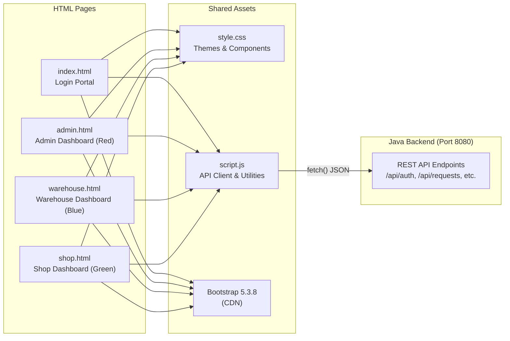

# APPENDIX: VALAM SUPPLY MANAGEMENT SYSTEM - FRONTEND SOURCE CODE

> **Project Name:** VALAM - Public Distribution and Multi-Warehouse Supply Chain Management System  
> **Frontend Stack:** HTML5, CSS3, JavaScript (ES6), Bootstrap 5.3.8  
> **Design Pattern:** Single-page sections with dynamic show/hide navigation  
> **API Communication:** Fetch API with JSON payloads to Java HTTP Server (port 8080)  
> **Date of Generation:** November 02, 2026  
> **Documentation Scope:** Structural overview and complete source code for all frontend files.

---

## 1. Frontend Architecture Overview

The VALAM frontend uses plain HTML5 pages styled with Bootstrap 5 and a custom CSS stylesheet. Each user role (Admin, Warehouse, Shop) has its own dedicated HTML page with a distinct color theme. All pages share a common `script.js` for API communication and utility functions. No frontend frameworks (React, Angular, Vue) are used.



---

## 2. Frontend Source File Inventory

| S.No | File Name | Type | Purpose | Lines | Size |
| :---: | :--- | :---: | :--- | :---: | :---: |
| 1 | `index.html` | HTML | Login Portal - Role Selection and Authentication | 160 | 7.8 KB |
| 2 | `admin.html` | HTML | District Supply Officer - Admin Dashboard | 957 | 48.3 KB |
| 3 | `warehouse.html` | HTML | Warehouse Supervisor - Warehouse Dashboard | 1692 | 87.5 KB |
| 4 | `shop.html` | HTML | Fair Price Shop Keeper - Shop Dashboard | 1169 | 62.3 KB |
| 5 | `style.css` | CSS | Global Stylesheet - Themes and Component Styling | 450 | 7.9 KB |
| 6 | `script.js` | JavaScript | Centralized API Client and Shared Utilities | 204 | 9.0 KB |
| | **Total: 6 Files** | | **Complete Frontend** | **4632** | **222.8 KB** |

---

## 3. Page-wise Module Breakdown

### 3.1 index.html - Login Portal - Role Selection and Authentication

**Description:** Landing page of the VALAM application. Presents three role-based portal cards (Admin, Shop, Warehouse) with a Bootstrap modal login form. On successful authentication through the Java backend API, redirects the user to their respective dashboard.

**Metrics:** 160 lines (7.8 KB)

**UI Sections / Components:**

1. Top Navbar - VALAM brand logo with live system status indicator
2. Hero Section - Public Distribution Network introduction with feature highlights
3. Portal Cards - Three clickable role cards: Admin (Red), Shop (Green), Warehouse (Blue)
4. Login Modal - Bootstrap modal with username/password form, role-specific theming, and API authentication
5. Footer - Copyright notice

**Backend API Calls:**

- `POST /api/auth/login (via script.js handleLogin)`

---

### 3.2 admin.html - District Supply Officer - Admin Dashboard

**Description:** Administrative control panel for the District Supply Officer. Features a card-based dashboard with six monitoring modules. All data tables are dynamically populated from the Java/SQLite backend via fetch API calls. Uses the red admin theme.

**Metrics:** 957 lines (48.3 KB)

**UI Sections / Components:**

1. Admin Navbar (Red Theme) - Welcome greeting with logout button
2. Dashboard Cards (6 Cards) - View Shops, View Warehouses, View Vehicles, View Requests, Delivery Status, Operation History
3. Shops View - Table of all Fair Price Shops with ID, name, location, and current request status
4. Warehouses View - Table showing W01, W02, W03 with real-time Rice, Wheat, Sugar stock levels
5. Vehicles View - Fleet listing with vehicle number, capacity, availability, and status badges
6. Requests View - All commodity requests with shop ID, quantities, urgency, warehouse, and status
7. Delivery Status View - Delivery tracking table with dispatch/delivery dates and current status
8. Operation History View - Paginated audit log with date filter, warehouse filter, and detail modal

**Backend API Calls:**

- `GET /api/shops`
- `GET /api/warehouses`
- `GET /api/vehicles`
- `GET /api/requests`
- `GET /api/requests (status filters for delivery)`
- `GET /api/operations`

---

### 3.3 warehouse.html - Warehouse Supervisor - Warehouse Dashboard

**Description:** Operational dashboard for warehouse supervisors (W01, W02, or W03). Provides eight feature modules for managing shop requests, stock levels, vehicle dispatch, and operational history. Each supervisor sees only their warehouse data. Uses the blue warehouse theme.

**Metrics:** 1692 lines (87.5 KB)

**UI Sections / Components:**

1. Warehouse Navbar (Blue Theme) - Dynamic warehouse name display with logout button
2. Warehouse Profile Card - Shows logged-in warehouse ID, name, and location
3. Dashboard Cards (8 Cards) - Shop Requests, Process Request, Warehouse Stock, Delivery/Vehicle, Request History & Timeline, Stock Update History, Warehouse Operation History, Delivery Issues
4. Shop Requests Section - Filterable table of incoming commodity requests from Fair Price Shops
5. Process Request Section - Form to approve/reserve stock for a specific request with quantity validation
6. Warehouse Stock Section - Live stock table for Rice, Wheat, Sugar, Kerosene with Add Stock modal
7. Delivery/Vehicle Section - Vehicle assignment form, transit marking, and delivery completion controls
8. Request History & Timeline Section - Historical requests with Timeline modal showing state transitions
9. Stock Update History Section - Chronological log of all stock additions and deductions
10. Warehouse Operation History Section - Date-filtered audit trail of warehouse activities
11. Delivery Issues Section - Reported discrepancies with Resolve Issue modal for settlement actions

**Backend API Calls:**

- `GET /api/requests?warehouseId=`
- `POST /api/requests/{id}/process`
- `GET /api/warehouses/{id}`
- `POST /api/warehouses/{id}/stock`
- `POST /api/requests/{id}/assign-vehicle`
- `POST /api/requests/{id}/transit`
- `POST /api/requests/{id}/delivered`
- `GET /api/requests/{id}/timeline`
- `GET /api/stock-history?warehouseId=`
- `GET /api/operations?warehouseId=`
- `GET /api/vehicles`
- `GET /api/delivery-issues?warehouseId=`
- `POST /api/delivery-issues/{id}/resolve`

---

### 3.4 shop.html - Fair Price Shop Keeper - Shop Dashboard

**Description:** Dashboard for Fair Price Shop operators. Enables shopkeepers to raise commodity stock requests, monitor warehouse stock, track delivery status, confirm receipt of delivered goods, and report delivery discrepancies. Uses the green shop theme.

**Metrics:** 1169 lines (62.3 KB)

**UI Sections / Components:**

1. Shop Navbar (Green Theme) - Dynamic shop name display with logout button
2. Shop Profile Card - Shows logged-in shop ID, name, location, nearest warehouse, and distance
3. Dashboard Cards (5 Cards) - Stock Request, Warehouse Stock & Location, Request Status, Delivery Status, My Request History
4. Stock Request Section - Form to submit new commodity requests with Rice, Wheat, Sugar quantities and urgency level
5. Warehouse Stock & Location Section - Read-only view of available stock across all three warehouses
6. Request Status Section - Table showing current status of all submitted requests with status badges
7. Delivery Status Section - Dispatched requests with Confirm Receipt button and Report Issue button
8. Confirm Receipt Modal - Shows request details; shopkeeper confirms correct delivery quantities received
9. Report Issue Modal - Form to report quantity discrepancy with fields for actual received, damaged, and shortage counts
10. My Request History Section - Historical log of all past requests with timeline modal

**Backend API Calls:**

- `POST /api/requests`
- `GET /api/warehouses`
- `GET /api/requests?shopId=`
- `POST /api/requests/{id}/confirm-receipt`
- `POST /api/requests/{id}/report-issue`
- `GET /api/requests/{id}/timeline`
- `GET /api/shops/{id}/stock`

---

### 3.5 style.css - Global Stylesheet - Themes and Component Styling

**Description:** Custom CSS stylesheet for the entire VALAM application. Defines the login page design (gradient background, hero section, portal cards with glassmorphism), role-based color themes (Admin Red, Warehouse Blue, Shop Green), dashboard cards, table formatting, navbar styles, and responsive breakpoints.

**Metrics:** 450 lines (7.9 KB)

**UI Sections / Components:**

1. General Body Style - Background color, Inter font family
2. Login Page Styles - Gradient background, hero section, portal cards with hover animations
3. Login Navbar - Glassmorphism navbar with blur backdrop
4. Portal Cards - Card layout with icon circles, hover elevation effects
5. Login Modal - Rounded form inputs, role-colored submit button
6. Admin Theme (.admin-*) - Red color scheme (#d93829)
7. Warehouse Theme (.warehouse-*) - Blue color scheme (#2563eb)
8. Shop Theme (.shop-*) - Green color scheme (#16a34a)
9. Dashboard Cards - Hover shadow transitions, icon circles
10. Table Styles - Bold headers, striped rows
11. Responsive Breakpoints - Mobile-optimized hero text and portal card sizing

---

### 3.6 script.js - Centralized API Client and Shared Utilities

**Description:** Core JavaScript file loaded by all pages. Contains warehouse and shop user mapping data, the VALAM API client (fetch-based), portal navigation and login authentication logic, IST date/time formatting utilities, and reusable status/urgency badge generators.

**Metrics:** 204 lines (9.0 KB)

**UI Sections / Components:**

1. Warehouse User Map (WH_USER_MAP) - Maps login usernames (Wh01, Wh02, Wh03) to warehouse profile data
2. Shop User Map (SHOP_USER_MAP) - Maps login usernames (Shop01-Shop05) to shop profile data
3. API Base URL Detection - Auto-detects localhost:8080 for file:// protocol or relative URL for served pages
4. valamApiCall() - Universal async fetch wrapper for all Java backend REST API calls with JSON parsing and error handling
5. goToPortal() - Opens login modal with role-specific theming (Admin Red, Warehouse Blue, Shop Green)
6. handleLogin() - Authenticates via POST /api/auth/login, stores session data, and redirects to role dashboard
7. Date/Time Utilities - getCurrentDateIST(), getCurrentTimeIST(), formatTimeIST(), formatDateReadable()
8. Badge Generators - getStatusBadge() for request/delivery status coloring, getUrgencyBadge() for priority levels

**Backend API Calls:**

- `POST /api/auth/login`

---

## 4. Role-Based Color Theme Reference

| Role | Portal Icon | Navbar Class | Primary Color | Hover Color | Icon Background |
| :--- | :---: | :--- | :---: | :---: | :---: |
| **Admin** (District Officer) | A | `.admin-navbar` | `#d93829` (Red) | `#b91c1c` | `#fdf1ee` |
| **Warehouse** (Supervisor) | W | `.warehouse-navbar` | `#2563eb` (Blue) | `#1d4ed8` | `#edf4fe` |
| **Shop** (FPS Keeper) | S | `.shop-navbar` | `#16a34a` (Green) | `#15803d` | `#ecf8f0` |

---

## 5. Complete Frontend Source Code Listings

### Appendix B.1: index.html - Login Portal - Role Selection and Authentication

- **Source Path:** `index.html`
- **Metrics:** 160 lines (7.8 KB)
- **Description:** Landing page of the VALAM application. Presents three role-based portal cards (Admin, Shop, Warehouse) with a Bootstrap modal login form. On successful authentication through the Java backend API, redirects the user to their respective dashboard.

#### Source Code:

```html
<!DOCTYPE html>
<html lang="en">

<head>
    <meta charset="UTF-8">
    <meta name="viewport" content="width=device-width, initial-scale=1.0">
    <title>VALAM - Supply Management System</title>

    <link rel="stylesheet" href="https://cdn.jsdelivr.net/npm/bootstrap@5.3.8/dist/css/bootstrap.min.css">
    <link href="https://fonts.googleapis.com/css2?family=Inter:wght@400;500;600;700;800&display=swap" rel="stylesheet">

    <link rel="stylesheet" href="style.css">
</head>

<body class="login-page">

    <!-- ===== TOP NAVBAR ===== -->
    <nav class="login-navbar">
        <div class="container-fluid px-4">
            <div class="d-flex justify-content-between align-items-center">
                <!-- Brand -->
                <div class="d-flex align-items-center gap-2">
                    <div class="brand-icon">V</div>
                    <div>
                        <div class="brand-name">VALAM</div>
                        <div class="brand-tagline">Supply Management System</div>
                    </div>
                </div>
                <!-- Status -->
                <div class="status-badge">
                    <span class="status-dot"></span> System online
                </div>
            </div>
        </div>
    </nav>

    <!-- ===== MAIN CONTENT ===== -->
    <main class="login-main">
        <div class="container">
            <div class="row align-items-center justify-content-center g-5">

                <!-- LEFT: Hero Text -->
                <div class="col-lg-6">
                    <p class="hero-label">PUBLIC DISTRIBUTION NETWORK</p>
                    <h1 class="hero-title">
                        Supply management,<br>
                        <span class="hero-accent">made simpler.</span>
                    </h1>
                    <p class="hero-description">
                        A dedicated workspace for fair-price shops to raise commodity
                        requests, for warehouses to reserve and dispatch stock, and for district
                        officers to monitor every delivery.
                    </p>
                    <div class="hero-feature-box">
                        <h6 class="hero-feature-title">Role-based workspaces</h6>
                        <p class="hero-feature-text">
                            Each user sees only the tools and data that belong to their role,
                            keeping operations secure and organised.
                        </p>
                    </div>
                </div>

                <!-- RIGHT: Portal Cards -->
                <div class="col-lg-5 col-md-8">
                    <div class="portal-card">
                        <p class="portal-label">CHOOSE YOUR PORTAL</p>
                        <h2 class="portal-title">Sign in to continue</h2>
                        <p class="portal-subtitle">Select the workspace that applies to you.</p>

                        <!-- Admin Portal -->
                        <a href="#" class="portal-option" onclick="goToPortal('admin')">
                            <div class="portal-icon admin-portal-icon">A</div>
                            <div class="portal-info">
                                <div class="portal-name">Admin portal</div>
                                <div class="portal-desc">Monitor warehouses, shops and deliveries</div>
                            </div>
                            <div class="portal-arrow">&rarr;</div>
                        </a>

                        <!-- Shop Portal -->
                        <a href="#" class="portal-option" onclick="goToPortal('shop')">
                            <div class="portal-icon shop-portal-icon">S</div>
                            <div class="portal-info">
                                <div class="portal-name">Shop portal</div>
                                <div class="portal-desc">Create commodity requests and track delivery</div>
                            </div>
                            <div class="portal-arrow">&rarr;</div>
                        </a>

                        <!-- Warehouse Portal -->
                        <a href="#" class="portal-option" onclick="goToPortal('warehouse')">
                            <div class="portal-icon warehouse-portal-icon">W</div>
                            <div class="portal-info">
                                <div class="portal-name">Warehouse portal</div>
                                <div class="portal-desc">Manage stock, reserve and dispatch</div>
                            </div>
                            <div class="portal-arrow">&rarr;</div>
                        </a>

                        <p class="portal-footer">Access is restricted to authorised users only.</p>
                    </div>
                </div>

            </div>
        </div>
    </main>

    <!-- ===== LOGIN MODAL ===== -->
    <div class="modal fade" id="loginModal" tabindex="-1" aria-labelledby="loginModalLabel" aria-hidden="true">
        <div class="modal-dialog modal-dialog-centered">
            <div class="modal-content" style="border-radius: 16px; border: none; box-shadow: 0 8px 32px rgba(0,0,0,0.12);">
                <div class="modal-header border-0 pb-0" style="padding: 28px 32px 0;">
                    <div class="d-flex align-items-center gap-3">
                        <div id="modalPortalIcon" class="portal-icon"></div>
                        <div>
                            <h5 class="modal-title mb-0" id="loginModalLabel" style="font-weight: 700; color: #0f1f2e;">Sign in</h5>
                            <p class="mb-0" style="font-size: 0.85rem; color: #7a8a9c;" id="modalPortalName"></p>
                        </div>
                    </div>
                    <button type="button" class="btn-close" data-bs-dismiss="modal" aria-label="Close"></button>
                </div>
                <div class="modal-body" style="padding: 24px 32px 32px;">
                    <form id="loginForm" onsubmit="handleLogin(event)">
                        <div class="mb-3">
                            <label for="username" class="form-label" style="font-weight: 500; font-size: 0.9rem;">Username</label>
                            <input type="text" class="form-control" id="username" placeholder="Enter your username" required
                                   style="border-radius: 10px; padding: 10px 14px; border: 1px solid #d0d5dd;">
                        </div>
                        <div class="mb-3">
                            <label for="password" class="form-label" style="font-weight: 500; font-size: 0.9rem;">Password</label>
                            <input type="password" class="form-control" id="password" placeholder="Enter your password" required
                                   style="border-radius: 10px; padding: 10px 14px; border: 1px solid #d0d5dd;">
                        </div>
                        <div id="loginError" class="alert alert-danger py-2" style="display: none; font-size: 0.85rem; border-radius: 10px;"></div>
                        <button type="submit" class="btn w-100 mt-2" id="loginBtn"
                                style="border-radius: 10px; padding: 10px; font-weight: 600; color: white;">
                            Sign in
                        </button>
                    </form>
                    <p class="text-center mt-3 mb-0" style="font-size: 0.8rem; color: #9aa5b0;">
                        Use the credentials provided by your administrator.
                    </p>
                </div>
            </div>
        </div>
    </div>

    <!-- ===== FOOTER ===== -->
    <footer class="login-footer">
        <p>&copy; VALAM - Supply Management System 2026</p>
    </footer>

    <script src="https://cdn.jsdelivr.net/npm/bootstrap@5.3.8/dist/js/bootstrap.bundle.min.js"></script>

    <!-- Our custom JavaScript file -->
    <script src="script.js"></script>

</body>

</html>
```

---

### Appendix B.2: admin.html - District Supply Officer - Admin Dashboard

- **Source Path:** `admin.html`
- **Metrics:** 957 lines (48.3 KB)
- **Description:** Administrative control panel for the District Supply Officer. Features a card-based dashboard with six monitoring modules. All data tables are dynamically populated from the Java/SQLite backend via fetch API calls. Uses the red admin theme.

#### Source Code:

```html
<!DOCTYPE html>
<html lang="en">
<head>
    <meta charset="UTF-8">
    <meta name="viewport" content="width=device-width, initial-scale=1.0">
    <title>Admin Dashboard - VALAM</title>

    <link rel="stylesheet" href="https://cdn.jsdelivr.net/npm/bootstrap@5.3.8/dist/css/bootstrap.min.css">

    <link rel="stylesheet" href="style.css">
</head>
<body>


    <nav class="navbar admin-navbar">
        <div class="container">
            <span class="navbar-brand text-white">VALAM - Admin Dashboard</span>
         
            <a href="index.html" class="btn btn-outline-light btn-sm">Logout</a>
        </div>
    </nav>


    <div class="container mt-4">


        <h4 class="mb-1">Welcome, District Supply Officer</h4>
        <p class="text-muted mb-4">Admin Panel — Monitor and manage all supply operations</p>

        <div id="dashboardMain">
            <div class="row g-4 justify-content-center">

                <div class="col-md-6 col-lg-4">
                    <div class="card dashboard-card p-3 text-center h-100">
                        <div class="card-body d-flex flex-column justify-content-between">
                            <div>
                                <div class="icon-circle admin-icon">🏪</div>
                                <h5 class="card-title mt-2">View Shops</h5>
                                <p class="card-text text-muted">View all fair-price shops and their details.</p>
                            </div>
                            <div>
                                <button class="btn admin-btn btn-sm" onclick="showSection('shopsView')">View Shops</button>
                            </div>
                        </div>
                    </div>
                </div>

            
                <div class="col-md-6 col-lg-4">
                    <div class="card dashboard-card p-3 text-center h-100">
                        <div class="card-body d-flex flex-column justify-content-between">
                            <div>
                                <div class="icon-circle admin-icon">🏭</div>
                                <h5 class="card-title mt-2">View Warehouses</h5>
                                <p class="card-text text-muted">View warehouses and their current stock.</p>
                            </div>
                            <div>
                                <button class="btn admin-btn btn-sm" onclick="showSection('warehousesView')">View Warehouses</button>
                            </div>
                        </div>
                    </div>
                </div>


                <div class="col-md-6 col-lg-4">
                    <div class="card dashboard-card p-3 text-center h-100">
                        <div class="card-body d-flex flex-column justify-content-between">
                            <div>
                                <div class="icon-circle admin-icon">🚚</div>
                                <h5 class="card-title mt-2">View Vehicles</h5>
                                <p class="card-text text-muted">View available vehicles for delivery.</p>
                            </div>
                            <div>
                                <button class="btn admin-btn btn-sm" onclick="showSection('vehiclesView')">View Vehicles</button>
                            </div>
                        </div>
                    </div>
                </div>

              
                <div class="col-md-6 col-lg-4">
                    <div class="card dashboard-card p-3 text-center h-100">
                        <div class="card-body d-flex flex-column justify-content-between">
                            <div>
                                <div class="icon-circle admin-icon">📋</div>
                                <h5 class="card-title mt-2">View Requests</h5>
                                <p class="card-text text-muted">View commodity requests received from shops.</p>
                            </div>
                            <div>
                                <button class="btn admin-btn btn-sm" onclick="showSection('requestsView')">View Requests</button>
                            </div>
                        </div>
                    </div>
                </div>

        
                <div class="col-md-6 col-lg-4">
                    <div class="card dashboard-card p-3 text-center h-100">
                        <div class="card-body d-flex flex-column justify-content-between">
                            <div>
                                <div class="icon-circle admin-icon">📍</div>
                                <h5 class="card-title mt-2">Delivery Status</h5>
                                <p class="card-text text-muted">Monitor the status of all deliveries.</p>
                            </div>
                            <div>
                                <button class="btn admin-btn btn-sm" onclick="showSection('deliveryStatusView')">View Status</button>
                            </div>
                        </div>
                    </div>
                </div>

                <!-- ========== NEW: OPERATION HISTORY CARD ========== -->
                <div class="col-md-6 col-lg-4">
                    <div class="card dashboard-card p-3 text-center h-100">
                        <div class="card-body d-flex flex-column justify-content-between">
                            <div>
                                <div class="icon-circle admin-icon">📜</div>
                                <h5 class="card-title mt-2">Operation History</h5>
                                <p class="card-text text-muted">Date-wise & time-wise audit log of all operations.</p>
                            </div>
                            <div>
                                <button class="btn admin-btn btn-sm" onclick="showSection('operationHistoryView')">View History</button>
                            </div>
                        </div>
                    </div>
                </div>

            </div>
        </div>

        <!-- ========== VIEW SHOPS (EXISTING — PRESERVED) ========== -->
        <div id="shopsView" style="display: none;">

         
            <button class="btn btn-outline-secondary btn-sm mb-3" onclick="goBack()">← Back to Dashboard</button>

            <div class="card p-4">
                <h5 class="mb-3">Fair-Price Shops</h5>
                <p class="text-muted mb-3" style="font-size: 0.95rem;">List of all 8 fair-price shops and their current request status across the district.</p>

                <div class="table-responsive">
                    <table class="table table-bordered table-striped align-middle mb-0">
                        <thead class="table-dark">
                            <tr>
                                <th>Shop ID</th>
                                <th>Shop Name</th>
                                <th>Location</th>
                                <th>Current Request Status</th>
                            </tr>
                        </thead>
                        <tbody id="shopsTableBody">
                            <!-- Populated dynamically from SQLite database -->
                        </tbody>
                    </table>
                </div>
            </div>
        </div>


        <!-- ========== VIEW WAREHOUSES (EXISTING — PRESERVED) ========== -->
        <div id="warehousesView" style="display: none;">

         
            <button class="btn btn-outline-secondary btn-sm mb-3" onclick="goBack()">← Back to Dashboard</button>

            <div class="card p-4">
                <h5 class="mb-3">Warehouses &amp; Current Stock</h5>
                <p class="text-muted mb-3" style="font-size: 0.95rem;">Overview of district warehouses and their available commodity stock levels.</p>

                <div class="table-responsive">
                    <table class="table table-bordered table-striped align-middle mb-0">
                        <thead class="table-dark">
                            <tr>
                                <th>Warehouse ID</th>
                                <th>Warehouse Name</th>
                                <th>Location</th>
                                <th>Rice Stock</th>
                                <th>Wheat Stock</th>
                                <th>Sugar Stock</th>
                            </tr>
                        </thead>
                        <tbody id="warehousesTableBody">
                            <!-- Populated dynamically from SQLite database -->
                        </tbody>
                    </table>
                </div>
            </div>
        </div>


        <!-- ========== VIEW VEHICLES (EXISTING — PRESERVED) ========== -->
        <div id="vehiclesView" style="display: none;">

       
            <button class="btn btn-outline-secondary btn-sm mb-3" onclick="goBack()">← Back to Dashboard</button>

            <div class="card p-4">
                <h5 class="mb-3">Available Vehicles</h5>
                <p class="text-muted mb-3" style="font-size: 0.95rem;">Fleet of supply vehicles available for commodity delivery operations.</p>

                <div class="table-responsive">
                    <table class="table table-bordered table-striped align-middle mb-0">
                        <thead class="table-dark">
                            <tr>
                                <th>Vehicle ID</th>
                                <th>Vehicle Name / Number</th>
                                <th>Capacity</th>
                                <th>Availability</th>
                                <th>Current Status</th>
                            </tr>
                        </thead>
                        <tbody id="vehiclesTableBody">
                            <!-- Populated dynamically from SQLite database -->
                        </tbody>
                    </table>
                </div>
            </div>
        </div>
        <!-- ========== END VIEW VEHICLES ========== -->


        <!-- ========== VIEW REQUESTS (EXISTING — PRESERVED) ========== -->
        <div id="requestsView" style="display: none;">

        
            <button class="btn btn-outline-secondary btn-sm mb-3" onclick="goBack()">← Back to Dashboard</button>

            <div class="card p-4">
                <h5 class="mb-3">Commodity Requests</h5>
                <p class="text-muted mb-3" style="font-size: 0.95rem;">Commodity stock requests submitted by fair-price shops.</p>

                <div class="table-responsive">
                    <table class="table table-bordered table-striped align-middle mb-0">
                        <thead class="table-dark">
                            <tr>
                                <th>Request ID</th>
                                <th>Shop ID</th>
                                <th>Rice (kg)</th>
                                <th>Wheat (kg)</th>
                                <th>Sugar (kg)</th>
                                <th>Urgency</th>
                                <th>Selected Warehouse</th>
                                <th>Request Status</th>
                            </tr>
                        </thead>
                        <tbody id="requestsTableBody">
                            <!-- Populated dynamically from SQLite database -->
                        </tbody>
                    </table>
                </div>
            </div>
        </div>
        <!-- ========== END VIEW REQUESTS ========== -->


        <!-- ========== DELIVERY STATUS (EXISTING — PRESERVED) ========== -->
        <div id="deliveryStatusView" style="display: none;">

         
            <button class="btn btn-outline-secondary btn-sm mb-3" onclick="goBack()">← Back to Dashboard</button>

            <div class="card p-4">
                <h5 class="mb-3">Delivery Status Monitoring</h5>
                <p class="text-muted mb-3" style="font-size: 0.95rem;">Live monitoring of dispatch, in-transit, and delivered shipments across the district.</p>

                <div class="table-responsive">
                    <table class="table table-bordered table-striped align-middle mb-0">
                        <thead class="table-dark">
                            <tr>
                                <th>Request ID</th>
                                <th>Shop ID</th>
                                <th>Warehouse</th>
                                <th>Vehicle</th>
                                <th>Delivery Status</th>
                                <th>Shop Confirmation</th>
                                <th>Action</th>
                            </tr>
                        </thead>
                        <tbody id="deliveryStatusTableBody">
                            <!-- Populated dynamically from SQLite database -->
                        </tbody>
                    </table>
                </div>
            </div>

            <!-- ===== Reported Delivery Issues Section ===== -->
            <div class="card p-4 mt-4">
                <h5 class="mb-1">⚠️ Reported Delivery Issues (District-wide)</h5>
                <p class="text-muted mb-3" style="font-size: 0.95rem;">Monitor commodity discrepancies reported by Fair-Price Shops across all warehouses.</p>

                <div class="table-responsive">
                    <table class="table table-bordered table-striped align-middle mb-0" id="adminIssuesTable">
                        <thead class="table-dark">
                            <tr>
                                <th>Issue ID</th>
                                <th>Request ID</th>
                                <th>Shop</th>
                                <th>Warehouse</th>
                                <th>Issue Type</th>
                                <th>Description</th>
                                <th>Reported At</th>
                                <th>Status</th>
                                <th>Resolution Notes</th>
                            </tr>
                        </thead>
                        <tbody id="adminIssuesTableBody">
                            <!-- Populated dynamically from SQLite database -->
                        </tbody>
                    </table>
                </div>
                <div id="adminIssuesNoRecords" class="text-center py-3 text-muted" style="display: none;">
                    No delivery issues currently reported.
                </div>
            </div>
        </div>
        <!-- ========== END DELIVERY STATUS ========== -->


        <!-- ============================================================ -->
        <!-- NEW SECTION: OPERATION HISTORY / AUDIT LOG                   -->
        <!-- ============================================================ -->
        <div id="operationHistoryView" style="display: none;">

            <button class="btn btn-outline-secondary btn-sm mb-3" onclick="goBack()">← Back to Dashboard</button>

            <div class="card p-4 mb-4">
                <h5 class="mb-1">📜 Operation History / Audit Log</h5>
                <p class="text-muted mb-3" style="font-size: 0.95rem;">Date-wise and time-wise tracking of all supply operations across shops, warehouses, vehicles, requests and deliveries.</p>

                <!-- Date Range Filter -->
                <div class="row g-3 align-items-end mb-3">
                    <div class="col-md-3 col-sm-6">
                        <label for="filterFromDate" class="form-label" style="font-weight: 500; font-size: 0.9rem;">From Date</label>
                        <input type="date" class="form-control" id="filterFromDate">
                    </div>
                    <div class="col-md-3 col-sm-6">
                        <label for="filterToDate" class="form-label" style="font-weight: 500; font-size: 0.9rem;">To Date</label>
                        <input type="date" class="form-control" id="filterToDate">
                    </div>
                    <div class="col-md-3 col-sm-6">
                        <label for="filterCategory" class="form-label" style="font-weight: 500; font-size: 0.9rem;">Category</label>
                        <select class="form-select" id="filterCategory">
                            <option value="all">All Operations</option>
                            <option value="shop">Fair-Price Shops</option>
                            <option value="warehouse">Warehouses & Stock</option>
                            <option value="vehicle">Vehicles</option>
                            <option value="request">Commodity Requests</option>
                            <option value="delivery">Delivery Status</option>
                        </select>
                    </div>
                    <div class="col-md-3 col-sm-6">
                        <button class="btn admin-btn btn-sm me-2" onclick="filterOperationHistory()">🔍 Filter</button>
                        <button class="btn btn-outline-secondary btn-sm" onclick="resetOperationFilter()">↻ Reset</button>
                    </div>
                </div>

                <!-- Date Validation Error -->
                <div id="dateValidationError" class="alert alert-danger py-2" style="display: none; font-size: 0.85rem;">
                    ⚠️ "From Date" cannot be later than "To Date". Please select a valid date range.
                </div>
            </div>

            <!-- ===== Summary Cards ===== -->
            <div class="row g-3 mb-4" id="summaryCardsRow">
                <div class="col-6 col-md">
                    <div class="card text-center p-3" style="border-left: 4px solid #d93829;">
                        <div style="font-size: 1.8rem; font-weight: 700; color: #d93829;" id="summaryRequestsReceived">0</div>
                        <div style="font-size: 0.8rem; color: #666;">Requests Received</div>
                    </div>
                </div>
                <div class="col-6 col-md">
                    <div class="card text-center p-3" style="border-left: 4px solid #2563eb;">
                        <div style="font-size: 1.8rem; font-weight: 700; color: #2563eb;" id="summaryRequestsProcessed">0</div>
                        <div style="font-size: 0.8rem; color: #666;">Requests Processed</div>
                    </div>
                </div>
                <div class="col-6 col-md">
                    <div class="card text-center p-3" style="border-left: 4px solid #f59e0b;">
                        <div style="font-size: 1.8rem; font-weight: 700; color: #f59e0b;" id="summaryVehiclesDispatched">0</div>
                        <div style="font-size: 0.8rem; color: #666;">Vehicles Dispatched</div>
                    </div>
                </div>
                <div class="col-6 col-md">
                    <div class="card text-center p-3" style="border-left: 4px solid #16a34a;">
                        <div style="font-size: 1.8rem; font-weight: 700; color: #16a34a;" id="summaryDeliveriesCompleted">0</div>
                        <div style="font-size: 0.8rem; color: #666;">Deliveries Completed</div>
                    </div>
                </div>
                <div class="col-6 col-md">
                    <div class="card text-center p-3" style="border-left: 4px solid #8b5cf6;">
                        <div style="font-size: 1.8rem; font-weight: 700; color: #8b5cf6;" id="summaryStockUpdates">0</div>
                        <div style="font-size: 0.8rem; color: #666;">Stock Updates</div>
                    </div>
                </div>
            </div>

            <!-- ===== Operation History Table ===== -->
            <div class="card p-4 mb-3">
                <div class="d-flex justify-content-between align-items-center mb-3">
                    <h6 class="mb-0" style="font-weight: 600;">Operation Log</h6>
                    <span class="text-muted" style="font-size: 0.82rem;" id="historyResultCount"></span>
                </div>

                <div class="table-responsive">
                    <table class="table table-bordered table-striped align-middle mb-0" id="operationHistoryTable">
                        <thead class="table-dark">
                            <tr>
                                <th>S.No.</th>
                                <th>Operation ID</th>
                                <th>Request ID</th>
                                <th>Shop / Warehouse / Vehicle ID</th>
                                <th>Operation Type</th>
                                <th>Previous Status</th>
                                <th>New Status</th>
                                <th>Date</th>
                                <th>Time</th>
                                <th>Updated By</th>
                                <th>Details</th>
                            </tr>
                        </thead>
                        <tbody id="operationHistoryBody">
                            <!-- Populated by JavaScript -->
                        </tbody>
                    </table>
                </div>

                <!-- No Records Message -->
                <div id="noRecordsMsg" class="text-center py-4" style="display: none;">
                    <div style="font-size: 2.5rem;">📭</div>
                    <p class="text-muted mt-2 mb-0">No operations found for the selected date range.<br>Try adjusting the filter criteria.</p>
                </div>
            </div>

            <!-- Status Flow Legend -->
            <div class="card p-3 mb-3">
                <p class="mb-1" style="font-size: 0.85rem; font-weight: 600;">Status Flow Reference:</p>
                <p class="text-muted mb-0" style="font-size: 0.8rem;">
                    <span class="badge bg-secondary">Request Received</span> →
                    <span class="badge bg-primary">Request Accepted</span> →
                    <span class="badge bg-warning text-dark">Stock Updated / Reserved</span> →
                    <span class="badge bg-info text-dark">Vehicle Assigned / Dispatched</span> →
                    <span class="badge bg-warning text-dark">In Transit</span> →
                    <span class="badge bg-success">Delivered</span>
                </p>
            </div>

            <!-- Limitation Notice -->
            <div class="alert alert-info py-2 mb-3" style="font-size: 0.82rem;">
                <strong>ℹ️ Note:</strong> This prototype stores operation history in browser memory (JavaScript). 
                Data is based on sample records and will reset when the page is refreshed. 
                For persistent history, a database backend (e.g., MySQL with Java Servlets) is required.
            </div>

        </div>
        <!-- ========== END OPERATION HISTORY ========== -->


        <!-- ===== Operation Detail Modal ===== -->
        <div class="modal fade" id="operationDetailModal" tabindex="-1" aria-hidden="true">
            <div class="modal-dialog modal-dialog-centered modal-lg">
                <div class="modal-content" style="border-radius: 12px;">
                    <div class="modal-header" style="background-color: #d93829; color: white; border-radius: 12px 12px 0 0;">
                        <h6 class="modal-title mb-0" id="operationDetailTitle">Operation Details</h6>
                        <button type="button" class="btn-close btn-close-white" data-bs-dismiss="modal" aria-label="Close"></button>
                    </div>
                    <div class="modal-body" id="operationDetailBody">
                        <!-- Populated by JavaScript -->
                    </div>
                </div>
            </div>
        </div>


        <p class="text-center footer-text mt-4 mb-3">&copy; 2026 VALAM - Supply Management System</p>

    </div>
    <!-- ========== END MAIN CONTENT ========== -->


    <!-- Bootstrap 5 JS Bundle -->
    <script src="https://cdn.jsdelivr.net/npm/bootstrap@5.3.8/dist/js/bootstrap.bundle.min.js"></script>
    <script src="script.js"></script>

    <script>
    
        // ---------------------------------------------------------------
        // SECTION NAVIGATION (UPDATED — includes new section)
        // ---------------------------------------------------------------
        var adminSections = [
            "shopsView",
            "warehousesView",
            "vehiclesView",
            "requestsView",
            "deliveryStatusView",
            "operationHistoryView"
        ];

        var operationHistoryData = [];

        function showSection(sectionId) {
            document.getElementById("dashboardMain").style.display = "none";
            for (var i = 0; i < adminSections.length; i++) {
                var el = document.getElementById(adminSections[i]);
                if (el) el.style.display = "none";
            }
            var target = document.getElementById(sectionId);
            if (target) {
                target.style.display = "block";
            }

            if (sectionId === "shopsView") renderAdminShops();
            else if (sectionId === "warehousesView") renderAdminWarehouses();
            else if (sectionId === "vehiclesView") renderAdminVehicles();
            else if (sectionId === "requestsView" || sectionId === "deliveryStatusView") {
                renderAdminRequests();
                renderAdminIssues();
            }
            else if (sectionId === "operationHistoryView") loadAdminOperations();

            window.scrollTo(0, 0);
        }

        function goBack() {
            for (var i = 0; i < adminSections.length; i++) {
                var el = document.getElementById(adminSections[i]);
                if (el) el.style.display = "none";
            }
            document.getElementById("dashboardMain").style.display = "block";
            window.scrollTo(0, 0);
        }

        async function renderAdminShops() {
            var tbody = document.getElementById("shopsTableBody");
            if (!tbody) return;
            tbody.innerHTML = '<tr><td colspan="4" class="text-center text-muted py-3">Loading shops from SQLite database...</td></tr>';
            var shops = await valamApiCall("/api/shops", "GET");
            if (shops && shops.error) {
                tbody.innerHTML = '<tr><td colspan="4" class="text-center text-danger py-3">⚠️ Database Error: ' + shops.error + '</td></tr>';
                return;
            }
            tbody.innerHTML = "";
            if (!shops || !Array.isArray(shops) || shops.length === 0) {
                tbody.innerHTML = '<tr><td colspan="4" class="text-center text-muted py-3">No shops found in database.</td></tr>';
                return;
            }
            for (var i = 0; i < shops.length; i++) {
                var s = shops[i];
                var tr = document.createElement("tr");
                tr.innerHTML = "<td>" + s.id + "</td>" +
                    "<td>" + s.name + "</td>" +
                    "<td>" + s.location + "</td>" +
                    "<td>" + getStatusBadge(s.status) + "</td>";
                tbody.appendChild(tr);
            }
        }

        async function renderAdminWarehouses() {
            var tbody = document.getElementById("warehousesTableBody");
            if (!tbody) return;
            tbody.innerHTML = '<tr><td colspan="6" class="text-center text-muted py-3">Loading warehouses from SQLite database...</td></tr>';
            var whs = await valamApiCall("/api/warehouses", "GET");
            if (whs && whs.error) {
                tbody.innerHTML = '<tr><td colspan="6" class="text-center text-danger py-3">⚠️ Database Error: ' + whs.error + '</td></tr>';
                return;
            }
            tbody.innerHTML = "";
            if (!whs || !Array.isArray(whs) || whs.length === 0) {
                tbody.innerHTML = '<tr><td colspan="6" class="text-center text-muted py-3">No warehouses found in database.</td></tr>';
                return;
            }
            for (var i = 0; i < whs.length; i++) {
                var wh = whs[i];
                var rice = (wh.available ? wh.available.rice : wh.rice) + " kg";
                var wheat = (wh.available ? wh.available.wheat : wh.wheat) + " kg";
                var sugar = (wh.available ? wh.available.sugar : wh.sugar) + " kg";
                var tr = document.createElement("tr");
                tr.innerHTML = "<td>" + (wh.id || wh.warehouseId) + "</td>" +
                    "<td>" + (wh.name || wh.warehouseName) + "</td>" +
                    "<td>" + wh.location + "</td>" +
                    "<td>" + rice + "</td>" +
                    "<td>" + wheat + "</td>" +
                    "<td>" + sugar + "</td>";
                tbody.appendChild(tr);
            }
        }

        async function renderAdminVehicles() {
            var tbody = document.getElementById("vehiclesTableBody");
            if (!tbody) return;
            tbody.innerHTML = '<tr><td colspan="5" class="text-center text-muted py-3">Loading vehicles from SQLite database...</td></tr>';
            var vehs = await valamApiCall("/api/vehicles", "GET");
            if (vehs && vehs.error) {
                tbody.innerHTML = '<tr><td colspan="5" class="text-center text-danger py-3">⚠️ Database Error: ' + vehs.error + '</td></tr>';
                return;
            }
            tbody.innerHTML = "";
            if (!vehs || !Array.isArray(vehs) || vehs.length === 0) {
                tbody.innerHTML = '<tr><td colspan="5" class="text-center text-muted py-3">No vehicles found in database.</td></tr>';
                return;
            }
            for (var i = 0; i < vehs.length; i++) {
                var v = vehs[i];
                var tr = document.createElement("tr");
                tr.innerHTML = "<td>" + v.id + "</td>" +
                    "<td>" + v.vehicleName + "</td>" +
                    "<td>" + v.capacity + "</td>" +
                    "<td>" + getStatusBadge(v.availability) + "</td>" +
                    "<td>" + getStatusBadge(v.status) + "</td>";
                tbody.appendChild(tr);
            }
        }

        async function renderAdminRequests() {
            var tbody = document.getElementById("requestsTableBody");
            var delTbody = document.getElementById("deliveryStatusTableBody");
            if (tbody) tbody.innerHTML = '<tr><td colspan="8" class="text-center text-muted py-3">Loading requests from SQLite database...</td></tr>';
            if (delTbody) delTbody.innerHTML = '<tr><td colspan="5" class="text-center text-muted py-3">Loading deliveries from SQLite database...</td></tr>';

            var reqs = await valamApiCall("/api/requests", "GET");
            if (reqs && reqs.error) {
                if (tbody) tbody.innerHTML = '<tr><td colspan="8" class="text-center text-danger py-3">⚠️ Database Error: ' + reqs.error + '</td></tr>';
                if (delTbody) delTbody.innerHTML = '<tr><td colspan="5" class="text-center text-danger py-3">⚠️ Database Error: ' + reqs.error + '</td></tr>';
                return;
            }

            if (tbody) tbody.innerHTML = "";
            if (delTbody) delTbody.innerHTML = "";

            if (!reqs || !Array.isArray(reqs) || reqs.length === 0) {
                if (tbody) tbody.innerHTML = '<tr><td colspan="8" class="text-center text-muted py-3">No requests found in database.</td></tr>';
                if (delTbody) delTbody.innerHTML = '<tr><td colspan="5" class="text-center text-muted py-3">No deliveries found in database.</td></tr>';
                return;
            }

            for (var i = 0; i < reqs.length; i++) {
                var r = reqs[i];
                var reqId = r.id || r.requestId;
                var urgBadge = getUrgencyBadge(r.urgency);
                var statusBadge = getStatusBadge(r.status);
                var whName = r.warehouse || r.warehouseName || (r.warehouseId === "W01" ? "Valam Central Warehouse" : (r.warehouseId === "W02" ? "Valam North Warehouse" : "Valam South Warehouse"));

                if (tbody) {
                    var tr = document.createElement("tr");
                    tr.innerHTML = "<td>" + reqId + "</td>" +
                        "<td>" + r.shopId + "</td>" +
                        "<td>" + r.rice + "</td>" +
                        "<td>" + r.wheat + "</td>" +
                        "<td>" + r.sugar + "</td>" +
                        "<td>" + urgBadge + "</td>" +
                        "<td>" + whName + "</td>" +
                        "<td>" + statusBadge + "</td>";
                    tbody.appendChild(tr);
                }

                if (delTbody) {
                    var delTr = document.createElement("tr");
                    var rcBadge = '';
                    if (r.status === "Completed" || r.status === "Delivered" || r.receiptStatus === "Confirmed") {
                        var cAt = (r.receiptConfirmedDate ? formatDateReadable(r.receiptConfirmedDate) : "") + (r.receiptConfirmedTime ? " " + formatTime12IST(r.receiptConfirmedTime) : "");
                        rcBadge = '<span class="badge bg-success">Confirmed</span>' + (cAt ? '<br><small class="text-muted">' + cAt + '</small>' : '');
                    } else if (r.status === "Delivery Issue" || r.receiptStatus === "Issue Reported") {
                        rcBadge = '<span class="badge bg-danger">Issue Reported</span>';
                    } else if (r.status === "Dispatched" || r.status === "In Transit" || r.receiptStatus === "Awaiting Receipt") {
                        rcBadge = '<span class="badge bg-warning text-dark">Awaiting Receipt</span>';
                    } else {
                        rcBadge = '<span class="text-muted">—</span>';
                    }

                    delTr.innerHTML = "<td><strong>" + reqId + "</strong></td>" +
                        "<td>" + r.shopId + "</td>" +
                        "<td>" + whName + "</td>" +
                        "<td>" + (r.vehicle || "Not Assigned") + "</td>" +
                        "<td>" + statusBadge + "</td>" +
                        "<td>" + rcBadge + "</td>" +
                        '<td><button class="btn btn-outline-danger btn-sm text-nowrap" onclick="viewAdminTimeline(\'' + reqId + '\')">⏱️ Timeline</button></td>';
                    delTbody.appendChild(delTr);
                }
            }
        }

        async function renderAdminIssues() {
            var tbody = document.getElementById("adminIssuesTableBody");
            var noRec = document.getElementById("adminIssuesNoRecords");
            var table = document.getElementById("adminIssuesTable");
            if (!tbody) return;

            var issues = await valamApiCall("/api/delivery-issues", "GET");
            if (!issues || !Array.isArray(issues) || issues.length === 0) {
                if (table) table.style.display = "none";
                if (noRec) noRec.style.display = "block";
                return;
            }

            if (table) table.style.display = "table";
            if (noRec) noRec.style.display = "none";
            tbody.innerHTML = "";

            for (var i = 0; i < issues.length; i++) {
                var issue = issues[i];
                var tr = document.createElement("tr");

                var statusBadge = issue.status === "Open"
                    ? '<span class="badge bg-danger">Open</span>'
                    : '<span class="badge bg-success">Resolved</span>';

                tr.innerHTML =
                    '<td><strong>' + issue.issueId + '</strong></td>' +
                    '<td><span class="badge bg-light text-dark border">' + issue.requestId + '</span></td>' +
                    '<td>' + (issue.shopName || issue.shopId) + '</td>' +
                    '<td>' + (issue.warehouseName || issue.warehouseId) + '</td>' +
                    '<td><span class="badge bg-warning text-dark">' + issue.issueType + '</span></td>' +
                    '<td>' + (issue.description || '—') + '</td>' +
                    '<td>' + formatDateReadable(issue.reportedDate) + ' ' + formatTime12IST(issue.reportedTime) + '</td>' +
                    '<td>' + statusBadge + '</td>' +
                    '<td>' + (issue.resolutionNotes ? issue.resolutionNotes + ' <small class="text-muted">(' + (issue.resolvedBy || '') + ')</small>' : '<span class="text-muted">—</span>') + '</td>';
                tbody.appendChild(tr);
            }
        }

        async function viewAdminTimeline(reqId) {
            var req = await valamApiCall("/api/requests/" + encodeURIComponent(reqId), "GET");
            if (req && req.error) {
                alert("⚠️ Error loading request timeline: " + req.error);
                return;
            }
            if (!req) return;

            document.getElementById("operationDetailTitle").textContent = "Request Timeline & Lifecycle — " + reqId;
            var whName = req.warehouse || req.warehouseName || (req.warehouseId === "W01" ? "Valam Central Warehouse" : (req.warehouseId === "W02" ? "Valam North Warehouse" : "Valam South Warehouse"));

            var html = '';
            html += '<div class="alert alert-light border mb-3">';
            html += '<div class="row g-2" style="font-size:0.9rem;">';
            html += '<div class="col-sm-6">🏪 <strong>Shop:</strong> ' + req.shopId + ' (' + (req.shopName || '') + ')</div>';
            html += '<div class="col-sm-6">🏭 <strong>Warehouse:</strong> ' + whName + '</div>';
            html += '<div class="col-sm-6">📦 <strong>Commodities:</strong> Rice ' + req.rice + 'kg, Wheat ' + req.wheat + 'kg, Sugar ' + req.sugar + 'kg</div>';
            html += '<div class="col-sm-6">🚚 <strong>Vehicle:</strong> ' + (req.vehicle || 'Not Assigned') + '</div>';
            html += '<div class="col-sm-6">📋 <strong>Status:</strong> ' + getStatusBadge(req.status) + '</div>';
            html += '<div class="col-sm-6">📦 <strong>Receipt Status:</strong> ' + (req.receiptStatus || 'Pending') + '</div>';
            html += '</div></div>';

            html += '<h6 class="mb-3" style="font-weight:600;">Chronological Event History (SQLite)</h6>';
            html += '<div class="list-group">';

            var events = req.timeline || [];
            if (events.length === 0) {
                html += '<p class="text-muted text-center py-3">No timeline events recorded yet.</p>';
            } else {
                for (var i = 0; i < events.length; i++) {
                    var ev = events[i];
                    html += '<div class="list-group-item p-3 mb-2 rounded border" style="border-left: 4px solid #dc3545 !important;">';
                    html += '<div class="d-flex justify-content-between align-items-center flex-wrap gap-2">';
                    html += '<div><strong>' + (i + 1) + '. ' + (ev.title || ev.stage || ev.stageTitle) + '</strong> ' + getStatusBadge(ev.status) + '</div>';
                    html += '<div class="text-muted" style="font-size:0.82rem;">📅 ' + formatDateReadable(ev.date) + ' | 🕒 ' + formatTime12IST(ev.time) + '</div>';
                    html += '</div>';
                    html += '<p class="mt-2 mb-1 text-muted" style="font-size:0.88rem;">' + (ev.details || '') + '</p>';
                    html += '<small class="text-secondary">👤 Action Performed By: <strong>' + (ev.by || ev.performedBy || 'Staff') + '</strong></small>';
                    html += '</div>';
                }
            }
            html += '</div>';

            document.getElementById("operationDetailBody").innerHTML = html;
            var modal = new bootstrap.Modal(document.getElementById("operationDetailModal"));
            modal.show();
        }

        async function loadAdminOperations() {
            var from = document.getElementById("filterFromDate").value;
            var to = document.getElementById("filterToDate").value;
            var cat = document.getElementById("filterCategory").value;
            var url = "/api/operations?category=" + encodeURIComponent(cat);
            if (from) url += "&fromDate=" + encodeURIComponent(from);
            if (to) url += "&toDate=" + encodeURIComponent(to);

            var ops = await valamApiCall(url, "GET");
            if (ops && ops.error) {
                var tbody = document.getElementById("operationHistoryBody");
                if (tbody) tbody.innerHTML = '<tr><td colspan="11" class="text-center text-danger py-3">⚠️ Database Error: ' + ops.error + '</td></tr>';
                document.getElementById("operationHistoryTable").style.display = "table";
                document.getElementById("noRecordsMsg").style.display = "none";
                return;
            }

            if (ops && Array.isArray(ops)) {
                operationHistoryData = ops;
                renderOperationHistory(ops);
            } else {
                operationHistoryData = [];
                renderOperationHistory([]);
            }
        }

        function getOperationTypeBadge(opType) {
            var colors = {
                "Request Received": "bg-secondary",
                "Request Accepted": "bg-primary",
                "Stock Updated": "bg-warning text-dark",
                "Vehicle Assigned": "bg-info text-dark",
                "Vehicle Released": "bg-success",
                "Dispatched": "bg-info text-dark",
                "In Transit": "bg-warning text-dark",
                "Delivered": "bg-success"
            };
            var cls = colors[opType] || "bg-secondary";
            return '<span class="badge ' + cls + '">' + opType + '</span>';
        }

        function renderOperationHistory(data) {
            var tbody = document.getElementById("operationHistoryBody");
            var noMsg = document.getElementById("noRecordsMsg");
            var countSpan = document.getElementById("historyResultCount");

            tbody.innerHTML = "";

            if (!data || data.length === 0) {
                noMsg.style.display = "block";
                document.getElementById("operationHistoryTable").style.display = "none";
                countSpan.textContent = "";
            } else {
                noMsg.style.display = "none";
                document.getElementById("operationHistoryTable").style.display = "table";
                countSpan.textContent = "Showing " + data.length + " record(s)";

                for (var i = 0; i < data.length; i++) {
                    var op = data[i];
                    var row = document.createElement("tr");
                    row.innerHTML =
                        "<td>" + (i + 1) + "</td>" +
                        "<td><strong>" + op.opId + "</strong></td>" +
                        "<td>" + op.requestId + "</td>" +
                        "<td>" + op.entityId + "</td>" +
                        "<td>" + getOperationTypeBadge(op.operationType) + "</td>" +
                        "<td>" + getStatusBadge(op.prevStatus) + "</td>" +
                        "<td>" + getStatusBadge(op.newStatus) + "</td>" +
                        "<td>" + formatDateReadable(op.date) + "</td>" +
                        "<td>" + formatTimeIST(op.time) + "</td>" +
                        "<td>" + op.updatedBy + "</td>" +
                        '<td><button class="btn btn-outline-danger btn-sm" onclick="viewOperationDetail(\'' + op.opId + '\')">View</button></td>';
                    tbody.appendChild(row);
                }
            }

            updateSummaryCards(data || []);
        }

        function updateSummaryCards(data) {
            var received = 0, processed = 0, dispatched = 0, delivered = 0, stockUpdates = 0;

            for (var i = 0; i < data.length; i++) {
                var opType = data[i].operationType;
                if (opType === "Request Received") received++;
                if (opType === "Request Accepted") processed++;
                if (opType === "Dispatched" || opType === "Vehicle Assigned") dispatched++;
                if (opType === "Delivered") delivered++;
                if (opType === "Stock Updated") stockUpdates++;
            }

            document.getElementById("summaryRequestsReceived").textContent = received;
            document.getElementById("summaryRequestsProcessed").textContent = processed;
            document.getElementById("summaryVehiclesDispatched").textContent = dispatched;
            document.getElementById("summaryDeliveriesCompleted").textContent = delivered;
            document.getElementById("summaryStockUpdates").textContent = stockUpdates;
        }

        function filterOperationHistory() {
            var fromDate = document.getElementById("filterFromDate").value;
            var toDate = document.getElementById("filterToDate").value;
            var errorDiv = document.getElementById("dateValidationError");

            if (fromDate && toDate && fromDate > toDate) {
                errorDiv.style.display = "block";
                return;
            }
            errorDiv.style.display = "none";
            loadAdminOperations();
        }

        function resetOperationFilter() {
            document.getElementById("filterFromDate").value = "";
            document.getElementById("filterToDate").value = "";
            document.getElementById("filterCategory").value = "all";
            document.getElementById("dateValidationError").style.display = "none";
            loadAdminOperations();
        }

        function viewOperationDetail(opId) {
            var op = null;
            for (var i = 0; i < operationHistoryData.length; i++) {
                if (operationHistoryData[i].opId === opId) {
                    op = operationHistoryData[i];
                    break;
                }
            }
            if (!op) return;

            document.getElementById("operationDetailTitle").textContent = "Operation Details — " + op.opId;

            var relatedOps = [];
            for (var j = 0; j < operationHistoryData.length; j++) {
                if (op.requestId && op.requestId !== "—" && operationHistoryData[j].requestId === op.requestId) {
                    relatedOps.push(operationHistoryData[j]);
                }
            }

            var html = "";
            html += '<div class="p-3 border rounded mb-3">';
            html += '<div class="row">';
            html += '<div class="col-md-6"><p class="mb-1"><strong>Operation ID:</strong> ' + op.opId + '</p></div>';
            html += '<div class="col-md-6"><p class="mb-1"><strong>Request ID:</strong> ' + op.requestId + '</p></div>';
            html += '<div class="col-md-6"><p class="mb-1"><strong>Entity ID:</strong> ' + op.entityId + '</p></div>';
            html += '<div class="col-md-6"><p class="mb-1"><strong>Category:</strong> ' + (op.category ? (op.category.charAt(0).toUpperCase() + op.category.slice(1)) : 'General') + '</p></div>';
            html += '<div class="col-md-6"><p class="mb-1"><strong>Operation:</strong> ' + getOperationTypeBadge(op.operationType) + '</p></div>';
            html += '<div class="col-md-6"><p class="mb-1"><strong>Updated By:</strong> ' + op.updatedBy + '</p></div>';
            html += '<div class="col-md-6"><p class="mb-1"><strong>Date:</strong> ' + formatDateReadable(op.date) + '</p></div>';
            html += '<div class="col-md-6"><p class="mb-1"><strong>Time:</strong> ' + formatTimeIST(op.time) + '</p></div>';
            html += '<div class="col-12"><p class="mb-1"><strong>Status Change:</strong> ' + getStatusBadge(op.prevStatus) + ' → ' + getStatusBadge(op.newStatus) + '</p></div>';
            html += '</div>';
            html += '<hr>';
            html += '<p class="mb-0" style="font-size: 0.9rem;"><strong>Description:</strong><br>' + op.details + '</p>';
            html += '</div>';

            if (relatedOps.length > 1) {
                html += '<h6 class="mt-3 mb-2" style="font-weight: 600;">📋 Full Timeline for ' + op.requestId + '</h6>';
                html += '<div class="list-group">';
                for (var k = 0; k < relatedOps.length; k++) {
                    var r = relatedOps[k];
                    var isActive = r.opId === op.opId ? ' list-group-item-warning' : '';
                    html += '<div class="list-group-item' + isActive + '" style="font-size: 0.85rem;">';
                    html += '<div class="d-flex justify-content-between align-items-center">';
                    html += '<div>' + getOperationTypeBadge(r.operationType) + ' <span class="ms-2 text-muted">' + r.opId + '</span></div>';
                    html += '<div class="text-muted" style="font-size: 0.78rem;">' + formatDateReadable(r.date) + ' · ' + formatTimeIST(r.time) + '</div>';
                    html += '</div>';
                    html += '<div class="mt-1">' + getStatusBadge(r.prevStatus) + ' → ' + getStatusBadge(r.newStatus) + ' <span class="ms-2 text-muted">by ' + r.updatedBy + '</span></div>';
                    html += '</div>';
                }
                html += '</div>';
            }

            document.getElementById("operationDetailBody").innerHTML = html;
            var modal = new bootstrap.Modal(document.getElementById("operationDetailModal"));
            modal.show();
        }

        document.addEventListener("DOMContentLoaded", function() {
            renderAdminWarehouses();
            renderAdminRequests();
        });
    </script>

</body>
</html>
```

---

### Appendix B.3: warehouse.html - Warehouse Supervisor - Warehouse Dashboard

- **Source Path:** `warehouse.html`
- **Metrics:** 1692 lines (87.5 KB)
- **Description:** Operational dashboard for warehouse supervisors (W01, W02, or W03). Provides eight feature modules for managing shop requests, stock levels, vehicle dispatch, and operational history. Each supervisor sees only their warehouse data. Uses the blue warehouse theme.

#### Source Code:

```html
<!DOCTYPE html>
<html lang="en">
<head>
    <meta charset="UTF-8">
    <meta name="viewport" content="width=device-width, initial-scale=1.0">
    <title>Warehouse Dashboard - VALAM</title>

    <link rel="stylesheet" href="https://cdn.jsdelivr.net/npm/bootstrap@5.3.8/dist/css/bootstrap.min.css">
    <link rel="stylesheet" href="style.css">
</head>
<body>

    <!-- ========== WAREHOUSE NAVBAR ========== -->
    <nav class="navbar warehouse-navbar">
        <div class="container">
            <span class="navbar-brand text-white">VALAM - Warehouse Dashboard</span>
            <div class="d-flex align-items-center gap-3">
                <span class="seperate-login01" style="font-size: 0.85rem;" id="whUserBadge">Logged in: Wh01 (W01 - Valam Central Warehouse)</span>
                <a href="index.html" class="btn btn-outline-light btn-sm" onclick="sessionStorage.clear()">Logout</a>
            </div>
        </div>
    </nav>
   
    <div class="container mt-4">

        <h4 class="mb-1" id="whWelcomeHeading">Welcome, Warehouse Staff</h4>
        <p class="text-muted mb-4">Manage stock, track processing timelines, record audit operations and dispatch shipments</p>

        <!-- ========== DASHBOARD MAIN MENU ========== -->
        <div id="dashboardMain">
            <div class="row g-4">

                <!-- Card 1: Shop Requests -->
                <div class="col-md-6 col-lg-4">
                    <div class="card dashboard-card p-3 text-center h-100">
                        <div class="card-body d-flex flex-column justify-content-between">
                            <div>
                                <div class="icon-circle warehouse-icon">📋</div>
                                <h5 class="card-title mt-2">Shop Requests</h5>
                                <p class="card-text text-muted">View commodity requests received from fair-price shops.</p>
                            </div>
                            <div>
                                <button class="btn warehouse-btn btn-sm" onclick="showSection('shopRequestsView')">View Requests</button>
                            </div>
                        </div>
                    </div>
                </div>

                <!-- Card 2: Process Request -->
                <div class="col-md-6 col-lg-4">
                    <div class="card dashboard-card p-3 text-center h-100">
                        <div class="card-body d-flex flex-column justify-content-between">
                            <div>
                                <div class="icon-circle warehouse-icon">⚙️</div>
                                <h5 class="card-title mt-2">Process Request</h5>
                                <p class="card-text text-muted">Review, approve and reserve stock for shop requests.</p>
                            </div>
                            <div>
                                <button class="btn warehouse-btn btn-sm" onclick="showSection('processRequestView')">Process Request</button>
                            </div>
                        </div>
                    </div>
                </div>

                <!-- Card 3: Warehouse Stock -->
                <div class="col-md-6 col-lg-4">
                    <div class="card dashboard-card p-3 text-center h-100">
                        <div class="card-body d-flex flex-column justify-content-between">
                            <div>
                                <div class="icon-circle warehouse-icon">📦</div>
                                <h5 class="card-title mt-2">Warehouse Stock</h5>
                                <p class="card-text text-muted">View stock levels, summary banner and stock update history.</p>
                            </div>
                            <div>
                                <button class="btn warehouse-btn btn-sm" onclick="showSection('warehouseStockView')">View Stock</button>
                            </div>
                        </div>
                    </div>
                </div>

                <!-- Card 4: Delivery / Vehicle -->
                <div class="col-md-6 col-lg-4">
                    <div class="card dashboard-card p-3 text-center h-100">
                        <div class="card-body d-flex flex-column justify-content-between">
                            <div>
                                <div class="icon-circle warehouse-icon">🚚</div>
                                <h5 class="card-title mt-2">Delivery / Vehicle</h5>
                                <p class="card-text text-muted">Assign vehicle and update dispatch delivery status.</p>
                            </div>
                            <div>
                                <button class="btn warehouse-btn btn-sm" onclick="showSection('deliveryVehicleView')">Manage Delivery</button>
                            </div>
                        </div>
                    </div>
                </div>

                <!-- Card 5 (NEW): Request History & Timeline -->
                <div class="col-md-6 col-lg-4">
                    <div class="card dashboard-card p-3 text-center h-100">
                        <div class="card-body d-flex flex-column justify-content-between">
                            <div>
                                <div class="icon-circle warehouse-icon">⏱️</div>
                                <h5 class="card-title mt-2">Request History &amp; Timeline</h5>
                                <p class="card-text text-muted">Date-wise received &amp; processed tracking and waiting times.</p>
                            </div>
                            <div>
                                <button class="btn warehouse-btn btn-sm" onclick="showSection('requestHistoryView')">View Timelines</button>
                            </div>
                        </div>
                    </div>
                </div>

                <!-- Card 6 (NEW): Stock Update History -->
                <div class="col-md-6 col-lg-4">
                    <div class="card dashboard-card p-3 text-center h-100">
                        <div class="card-body d-flex flex-column justify-content-between">
                            <div>
                                <div class="icon-circle warehouse-icon">📊</div>
                                <h5 class="card-title mt-2">Stock Update History</h5>
                                <p class="card-text text-muted">Detailed log of all stock additions and deductions.</p>
                            </div>
                            <div>
                                <button class="btn warehouse-btn btn-sm" onclick="showSection('stockHistoryView')">View Stock Log</button>
                            </div>
                        </div>
                    </div>
                </div>

                <!-- Card 7 (NEW): Warehouse Operation History -->
                <div class="col-md-6 col-lg-4">
                    <div class="card dashboard-card p-3 text-center h-100">
                        <div class="card-body d-flex flex-column justify-content-between">
                            <div>
                                <div class="icon-circle warehouse-icon">📜</div>
                                <h5 class="card-title mt-2">Warehouse Operation History</h5>
                                <p class="card-text text-muted">Audit log of all warehouse actions with exact IST timestamps.</p>
                            </div>
                            <div>
                                <button class="btn warehouse-btn btn-sm" onclick="showSection('operationHistoryView')">View Operation Log</button>
                            </div>
                        </div>
                    </div>
                </div>

                <!-- Card 8 (NEW): Reported Delivery Issues -->
                <div class="col-md-6 col-lg-4">
                    <div class="card dashboard-card p-3 text-center h-100">
                        <div class="card-body d-flex flex-column justify-content-between">
                            <div>
                                <div class="icon-circle warehouse-icon">⚠️</div>
                                <h5 class="card-title mt-2">Delivery Issues</h5>
                                <p class="card-text text-muted">Review delivery discrepancies reported by shops and resolve them.</p>
                            </div>
                            <div>
                                <button class="btn warehouse-btn btn-sm" onclick="showSection('deliveryIssuesView')">
                                    Review &amp; Resolve Issues <span class="badge bg-danger ms-1" id="whOpenIssuesCount" style="display: none;">0</span>
                                </button>
                            </div>
                        </div>
                    </div>
                </div>

            </div>
        </div>
        <!-- ========== END DASHBOARD MAIN MENU ========== -->


        <!-- ========== DETAIL VIEW 1: SHOP REQUESTS (EXISTING PRESERVED) ========== -->
        <div id="shopRequestsView" style="display: none;">
            <button class="btn btn-outline-secondary btn-sm mb-3" onclick="goBack()">← Back to Dashboard</button>

            <div class="card p-4">
                <h5 class="mb-3">Shop Requests</h5>

                <div class="table-responsive">
                    <table class="table table-bordered table-striped mb-0">
                        <thead class="table-dark">
                            <tr>
                                <th>Request ID</th>
                                <th>Shop ID</th>
                                <th>Rice (kg)</th>
                                <th>Wheat (kg)</th>
                                <th>Sugar (kg)</th>
                                <th>Urgency</th>
                                <th>Warehouse</th>
                                <th>Status</th>
                            </tr>
                        </thead>
                        <tbody id="shopRequestsBody">
                            <!-- Populated dynamically from SQLite database -->
                        </tbody>
                    </table>
                </div>
            </div>
        </div>
        <!-- ========== END SHOP REQUESTS VIEW ========== -->


        <!-- ========== DETAIL VIEW 2: PROCESS REQUEST (EXISTING ENHANCED) ========== -->
        <div id="processRequestView" style="display: none;">
            <button class="btn btn-outline-secondary btn-sm mb-3" onclick="goBack()">← Back to Dashboard</button>

            <div class="card p-4">
                <h5 class="mb-3">Process Request</h5>

                <div class="mb-3">
                    <label for="processRequestSelect" class="form-label">Select Request to Process:</label>
                    <select class="form-select" id="processRequestSelect" onchange="showRequestDetails()">
                        <option value="">-- Select a Request --</option>
                    </select>
                </div>

                <div id="processRequestDetails" style="display: none;">
                    <div class="p-3 border rounded mb-3">
                        <p class="mb-1"><strong>Request ID:</strong> <span id="detailRequestId"></span></p>
                        <p class="mb-1"><strong>Shop ID:</strong> <span id="detailShopId"></span></p>
                        <p class="mb-1"><strong>Rice:</strong> <span id="detailRice"></span> kg</p>
                        <p class="mb-1"><strong>Wheat:</strong> <span id="detailWheat"></span> kg</p>
                        <p class="mb-1"><strong>Sugar:</strong> <span id="detailSugar"></span> kg</p>
                        <p class="mb-1"><strong>Urgency:</strong> <span id="detailUrgency"></span></p>
                        <p class="mb-1"><strong>Warehouse:</strong> <span id="detailWarehouse"></span></p>
                        <p class="mb-0"><strong>Current Status:</strong> <span id="detailStatus"></span></p>
                    </div>

                    <button class="btn warehouse-btn" id="processBtn" onclick="processRequest()">Confirm / Process Request</button>

                    <div id="processSuccessMsg" class="alert alert-success mt-3 py-2" style="display: none;">
                        ✅ Request has been processed successfully! Status changed to <strong>Reserved</strong>. Stock deducted and audit record created.
                    </div>
                </div>
            </div>
        </div>
        <!-- ========== END PROCESS REQUEST VIEW ========== -->


        <!-- ========== DETAIL VIEW 3: WAREHOUSE STOCK (ENHANCED WITH LAST UPDATE SUMMARY) ========== -->
        <div id="warehouseStockView" style="display: none;">
            <button class="btn btn-outline-secondary btn-sm mb-3" onclick="goBack()">← Back to Dashboard</button>

            <!-- LAST STOCK UPDATE SUMMARY BANNER (REQUIREMENT 4) -->
            <div class="card p-4 mb-4" style="border-left: 5px solid #2563eb;">
                <div class="d-flex justify-content-between align-items-center flex-wrap gap-2 mb-2">
                    <div>
                        <h5 class="mb-0" id="summaryWhTitle">Warehouse ID: W01 — Valam Central Warehouse</h5>
                        <p class="text-muted mb-0" style="font-size: 0.88rem;">Official inventory balance and latest stock update summary</p>
                    </div>
                    <div>
                        <button class="btn btn-outline-primary btn-sm" data-bs-toggle="modal" data-bs-target="#addStockModal">+ Add Fresh Stock Arrival</button>
                    </div>
                </div>
                <hr>

                <div class="row g-3 text-center mb-3">
                    <div class="col-md-4">
                        <div class="p-3 bg-light rounded border">
                            <span class="text-muted" style="font-size: 0.82rem;">Current Rice Stock</span>
                            <h4 class="mb-0 mt-1" style="color: #2563eb; font-weight: 700;"><span id="bannerRice">5000</span> kg</h4>
                        </div>
                    </div>
                    <div class="col-md-4">
                        <div class="p-3 bg-light rounded border">
                            <span class="text-muted" style="font-size: 0.82rem;">Current Wheat Stock</span>
                            <h4 class="mb-0 mt-1" style="color: #2563eb; font-weight: 700;"><span id="bannerWheat">3200</span> kg</h4>
                        </div>
                    </div>
                    <div class="col-md-4">
                        <div class="p-3 bg-light rounded border">
                            <span class="text-muted" style="font-size: 0.82rem;">Current Sugar Stock</span>
                            <h4 class="mb-0 mt-1" style="color: #2563eb; font-weight: 700;"><span id="bannerSugar">1500</span> kg</h4>
                        </div>
                    </div>
                </div>

                <div class="p-2 bg-light-subtle rounded border" style="font-size: 0.85rem;" id="lastUpdateBannerText">
                    🕒 <strong>Last Stock Updated:</strong> <span id="lastUpdateDate">2026-10-24</span> at <span id="lastUpdateTime">01:16:00 PM IST</span> | <strong>Updated By:</strong> <span id="lastUpdateUser">Wh01 Staff</span>
                </div>
            </div>

            <!-- Current Stock Table -->
            <div class="card p-4">
                <h5 class="mb-3">Warehouse Stock Breakdown</h5>
                <div class="table-responsive">
                    <table class="table table-bordered table-striped mb-0">
                        <thead class="table-dark">
                            <tr>
                                <th>Commodity</th>
                                <th>Available Stock</th>
                                <th>Reserved</th>
                                <th>Total On-Hand</th>
                                <th>Unit</th>
                            </tr>
                        </thead>
                        <tbody>
                            <tr>
                                <td>Rice</td>
                                <td id="stockRice">5000</td>
                                <td id="reservedRice">800</td>
                                <td id="totalRice">5800</td>
                                <td>kg</td>
                            </tr>
                            <tr>
                                <td>Wheat</td>
                                <td id="stockWheat">3200</td>
                                <td id="reservedWheat">400</td>
                                <td id="totalWheat">3600</td>
                                <td>kg</td>
                            </tr>
                            <tr>
                                <td>Sugar</td>
                                <td id="stockSugar">1500</td>
                                <td id="reservedSugar">200</td>
                                <td id="totalSugar">1700</td>
                                <td>kg</td>
                            </tr>
                        </tbody>
                    </table>
                </div>
            </div>
        </div>
        <!-- ========== END WAREHOUSE STOCK VIEW ========== -->


        <!-- ========== DETAIL VIEW 4: DELIVERY / VEHICLE (EXISTING PRESERVED) ========== -->
        <div id="deliveryVehicleView" style="display: none;">
            <button class="btn btn-outline-secondary btn-sm mb-3" onclick="goBack()">← Back to Dashboard</button>

            <div class="card p-4">
                <h5 class="mb-3">Delivery / Vehicle Management</h5>

                <div class="mb-3">
                    <label for="deliveryRequestSelect" class="form-label">Select Processed Request:</label>
                    <select class="form-select" id="deliveryRequestSelect" onchange="showDeliveryDetails()">
                        <option value="">-- Select a Request --</option>
                    </select>
                </div>

                <div id="deliveryDetails" style="display: none;">
                    <div class="p-3 border rounded mb-3">
                        <p class="mb-1"><strong>Request ID:</strong> <span id="delRequestId"></span></p>
                        <p class="mb-1"><strong>Shop ID:</strong> <span id="delShopId"></span></p>
                        <p class="mb-1"><strong>Warehouse:</strong> <span id="delWarehouse"></span></p>
                        <p class="mb-1"><strong>Vehicle:</strong> <span id="delVehicle">Not Assigned</span></p>
                        <p class="mb-0"><strong>Delivery Status:</strong> <span id="delStatus"></span></p>
                    </div>

                    <div class="mb-3">
                        <label for="vehicleSelect" class="form-label">Assign Vehicle:</label>
                        <select class="form-select" id="vehicleSelect">
                            <option value="V01">V01 - TN-74-AA-1234 (Eicher 14ft)</option>
                            <option value="V02">V02 - TN-74-BB-5678 (Tata 407)</option>
                            <option value="V03">V03 - TN-74-CC-9012 (Ashok Leyland)</option>
                        </select>
                    </div>

                    <button class="btn warehouse-btn" id="assignVehicleBtn" onclick="assignVehicle()">Assign Vehicle &amp; Dispatch</button>

                    <div id="deliverySuccessMsg" class="alert alert-success mt-3 py-2" style="display: none;">
                        ✅ Vehicle assigned! Consignment dispatched and recorded in operation history.
                    </div>
                </div>

                <p class="text-muted mt-3 mb-0" style="font-size: 0.8rem;">
                    Delivery Flow:
                    <span class="badge bg-secondary">Pending</span> →
                    <span class="badge bg-info text-dark">Dispatched</span> →
                    <span class="badge bg-warning text-dark">In Transit</span> →
                    <span class="badge bg-success">Delivered</span>
                </p>
            </div>
        </div>
        <!-- ========== END DELIVERY / VEHICLE VIEW ========== -->


        <!-- ============================================================ -->
        <!-- NEW DETAIL VIEW 5: REQUEST HISTORY & PROCESSING TIMELINE     -->
        <!-- ============================================================ -->
        <div id="requestHistoryView" style="display: none;">
            <button class="btn btn-outline-secondary btn-sm mb-3" onclick="goBack()">← Back to Dashboard</button>

            <!-- Filters -->
            <div class="card p-4 mb-4">
                <div class="d-flex justify-content-between align-items-center flex-wrap gap-2 mb-2">
                    <div>
                        <h5 class="mb-1">⏱️ Request History &amp; Processing Timeline</h5>
                        <p class="text-muted mb-0" style="font-size: 0.9rem;">
                            Date-wise received &amp; processed timestamps, wait durations, and lifecycle timelines.
                        </p>
                    </div>
                    <div>
                        <span class="badge bg-primary px-3 py-2" id="whReqHistoryBadge">Warehouse: W01</span>
                    </div>
                </div>
                <hr>

                <div class="row g-3 align-items-end">
                    <div class="col-md-3 col-sm-6">
                        <label for="whReqFromDate" class="form-label" style="font-weight: 500; font-size: 0.88rem;">From Date</label>
                        <input type="date" class="form-control" id="whReqFromDate">
                    </div>
                    <div class="col-md-3 col-sm-6">
                        <label for="whReqToDate" class="form-label" style="font-weight: 500; font-size: 0.88rem;">To Date</label>
                        <input type="date" class="form-control" id="whReqToDate">
                    </div>
                    <div class="col-md-3 col-sm-6">
                        <label for="whReqStatusFilter" class="form-label" style="font-weight: 500; font-size: 0.88rem;">Status</label>
                        <select class="form-select" id="whReqStatusFilter">
                            <option value="all">All Statuses</option>
                            <option value="Pending">Pending</option>
                            <option value="Reserved">Reserved</option>
                            <option value="Dispatched">Dispatched</option>
                            <option value="Delivered">Delivered</option>
                        </select>
                    </div>
                    <div class="col-md-3 col-sm-6">
                        <button class="btn warehouse-btn btn-sm me-2" onclick="filterWarehouseRequests()">🔍 Filter</button>
                        <button class="btn btn-outline-secondary btn-sm" onclick="resetWarehouseRequestsFilter()">↻ Reset</button>
                    </div>
                </div>

                <div id="whReqDateAlert" class="alert alert-danger py-2 mt-3 mb-0" style="display: none; font-size: 0.85rem;">
                    ⚠️ "From Date" cannot be later than "To Date".
                </div>
            </div>

            <!-- Summary Cards -->
            <div class="row g-3 mb-4">
                <div class="col-6 col-md-3">
                    <div class="card p-3 text-center" style="border-left: 4px solid #2563eb;">
                        <h4 class="mb-0" id="statWhTotalReceived" style="color: #2563eb; font-weight: 700;">0</h4>
                        <small class="text-muted">Total Received</small>
                    </div>
                </div>
                <div class="col-6 col-md-3">
                    <div class="card p-3 text-center" style="border-left: 4px solid #16a34a;">
                        <h4 class="mb-0" id="statWhTotalProcessed" style="color: #16a34a; font-weight: 700;">0</h4>
                        <small class="text-muted">Total Processed</small>
                    </div>
                </div>
                <div class="col-6 col-md-3">
                    <div class="card p-3 text-center" style="border-left: 4px solid #f59e0b;">
                        <h4 class="mb-0" id="statWhTotalPending" style="color: #f59e0b; font-weight: 700;">0</h4>
                        <small class="text-muted">Total Pending</small>
                    </div>
                </div>
                <div class="col-6 col-md-3">
                    <div class="card p-3 text-center" style="border-left: 4px solid #059669;">
                        <h4 class="mb-0" id="statWhTotalDelivered" style="color: #059669; font-weight: 700;">0</h4>
                        <small class="text-muted">Total Delivered</small>
                    </div>
                </div>
            </div>

            <!-- Table -->
            <div class="card p-4 mb-4">
                <div class="d-flex justify-content-between align-items-center mb-3">
                    <h6 class="mb-0" style="font-weight: 600;">Request Processing History</h6>
                    <small class="text-muted" id="whReqCountText"></small>
                </div>

                <div class="table-responsive">
                    <table class="table table-bordered table-striped align-middle mb-0" id="whReqHistoryTable">
                        <thead class="table-dark">
                            <tr>
                                <th>Request ID</th>
                                <th>Shop ID</th>
                                <th>Rice (kg)</th>
                                <th>Wheat (kg)</th>
                                <th>Sugar (kg)</th>
                                <th>Urgency</th>
                                <th>Received Date</th>
                                <th>Received Time</th>
                                <th>Processed Date</th>
                                <th>Processed Time</th>
                                <th>Current Status</th>
                                <th>Wait Time</th>
                                <th>Action</th>
                            </tr>
                        </thead>
                        <tbody id="whReqHistoryTableBody">
                            <!-- Populated dynamically -->
                        </tbody>
                    </table>
                </div>

                <div id="whReqNoRecordsMsg" class="text-center py-4" style="display: none;">
                    <div style="font-size: 2.2rem;">📭</div>
                    <p class="text-muted mt-2 mb-0">No requests found for the selected date range.</p>
                </div>
            </div>
        </div>
        <!-- ========== END REQUEST HISTORY VIEW ========== -->


        <!-- ============================================================ -->
        <!-- NEW DETAIL VIEW 6: STOCK UPDATE HISTORY                      -->
        <!-- ============================================================ -->
        <div id="stockHistoryView" style="display: none;">
            <button class="btn btn-outline-secondary btn-sm mb-3" onclick="goBack()">← Back to Dashboard</button>

            <!-- Filters -->
            <div class="card p-4 mb-4">
                <div class="d-flex justify-content-between align-items-center flex-wrap gap-2 mb-2">
                    <div>
                        <h5 class="mb-1">📊 Stock Update History</h5>
                        <p class="text-muted mb-0" style="font-size: 0.9rem;">
                            Audit log of all stock deductions (processed requests) and fresh additions.
                        </p>
                    </div>
                    <div>
                        <button class="btn btn-outline-primary btn-sm" data-bs-toggle="modal" data-bs-target="#addStockModal">+ Record Stock Arrival</button>
                    </div>
                </div>
                <hr>

                <div class="row g-3 align-items-end">
                    <div class="col-md-3 col-sm-6">
                        <label for="stockFilterFromDate" class="form-label" style="font-weight: 500; font-size: 0.88rem;">From Date</label>
                        <input type="date" class="form-control" id="stockFilterFromDate">
                    </div>
                    <div class="col-md-3 col-sm-6">
                        <label for="stockFilterToDate" class="form-label" style="font-weight: 500; font-size: 0.88rem;">To Date</label>
                        <input type="date" class="form-control" id="stockFilterToDate">
                    </div>
                    <div class="col-md-3 col-sm-6">
                        <label for="stockFilterCommodity" class="form-label" style="font-weight: 500; font-size: 0.88rem;">Commodity</label>
                        <select class="form-select" id="stockFilterCommodity">
                            <option value="all">All Commodities</option>
                            <option value="Rice">Rice</option>
                            <option value="Wheat">Wheat</option>
                            <option value="Sugar">Sugar</option>
                        </select>
                    </div>
                    <div class="col-md-3 col-sm-6">
                        <button class="btn warehouse-btn btn-sm me-2" onclick="filterStockHistory()">🔍 Filter</button>
                        <button class="btn btn-outline-secondary btn-sm" onclick="resetStockFilter()">↻ Reset</button>
                    </div>
                </div>

                <div id="stockDateAlert" class="alert alert-danger py-2 mt-3 mb-0" style="display: none; font-size: 0.85rem;">
                    ⚠️ "From Date" cannot be later than "To Date".
                </div>
            </div>

            <!-- Stock Log Table -->
            <div class="card p-4 mb-4">
                <div class="d-flex justify-content-between align-items-center mb-3">
                    <h6 class="mb-0" style="font-weight: 600;">Stock Transaction Log (Latest First)</h6>
                    <small class="text-muted" id="stockLogCountText"></small>
                </div>

                <div class="table-responsive">
                    <table class="table table-bordered table-striped align-middle mb-0" id="stockHistoryTable">
                        <thead class="table-dark">
                            <tr>
                                <th>Update ID</th>
                                <th>Warehouse ID</th>
                                <th>Commodity</th>
                                <th>Previous Stock (kg)</th>
                                <th>Added (kg)</th>
                                <th>Deducted (kg)</th>
                                <th>Current Stock (kg)</th>
                                <th>Reason / Operation</th>
                                <th>Updated Date</th>
                                <th>Updated Time</th>
                                <th>Updated By</th>
                            </tr>
                        </thead>
                        <tbody id="stockHistoryTableBody">
                            <!-- Populated dynamically -->
                        </tbody>
                    </table>
                </div>

                <div id="stockNoRecordsMsg" class="text-center py-4" style="display: none;">
                    <div style="font-size: 2.2rem;">📭</div>
                    <p class="text-muted mt-2 mb-0">No stock updates recorded for the selected criteria.</p>
                </div>
            </div>
        </div>
        <!-- ========== END STOCK UPDATE HISTORY VIEW ========== -->


        <!-- ============================================================ -->
        <!-- NEW DETAIL VIEW 7: WAREHOUSE OPERATION HISTORY               -->
        <!-- ============================================================ -->
        <div id="operationHistoryView" style="display: none;">
            <button class="btn btn-outline-secondary btn-sm mb-3" onclick="goBack()">← Back to Dashboard</button>

            <div class="card p-4 mb-4">
                <h5 class="mb-1">📜 Warehouse Operation History / Audit Log</h5>
                <p class="text-muted mb-3" style="font-size: 0.9rem;">
                    Complete tracking of all warehouse actions: request receipt, processing, stock deductions, additions, and vehicle dispatches.
                </p>

                <div class="row g-3 align-items-end">
                    <div class="col-md-3 col-sm-6">
                        <label for="opFilterFromDate" class="form-label" style="font-weight: 500; font-size: 0.88rem;">From Date</label>
                        <input type="date" class="form-control" id="opFilterFromDate">
                    </div>
                    <div class="col-md-3 col-sm-6">
                        <label for="opFilterToDate" class="form-label" style="font-weight: 500; font-size: 0.88rem;">To Date</label>
                        <input type="date" class="form-control" id="opFilterToDate">
                    </div>
                    <div class="col-md-3 col-sm-6">
                        <label for="opFilterType" class="form-label" style="font-weight: 500; font-size: 0.88rem;">Operation Type</label>
                        <select class="form-select" id="opFilterType">
                            <option value="all">All Operations</option>
                            <option value="Request Received">Request Received</option>
                            <option value="Request Accepted">Request Accepted</option>
                            <option value="Stock Deducted">Stock Deducted</option>
                            <option value="Stock Added">Stock Added</option>
                            <option value="Vehicle Assigned">Vehicle Assigned</option>
                            <option value="Dispatched">Dispatched</option>
                        </select>
                    </div>
                    <div class="col-md-3 col-sm-6">
                        <button class="btn warehouse-btn btn-sm me-2" onclick="filterWarehouseOperations()">🔍 Filter</button>
                        <button class="btn btn-outline-secondary btn-sm" onclick="resetWarehouseOperationsFilter()">↻ Reset</button>
                    </div>
                </div>

                <div id="opDateAlert" class="alert alert-danger py-2 mt-3 mb-0" style="display: none; font-size: 0.85rem;">
                    ⚠️ "From Date" cannot be later than "To Date".
                </div>
            </div>

            <div class="card p-4 mb-4">
                <div class="d-flex justify-content-between align-items-center mb-3">
                    <h6 class="mb-0" style="font-weight: 600;">Operation Audit Log</h6>
                    <small class="text-muted" id="opCountText"></small>
                </div>

                <div class="table-responsive">
                    <table class="table table-bordered table-striped align-middle mb-0" id="warehouseOpTable">
                        <thead class="table-dark">
                            <tr>
                                <th>Operation ID</th>
                                <th>Request ID</th>
                                <th>Warehouse ID</th>
                                <th>Operation Type</th>
                                <th>Previous Value</th>
                                <th>New Value</th>
                                <th>Date</th>
                                <th>Time</th>
                                <th>Updated By</th>
                            </tr>
                        </thead>
                        <tbody id="warehouseOpTableBody">
                            <!-- Populated dynamically -->
                        </tbody>
                    </table>
                </div>

                <div id="opNoRecordsMsg" class="text-center py-4" style="display: none;">
                    <div style="font-size: 2.2rem;">📭</div>
                    <p class="text-muted mt-2 mb-0">No operations found for the selected date range.</p>
                </div>
            </div>
        </div>
        <!-- ========== END WAREHOUSE OPERATION HISTORY VIEW ========== -->


        <!-- ============================================================ -->
        <!-- NEW DETAIL VIEW 8: REPORTED DELIVERY ISSUES                  -->
        <!-- ============================================================ -->
        <div id="deliveryIssuesView" style="display: none;">
            <button class="btn btn-outline-secondary btn-sm mb-3" onclick="goBack()">← Back to Dashboard</button>

            <div class="card p-4 mb-4">
                <div class="d-flex justify-content-between align-items-center flex-wrap gap-2 mb-2">
                    <div>
                        <h5 class="mb-1">⚠️ Reported Delivery Issues</h5>
                        <p class="text-muted mb-0" style="font-size: 0.9rem;">
                            Discrepancies reported by Fair-Price Shops upon delivery. Review, take corrective action, and mark as resolved.
                        </p>
                    </div>
                    <div>
                        <span class="badge bg-primary px-3 py-2" id="whIssuesFilterBadge">Warehouse: W01</span>
                    </div>
                </div>
                <hr>

                <div class="row g-3 align-items-end mb-3">
                    <div class="col-md-4 col-sm-6">
                        <label for="whIssueStatusFilter" class="form-label" style="font-weight: 500; font-size: 0.88rem;">Filter by Status</label>
                        <select class="form-select form-select-sm" id="whIssueStatusFilter" onchange="filterWarehouseIssues()">
                            <option value="all">All Issues (Open &amp; Resolved)</option>
                            <option value="Open" selected>Open Only (Action Required)</option>
                            <option value="Resolved">Resolved</option>
                        </select>
                    </div>
                    <div class="col-md-4 col-sm-6">
                        <button class="btn warehouse-btn btn-sm" onclick="loadWarehouseIssues()">↻ Refresh Issues</button>
                    </div>
                </div>

                <div class="table-responsive">
                    <table class="table table-bordered table-striped align-middle mb-0" id="whIssuesTable">
                        <thead class="table-dark">
                            <tr>
                                <th>Issue ID</th>
                                <th>Request ID</th>
                                <th>Shop</th>
                                <th>Issue Type</th>
                                <th>Description</th>
                                <th>Reported At</th>
                                <th>Reported By</th>
                                <th>Status</th>
                                <th>Action</th>
                            </tr>
                        </thead>
                        <tbody id="whIssuesTableBody">
                            <!-- Populated dynamically -->
                        </tbody>
                    </table>
                </div>

                <div id="whIssuesNoRecordsMsg" class="text-center py-4" style="display: none;">
                    <div style="font-size: 2.2rem;">🎉</div>
                    <p class="text-muted mt-2 mb-0">No active delivery issues reported for this warehouse.</p>
                </div>
            </div>
        </div>
        <!-- ========== END REPORTED DELIVERY ISSUES VIEW ========== -->


        <!-- ===== TIMELINE MODAL ===== -->
        <div class="modal fade" id="whTimelineModal" tabindex="-1" aria-hidden="true">
            <div class="modal-dialog modal-dialog-centered modal-lg">
                <div class="modal-content" style="border-radius: 14px; border: none; box-shadow: 0 10px 30px rgba(0,0,0,0.15);">
                    <div class="modal-header" style="background-color: #2563eb; color: white; border-radius: 14px 14px 0 0;">
                        <div>
                            <h6 class="modal-title mb-0" id="whTimelineModalTitle" style="font-weight: 700;">Request Processing Lifecycle</h6>
                            <small class="text-white-50" id="whTimelineModalSubtitle"></small>
                        </div>
                        <button type="button" class="btn-close btn-close-white" data-bs-dismiss="modal" aria-label="Close"></button>
                    </div>
                    <div class="modal-body p-4" id="whTimelineModalBody">
                        <!-- Populated by JavaScript -->
                    </div>
                </div>
            </div>
        </div>

        <!-- ===== RESOLVE DELIVERY ISSUE MODAL ===== -->
        <div class="modal fade" id="resolveIssueModal" tabindex="-1" aria-hidden="true">
            <div class="modal-dialog modal-dialog-centered">
                <div class="modal-content" style="border-radius: 14px; border: none; box-shadow: 0 10px 30px rgba(0,0,0,0.15);">
                    <div class="modal-header" style="background-color: #0d6efd; color: white; border-radius: 14px 14px 0 0;">
                        <h6 class="modal-title mb-0" style="font-weight: 700;">🔧 Resolve Delivery Issue</h6>
                        <button type="button" class="btn-close btn-close-white" data-bs-dismiss="modal" aria-label="Close"></button>
                    </div>
                    <div class="modal-body p-4" id="resolveIssueModalBody">
                        <!-- Populated by JavaScript -->
                    </div>
                    <div class="modal-footer bg-light" style="border-radius: 0 0 14px 14px;">
                        <button type="button" class="btn btn-outline-secondary btn-sm" data-bs-dismiss="modal">Cancel</button>
                        <button type="button" class="btn btn-primary btn-sm" id="btnSubmitResolution" onclick="submitIssueResolution()">✅ Mark Issue Resolved</button>
                    </div>
                </div>
            </div>
        </div>

        <!-- ===== ADD STOCK MODAL ===== -->
        <div class="modal fade" id="addStockModal" tabindex="-1" aria-hidden="true">
            <div class="modal-dialog modal-dialog-centered">
                <div class="modal-content" style="border-radius: 14px;">
                    <div class="modal-header" style="background-color: #2563eb; color: white;">
                        <h6 class="modal-title mb-0">Record Fresh Stock Arrival</h6>
                        <button type="button" class="btn-close btn-close-white" data-bs-dismiss="modal" aria-label="Close"></button>
                    </div>
                    <div class="modal-body p-4">
                        <form onsubmit="handleManualStockAdd(event)">
                            <div class="mb-3">
                                <label for="addCommodity" class="form-label" style="font-weight: 500;">Select Commodity</label>
                                <select class="form-select" id="addCommodity" required>
                                    <option value="rice">Rice</option>
                                    <option value="wheat">Wheat</option>
                                    <option value="sugar">Sugar</option>
                                </select>
                            </div>
                            <div class="mb-3">
                                <label for="addQuantity" class="form-label" style="font-weight: 500;">Quantity Added (kg)</label>
                                <input type="number" class="form-control" id="addQuantity" placeholder="e.g. 1000" min="1" required>
                            </div>
                            <div class="mb-3">
                                <label for="addReason" class="form-label" style="font-weight: 500;">Arrival Source / Reason</label>
                                <input type="text" class="form-control" id="addReason" value="Fresh consignment received from FCI Central Depot" required>
                            </div>
                            <button type="submit" class="btn warehouse-btn w-100">Confirm &amp; Update Stock</button>
                        </form>
                    </div>
                </div>
            </div>
        </div>


        <!-- Footer -->
        <p class="text-center footer-text mt-4 mb-3">&copy; 2026 VALAM - Supply Management System</p>

    </div>
    <!-- ========== END MAIN CONTENT ========== -->

    <!-- Bootstrap JS -->
    <script src="https://cdn.jsdelivr.net/npm/bootstrap@5.3.8/dist/js/bootstrap.bundle.min.js"></script>
    <script src="script.js"></script>

    <!-- JavaScript for Warehouse Functionality -->
    <script>
        var loggedInUser = sessionStorage.getItem("valam_user") || "Wh01";
        var currentWarehouse = (typeof WH_USER_MAP !== "undefined" && WH_USER_MAP[loggedInUser]) 
            ? WH_USER_MAP[loggedInUser] 
            : { id: "W01", name: "Valam Central Warehouse", location: "Central Area (Nagercoil)" };

        // Dynamic State (Loaded exclusively from SQLite Database)
        var warehouseStock = { rice: 0, wheat: 0, sugar: 0 };
        var reservedStock = { rice: 0, wheat: 0, sugar: 0 };
        var lastStockUpdate = null;
        var warehouseRequests = [];
        var stockHistoryData = [];
        var warehouseOperationsData = [];

        document.addEventListener("DOMContentLoaded", function() {
            var badge = document.getElementById("whUserBadge");
            if (badge) badge.textContent = "Logged in: " + loggedInUser + " (" + currentWarehouse.id + " - " + currentWarehouse.name + ")";
            var heading = document.getElementById("whWelcomeHeading");
            if (heading) heading.textContent = "Welcome, " + currentWarehouse.name + " (" + currentWarehouse.id + ")";
            var reqBadge = document.getElementById("whReqHistoryBadge");
            if (reqBadge) reqBadge.textContent = "Warehouse: " + currentWarehouse.id;
            var summaryTitle = document.getElementById("summaryWhTitle");
            if (summaryTitle) summaryTitle.textContent = "Warehouse ID: " + currentWarehouse.id + " — " + currentWarehouse.name;

            refreshWarehouseDataFromServer();
        });

        async function refreshWarehouseDataFromServer() {
            await Promise.all([
                loadWarehouseStock(),
                loadWarehouseRequests(),
                loadStockHistory(),
                loadWarehouseOperations(),
                loadVehiclesForDropdown(),
                loadWarehouseIssues()
            ]);
        }

        async function loadWarehouseStock() {
            var res = await valamApiCall("/api/warehouses/" + encodeURIComponent(currentWarehouse.id), "GET");
            if (res && res.error) {
                console.error("[Warehouse] Error loading warehouse stock:", res.error);
                return;
            }
            if (res && res.available) {
                warehouseStock = res.available;
                reservedStock = res.reserved || { rice: 0, wheat: 0, sugar: 0 };
                lastStockUpdate = res.lastUpdate;
                updateStockDisplays();
            }
        }

        function updateStockDisplays() {
            if (!warehouseStock || !reservedStock) return;
            document.getElementById("stockRice").textContent = warehouseStock.rice;
            document.getElementById("stockWheat").textContent = warehouseStock.wheat;
            document.getElementById("stockSugar").textContent = warehouseStock.sugar;

            document.getElementById("reservedRice").textContent = reservedStock.rice;
            document.getElementById("reservedWheat").textContent = reservedStock.wheat;
            document.getElementById("reservedSugar").textContent = reservedStock.sugar;

            document.getElementById("totalRice").textContent = warehouseStock.rice + reservedStock.rice;
            document.getElementById("totalWheat").textContent = warehouseStock.wheat + reservedStock.wheat;
            document.getElementById("totalSugar").textContent = warehouseStock.sugar + reservedStock.sugar;

            document.getElementById("bannerRice").textContent = warehouseStock.rice;
            document.getElementById("bannerWheat").textContent = warehouseStock.wheat;
            document.getElementById("bannerSugar").textContent = warehouseStock.sugar;

            if (lastStockUpdate && lastStockUpdate.date && lastStockUpdate.date !== "") {
                document.getElementById("lastUpdateDate").textContent = formatDateReadable(lastStockUpdate.date);
                document.getElementById("lastUpdateTime").textContent = formatTime12IST(lastStockUpdate.time);
                document.getElementById("lastUpdateUser").textContent = lastStockUpdate.updatedBy;
            } else {
                document.getElementById("lastUpdateBannerText").innerHTML = "<em>No stock updates recorded yet</em>";
            }
        }

        async function loadWarehouseRequests() {
            var res = await valamApiCall("/api/requests?warehouseId=" + encodeURIComponent(currentWarehouse.id), "GET");
            if (res && res.error) {
                console.error("[Warehouse] Error loading requests:", res.error);
                var tbody = document.getElementById("shopRequestsBody");
                if (tbody) tbody.innerHTML = '<tr><td colspan="8" class="text-center text-danger py-3">⚠️ Database Error: ' + res.error + '</td></tr>';
                return;
            }
            warehouseRequests = Array.isArray(res) ? res : [];
            renderShopRequestsTable();
            populateProcessDropdown();
            populateDeliveryDropdown();
            renderWarehouseRequestsHistory(warehouseRequests);
        }

        function renderShopRequestsTable() {
            var tbody = document.getElementById("shopRequestsBody");
            if (!tbody) return;
            tbody.innerHTML = "";
            if (!warehouseRequests || warehouseRequests.length === 0) {
                tbody.innerHTML = '<tr><td colspan="8" class="text-center text-muted py-3">No requests found for ' + currentWarehouse.name + ' (' + currentWarehouse.id + ') in database.</td></tr>';
                return;
            }
            for (var i = 0; i < warehouseRequests.length; i++) {
                var req = warehouseRequests[i];
                var tr = document.createElement("tr");
                var urgencyBadge = getUrgencyBadge(req.urgency);
                var statusBadge = getStatusBadge(req.status);

                tr.innerHTML =
                    "<td><strong>" + (req.id || req.requestId) + "</strong></td>" +
                    "<td><span class=\"badge bg-light text-dark border\">" + req.shopId + "</span></td>" +
                    "<td>" + req.rice + "</td>" +
                    "<td>" + req.wheat + "</td>" +
                    "<td>" + req.sugar + "</td>" +
                    "<td>" + urgencyBadge + "</td>" +
                    "<td>" + (req.warehouse || req.warehouseName || currentWarehouse.name) + "</td>" +
                    "<td>" + statusBadge + "</td>";
                tbody.appendChild(tr);
            }
        }

        async function loadStockHistory() {
            var res = await valamApiCall("/api/stock-history?warehouseId=" + encodeURIComponent(currentWarehouse.id), "GET");
            if (res && res.error) {
                console.error("[Warehouse] Error loading stock history:", res.error);
                return;
            }
            stockHistoryData = Array.isArray(res) ? res : [];
            renderStockHistory(stockHistoryData);
        }

        async function loadWarehouseOperations() {
            var res = await valamApiCall("/api/operations?warehouseId=" + encodeURIComponent(currentWarehouse.id), "GET");
            if (res && res.error) {
                console.error("[Warehouse] Error loading operations:", res.error);
                return;
            }
            warehouseOperationsData = Array.isArray(res) ? res : [];
            renderWarehouseOperations(warehouseOperationsData);
        }

        async function loadVehiclesForDropdown() {
            var select = document.getElementById("vehicleSelect");
            if (!select) return;
            var vehs = await valamApiCall("/api/vehicles", "GET");
            if (vehs && Array.isArray(vehs) && vehs.length > 0) {
                select.innerHTML = "";
                for (var i = 0; i < vehs.length; i++) {
                    var v = vehs[i];
                    var opt = document.createElement("option");
                    opt.value = v.id;
                    opt.textContent = v.id + " - " + v.vehicleName + " (" + v.availability + ")";
                    select.appendChild(opt);
                }
            }
        }

        // ---------------------------------------------------------------
        // NAVIGATION: Show/Hide Sections
        // ---------------------------------------------------------------
        var warehouseSections = [
            "shopRequestsView",
            "processRequestView",
            "warehouseStockView",
            "deliveryVehicleView",
            "requestHistoryView",
            "stockHistoryView",
            "operationHistoryView",
            "deliveryIssuesView"
        ];

        function showSection(sectionId) {
            document.getElementById("dashboardMain").style.display = "none";
            for (var i = 0; i < warehouseSections.length; i++) {
                var el = document.getElementById(warehouseSections[i]);
                if (el) el.style.display = "none";
            }
            var target = document.getElementById(sectionId);
            if (target) target.style.display = "block";

            if (sectionId === "shopRequestsView") renderShopRequestsTable();
            if (sectionId === "processRequestView") populateProcessDropdown();
            if (sectionId === "warehouseStockView") loadWarehouseStock();
            if (sectionId === "deliveryVehicleView") populateDeliveryDropdown();
            if (sectionId === "requestHistoryView") renderWarehouseRequestsHistory(warehouseRequests);
            if (sectionId === "stockHistoryView") renderStockHistory(stockHistoryData);
            if (sectionId === "operationHistoryView") renderWarehouseOperations(warehouseOperationsData);
            if (sectionId === "deliveryIssuesView") loadWarehouseIssues();

            window.scrollTo(0, 0);
        }

        function goBack() {
            for (var i = 0; i < warehouseSections.length; i++) {
                var el = document.getElementById(warehouseSections[i]);
                if (el) el.style.display = "none";
            }
            document.getElementById("dashboardMain").style.display = "block";
            window.scrollTo(0, 0);
        }

        // ---------------------------------------------------------------
        // TIME HELPERS (IST)
        // ---------------------------------------------------------------
        function formatTime12IST(timeStr) {
            return formatTimeIST(timeStr);
        }

        function calculateWaitTime(receivedDate, receivedTime, procDate, procTime) {
            if (!procDate || !procTime || procDate === "—" || procTime === "—") {
                return '<span class="badge bg-warning text-dark">Awaiting Processing</span>';
            }
            try {
                var start = new Date(receivedDate + "T" + receivedTime);
                var end = new Date(procDate + "T" + procTime);
                var diffMs = end - start;
                if (isNaN(diffMs) || diffMs < 0) return '<span class="badge bg-secondary">Immediate</span>';
                var diffMinutes = Math.floor(diffMs / (1000 * 60));
                var hours = Math.floor(diffMinutes / 60);
                var mins = diffMinutes % 60;
                if (hours === 0) {
                    return '<span class="badge bg-success">' + mins + ' min(s)</span>';
                }
                return '<span class="badge bg-info text-dark">' + hours + ' hr ' + mins + ' min</span>';
            } catch(e) {
                return '<span class="badge bg-secondary">Recorded</span>';
            }
        }

        // ---------------------------------------------------------------
        // PROCESS REQUEST (STRICTLY SQLITE)
        // ---------------------------------------------------------------
        function populateProcessDropdown() {
            var select = document.getElementById("processRequestSelect");
            if (!select) return;
            select.innerHTML = '<option value="">-- Select a Request --</option>';

            for (var i = 0; i < warehouseRequests.length; i++) {
                if (warehouseRequests[i].status === "Pending") {
                    var reqId = warehouseRequests[i].id || warehouseRequests[i].requestId;
                    var option = document.createElement("option");
                    option.value = reqId;
                    option.textContent = reqId + " — " + warehouseRequests[i].shopId + " (" + warehouseRequests[i].rice + "kg Rice, " + warehouseRequests[i].wheat + "kg Wheat, " + warehouseRequests[i].sugar + "kg Sugar)";
                    select.appendChild(option);
                }
            }
            document.getElementById("processRequestDetails").style.display = "none";
            document.getElementById("processSuccessMsg").style.display = "none";
        }

        function showRequestDetails() {
            var selectedId = document.getElementById("processRequestSelect").value;
            if (selectedId === "") {
                document.getElementById("processRequestDetails").style.display = "none";
                return;
            }

            var req = null;
            for (var i = 0; i < warehouseRequests.length; i++) {
                var rId = warehouseRequests[i].id || warehouseRequests[i].requestId;
                if (rId === selectedId) {
                    req = warehouseRequests[i];
                    break;
                }
            }
            if (!req) return;

            document.getElementById("detailRequestId").textContent = req.id || req.requestId;
            document.getElementById("detailShopId").textContent = req.shopId;
            document.getElementById("detailRice").textContent = req.rice;
            document.getElementById("detailWheat").textContent = req.wheat;
            document.getElementById("detailSugar").textContent = req.sugar;
            document.getElementById("detailUrgency").textContent = (req.urgency || "NORMAL").toUpperCase();
            document.getElementById("detailWarehouse").textContent = (req.warehouse || req.warehouseName || currentWarehouse.name) + " (" + currentWarehouse.id + ")";
            document.getElementById("detailStatus").innerHTML = getStatusBadge(req.status);

            document.getElementById("processRequestDetails").style.display = "block";
            document.getElementById("processBtn").style.display = "inline-block";
            document.getElementById("processSuccessMsg").style.display = "none";
        }

        async function processRequest() {
            var selectedId = document.getElementById("processRequestSelect").value;
            if (!selectedId) return;

            var res = await valamApiCall("/api/requests/" + encodeURIComponent(selectedId) + "/process", "POST", {
                updatedBy: loggedInUser + " Staff"
            });

            if (res && res.error) {
                alert("⚠️ Error processing request: " + res.error);
                return;
            }

            await refreshWarehouseDataFromServer();

            document.getElementById("detailStatus").innerHTML = getStatusBadge("Reserved");
            document.getElementById("processBtn").style.display = "none";
            document.getElementById("processSuccessMsg").style.display = "block";
        }

        // ---------------------------------------------------------------
        // MANUAL STOCK ADDITION (STRICTLY SQLITE)
        // ---------------------------------------------------------------
        async function handleManualStockAdd(event) {
            event.preventDefault();
            var comm = document.getElementById("addCommodity").value;
            var qty = parseInt(document.getElementById("addQuantity").value) || 0;
            var reason = document.getElementById("addReason").value.trim();

            if (qty <= 0) {
                alert("Please enter a valid quantity greater than 0.");
                return;
            }

            var commName = comm.charAt(0).toUpperCase() + comm.slice(1);
            var res = await valamApiCall("/api/warehouses/" + encodeURIComponent(currentWarehouse.id) + "/stock", "POST", {
                commodity: commName,
                quantity: qty,
                reason: reason,
                updatedBy: loggedInUser + " Staff"
            });

            if (res && res.error) {
                alert("⚠️ Failed to update stock: " + res.error);
                return;
            }

            await refreshWarehouseDataFromServer();

            var modalEl = document.getElementById("addStockModal");
            var modal = bootstrap.Modal.getInstance(modalEl);
            if (modal) modal.hide();

            alert("✅ Successfully added " + qty + " kg of " + commName + " to " + currentWarehouse.name + " (" + currentWarehouse.id + ") in SQLite database!");
        }

        // ---------------------------------------------------------------
        // DELIVERY ASSIGNMENT (STRICTLY SQLITE)
        // ---------------------------------------------------------------
        function populateDeliveryDropdown() {
            var select = document.getElementById("deliveryRequestSelect");
            if (!select) return;
            select.innerHTML = '<option value="">-- Select a Request --</option>';

            for (var i = 0; i < warehouseRequests.length; i++) {
                if (warehouseRequests[i].status === "Reserved") {
                    var reqId = warehouseRequests[i].id || warehouseRequests[i].requestId;
                    var option = document.createElement("option");
                    option.value = reqId;
                    option.textContent = reqId + " — " + warehouseRequests[i].shopId;
                    select.appendChild(option);
                }
            }
            document.getElementById("deliveryDetails").style.display = "none";
            document.getElementById("deliverySuccessMsg").style.display = "none";
        }

        function showDeliveryDetails() {
            var selectedId = document.getElementById("deliveryRequestSelect").value;
            if (selectedId === "") {
                document.getElementById("deliveryDetails").style.display = "none";
                return;
            }

            var req = null;
            for (var i = 0; i < warehouseRequests.length; i++) {
                var rId = warehouseRequests[i].id || warehouseRequests[i].requestId;
                if (rId === selectedId) {
                    req = warehouseRequests[i];
                    break;
                }
            }
            if (!req) return;

            document.getElementById("delRequestId").textContent = req.id || req.requestId;
            document.getElementById("delShopId").textContent = req.shopId;
            document.getElementById("delWarehouse").textContent = req.warehouse || req.warehouseName || currentWarehouse.name;
            document.getElementById("delVehicle").textContent = req.vehicle || "Not Assigned";
            document.getElementById("delStatus").innerHTML = getStatusBadge(req.status);

            document.getElementById("deliveryDetails").style.display = "block";
            document.getElementById("assignVehicleBtn").style.display = "inline-block";
            document.getElementById("deliverySuccessMsg").style.display = "none";
        }

        async function assignVehicle() {
            var selectedId = document.getElementById("deliveryRequestSelect").value;
            var selectedVehicle = document.getElementById("vehicleSelect").value;
            if (!selectedId || !selectedVehicle) return;

            var res = await valamApiCall("/api/requests/" + encodeURIComponent(selectedId) + "/assign-vehicle", "POST", {
                vehicleId: selectedVehicle,
                updatedBy: loggedInUser + " Staff"
            });

            if (res && res.error) {
                alert("⚠️ Error assigning vehicle: " + res.error);
                return;
            }

            await refreshWarehouseDataFromServer();

            document.getElementById("delVehicle").textContent = selectedVehicle;
            document.getElementById("delStatus").innerHTML = getStatusBadge("Dispatched");
            document.getElementById("assignVehicleBtn").style.display = "none";
            document.getElementById("deliverySuccessMsg").style.display = "block";
        }

        // ---------------------------------------------------------------
        // RENDER 1: REQUEST HISTORY & PROCESSING TIMELINE TABLE
        // ---------------------------------------------------------------
        function renderWarehouseRequestsHistory(data) {
            var tbody = document.getElementById("whReqHistoryTableBody");
            var table = document.getElementById("whReqHistoryTable");
            var noMsg = document.getElementById("whReqNoRecordsMsg");
            var countText = document.getElementById("whReqCountText");

            tbody.innerHTML = "";

            if (!data || data.length === 0) {
                table.style.display = "none";
                noMsg.style.display = "block";
                countText.textContent = "";
            } else {
                table.style.display = "table";
                noMsg.style.display = "none";
                countText.textContent = "Showing " + data.length + " request(s)";

                for (var i = 0; i < data.length; i++) {
                    var req = data[i];
                    var tr = document.createElement("tr");
                    var reqId = req.id || req.requestId;
                    var recDate = req.submittedDate || req.receivedDate;
                    var recTime = req.submittedTime || req.receivedTime;

                    var waitHtml = calculateWaitTime(recDate, recTime, req.processedDate, req.processedTime);

                    tr.innerHTML =
                        "<td><strong>" + reqId + "</strong></td>" +
                        "<td><span class=\"badge bg-light text-dark border\">" + req.shopId + "</span></td>" +
                        "<td>" + req.rice + "</td>" +
                        "<td>" + req.wheat + "</td>" +
                        "<td>" + req.sugar + "</td>" +
                        "<td>" + getUrgencyBadge(req.urgency) + "</td>" +
                        "<td>" + formatDateReadable(recDate) + "</td>" +
                        "<td>" + formatTime12IST(recTime) + "</td>" +
                        "<td>" + (req.processedDate && req.processedDate !== '—' ? formatDateReadable(req.processedDate) : '<span class=\"text-muted\">—</span>') + "</td>" +
                        "<td>" + (req.processedTime && req.processedTime !== '—' ? formatTime12IST(req.processedTime) : '<span class=\"text-muted\">—</span>') + "</td>" +
                        "<td>" + getStatusBadge(req.status) + "</td>" +
                        "<td>" + waitHtml + "</td>" +
                        '<td><button class="btn btn-outline-primary btn-sm text-nowrap" onclick="viewWarehouseTimeline(\'' + reqId + '\')">⏱️ View Timeline</button></td>';
                    tbody.appendChild(tr);
                }
            }

            // Update stats
            var total = data ? data.length : 0;
            var processed = 0, pending = 0, delivered = 0;
            if (data) {
                for (var k = 0; k < data.length; k++) {
                    if (data[k].status === "Pending") pending++;
                    if (data[k].status === "Reserved" || data[k].status === "Dispatched" || data[k].status === "Delivered") processed++;
                    if (data[k].status === "Delivered") delivered++;
                }
            }
            document.getElementById("statWhTotalReceived").textContent = total;
            document.getElementById("statWhTotalProcessed").textContent = processed;
            document.getElementById("statWhTotalPending").textContent = pending;
            document.getElementById("statWhTotalDelivered").textContent = delivered;
        }

        function filterWarehouseRequests() {
            var from = document.getElementById("whReqFromDate").value;
            var to = document.getElementById("whReqToDate").value;
            var status = document.getElementById("whReqStatusFilter").value;
            var alertBox = document.getElementById("whReqDateAlert");

            if (from && to && from > to) {
                alertBox.style.display = "block";
                return;
            }
            alertBox.style.display = "none";

            var filtered = [];
            for (var i = 0; i < warehouseRequests.length; i++) {
                var r = warehouseRequests[i];
                var recDate = r.submittedDate || r.receivedDate;
                var dateOk = true;
                var statOk = true;

                if (from && recDate < from) dateOk = false;
                if (to && recDate > to) dateOk = false;
                if (status !== "all" && r.status !== status) statOk = false;

                if (dateOk && statOk) filtered.push(r);
            }

            renderWarehouseRequestsHistory(filtered);
        }

        function resetWarehouseRequestsFilter() {
            document.getElementById("whReqFromDate").value = "";
            document.getElementById("whReqToDate").value = "";
            document.getElementById("whReqStatusFilter").value = "all";
            document.getElementById("whReqDateAlert").style.display = "none";
            renderWarehouseRequestsHistory(warehouseRequests);
        }

        // ---------------------------------------------------------------
        // VIEW TIMELINE MODAL (STRICTLY SQLITE)
        // ---------------------------------------------------------------
        async function viewWarehouseTimeline(reqId) {
            var res = await valamApiCall("/api/requests/" + encodeURIComponent(reqId), "GET");
            if (res && res.error) {
                alert("⚠️ Error loading timeline: " + res.error);
                return;
            }
            var req = res;
            if (!req) return;

            var rId = req.id || req.requestId;
            var recDate = req.submittedDate || req.receivedDate;
            var recTime = req.submittedTime || req.receivedTime;

            document.getElementById("whTimelineModalTitle").textContent = "Lifecycle Timeline — " + rId;
            document.getElementById("whTimelineModalSubtitle").textContent = "Shop: " + req.shopId + " | Warehouse: " + (req.warehouse || req.warehouseName || currentWarehouse.name) + " (" + currentWarehouse.id + ")";

            var waitBadge = calculateWaitTime(recDate, recTime, req.processedDate, req.processedTime);

            var html = '';
            html += '<div class="p-3 bg-light rounded border mb-3">';
            html += '<div class="row align-items-center">';
            html += '<div class="col-md-8">';
            html += '<p class="mb-1"><strong>Commodities Requested:</strong> Rice: ' + req.rice + ' kg | Wheat: ' + req.wheat + ' kg | Sugar: ' + req.sugar + ' kg</p>';
            html += '<p class="mb-0 text-muted" style="font-size: 0.88rem;"><strong>Received:</strong> ' + formatDateReadable(recDate) + ' at ' + formatTime12IST(recTime) + '</p>';
            html += '</div>';
            html += '<div class="col-md-4 text-md-end mt-2 mt-md-0">';
            html += '<div><span class="text-muted" style="font-size:0.8rem;">Processing Wait Time:</span><br>' + waitBadge + '</div>';
            html += '</div>';
            html += '</div></div>';

            html += '<h6 class="mb-3" style="font-weight: 600;">Chronological Event History (IST)</h6>';
            html += '<div class="list-group">';

            var tEvents = req.timeline || [];
            if (tEvents.length === 0) {
                html += '<p class="text-muted text-center py-3">No timeline events recorded yet.</p>';
            } else {
                for (var t = 0; t < tEvents.length; t++) {
                    var item = tEvents[t];
                    var isLatest = (t === tEvents.length - 1);
                    var activeClass = isLatest ? ' border-primary shadow-sm' : '';

                    html += '<div class="list-group-item p-3 mb-2 rounded' + activeClass + '" style="border-left: 4px solid #2563eb !important;">';
                    html += '<div class="d-flex justify-content-between align-items-center flex-wrap gap-2">';
                    html += '<div>';
                    html += '<strong style="font-size: 0.95rem;">' + (t + 1) + '. ' + (item.stage || item.stageTitle) + '</strong> ';
                    html += getStatusBadge(item.status);
                    html += '</div>';
                    html += '<div class="text-muted" style="font-size: 0.8rem;">';
                    html += '📅 ' + formatDateReadable(item.date) + ' &nbsp;|&nbsp; 🕒 ' + formatTime12IST(item.time);
                    html += '</div>';
                    html += '</div>';
                    html += '<p class="mt-2 mb-1 text-muted" style="font-size: 0.88rem;">' + (item.details || item.note || '') + '</p>';
                    html += '<small class="text-secondary">👤 Logged by: <strong>' + (item.updatedBy || item.actor || 'Staff') + '</strong></small>';
                    html += '</div>';
                }
            }

            html += '</div>';

            document.getElementById("whTimelineModalBody").innerHTML = html;
            var modal = new bootstrap.Modal(document.getElementById("whTimelineModal"));
            modal.show();
        }

        // ---------------------------------------------------------------
        // RENDER 2: STOCK UPDATE HISTORY TABLE
        // ---------------------------------------------------------------
        function renderStockHistory(data) {
            var tbody = document.getElementById("stockHistoryTableBody");
            var table = document.getElementById("stockHistoryTable");
            var noMsg = document.getElementById("stockNoRecordsMsg");
            var countText = document.getElementById("stockLogCountText");

            tbody.innerHTML = "";

            if (!data || data.length === 0) {
                table.style.display = "none";
                noMsg.style.display = "block";
                countText.textContent = "";
            } else {
                table.style.display = "table";
                noMsg.style.display = "none";
                countText.textContent = "Showing " + data.length + " stock update(s)";

                for (var i = 0; i < data.length; i++) {
                    var s = data[i];
                    var tr = document.createElement("tr");

                    var addedBadge = s.quantityAdded > 0 ? '<span class="badge bg-success">+' + s.quantityAdded + ' kg</span>' : '<span class="text-muted">—</span>';
                    var deductedBadge = s.quantityDeducted > 0 ? '<span class="badge bg-danger">-' + s.quantityDeducted + ' kg</span>' : '<span class="text-muted">—</span>';

                    tr.innerHTML =
                        "<td><strong>" + s.updateId + "</strong></td>" +
                        "<td><span class=\"badge bg-light text-dark border\">" + s.warehouseId + "</span></td>" +
                        "<td><strong>" + s.commodity + "</strong></td>" +
                        "<td>" + s.previousStock + " kg</td>" +
                        "<td>" + addedBadge + "</td>" +
                        "<td>" + deductedBadge + "</td>" +
                        "<td><strong>" + s.currentStock + " kg</strong></td>" +
                        "<td>" + s.reason + "</td>" +
                        "<td>" + formatDateReadable(s.date) + "</td>" +
                        "<td>" + formatTime12IST(s.time) + "</td>" +
                        "<td>" + s.updatedBy + "</td>";
                    tbody.appendChild(tr);
                }
            }
        }

        function filterStockHistory() {
            var from = document.getElementById("stockFilterFromDate").value;
            var to = document.getElementById("stockFilterToDate").value;
            var comm = document.getElementById("stockFilterCommodity").value;
            var alertBox = document.getElementById("stockDateAlert");

            if (from && to && from > to) {
                alertBox.style.display = "block";
                return;
            }
            alertBox.style.display = "none";

            var filtered = [];
            for (var i = 0; i < stockHistoryData.length; i++) {
                var s = stockHistoryData[i];
                var dateOk = true;
                var commOk = true;

                if (from && s.date < from) dateOk = false;
                if (to && s.date > to) dateOk = false;
                if (comm !== "all" && s.commodity.toLowerCase() !== comm.toLowerCase()) commOk = false;

                if (dateOk && commOk) filtered.push(s);
            }

            renderStockHistory(filtered);
        }

        function resetStockFilter() {
            document.getElementById("stockFilterFromDate").value = "";
            document.getElementById("stockFilterToDate").value = "";
            document.getElementById("stockFilterCommodity").value = "all";
            document.getElementById("stockDateAlert").style.display = "none";
            renderStockHistory(stockHistoryData);
        }

        // ---------------------------------------------------------------
        // RENDER 3: WAREHOUSE OPERATION AUDIT LOG
        // ---------------------------------------------------------------
        function renderWarehouseOperations(data) {
            var tbody = document.getElementById("warehouseOpTableBody");
            var table = document.getElementById("warehouseOpTable");
            var noMsg = document.getElementById("opNoRecordsMsg");
            var countText = document.getElementById("opCountText");

            tbody.innerHTML = "";

            if (!data || data.length === 0) {
                table.style.display = "none";
                noMsg.style.display = "block";
                countText.textContent = "";
            } else {
                table.style.display = "table";
                noMsg.style.display = "none";
                countText.textContent = "Showing " + data.length + " audit record(s)";

                for (var i = 0; i < data.length; i++) {
                    var op = data[i];
                    var tr = document.createElement("tr");

                    var typeBadge = '<span class="badge bg-secondary">' + op.operationType + '</span>';
                    if (op.operationType === "Request Accepted") typeBadge = '<span class="badge bg-primary">Request Accepted</span>';
                    else if (op.operationType === "Stock Deducted" || op.operationType === "Stock Updated") typeBadge = '<span class="badge bg-warning text-dark">' + op.operationType + '</span>';
                    else if (op.operationType === "Stock Added") typeBadge = '<span class="badge bg-success">Stock Added</span>';
                    else if (op.operationType === "Vehicle Assigned" || op.operationType === "Dispatched") typeBadge = '<span class="badge bg-info text-dark">' + op.operationType + '</span>';
                    else if (op.operationType === "Delivered") typeBadge = '<span class="badge bg-success">Delivered</span>';

                    tr.innerHTML =
                        "<td><strong>" + op.opId + "</strong></td>" +
                        "<td>" + (op.requestId && op.requestId !== '—' ? '<strong>' + op.requestId + '</strong>' : '<span class="text-muted">—</span>') + "</td>" +
                        "<td>" + (op.entityId || op.warehouseId) + "</td>" +
                        "<td>" + typeBadge + "</td>" +
                        "<td>" + (op.prevValue || op.prevStatus || '—') + "</td>" +
                        "<td>" + (op.newValue || op.newStatus || '—') + "</td>" +
                        "<td>" + formatDateReadable(op.date) + "</td>" +
                        "<td>" + formatTime12IST(op.time) + "</td>" +
                        "<td>" + op.updatedBy + "</td>";
                    tbody.appendChild(tr);
                }
            }
        }

        function filterWarehouseOperations() {
            var from = document.getElementById("opFilterFromDate").value;
            var to = document.getElementById("opFilterToDate").value;
            var type = document.getElementById("opFilterType").value;
            var alertBox = document.getElementById("opDateAlert");

            if (from && to && from > to) {
                alertBox.style.display = "block";
                return;
            }
            alertBox.style.display = "none";

            var filtered = [];
            for (var i = 0; i < warehouseOperationsData.length; i++) {
                var o = warehouseOperationsData[i];
                var dateOk = true;
                var typeOk = true;

                if (from && o.date < from) dateOk = false;
                if (to && o.date > to) dateOk = false;
                if (type !== "all" && o.operationType.toLowerCase() !== type.toLowerCase()) typeOk = false;

                if (dateOk && typeOk) filtered.push(o);
            }

            renderWarehouseOperations(filtered);
        }

        function resetWarehouseOperationsFilter() {
            document.getElementById("opFilterFromDate").value = "";
            document.getElementById("opFilterToDate").value = "";
            document.getElementById("opFilterType").value = "all";
            document.getElementById("opDateAlert").style.display = "none";
            renderWarehouseOperations(warehouseOperationsData);
        }

        // ---------------------------------------------------------------
        // REPORTED DELIVERY ISSUES & RESOLUTION (STRICTLY SQLITE)
        // ---------------------------------------------------------------
        var warehouseIssues = [];
        var activeResolveIssueId = null;

        async function loadWarehouseIssues() {
            var res = await valamApiCall("/api/delivery-issues?warehouseId=" + encodeURIComponent(currentWarehouse.id), "GET");
            if (res && res.error) {
                console.error("[Warehouse] Error loading delivery issues:", res.error);
                return;
            }
            warehouseIssues = Array.isArray(res) ? res : [];
            var openCount = warehouseIssues.filter(function(i) { return i.status === "Open"; }).length;
            var badge = document.getElementById("whOpenIssuesCount");
            if (badge) {
                if (openCount > 0) {
                    badge.textContent = openCount + " Open";
                    badge.style.display = "inline-block";
                } else {
                    badge.style.display = "none";
                }
            }
            renderWarehouseIssues(warehouseIssues);
        }

        function filterWarehouseIssues() {
            var sel = document.getElementById("whIssueStatusFilter");
            var val = sel ? sel.value : "all";
            if (val === "all") {
                renderWarehouseIssues(warehouseIssues);
            } else {
                var filtered = warehouseIssues.filter(function(i) { return i.status === val; });
                renderWarehouseIssues(filtered);
            }
        }

        function renderWarehouseIssues(data) {
            var tbody = document.getElementById("whIssuesTableBody");
            var table = document.getElementById("whIssuesTable");
            var noMsg = document.getElementById("whIssuesNoRecordsMsg");
            if (!tbody) return;

            tbody.innerHTML = "";
            if (!data || data.length === 0) {
                table.style.display = "none";
                noMsg.style.display = "block";
            } else {
                table.style.display = "table";
                noMsg.style.display = "none";

                for (var i = 0; i < data.length; i++) {
                    var issue = data[i];
                    var tr = document.createElement("tr");

                    var statusBadge = issue.status === "Open"
                        ? '<span class="badge bg-danger">Open / Pending Resolution</span>'
                        : '<span class="badge bg-success">Resolved</span>';

                    var actBtn = '';
                    if (issue.status === "Open") {
                        actBtn = '<button class="btn btn-primary btn-sm text-nowrap" onclick="openResolveIssueModal(\'' + issue.issueId + '\')">🔧 Resolve Issue</button>';
                    } else {
                        actBtn = '<small class="text-muted">Resolved by ' + (issue.resolvedBy || 'Staff') + '</small>';
                    }

                    tr.innerHTML =
                        '<td><strong>' + issue.issueId + '</strong></td>' +
                        '<td><span class="badge bg-light text-dark border">' + issue.requestId + '</span></td>' +
                        '<td>' + (issue.shopName || issue.shopId) + '</td>' +
                        '<td><span class="badge bg-warning text-dark">' + issue.issueType + '</span></td>' +
                        '<td>' + (issue.description || '—') + '</td>' +
                        '<td>' + formatDateReadable(issue.reportedDate) + ' ' + formatTime12IST(issue.reportedTime) + '</td>' +
                        '<td>' + (issue.reportedBy || 'Shop') + '</td>' +
                        '<td>' + statusBadge + '</td>' +
                        '<td>' + actBtn + '</td>';
                    tbody.appendChild(tr);
                }
            }
        }

        function openResolveIssueModal(issueId) {
            activeResolveIssueId = issueId;
            var issue = warehouseIssues.find(function(i) { return i.issueId === issueId; });
            if (!issue) return;

            var html = '';
            html += '<div class="alert alert-warning py-2 mb-3" style="font-size:0.9rem;">';
            html += '<strong>Issue: ' + issue.issueId + ' for ' + issue.requestId + '</strong><br>';
            html += 'Shop: <strong>' + (issue.shopName || issue.shopId) + '</strong><br>';
            html += 'Type: <strong>' + issue.issueType + '</strong><br>';
            html += 'Description: <em>' + (issue.description || '—') + '</em>';
            html += '</div>';

            html += '<div class="mb-3">';
            html += '<label for="resolutionNotesInput" class="form-label" style="font-size:0.88rem; font-weight:600;">Resolution Action &amp; Notes:</label>';
            html += '<textarea class="form-control form-control-sm" id="resolutionNotesInput" rows="3" placeholder="Describe corrective action taken (e.g. Replacement sack arranged and sent; discrepancy verified and corrected with shop)."></textarea>';
            html += '</div>';

            html += '<p class="text-muted mb-0" style="font-size:0.83rem;">';
            html += 'ℹ️ <em>Resolving this issue transitions the consignment back to <strong>Awaiting Receipt</strong> status and notifies the Shop User to proceed with receipt confirmation.</em>';
            html += '</p>';

            document.getElementById("resolveIssueModalBody").innerHTML = html;
            var modal = new bootstrap.Modal(document.getElementById("resolveIssueModal"));
            modal.show();
        }

        async function submitIssueResolution() {
            if (!activeResolveIssueId) return;

            var notesEl = document.getElementById("resolutionNotesInput");
            var notes = notesEl ? notesEl.value.trim() : "";
            if (!notes) {
                alert("Please enter resolution notes describing how the issue was resolved.");
                return;
            }

            var btn = document.getElementById("btnSubmitResolution");
            if (btn) btn.disabled = true;

            var res = await valamApiCall("/api/delivery-issues/" + encodeURIComponent(activeResolveIssueId) + "/resolve", "POST", {
                resolvedBy: currentWarehouse.name + " (" + loggedInUser + ")",
                resolutionNotes: notes
            });

            if (btn) btn.disabled = false;

            if (res && res.error) {
                alert("⚠️ Error resolving issue: " + res.error);
                return;
            }

            var modalEl = document.getElementById("resolveIssueModal");
            var modal = bootstrap.Modal.getInstance(modalEl);
            if (modal) modal.hide();

            await refreshWarehouseDataFromServer();

            alert("✅ Delivery Issue Marked as Resolved!\n\nIssue ID: " + activeResolveIssueId + "\nRequest " + (res.requestId || '') + " is now in 'Awaiting Receipt' status.\nShop can now confirm the corrected delivery.");
        }
    </script>
</body>
</html>
```

---

### Appendix B.4: shop.html - Fair Price Shop Keeper - Shop Dashboard

- **Source Path:** `shop.html`
- **Metrics:** 1169 lines (62.3 KB)
- **Description:** Dashboard for Fair Price Shop operators. Enables shopkeepers to raise commodity stock requests, monitor warehouse stock, track delivery status, confirm receipt of delivered goods, and report delivery discrepancies. Uses the green shop theme.

#### Source Code:

```html
<!DOCTYPE html>
<html lang="en">
<head>
    <meta charset="UTF-8">
    <meta name="viewport" content="width=device-width, initial-scale=1.0">
    <title>Shop Dashboard - VALAM</title>

    <link rel="stylesheet" href="https://cdn.jsdelivr.net/npm/bootstrap@5.3.8/dist/css/bootstrap.min.css">
    <link rel="stylesheet" href="style.css">
</head>
<body>

    <!-- ========== SHOP NAVBAR ========== -->
    <nav class="navbar shop-navbar">
        <div class="container">
            <span class="navbar-brand text-white">VALAM - Shop Dashboard</span>
            <div class="d-flex align-items-center gap-3">
                <span class="seperate-login01" style="font-size: 0.85rem;" id="shopUserBadge">Logged in: Shop01 (S01)</span>
                <a href="index.html" class="btn btn-outline-light btn-sm" onclick="sessionStorage.clear()">Logout</a>
            </div>
        </div>
    </nav>

    <!-- ========== MAIN CONTENT ========== -->
    <div class="container mt-4">

        <!-- Welcome Message -->
        <h4 class="mb-1" id="shopWelcomeHeading">Welcome, Shop User</h4>
        <p class="text-muted mb-3">Fair-Price Shop — Create requests, track deliveries, and monitor lifecycle history</p>

        <!-- Current Shop Inventory / Stock Banner -->
        <div class="card p-3 mb-4 shadow-sm" style="border-left: 5px solid #16a34a; background: #f8faf8;">
            <div class="d-flex justify-content-between align-items-center flex-wrap gap-2">
                <div>
                    <h6 class="mb-1" style="font-weight: 700; color: #16a34a;">🏪 Current Shop Inventory / Stock</h6>
                    <span class="text-muted" style="font-size: 0.84rem;" id="shopStockLastUpdated">Last receipt: Never</span>
                </div>
                <div class="d-flex gap-2 flex-wrap">
                    <span class="badge bg-success px-3 py-2" style="font-size: 0.88rem;">Rice: <strong id="shopRiceStock">0 kg</strong></span>
                    <span class="badge bg-success px-3 py-2" style="font-size: 0.88rem;">Wheat: <strong id="shopWheatStock">0 kg</strong></span>
                    <span class="badge bg-success px-3 py-2" style="font-size: 0.88rem;">Sugar: <strong id="shopSugarStock">0 kg</strong></span>
                </div>
            </div>
        </div>

        <!-- ========== DASHBOARD MAIN MENU ========== -->
        <div id="dashboardMain">
            <div class="row g-4">

                <div class="col-md-6 col-lg-4">
                    <div class="card dashboard-card p-3 text-center h-100">
                        <div class="card-body d-flex flex-column justify-content-between">
                            <div>
                                <div class="icon-circle shop-icon">📦</div>
                                <h5 class="card-title mt-2">Stock Request</h5>
                                <p class="card-text text-muted">Create a new commodity request.</p>
                            </div>
                            <div>
                                <button class="btn shop-btn btn-sm" onclick="showSection('stockRequestView')">Create Request</button>
                            </div>
                        </div>
                    </div>
                </div>

                <div class="col-md-6 col-lg-4">
                    <div class="card dashboard-card p-3 text-center h-100">
                        <div class="card-body d-flex flex-column justify-content-between">
                            <div>
                                <div class="icon-circle shop-icon">🏭</div>
                                <h5 class="card-title mt-2">Warehouse Stock &amp; Location</h5>
                                <p class="card-text text-muted">Check the nearest warehouse, location and available stock.</p>
                            </div>
                            <div>
                                <button class="btn shop-btn btn-sm" onclick="showSection('warehouseView')">View Warehouse</button>
                            </div>
                        </div>
                    </div>
                </div>

                <div class="col-md-6 col-lg-4">
                    <div class="card dashboard-card p-3 text-center h-100">
                        <div class="card-body d-flex flex-column justify-content-between">
                            <div>
                                <div class="icon-circle shop-icon">📋</div>
                                <h5 class="card-title mt-2">Request Status</h5>
                                <p class="card-text text-muted">Check the status of submitted requests.</p>
                            </div>
                            <div>
                                <button class="btn shop-btn btn-sm" onclick="showSection('requestStatusView')">View Status</button>
                            </div>
                        </div>
                    </div>
                </div>

                <div class="col-md-6 col-lg-4">
                    <div class="card dashboard-card p-3 text-center h-100">
                        <div class="card-body d-flex flex-column justify-content-between">
                            <div>
                                <div class="icon-circle shop-icon">🚚</div>
                                <h5 class="card-title mt-2">Delivery Status</h5>
                                <p class="card-text text-muted">Track the delivery of the requested commodities.</p>
                            </div>
                            <div>
                                <button class="btn shop-btn btn-sm" onclick="showSection('deliveryStatusView')">Track Delivery</button>
                            </div>
                        </div>
                    </div>
                </div>

                <!-- NEW: MY REQUEST HISTORY CARD -->
                <div class="col-md-6 col-lg-4">
                    <div class="card dashboard-card p-3 text-center h-100">
                        <div class="card-body d-flex flex-column justify-content-between">
                            <div>
                                <div class="icon-circle shop-icon">📜</div>
                                <h5 class="card-title mt-2">My Request History</h5>
                                <p class="card-text text-muted">Date-wise and time-wise request tracking &amp; complete timeline.</p>
                            </div>
                            <div>
                                <button class="btn shop-btn btn-sm" onclick="showSection('requestHistoryView')">View History</button>
                            </div>
                        </div>
                    </div>
                </div>

            </div>
        </div>
        <!-- ========== END DASHBOARD MAIN MENU ========== -->


        <!-- ========== DETAIL VIEW 1: STOCK REQUEST (EXISTING PRESERVED) ========== -->
        <div id="stockRequestView" style="display: none;">

            <button class="btn btn-outline-secondary btn-sm mb-3" onclick="goBack()">← Back to Dashboard</button>

            <div class="row g-4">

                <div class="col-md-6">
                    <div class="card p-4">
                        <h5 class="mb-3">Create Commodity Request</h5>

                        <form onsubmit="submitRequest(event)">

                            <div class="mb-3">
                                <label for="rice" class="form-label">Rice (kg):</label>
                                <input type="number" class="form-control" id="rice" placeholder="Enter quantity" min="0">
                            </div>

                            <div class="mb-3">
                                <label for="wheat" class="form-label">Wheat (kg):</label>
                                <input type="number" class="form-control" id="wheat" placeholder="Enter quantity" min="0">
                            </div>

                            <div class="mb-3">
                                <label for="sugar" class="form-label">Sugar (kg):</label>
                                <input type="number" class="form-control" id="sugar" placeholder="Enter quantity" min="0">
                            </div>

                            <div class="mb-3">
                                <label for="urgency" class="form-label">Select Urgency:</label>
                                <select class="form-select" id="urgency">
                                    <option value="normal">Normal</option>
                                    <option value="urgent">Urgent</option>
                                    <option value="critical">Critical</option>
                                </select>
                            </div>

                            <div class="mb-3">
                                <label for="warehouse" class="form-label">Choose Warehouse:</label>
                                <select class="form-select" id="warehouse">
                                    <option value="Valam Central Warehouse">Valam Central Warehouse (W01 - Central Area)</option>
                                    <option value="Valam North Warehouse">Valam North Warehouse (W02 - North Area)</option>
                                    <option value="Valam South Warehouse">Valam South Warehouse (W03 - South Area)</option>
                                </select>
                            </div>

                            <button type="submit" class="btn shop-btn">Submit Request</button>

                        </form>
                    </div>
                </div>

                <div class="col-md-6">
                    <div class="card p-4">
                        <h5 class="mb-3">Your Recent Requests</h5>
                        <div class="table-responsive">
                            <table class="table table-bordered table-striped">
                                <thead class="table-dark">
                                    <tr>
                                        <th>Request ID</th>
                                        <th>Rice (kg)</th>
                                        <th>Wheat (kg)</th>
                                        <th>Sugar (kg)</th>
                                        <th>Urgency</th>
                                        <th>Warehouse</th>
                                        <th>Status</th>
                                    </tr>
                                </thead>
                                <tbody id="recentRequestsBody">
                                    <!-- Populated dynamically from SQLite database -->
                                </tbody>
                            </table>
                        </div>
                    </div>
                </div>

            </div>
        </div>
        <!-- ========== END STOCK REQUEST VIEW ========== -->


        <!-- ========== DETAIL VIEW 2: WAREHOUSE VIEW (EXISTING PRESERVED) ========== -->
        <div id="warehouseView" style="display: none;">

            <button class="btn btn-outline-secondary btn-sm mb-3" onclick="goBack()">← Back to Dashboard</button>

            <div class="card p-4">
                <h5 class="mb-3">Warehouse Stock &amp; Location</h5>

                <div class="alert alert-success mb-3 py-2" role="alert" id="nearestWarehouseAlert">
                    <strong>Nearest Warehouse:</strong> Valam Central Warehouse (5 km)
                </div>

                <!-- Warehouse 1 -->
                <div class="mb-3 p-3 border rounded">
                    <h6 class="mb-1"><strong>Valam Central Warehouse (W01)</strong></h6>
                    <p class="text-muted mb-1" style="font-size: 0.9rem;">📍 Location: Central Area (Nagercoil) &nbsp;|&nbsp; Distance: 10 km</p>
                    <p class="mb-0" style="font-size: 0.9rem;">
                        <strong>Available Stock:</strong><br>
                        Rice: <span class="badge bg-success" id="shopStockW01Rice">5000 kg</span> &nbsp;
                        Wheat: <span class="badge bg-success" id="shopStockW01Wheat">3200 kg</span> &nbsp;
                        Sugar: <span class="badge bg-success" id="shopStockW01Sugar">1500 kg</span>
                    </p>
                </div>

                <!-- Warehouse 2 -->
                <div class="mb-3 p-3 border rounded">
                    <h6 class="mb-1"><strong>Valam North Warehouse (W02)</strong></h6>
                    <p class="text-muted mb-1" style="font-size: 0.9rem;">📍 Location: North Area (Marthandam) &nbsp;|&nbsp; Distance: 8 km</p>
                    <p class="mb-0" style="font-size: 0.9rem;">
                        <strong>Available Stock:</strong><br>
                        Rice: <span class="badge bg-success" id="shopStockW02Rice">4500 kg</span> &nbsp;
                        Wheat: <span class="badge bg-success" id="shopStockW02Wheat">2800 kg</span> &nbsp;
                        Sugar: <span class="badge bg-success" id="shopStockW02Sugar">1200 kg</span>
                    </p>
                </div>

                <!-- Warehouse 3 -->
                <div class="p-3 border rounded">
                    <h6 class="mb-1"><strong>Valam South Warehouse (W03)</strong></h6>
                    <p class="text-muted mb-1" style="font-size: 0.9rem;">📍 Location: South Area (Kanyakumari) &nbsp;|&nbsp; Distance: 3 km</p>
                    <p class="mb-0" style="font-size: 0.9rem;">
                        <strong>Available Stock:</strong><br>
                        Rice: <span class="badge bg-success" id="shopStockW03Rice">4000 kg</span> &nbsp;
                        Wheat: <span class="badge bg-success" id="shopStockW03Wheat">2500 kg</span> &nbsp;
                        Sugar: <span class="badge bg-success" id="shopStockW03Sugar">1000 kg</span>
                    </p>
                </div>
            </div>
        </div>
        <!-- ========== END WAREHOUSE VIEW ========== -->


        <!-- ========== DETAIL VIEW 3: REQUEST STATUS (EXISTING PRESERVED) ========== -->
        <div id="requestStatusView" style="display: none;">

            <button class="btn btn-outline-secondary btn-sm mb-3" onclick="goBack()">← Back to Dashboard</button>

            <div class="card p-4">
                <h5 class="mb-3">Request Status</h5>

                <div class="table-responsive">
                    <table class="table table-bordered table-striped mb-0">
                        <thead class="table-dark">
                            <tr>
                                <th>Request ID</th>
                                <th>Rice (kg)</th>
                                <th>Wheat (kg)</th>
                                <th>Sugar (kg)</th>
                                <th>Urgency</th>
                                <th>Warehouse</th>
                                <th>Status</th>
                            </tr>
                        </thead>
                        <tbody id="requestStatusBody">
                            <!-- Populated dynamically from SQLite database -->
                        </tbody>
                    </table>
                </div>

                <p class="text-muted mt-2 mb-0" style="font-size: 0.8rem;">
                    Status Flow:
                    <span class="badge bg-secondary">Pending</span> →
                    <span class="badge bg-warning text-dark">Reserved</span> →
                    <span class="badge bg-info text-dark">Dispatched</span> →
                    <span class="badge bg-success">Delivered</span>
                </p>
            </div>
        </div>
        <!-- ========== END REQUEST STATUS VIEW ========== -->


        <!-- ========== DETAIL VIEW 4: DELIVERY STATUS (EXISTING PRESERVED) ========== -->
        <div id="deliveryStatusView" style="display: none;">

            <button class="btn btn-outline-secondary btn-sm mb-3" onclick="goBack()">← Back to Dashboard</button>

            <div class="card p-4">
                <h5 class="mb-3">Delivery Status</h5>

                <div id="deliveryStatusList">
                    <!-- Populated dynamically from SQLite database -->
                </div>

                <p class="text-muted mt-2 mb-0" style="font-size: 0.8rem;">
                    Delivery Flow:
                    <span class="badge bg-secondary">Pending</span> →
                    <span class="badge bg-info text-dark">Dispatched</span> →
                    <span class="badge bg-warning text-dark">In Transit</span> →
                    <span class="badge bg-success">Delivered</span>
                </p>
            </div>
        </div>
        <!-- ========== END DELIVERY STATUS VIEW ========== -->


        <!-- ============================================================ -->
        <!-- NEW DETAIL VIEW 5: MY REQUEST HISTORY & TIMELINE TRACKING     -->
        <!-- ============================================================ -->
        <div id="requestHistoryView" style="display: none;">

            <button class="btn btn-outline-secondary btn-sm mb-3" onclick="goBack()">← Back to Dashboard</button>

            <!-- Filter Controls -->
            <div class="card p-4 mb-4">
                <div class="d-flex justify-content-between align-items-center flex-wrap gap-2 mb-2">
                    <div>
                        <h5 class="mb-1">📜 My Request History</h5>
                        <p class="text-muted mb-0" style="font-size: 0.9rem;">
                            Date-wise and time-wise operation tracking for your fair-price shop.
                        </p>
                    </div>
                    <div>
                        <span class="badge bg-success px-3 py-2" id="shopActiveFilterBadge">Shop: S01</span>
                    </div>
                </div>
                <hr>

                <div class="row g-3 align-items-end">
                    <div class="col-md-3 col-sm-6">
                        <label for="shopFilterFromDate" class="form-label" style="font-weight: 500; font-size: 0.88rem;">From Date</label>
                        <input type="date" class="form-control" id="shopFilterFromDate">
                    </div>
                    <div class="col-md-3 col-sm-6">
                        <label for="shopFilterToDate" class="form-label" style="font-weight: 500; font-size: 0.88rem;">To Date</label>
                        <input type="date" class="form-control" id="shopFilterToDate">
                    </div>
                    <div class="col-md-3 col-sm-6">
                        <label for="shopStatusFilter" class="form-label" style="font-weight: 500; font-size: 0.88rem;">Filter by Status</label>
                        <select class="form-select" id="shopStatusFilter">
                            <option value="all">All Statuses</option>
                            <option value="Pending">Pending</option>
                            <option value="Reserved">Reserved</option>
                            <option value="Dispatched">Dispatched</option>
                            <option value="In Transit">In Transit</option>
                            <option value="Delivered">Delivered</option>
                        </select>
                    </div>
                    <div class="col-md-3 col-sm-6">
                        <button class="btn shop-btn btn-sm me-2" onclick="filterShopRequests()">🔍 Filter</button>
                        <button class="btn btn-outline-secondary btn-sm" onclick="resetShopFilter()">↻ Reset</button>
                    </div>
                </div>

                <!-- Date Validation Alert -->
                <div id="shopDateAlert" class="alert alert-danger py-2 mt-3 mb-0" style="display: none; font-size: 0.85rem;">
                    ⚠️ "From Date" cannot be later than "To Date". Please select a valid range.
                </div>
            </div>

            <!-- Summary Counter Cards -->
            <div class="row g-3 mb-4">
                <div class="col-6 col-md-3">
                    <div class="card p-3 text-center" style="border-left: 4px solid #16a34a;">
                        <h4 class="mb-0" id="statTotalRequests" style="color: #16a34a; font-weight: 700;">0</h4>
                        <small class="text-muted">Total Requests</small>
                    </div>
                </div>
                <div class="col-6 col-md-3">
                    <div class="card p-3 text-center" style="border-left: 4px solid #6c757d;">
                        <h4 class="mb-0" id="statPendingRequests" style="color: #6c757d; font-weight: 700;">0</h4>
                        <small class="text-muted">Pending</small>
                    </div>
                </div>
                <div class="col-6 col-md-3">
                    <div class="card p-3 text-center" style="border-left: 4px solid #0dcaf0;">
                        <h4 class="mb-0" id="statDispatchedRequests" style="color: #0dcaf0; font-weight: 700;">0</h4>
                        <small class="text-muted">Dispatched / Transit</small>
                    </div>
                </div>
                <div class="col-6 col-md-3">
                    <div class="card p-3 text-center" style="border-left: 4px solid #198754;">
                        <h4 class="mb-0" id="statDeliveredRequests" style="color: #198754; font-weight: 700;">0</h4>
                        <small class="text-muted">Delivered</small>
                    </div>
                </div>
            </div>

            <!-- Request History Table -->
            <div class="card p-4 mb-4">
                <div class="d-flex justify-content-between align-items-center mb-3">
                    <h6 class="mb-0" style="font-weight: 600;">Request History Log</h6>
                    <small class="text-muted" id="shopHistoryCountText"></small>
                </div>

                <div class="table-responsive">
                    <table class="table table-bordered table-striped align-middle mb-0" id="shopHistoryTable">
                        <thead class="table-dark">
                            <tr>
                                <th>Request ID</th>
                                <th>Shop ID</th>
                                <th>Rice (kg)</th>
                                <th>Wheat (kg)</th>
                                <th>Sugar (kg)</th>
                                <th>Urgency</th>
                                <th>Selected Warehouse</th>
                                <th>Request Status</th>
                                <th>Submitted Date</th>
                                <th>Submitted Time</th>
                                <th>Last Updated Date</th>
                                <th>Last Updated Time</th>
                                <th>Action</th>
                            </tr>
                        </thead>
                        <tbody id="shopHistoryTableBody">
                            <!-- Populated dynamically -->
                        </tbody>
                    </table>
                </div>

                <!-- Empty State Message -->
                <div id="shopNoRecordsMsg" class="text-center py-4" style="display: none;">
                    <div style="font-size: 2.2rem;">📭</div>
                    <p class="text-muted mt-2 mb-0">No commodity requests found for the selected date range.<br>Submit a new request or adjust your filters.</p>
                </div>
            </div>

            <!-- Note -->
            <div class="alert alert-info py-2" style="font-size: 0.82rem;">
                <strong>ℹ️ Prototype Note:</strong> History timestamps and lifecycle stages are recorded in browser memory. 
                Timestamps are displayed in Indian Standard Time (IST). For permanent multi-user persistence across page refreshes, a Java backend &amp; database is required.
            </div>

        </div>
        <!-- ========== END REQUEST HISTORY VIEW ========== -->


        <!-- ===== TIMELINE MODAL ===== -->
        <div class="modal fade" id="shopTimelineModal" tabindex="-1" aria-hidden="true">
            <div class="modal-dialog modal-dialog-centered modal-lg">
                <div class="modal-content" style="border-radius: 14px; border: none; box-shadow: 0 10px 30px rgba(0,0,0,0.15);">
                    <div class="modal-header" style="background-color: #16a34a; color: white; border-radius: 14px 14px 0 0;">
                        <div>
                            <h6 class="modal-title mb-0" id="timelineModalTitle" style="font-weight: 700;">Request Lifecycle Timeline</h6>
                            <small class="text-white-50" id="timelineModalSubtitle"></small>
                        </div>
                        <button type="button" class="btn-close btn-close-white" data-bs-dismiss="modal" aria-label="Close"></button>
                    </div>
                    <div class="modal-body p-4" id="timelineModalBody">
                        <!-- Populated by JavaScript -->
                    </div>
                </div>
            </div>
        </div>

        <!-- ===== CONFIRM RECEIPT MODAL ===== -->
        <div class="modal fade" id="confirmReceiptModal" tabindex="-1" aria-hidden="true">
            <div class="modal-dialog modal-dialog-centered">
                <div class="modal-content" style="border-radius: 14px; border: none; box-shadow: 0 10px 30px rgba(0,0,0,0.15);">
                    <div class="modal-header" style="background-color: #16a34a; color: white; border-radius: 14px 14px 0 0;">
                        <h6 class="modal-title mb-0" id="confirmModalTitle" style="font-weight: 700;">📦 Confirm Delivery Receipt</h6>
                        <button type="button" class="btn-close btn-close-white" data-bs-dismiss="modal" aria-label="Close"></button>
                    </div>
                    <div class="modal-body p-4" id="confirmModalBody">
                        <!-- Populated by JavaScript -->
                    </div>
                    <div class="modal-footer bg-light" style="border-radius: 0 0 14px 14px;">
                        <button type="button" class="btn btn-outline-secondary btn-sm" data-bs-dismiss="modal">Cancel</button>
                        <button type="button" class="btn btn-success btn-sm" id="btnSubmitReceiptConfirm" onclick="submitReceiptConfirmation()">✅ Confirm Receipt</button>
                    </div>
                </div>
            </div>
        </div>

        <!-- ===== REPORT DELIVERY ISSUE MODAL ===== -->
        <div class="modal fade" id="reportIssueModal" tabindex="-1" aria-hidden="true">
            <div class="modal-dialog modal-dialog-centered">
                <div class="modal-content" style="border-radius: 14px; border: none; box-shadow: 0 10px 30px rgba(0,0,0,0.15);">
                    <div class="modal-header" style="background-color: #d97706; color: white; border-radius: 14px 14px 0 0;">
                        <h6 class="modal-title mb-0" id="reportIssueModalTitle" style="font-weight: 700;">⚠️ Report Delivery Issue</h6>
                        <button type="button" class="btn-close btn-close-white" data-bs-dismiss="modal" aria-label="Close"></button>
                    </div>
                    <div class="modal-body p-4" id="reportIssueModalBody">
                        <!-- Populated by JavaScript -->
                    </div>
                    <div class="modal-footer bg-light" style="border-radius: 0 0 14px 14px;">
                        <button type="button" class="btn btn-outline-secondary btn-sm" data-bs-dismiss="modal">Cancel</button>
                        <button type="button" class="btn btn-danger btn-sm" id="btnSubmitIssueReport" onclick="submitIssueReport()">🚨 Submit Delivery Issue</button>
                    </div>
                </div>
            </div>
        </div>

        <!-- Footer -->
        <p class="text-center footer-text mt-4 mb-3">&copy; 2026 VALAM - Supply Management System</p>

    </div>
    <!-- ========== END MAIN CONTENT ========== -->

    <!-- Bootstrap JS -->
    <script src="https://cdn.jsdelivr.net/npm/bootstrap@5.3.8/dist/js/bootstrap.bundle.min.js"></script>
    <script src="script.js"></script>

    <!-- JavaScript for Shop Functionality -->
    <script>
        var loggedInUser = sessionStorage.getItem("valam_user") || "Shop01";
        var currentShop = (typeof SHOP_USER_MAP !== "undefined" && SHOP_USER_MAP[loggedInUser]) 
            ? SHOP_USER_MAP[loggedInUser] 
            : { id: "S01", name: "FPS Nagercoil", nearestWh: "W01", nearestWhName: "Valam Central Warehouse", distance: "5 km" };

        var allShopRequests = [];

        document.addEventListener("DOMContentLoaded", function() {
            var badge = document.getElementById("shopUserBadge");
            if (badge) badge.textContent = "Logged in: " + loggedInUser + " (" + currentShop.id + " - " + currentShop.name + ")";
            var heading = document.getElementById("shopWelcomeHeading");
            if (heading) heading.textContent = "Welcome, " + currentShop.name + " (" + currentShop.id + ")";
            var filterBadge = document.getElementById("shopActiveFilterBadge");
            if (filterBadge) filterBadge.textContent = "Shop: " + currentShop.id + " (" + currentShop.name + ")";

            refreshShopDataFromServer();
        });

        async function refreshShopDataFromServer() {
            await Promise.all([
                loadShopRequests(),
                loadWarehouseStockForShop(),
                loadShopInventoryStock()
            ]);
        }

        async function loadShopInventoryStock() {
            var res = await valamApiCall("/api/shops/" + encodeURIComponent(currentShop.id) + "/stock", "GET");
            if (res && !res.error) {
                var rEl = document.getElementById("shopRiceStock");
                var wEl = document.getElementById("shopWheatStock");
                var sEl = document.getElementById("shopSugarStock");
                var luEl = document.getElementById("shopStockLastUpdated");
                if (rEl) rEl.textContent = (res.rice || 0) + " kg";
                if (wEl) wEl.textContent = (res.wheat || 0) + " kg";
                if (sEl) sEl.textContent = (res.sugar || 0) + " kg";
                if (luEl) {
                    if (res.lastReceiptDate && res.lastReceiptTime) {
                        luEl.textContent = "Last receipt: " + formatDateReadable(res.lastReceiptDate) + " at " + formatTime12IST(res.lastReceiptTime);
                    } else {
                        luEl.textContent = "Last receipt: None yet";
                    }
                }
            }
        }

        async function loadShopRequests() {
            var res = await valamApiCall("/api/requests?shopId=" + encodeURIComponent(currentShop.id), "GET");
            if (res && res.error) {
                console.error("[Shop] Error loading requests:", res.error);
                var tbody = document.getElementById("recentRequestsBody");
                if (tbody) tbody.innerHTML = '<tr><td colspan="7" class="text-center text-danger py-3">⚠️ Database Error: ' + res.error + '</td></tr>';
                return;
            }
            allShopRequests = Array.isArray(res) ? res : [];
            renderShopTables();
            renderShopHistory(allShopRequests);
        }

        function renderShopTables() {
            var recentTbody = document.getElementById("recentRequestsBody");
            var statusTbody = document.getElementById("requestStatusBody");
            var deliveryList = document.getElementById("deliveryStatusList");

            if (recentTbody) recentTbody.innerHTML = "";
            if (statusTbody) statusTbody.innerHTML = "";
            if (deliveryList) deliveryList.innerHTML = "";

            if (!allShopRequests || allShopRequests.length === 0) {
                if (recentTbody) recentTbody.innerHTML = '<tr><td colspan="7" class="text-center text-muted py-3">No requests submitted yet. Use Create Request above.</td></tr>';
                if (statusTbody) statusTbody.innerHTML = '<tr><td colspan="7" class="text-center text-muted py-3">No request statuses available.</td></tr>';
                if (deliveryList) deliveryList.innerHTML = '<p class="text-muted text-center py-3">No active deliveries for this shop.</p>';
                return;
            }

            for (var i = 0; i < allShopRequests.length; i++) {
                var req = allShopRequests[i];
                var reqId = req.id || req.requestId;
                var urgBadge = getUrgencyBadge(req.urgency);
                var statusBadge = getStatusBadge(req.status);
                var whName = req.warehouse || req.warehouseName || (req.warehouseId === "W01" ? "Valam Central Warehouse" : (req.warehouseId === "W02" ? "Valam North Warehouse" : "Valam South Warehouse"));

                if (recentTbody) {
                    var rRow = document.createElement("tr");
                    rRow.innerHTML = "<td><strong>" + reqId + "</strong></td>" +
                        "<td>" + req.rice + "</td>" +
                        "<td>" + req.wheat + "</td>" +
                        "<td>" + req.sugar + "</td>" +
                        "<td>" + urgBadge + "</td>" +
                        "<td>" + whName + "</td>" +
                        "<td>" + statusBadge + "</td>";
                    recentTbody.appendChild(rRow);
                }

                if (statusTbody) {
                    var sRow = document.createElement("tr");
                    sRow.innerHTML = "<td><strong>" + reqId + "</strong></td>" +
                        "<td>" + req.rice + "</td>" +
                        "<td>" + req.wheat + "</td>" +
                        "<td>" + req.sugar + "</td>" +
                        "<td>" + urgBadge + "</td>" +
                        "<td>" + whName + "</td>" +
                        "<td>" + statusBadge + "</td>";
                    statusTbody.appendChild(sRow);
                }

                if (deliveryList) {
                    var isDispatched = (req.status === "Dispatched" || req.status === "In Transit" || req.status === "Awaiting Receipt" || req.receiptStatus === "Awaiting Receipt");
                    var isConfirmed = (req.status === "Completed" || req.status === "Delivered" || req.receiptStatus === "Confirmed");
                    var isIssue = (req.status === "Delivery Issue" || req.receiptStatus === "Issue Reported");

                    var card = document.createElement("div");
                    card.className = "mb-3 p-3 border rounded shadow-sm";
                    if (isDispatched) {
                        card.style.borderLeft = "5px solid #0dcaf0";
                    } else if (isConfirmed) {
                        card.style.borderLeft = "5px solid #198754";
                    } else if (isIssue) {
                        card.style.borderLeft = "5px solid #dc3545";
                    }

                    var dispDateStr = req.dispatchedDate ? formatDateReadable(req.dispatchedDate) : (req.updatedDate ? formatDateReadable(req.updatedDate) : "—");
                    var dispTimeStr = req.dispatchedTime ? formatTime12IST(req.dispatchedTime) : (req.updatedTime ? formatTime12IST(req.updatedTime) : "—");

                    var cardHtml = '<div class="d-flex justify-content-between align-items-center flex-wrap gap-2 mb-2">';
                    cardHtml += '<div><h6 class="mb-0"><strong>' + reqId + '</strong></h6></div>';
                    cardHtml += '<div>Status: ' + statusBadge + '</div>';
                    cardHtml += '</div>';

                    cardHtml += '<div class="row g-2 mb-2" style="font-size: 0.9rem;">';
                    cardHtml += '<div class="col-sm-6">🏭 <strong>Warehouse:</strong> ' + whName + '</div>';
                    cardHtml += '<div class="col-sm-6">🚚 <strong>Vehicle:</strong> ' + (req.vehicle || 'Not Assigned') + '</div>';
                    cardHtml += '<div class="col-sm-6">📦 <strong>Commodities:</strong> Rice <strong>' + req.rice + 'kg</strong>, Wheat <strong>' + req.wheat + 'kg</strong>, Sugar <strong>' + req.sugar + 'kg</strong></div>';
                    cardHtml += '<div class="col-sm-6">🕒 <strong>Dispatched At:</strong> ' + dispDateStr + ' ' + dispTimeStr + '</div>';
                    cardHtml += '</div>';

                    if (isDispatched) {
                        cardHtml += '<div class="p-2 bg-light rounded border mb-2 d-flex justify-content-between align-items-center flex-wrap gap-2">';
                        cardHtml += '<span class="text-muted" style="font-size: 0.86rem;">Commodities arrived? Please verify and confirm receipt to credit shop stock:</span>';
                        cardHtml += '<div>';
                        cardHtml += '<button class="btn btn-success btn-sm me-2" onclick="openConfirmReceiptModal(\'' + reqId + '\')">✅ Confirm Receipt</button>';
                        cardHtml += '<button class="btn btn-outline-warning btn-sm" onclick="openReportIssueModal(\'' + reqId + '\')">⚠️ Report Delivery Issue</button>';
                        cardHtml += '</div>';
                        cardHtml += '</div>';
                    } else if (isIssue) {
                        cardHtml += '<div class="alert alert-danger py-2 mb-2" style="font-size: 0.85rem;">';
                        cardHtml += '⚠️ <strong>Delivery Discrepancy Reported:</strong> Issue logged in SQLite. Warehouse staff has been notified to investigate and resolve.';
                        cardHtml += '</div>';
                    } else if (isConfirmed) {
                        var confDateStr = req.receiptConfirmedDate ? formatDateReadable(req.receiptConfirmedDate) : (req.updatedDate ? formatDateReadable(req.updatedDate) : "");
                        var confTimeStr = req.receiptConfirmedTime ? formatTime12IST(req.receiptConfirmedTime) : (req.updatedTime ? formatTime12IST(req.updatedTime) : "");
                        cardHtml += '<div class="alert alert-success py-2 mb-2" style="font-size: 0.85rem;">';
                        cardHtml += '✅ <strong>Receipt Confirmed:</strong> Consignment received by <strong>' + (req.receiptConfirmedBy || 'Shop User') + '</strong>';
                        if (confDateStr) cardHtml += ' on ' + confDateStr + ' at ' + confTimeStr;
                        cardHtml += '. Stock credited to shop inventory.';
                        cardHtml += '</div>';
                    }

                    cardHtml += '<div class="d-flex justify-content-end">';
                    cardHtml += '<button class="btn btn-outline-secondary btn-sm" onclick="viewRequestTimeline(\'' + reqId + '\')">⏱️ View Timeline</button>';
                    cardHtml += '</div>';

                    card.innerHTML = cardHtml;
                    deliveryList.appendChild(card);
                }
            }
        }

        async function loadWarehouseStockForShop() {
            var res = await valamApiCall("/api/warehouses", "GET");
            if (!res || !Array.isArray(res)) return;

            var nearestAlert = document.getElementById("nearestWarehouseAlert");
            if (nearestAlert) {
                var nName = currentShop.nearestWhName || "Valam Central Warehouse";
                var nDist = currentShop.distance || "5 km";
                nearestAlert.innerHTML = '<strong>Nearest Warehouse:</strong> ' + nName + ' (' + nDist + ')';
            }

            for (var i = 0; i < res.length; i++) {
                var wh = res[i];
                var rice = (wh.available ? wh.available.rice : wh.rice) + " kg";
                var wheat = (wh.available ? wh.available.wheat : wh.wheat) + " kg";
                var sugar = (wh.available ? wh.available.sugar : wh.sugar) + " kg";

                if (wh.id === "W01") {
                    var rEl = document.getElementById("shopStockW01Rice");
                    if (rEl) {
                        rEl.textContent = rice;
                        document.getElementById("shopStockW01Wheat").textContent = wheat;
                        document.getElementById("shopStockW01Sugar").textContent = sugar;
                    }
                } else if (wh.id === "W02") {
                    var rEl = document.getElementById("shopStockW02Rice");
                    if (rEl) {
                        rEl.textContent = rice;
                        document.getElementById("shopStockW02Wheat").textContent = wheat;
                        document.getElementById("shopStockW02Sugar").textContent = sugar;
                    }
                } else if (wh.id === "W03") {
                    var rEl = document.getElementById("shopStockW03Rice");
                    if (rEl) {
                        rEl.textContent = rice;
                        document.getElementById("shopStockW03Wheat").textContent = wheat;
                        document.getElementById("shopStockW03Sugar").textContent = sugar;
                    }
                }
            }
        }

        // ---------------------------------------------------------------
        // SECTION NAVIGATION
        // ---------------------------------------------------------------
        var shopSections = [
            "stockRequestView",
            "warehouseView",
            "requestStatusView",
            "deliveryStatusView",
            "requestHistoryView"
        ];

        function showSection(sectionId) {
            document.getElementById("dashboardMain").style.display = "none";
            for (var i = 0; i < shopSections.length; i++) {
                var el = document.getElementById(shopSections[i]);
                if (el) el.style.display = "none";
            }
            var target = document.getElementById(sectionId);
            if (target) {
                target.style.display = "block";
            }
            if (sectionId === "warehouseView") {
                loadWarehouseStockForShop();
            }
            if (sectionId === "requestHistoryView") {
                renderShopHistory(allShopRequests);
            }
            window.scrollTo(0, 0);
        }

        function goBack() {
            for (var i = 0; i < shopSections.length; i++) {
                var el = document.getElementById(shopSections[i]);
                if (el) el.style.display = "none";
            }
            document.getElementById("dashboardMain").style.display = "block";
            window.scrollTo(0, 0);
        }

        function formatTime12IST(timeStr) {
            return formatTimeIST(timeStr);
        }

        // ---------------------------------------------------------------
        // CREATE / SUBMIT COMMODITY REQUEST (STRICTLY SQLITE)
        // ---------------------------------------------------------------
        async function submitRequest(event) {
            event.preventDefault();

            var rice = document.getElementById("rice").value.trim();
            var wheat = document.getElementById("wheat").value.trim();
            var sugar = document.getElementById("sugar").value.trim();
            var urgency = document.getElementById("urgency").value;
            var warehouseSelect = document.getElementById("warehouse").value;

            if (rice === "" && wheat === "" && sugar === "") {
                alert("Please enter at least one commodity quantity.");
                return;
            }

            var warehouseId = "W01";
            if (warehouseSelect.indexOf("North") !== -1 || warehouseSelect.indexOf("W02") !== -1) {
                warehouseId = "W02";
            } else if (warehouseSelect.indexOf("South") !== -1 || warehouseSelect.indexOf("W03") !== -1) {
                warehouseId = "W03";
            } else {
                warehouseId = "W01";
            }

            var res = await valamApiCall("/api/requests", "POST", {
                shopId: currentShop.id,
                rice: rice === "" ? 0 : parseInt(rice),
                wheat: wheat === "" ? 0 : parseInt(wheat),
                sugar: sugar === "" ? 0 : parseInt(sugar),
                urgency: urgency,
                warehouseId: warehouseId
            });

            if (res && res.error) {
                alert("⚠️ Error submitting request: " + res.error);
                return;
            }

            // Clear inputs
            document.getElementById("rice").value = "";
            document.getElementById("wheat").value = "";
            document.getElementById("sugar").value = "";
            document.getElementById("urgency").value = "normal";
            document.getElementById("warehouse").selectedIndex = 0;

            await refreshShopDataFromServer();

            var reqId = res.id || res.requestId;
            var whName = res.warehouseName || res.warehouse || warehouseSelect;
            alert("✅ Request submitted successfully! Stored directly in SQLite database.\n\nRequest ID: " + reqId + "\nAssigned Warehouse: " + whName + " (" + warehouseId + ")");
        }

        // ---------------------------------------------------------------
        // RENDER: MY REQUEST HISTORY TABLE & STATS
        // ---------------------------------------------------------------
        function renderShopHistory(data) {
            var tbody = document.getElementById("shopHistoryTableBody");
            var noMsg = document.getElementById("shopNoRecordsMsg");
            var table = document.getElementById("shopHistoryTable");
            var countText = document.getElementById("shopHistoryCountText");

            tbody.innerHTML = "";

            if (!data || data.length === 0) {
                table.style.display = "none";
                noMsg.style.display = "block";
                countText.textContent = "";
            } else {
                table.style.display = "table";
                noMsg.style.display = "none";
                countText.textContent = "Showing " + data.length + " request(s)";

                for (var i = 0; i < data.length; i++) {
                    var req = data[i];
                    var tr = document.createElement("tr");
                    var reqId = req.id || req.requestId;
                    var whName = req.warehouse || req.warehouseName || (req.warehouseId === "W01" ? "Valam Central Warehouse" : (req.warehouseId === "W02" ? "Valam North Warehouse" : "Valam South Warehouse"));

                    tr.innerHTML =
                        "<td><strong>" + reqId + "</strong></td>" +
                        "<td><span class=\"badge bg-light text-dark border\">" + req.shopId + "</span></td>" +
                        "<td>" + req.rice + "</td>" +
                        "<td>" + req.wheat + "</td>" +
                        "<td>" + req.sugar + "</td>" +
                        "<td>" + getUrgencyBadge(req.urgency) + "</td>" +
                        "<td>" + whName + "</td>" +
                        "<td>" + getStatusBadge(req.status) + "</td>" +
                        "<td>" + formatDateReadable(req.submittedDate) + "</td>" +
                        "<td>" + formatTime12IST(req.submittedTime) + "</td>" +
                        "<td>" + formatDateReadable(req.lastUpdatedDate) + "</td>" +
                        "<td>" + formatTime12IST(req.lastUpdatedTime) + "</td>";

                    var isDisp = (req.status === "Dispatched" || req.status === "In Transit" || req.status === "Awaiting Receipt" || req.receiptStatus === "Awaiting Receipt");
                    var actHtml = '<div class="d-flex gap-1">';
                    if (isDisp) {
                        actHtml += '<button class="btn btn-success btn-sm text-nowrap" onclick="openConfirmReceiptModal(\'' + reqId + '\')">✅ Confirm</button>';
                    }
                    actHtml += '<button class="btn btn-outline-success btn-sm text-nowrap" onclick="viewRequestTimeline(\'' + reqId + '\')">⏱️ Timeline</button>';
                    actHtml += '</div>';

                    tr.innerHTML += '<td>' + actHtml + '</td>';
                    tbody.appendChild(tr);
                }
            }

            var total = data ? data.length : 0;
            var pending = 0, dispatched = 0, delivered = 0;
            if (data) {
                for (var j = 0; j < data.length; j++) {
                    var s = data[j].status;
                    if (s === "Pending" || s === "Reserved") pending++;
                    else if (s === "Dispatched" || s === "In Transit") dispatched++;
                    else if (s === "Delivered") delivered++;
                }
            }
            document.getElementById("statTotalRequests").textContent = total;
            document.getElementById("statPending").textContent = pending;
            document.getElementById("statDispatched").textContent = dispatched;
            document.getElementById("statDelivered").textContent = delivered;
        }

        function filterShopHistory() {
            var from = document.getElementById("shopFilterFromDate").value;
            var to = document.getElementById("shopFilterToDate").value;
            var status = document.getElementById("shopFilterStatus").value;
            var alertBox = document.getElementById("shopDateValidationAlert");

            if (from && to && from > to) {
                alertBox.style.display = "block";
                return;
            }
            alertBox.style.display = "none";

            var filtered = [];
            for (var i = 0; i < allShopRequests.length; i++) {
                var r = allShopRequests[i];
                var dateOk = true;
                var statOk = true;

                if (from && r.submittedDate < from) dateOk = false;
                if (to && r.submittedDate > to) dateOk = false;
                if (status !== "all" && r.status !== status) statOk = false;

                if (dateOk && statOk) filtered.push(r);
            }

            renderShopHistory(filtered);
        }

        function resetShopHistoryFilter() {
            document.getElementById("shopFilterFromDate").value = "";
            document.getElementById("shopFilterToDate").value = "";
            document.getElementById("shopFilterStatus").value = "all";
            document.getElementById("shopDateValidationAlert").style.display = "none";
            renderShopHistory(allShopRequests);
        }

        // ---------------------------------------------------------------
        // VIEW REQUEST TIMELINE MODAL (STRICTLY SQLITE)
        // ---------------------------------------------------------------
        async function viewRequestTimeline(reqId) {
            var res = await valamApiCall("/api/requests/" + encodeURIComponent(reqId), "GET");
            if (res && res.error) {
                alert("⚠️ Error loading timeline: " + res.error);
                return;
            }
            var req = res;
            if (!req) return;

            var rId = req.id || req.requestId;
            var whName = req.warehouse || req.warehouseName || (req.warehouseId === "W01" ? "Valam Central Warehouse" : (req.warehouseId === "W02" ? "Valam North Warehouse" : "Valam South Warehouse"));

            document.getElementById("timelineModalTitle").textContent = "Request Timeline — " + rId;
            document.getElementById("timelineModalSubtitle").textContent = "Shop: " + currentShop.id + " (" + currentShop.name + ") | Warehouse: " + whName;

            var html = '';
            html += '<div class="p-3 bg-light rounded border mb-3">';
            html += '<div class="row">';
            html += '<div class="col-md-6"><p class="mb-1"><strong>Commodities:</strong> Rice ' + req.rice + 'kg, Wheat ' + req.wheat + 'kg, Sugar ' + req.sugar + 'kg</p></div>';
            html += '<div class="col-md-6"><p class="mb-1"><strong>Urgency:</strong> ' + getUrgencyBadge(req.urgency) + '</p></div>';
            html += '<div class="col-md-6"><p class="mb-1"><strong>Current Status:</strong> ' + getStatusBadge(req.status) + '</p></div>';
            html += '<div class="col-md-6"><p class="mb-1"><strong>Vehicle:</strong> ' + (req.vehicle || 'Not Assigned') + '</p></div>';
            html += '</div></div>';

            html += '<h6 class="mb-3" style="font-weight: 600;">Event History (Chronological)</h6>';
            html += '<div class="list-group">';

            var events = req.timeline || [];
            if (events.length === 0) {
                html += '<p class="text-muted text-center py-3">No timeline events recorded yet.</p>';
            } else {
                for (var i = 0; i < events.length; i++) {
                    var ev = events[i];
                    var isLatest = (i === events.length - 1);
                    var activeBorder = isLatest ? 'border-success shadow-sm' : '';

                    html += '<div class="list-group-item p-3 mb-2 rounded ' + activeBorder + '" style="border-left: 4px solid #16a34a !important;">';
                    html += '<div class="d-flex justify-content-between align-items-center flex-wrap gap-2">';
                    html += '<div>';
                    html += '<strong style="font-size: 0.95rem;">' + (i + 1) + '. ' + (ev.stage || ev.stageTitle) + '</strong> ';
                    html += getStatusBadge(ev.status);
                    html += '</div>';
                    html += '<div class="text-muted" style="font-size: 0.8rem;">';
                    html += '📅 ' + formatDateReadable(ev.date) + ' &nbsp;|&nbsp; 🕒 ' + formatTime12IST(ev.time);
                    html += '</div>';
                    html += '</div>';
                    html += '<p class="mt-2 mb-1 text-muted" style="font-size: 0.88rem;">' + (ev.details || ev.note || '') + '</p>';
                    html += '<small class="text-secondary">👤 Action Performed By: <strong>' + (ev.updatedBy || ev.actor || 'Staff') + '</strong></small>';
                    html += '</div>';
                }
            }
            html += '</div>';

            if (req.status !== "Delivered") {
                html += '<div class="mt-3 p-2 bg-light rounded border" style="font-size: 0.82rem;">';
                html += '⏳ <strong>Current Stage:</strong> ' + req.status + '. Next updates will be recorded automatically when Warehouse operations proceed.';
                html += '</div>';
            } else {
                html += '<div class="mt-3 p-2 bg-success-subtle rounded border border-success" style="font-size: 0.82rem;">';
                html += '✅ <strong>Lifecycle Complete:</strong> Consignment successfully delivered and closed.';
                html += '</div>';
            }

            document.getElementById("timelineModalBody").innerHTML = html;
            var modal = new bootstrap.Modal(document.getElementById("shopTimelineModal"));
            modal.show();
        }

        // ---------------------------------------------------------------
        // DELIVERY RECEIPT CONFIRMATION & ISSUE REPORTING (MODAL ACTIONS)
        // ---------------------------------------------------------------
        var activeActionReqId = null;

        function openConfirmReceiptModal(reqId) {
            activeActionReqId = reqId;
            var req = allShopRequests.find(function(r) { return (r.id || r.requestId) === reqId; });
            if (!req) return;

            var whName = req.warehouse || req.warehouseName || (req.warehouseId === "W01" ? "Valam Central Warehouse" : (req.warehouseId === "W02" ? "Valam North Warehouse" : "Valam South Warehouse"));
            var dispDate = req.dispatchedDate ? formatDateReadable(req.dispatchedDate) : (req.updatedDate ? formatDateReadable(req.updatedDate) : "Today");
            var dispTime = req.dispatchedTime ? formatTime12IST(req.dispatchedTime) : (req.updatedTime ? formatTime12IST(req.updatedTime) : "Recent");

            var html = '';
            html += '<div class="alert alert-success py-2 mb-3" style="font-size:0.9rem;">';
            html += '<strong>Delivery Consignment: ' + reqId + '</strong><br>';
            html += 'Dispatched from: <strong>' + whName + '</strong> (' + (req.vehicle || 'Assigned Vehicle') + ')<br>';
            html += 'Dispatch Time: ' + dispDate + ' ' + dispTime;
            html += '</div>';

            html += '<h6 class="mb-2" style="font-weight:600;">Commodity Quantities to Confirm:</h6>';
            html += '<div class="table-responsive mb-3">';
            html += '<table class="table table-bordered table-sm text-center align-middle mb-0">';
            html += '<thead class="table-light"><tr><th>Rice</th><th>Wheat</th><th>Sugar</th></tr></thead>';
            html += '<tbody><tr>';
            html += '<td><strong class="text-success" style="font-size:1.1rem;">' + req.rice + ' kg</strong></td>';
            html += '<td><strong class="text-success" style="font-size:1.1rem;">' + req.wheat + ' kg</strong></td>';
            html += '<td><strong class="text-success" style="font-size:1.1rem;">' + req.sugar + ' kg</strong></td>';
            html += '</tr></tbody></table></div>';

            html += '<div class="mb-3">';
            html += '<label for="receiptConfirmNotes" class="form-label" style="font-size:0.88rem; font-weight:500;">Shop Acknowledgment / Notes (Optional):</label>';
            html += '<input type="text" class="form-control form-control-sm" id="receiptConfirmNotes" placeholder="e.g. Received in good order, seals verified">';
            html += '</div>';

            html += '<p class="text-muted mb-0" style="font-size:0.83rem;">';
            html += '⚠️ <em>Upon confirmation, the Fair-Price Shop inventory will be automatically credited with the confirmed quantities and the request will be marked as Completed.</em>';
            html += '</p>';

            document.getElementById("confirmModalBody").innerHTML = html;
            var modal = new bootstrap.Modal(document.getElementById("confirmReceiptModal"));
            modal.show();
        }

        async function submitReceiptConfirmation() {
            if (!activeActionReqId) return;
            var req = allShopRequests.find(function(r) { return (r.id || r.requestId) === activeActionReqId; });
            if (!req) return;

            var notesEl = document.getElementById("receiptConfirmNotes");
            var notes = notesEl ? notesEl.value.trim() : "";

            var btn = document.getElementById("btnSubmitReceiptConfirm");
            if (btn) btn.disabled = true;

            var res = await valamApiCall("/api/requests/" + encodeURIComponent(activeActionReqId) + "/confirm-receipt", "POST", {
                shopId: currentShop.id,
                confirmedBy: currentShop.name + " (" + loggedInUser + ")",
                notes: notes,
                rice: req.rice,
                wheat: req.wheat,
                sugar: req.sugar
            });

            if (btn) btn.disabled = false;

            if (res && res.error) {
                alert("⚠️ Error confirming receipt: " + res.error);
                return;
            }

            var modalEl = document.getElementById("confirmReceiptModal");
            var modal = bootstrap.Modal.getInstance(modalEl);
            if (modal) modal.hide();

            await refreshShopDataFromServer();

            alert("🎉 Delivery Receipt Confirmed Successfully!\n\nRequest ID: " + activeActionReqId + "\nShop Inventory Credited: Rice +" + req.rice + "kg, Wheat +" + req.wheat + "kg, Sugar +" + req.sugar + "kg.\nDelivery Status: Completed.");
        }

        function openReportIssueModal(reqId) {
            activeActionReqId = reqId;
            var req = allShopRequests.find(function(r) { return (r.id || r.requestId) === reqId; });
            if (!req) return;

            var whName = req.warehouse || req.warehouseName || (req.warehouseId === "W01" ? "Valam Central Warehouse" : (req.warehouseId === "W02" ? "Valam North Warehouse" : "Valam South Warehouse"));

            var html = '';
            html += '<div class="alert alert-warning py-2 mb-3" style="font-size:0.9rem;">';
            html += '<strong>Report Discrepancy for ' + reqId + '</strong><br>';
            html += 'Warehouse: <strong>' + whName + '</strong> | Expected: Rice ' + req.rice + 'kg, Wheat ' + req.wheat + 'kg, Sugar ' + req.sugar + 'kg';
            html += '</div>';

            html += '<div class="mb-3">';
            html += '<label for="issueTypeSelect" class="form-label" style="font-size:0.88rem; font-weight:600;">Issue Type:</label>';
            html += '<select class="form-select form-select-sm" id="issueTypeSelect">';
            html += '<option value="Damaged commodities">Damaged commodities (torn bags, moisture, contamination)</option>';
            html += '<option value="Missing commodities">Missing commodities (shortage in bag count)</option>';
            html += '<option value="Incorrect quantities">Incorrect quantities (weight mismatch)</option>';
            html += '<option value="Other delivery problems">Other delivery problems</option>';
            html += '</select>';
            html += '</div>';

            html += '<div class="mb-3">';
            html += '<label for="issueDescriptionText" class="form-label" style="font-size:0.88rem; font-weight:600;">Short Description / Discrepancy Details:</label>';
            html += '<textarea class="form-control form-control-sm" id="issueDescriptionText" rows="3" placeholder="Describe the issue observed (e.g. 50kg wheat sack damaged during transit; bag torn)."></textarea>';
            html += '</div>';

            html += '<p class="text-muted mb-0" style="font-size:0.83rem;">';
            html += 'ℹ️ <em>The delivery will be placed on hold under <strong>Delivery Issue</strong> status. Warehouse staff will review and rectify the issue before you confirm receipt.</em>';
            html += '</p>';

            document.getElementById("reportIssueModalBody").innerHTML = html;
            var modal = new bootstrap.Modal(document.getElementById("reportIssueModal"));
            modal.show();
        }

        async function submitIssueReport() {
            if (!activeActionReqId) return;

            var typeEl = document.getElementById("issueTypeSelect");
            var descEl = document.getElementById("issueDescriptionText");

            var issueType = typeEl ? typeEl.value : "Delivery Discrepancy";
            var description = descEl ? descEl.value.trim() : "";

            if (!description) {
                alert("Please enter a short description of the delivery issue.");
                return;
            }

            var btn = document.getElementById("btnSubmitIssueReport");
            if (btn) btn.disabled = true;

            var res = await valamApiCall("/api/requests/" + encodeURIComponent(activeActionReqId) + "/report-issue", "POST", {
                shopId: currentShop.id,
                reportedBy: currentShop.name + " (" + loggedInUser + ")",
                issueType: issueType,
                description: description
            });

            if (btn) btn.disabled = false;

            if (res && res.error) {
                alert("⚠️ Error reporting delivery issue: " + res.error);
                return;
            }

            var modalEl = document.getElementById("reportIssueModal");
            var modal = bootstrap.Modal.getInstance(modalEl);
            if (modal) modal.hide();

            await refreshShopDataFromServer();

            alert("⚠️ Delivery Issue Reported Successfully!\n\nIssue ID: " + (res.issueId || 'Logged') + "\nRequest: " + activeActionReqId + "\nStatus changed to 'Delivery Issue'. Warehouse staff will investigate and resolve.");
        }
    </script>
</body>
</html>
```

---

### Appendix B.5: style.css - Global Stylesheet - Themes and Component Styling

- **Source Path:** `style.css`
- **Metrics:** 450 lines (7.9 KB)
- **Description:** Custom CSS stylesheet for the entire VALAM application. Defines the login page design (gradient background, hero section, portal cards with glassmorphism), role-based color themes (Admin Red, Warehouse Blue, Shop Green), dashboard cards, table formatting, navbar styles, and responsive breakpoints.

#### Source Code:

```css
/* ========================================
   VALAM - Supply Management System
   Custom CSS Stylesheet
   ======================================== */

/* ---------- General Body Style ---------- */
body {
    background-color: #f5f5f5;
    font-family: 'Inter', 'Segoe UI', Tahoma, Geneva, Verdana, sans-serif;
    margin: 0;
}

.seperate-login01{
    color: #f5f5f5;
}
/* ========================================
   LOGIN PAGE STYLES
   ======================================== */

/* Login page body */
.login-page {
    background: linear-gradient(135deg, #f0f4f8 0%, #e8edf3 50%, #f5f0fa 100%);
    min-height: 100vh;
    display: flex;
    flex-direction: column;
}

/* ---- Login Navbar ---- */
.login-navbar {
    padding: 16px 24px;
    background: rgba(255, 255, 255, 0.7);
    backdrop-filter: blur(12px);
    border-bottom: 1px solid rgba(0, 0, 0, 0.06);
}

.brand-icon {
    width: 38px;
    height: 38px;
    background: linear-gradient(135deg, #2563eb, #3b82f6);
    color: white;
    border-radius: 10px;
    display: flex;
    align-items: center;
    justify-content: center;
    font-weight: 700;
    font-size: 1rem;
}

.brand-name {
    font-weight: 700;
    font-size: 1.05rem;
    color: #1a2b3c;
    line-height: 1.2;
}

.brand-tagline {
    font-size: 0.75rem;
    color:  #3b82f6;
    line-height: 1.2;
}

.status-badge {
    font-size: 0.82rem;
    color: #5a6a7a;
    display: flex;
    align-items: center;
    gap: 6px;
}

.status-dot {
    width: 8px;
    height: 8px;
    background-color: #34c759;
    border-radius: 50%;
    display: inline-block;
    animation: pulse-dot 2s infinite;
}

@keyframes pulse-dot {

    0%,
    100% {
        opacity: 1;
    }

    50% {
        opacity: 0.4;
    }
}

/* ---- Hero Section ---- */
.login-main {
    flex: 1;
    display: flex;
    align-items: center;
    padding: 40px 0;
}

.hero-label {
    font-size: 0.75rem;
    font-weight: 600;
    letter-spacing: 2.5px;
    color: #5a6a7a;
    margin-bottom: 16px;
    text-transform: uppercase;
}

.hero-title {
    font-size: 3rem;
    font-weight: 800;
    color: #0f1f2e;
    line-height: 1.15;
    margin-bottom: 20px;
}

.hero-accent {
    background: linear-gradient(135deg, #2563eb, #3b82f6);
    -webkit-background-clip: text;
    -webkit-text-fill-color: transparent;
    background-clip: text;
}

.hero-description {
    font-size: 1rem;
    color: #5a6a7a;
    line-height: 1.7;
    margin-bottom: 28px;
    max-width: 460px;
}

.hero-feature-box {
    background: rgba(255, 255, 255, 0.6);
    backdrop-filter: blur(8px);
    border: 1px solid rgba(0, 0, 0, 0.06);
    border-left: 3px solid #2563eb;
    border-radius: 10px;
    padding: 18px 22px;
    max-width: 420px;
}

.hero-feature-title {
    font-weight: 700;
    font-size: 0.9rem;
    color: #0f1f2e;
    margin-bottom: 6px;
}

.hero-feature-text {
    font-size: 0.85rem;
    color: #5a6a7a;
    line-height: 1.6;
    margin-bottom: 0;
}

/* ---- Portal Card ---- */
.portal-card {
    background: white;
    border-radius: 16px;
    padding: 36px 32px;
    box-shadow: 0 4px 24px rgba(0, 0, 0, 0.06), 0 1px 4px rgba(0, 0, 0, 0.04);
    border: 1px solid rgba(0, 0, 0, 0.05);
}

.portal-label {
    font-size: 0.7rem;
    font-weight: 600;
    letter-spacing: 2px;
    color: #7a8a9c;
    margin-bottom: 6px;
    text-transform: uppercase;
}

.portal-title {
    font-size: 1.55rem;
    font-weight: 700;
    color: #0f1f2e;
    margin-bottom: 6px;
}

.portal-subtitle {
    font-size: 0.88rem;
    color: #7a8a9c;
    margin-bottom: 24px;
}

/* ---- Portal Option Links ---- */
.portal-option {
    display: flex;
    align-items: center;
    gap: 14px;
    padding: 16px 18px;
    border: 1px solid #e8ecf0;
    border-radius: 12px;
    margin-bottom: 12px;
    text-decoration: none;
    color: inherit;
    transition: all 0.25s ease;
    cursor: pointer;
}

.portal-option:hover {
    border-color: #c0d0e0;
    box-shadow: 0 4px 16px rgba(0, 0, 0, 0.07);
    transform: translateY(-2px);
    color: inherit;
    text-decoration: none;
}

.portal-icon {
    width: 42px;
    height: 42px;
    border-radius: 12px;
    display: flex;
    align-items: center;
    justify-content: center;
    font-weight: 700;
    font-size: 0.95rem;
    flex-shrink: 0;
}

.admin-portal-icon {
    background-color: #fef2f2;
    color: #dc2626;
}

.shop-portal-icon {
    background-color: #f0fdf4;
    color: #16a34a;
}

.warehouse-portal-icon {
    background-color: #eff6ff;
    color: #2563eb;
}

.portal-info {
    flex: 1;
}

.portal-name {
    font-weight: 600;
    font-size: 0.92rem;
    color: #0f1f2e;
}

.portal-desc {
    font-size: 0.78rem;
    color: #7a8a9c;
    line-height: 1.4;
}

.portal-arrow {
    font-size: 1.2rem;
    color: #bcc5d0;
    transition: transform 0.2s ease, color 0.2s ease;
}

.portal-option:hover .portal-arrow {
    transform: translateX(4px);
    color: #2563eb;
}

.portal-footer {
    font-size: 0.78rem;
    color: #9aa5b0;
    text-align: center;
    margin-top: 16px;
    margin-bottom: 0;
}

/* ---- Login Footer ---- */
.login-footer {
    text-align: center;
    padding: 20px;
    color: #9aa5b0;
    font-size: 0.82rem;
}

.login-footer p {
    margin: 0;
}

/* ---- Responsive ---- */
@media (max-width: 991px) {
    .hero-title {
        font-size: 2.2rem;
    }

    .login-main {
        padding: 30px 0;
    }
}

@media (max-width: 575px) {
    .hero-title {
        font-size: 1.8rem;
    }

    .portal-card {
        padding: 24px 20px;
    }
}

/* ---------- Login Page Card (legacy) ---------- */

/* Style for the login card */
.card {
    border-radius: 12px;
    border: 1px solid #dee2e6;
}


/* ---------- Navbar Styles ---------- */

/* Common style for all navbars */
.navbar {
    padding: 12px 0;
}

/* Navbar brand text */
.navbar-brand {
    font-size: 1.3rem;
    font-weight: bold;
}

/* ---------- Dashboard Card Styles ---------- */

/* Style for dashboard feature cards */
.dashboard-card {
    border-radius: 10px;
    border: 1px solid #dee2e6;
    transition: box-shadow 0.2s;
    /* Smooth shadow on hover */
}

/* Add shadow when hovering over a card */
.dashboard-card:hover {
    box-shadow: 0 4px 15px rgba(0, 0, 0, 1);
}

/* Icon circle inside cards */
.icon-circle {
    width: 50px;
    height: 50px;
    border-radius: 50%;
    display: flex;
    align-items: center;
    justify-content: center;
    font-size: 1.4rem;
    margin: 0 auto 10px auto;
}


/* ========================================
   ADMIN THEME - Matched to Portal 'A'
   ======================================== */

/* Admin navbar background */
.admin-navbar {
    background-color: #d93829;
}

/* Admin icon circle */
.admin-icon {
    background-color: #fdf1ee;
    color: #d93829;
}

/* Admin buttons */
.admin-btn {
    background-color: #d93829;
    color: white;
    border: none;
}

.admin-btn:hover {
    background-color: #b91c1c;
    color: white;
}


/* ========================================
   WAREHOUSE THEME - Matched to Portal 'W'
   ======================================== */

/* Warehouse navbar background */
.warehouse-navbar {
    background-color: #2563eb;
}

/* Warehouse icon circle */
.warehouse-icon {
    background-color: #edf4fe;
    color: #2563eb;
}

/* Warehouse buttons */
.warehouse-btn {
    background-color: #2563eb;
    color: white;
    border: none;
}

.warehouse-btn:hover {
    background-color: #1d4ed8;
    color: white;
}


/* ========================================
   SHOP THEME - Matched to Portal 'S'
   ======================================== */

/* Shop navbar background */
.shop-navbar {
    background-color: #16a34a;
}

/* Shop icon circle */
.shop-icon {
    background-color: #ecf8f0;
    color: #15803d;
}

/* Shop buttons */
.shop-btn {
    background-color: #16a34a;
    color: white;
    border: none;
}

.shop-btn:hover {
    background-color: #15803d;
    color: white;
}


/* ---------- Table Styles ---------- */

/* Make tables look cleaner */
.table th {
    font-weight: 600;
}

/* ---------- Footer ---------- */
.footer-text {
    color: #888;
    font-size: 0.85rem;
}
```

---

### Appendix B.6: script.js - Centralized API Client and Shared Utilities

- **Source Path:** `script.js`
- **Metrics:** 204 lines (9.0 KB)
- **Description:** Core JavaScript file loaded by all pages. Contains warehouse and shop user mapping data, the VALAM API client (fetch-based), portal navigation and login authentication logic, IST date/time formatting utilities, and reusable status/urgency badge generators.

#### Source Code:

```javascript
// ---------------------------------------------------------------
// VALAM - Supply Management System
// Centralized Data Layer & API Client (Connected strictly to Java + SQLite)
// ---------------------------------------------------------------

// Map Wh01, Wh02, Wh03 to warehouse details for profile display
var WH_USER_MAP = {
    "Wh01": { id: "W01", name: "Valam Central Warehouse", location: "Central Area (Nagercoil)" },
    "Wh02": { id: "W02", name: "Valam North Warehouse", location: "North Area (Marthandam)" },
    "Wh03": { id: "W03", name: "Valam South Warehouse", location: "South Area (Kanyakumari)" }
};

// Map Shop01 to Shop05 to shop details for profile display
var SHOP_USER_MAP = {
    "Shop01": { id: "S01", name: "FPS Nagercoil", location: "Nagercoil Town", nearestWh: "W01", nearestWhName: "Valam Central Warehouse", distance: "5 km" },
    "Shop02": { id: "S02", name: "FPS Marthandam", location: "Marthandam Central", nearestWh: "W02", nearestWhName: "Valam North Warehouse", distance: "8 km" },
    "Shop03": { id: "S03", name: "FPS Colachel", location: "Colachel Port", nearestWh: "W01", nearestWhName: "Valam Central Warehouse", distance: "6 km" },
    "Shop04": { id: "S04", name: "FPS Kanyakumari", location: "Kanyakumari Beach Road", nearestWh: "W03", nearestWhName: "Valam South Warehouse", distance: "3 km" },
    "Shop05": { id: "S05", name: "FPS Thuckalay", location: "Thuckalay Market", nearestWh: "W01", nearestWhName: "Valam Central Warehouse", distance: "7 km" }
};

// ---------------------------------------------------------------
// VALAM JAVA HTTP BACKEND API CLIENT
// ---------------------------------------------------------------
var VALAM_API_BASE = (function() {
    if (typeof window !== "undefined" && window.location) {
        if (window.location.protocol === "file:") {
            return "http://localhost:8080";
        }
        return "";
    }
    return "http://localhost:8080";
})();

async function valamApiCall(endpoint, method, data) {
    var url = VALAM_API_BASE + endpoint;
    var opts = {
        method: method || "GET",
        headers: {
            "Content-Type": "application/json"
        }
    };
    if (data && (method === "POST" || method === "PUT")) {
        opts.body = JSON.stringify(data);
    }
    try {
        var resp = await fetch(url, opts);
        var json = await resp.json();
        if (!resp.ok) {
            return { error: json.error || ("Server error: " + resp.status) };
        }
        return json;
    } catch (err) {
        console.error("[VALAM API] Network/Server Error connecting to " + endpoint + ":", err);
        return { error: "Cannot connect to Java backend. Please verify that the VALAM Java server is running on port 8080." };
    }
}

// ---------------------------------------------------------------
// PORTAL NAVIGATION & LOGIN (STRICTLY DATABASE-AUTHENTICATED)
// ---------------------------------------------------------------
var selectedRole = "";

function goToPortal(role) {
    selectedRole = role;

    var icon = document.getElementById("modalPortalIcon");
    var portalName = document.getElementById("modalPortalName");
    var loginBtn = document.getElementById("loginBtn");

    if (!icon || !portalName || !loginBtn) return;

    icon.className = "portal-icon";

    if (role === "admin") {
        icon.classList.add("admin-portal-icon");
        icon.textContent = "A";
        portalName.textContent = "Admin Portal";
        loginBtn.style.backgroundColor = "#d93829";
    } else if (role === "warehouse") {
        icon.classList.add("warehouse-portal-icon");
        icon.textContent = "W";
        portalName.textContent = "Warehouse Portal";
        loginBtn.style.backgroundColor = "#2563eb";
    } else if (role === "shop") {
        icon.classList.add("shop-portal-icon");
        icon.textContent = "S";
        portalName.textContent = "Shop Portal";
        loginBtn.style.backgroundColor = "#16a34a";
    }

    var userInput = document.getElementById("username");
    var passInput = document.getElementById("password");
    var errDiv = document.getElementById("loginError");

    if (userInput) userInput.value = "";
    if (passInput) passInput.value = "";
    if (errDiv) errDiv.style.display = "none";

    var loginModal = new bootstrap.Modal(document.getElementById("loginModal"));
    loginModal.show();
}

async function handleLogin(event) {
    event.preventDefault();

    var username = document.getElementById("username").value.trim();
    var password = document.getElementById("password").value.trim();
    var errorDiv = document.getElementById("loginError");

    if (username === "" || password === "") {
        errorDiv.textContent = "Please enter both username and password.";
        errorDiv.style.display = "block";
        return;
    }

    // Call Java Backend Authentication API (SQLite database)
    var res = await valamApiCall("/api/auth/login", "POST", {
        username: username,
        password: password,
        role: selectedRole
    });

    if (res && res.success) {
        if (typeof sessionStorage !== "undefined") {
            sessionStorage.setItem("valam_user", res.user);
            sessionStorage.setItem("valam_role", res.role);
            if (res.entityId) sessionStorage.setItem("valam_entity_id", res.entityId);
            if (res.entityName) sessionStorage.setItem("valam_entity_name", res.entityName);
        }

        if (selectedRole === "admin") {
            window.location.href = "admin.html";
        } else if (selectedRole === "warehouse") {
            window.location.href = "warehouse.html";
        } else if (selectedRole === "shop") {
            window.location.href = "shop.html";
        }
    } else {
        errorDiv.textContent = (res && res.error) ? res.error : "Authentication failed. Please verify credentials or server status.";
        errorDiv.style.display = "block";
    }
}

// ---------------------------------------------------------------
// TIME & DATE FORMATTING UTILITIES (IST)
// ---------------------------------------------------------------
function getCurrentDateIST() {
    var now = new Date();
    var y = now.getFullYear();
    var m = String(now.getMonth() + 1).padStart(2, '0');
    var d = String(now.getDate()).padStart(2, '0');
    return y + "-" + m + "-" + d;
}

function getCurrentTimeIST() {
    var now = new Date();
    var h = String(now.getHours()).padStart(2, '0');
    var m = String(now.getMinutes()).padStart(2, '0');
    var s = String(now.getSeconds()).padStart(2, '0');
    return h + ":" + m + ":" + s;
}

function formatTimeIST(timeStr) {
    if (!timeStr || timeStr === "—") return "—";
    var parts = timeStr.split(":");
    var hours = parseInt(parts[0]);
    var minutes = parts[1];
    var seconds = parts[2] || "00";
    var ampm = hours >= 12 ? "PM" : "AM";
    var displayHours = hours % 12;
    if (displayHours === 0) displayHours = 12;
    return displayHours + ":" + minutes + ":" + seconds + " " + ampm + " IST";
}

function formatDateReadable(dateStr) {
    if (!dateStr || dateStr === "—") return "—";
    var d = new Date(dateStr + "T00:00:00");
    var months = ["Jan", "Feb", "Mar", "Apr", "May", "Jun", "Jul", "Aug", "Sep", "Oct", "Nov", "Dec"];
    var days = ["Sun", "Mon", "Tue", "Wed", "Thu", "Fri", "Sat"];
    return days[d.getDay()] + ", " + d.getDate() + " " + months[d.getMonth()] + " " + d.getFullYear();
}

function getStatusBadge(status) {
    if (!status || status === "—" || status === "") return '<span class="text-muted">—</span>';
    if (status.indexOf("Pending") !== -1) return '<span class="badge bg-secondary">' + status + '</span>';
    if (status.indexOf("Reserved") !== -1) return '<span class="badge bg-warning text-dark">' + status + '</span>';
    if (status.indexOf("Dispatched") !== -1) return '<span class="badge bg-info text-dark">' + status + '</span>';
    if (status.indexOf("In Transit") !== -1) return '<span class="badge bg-warning text-dark">' + status + '</span>';
    if (status.indexOf("Awaiting") !== -1) return '<span class="badge bg-warning text-dark">' + status + '</span>';
    if (status.indexOf("Delivery Issue") !== -1 || status.indexOf("Issue") !== -1) return '<span class="badge bg-danger">' + status + '</span>';
    if (status.indexOf("Completed") !== -1 || status.indexOf("Delivered") !== -1 || status.indexOf("Confirmed") !== -1) return '<span class="badge bg-success">' + status + '</span>';
    if (status.indexOf("Available") !== -1) return '<span class="badge bg-success">' + status + '</span>';
    if (status.indexOf("On Trip") !== -1) return '<span class="badge bg-warning text-dark">' + status + '</span>';
    return '<span class="badge bg-info text-dark" style="font-size:0.75rem;">' + status + '</span>';
}

function getUrgencyBadge(urgency) {
    if (!urgency) return '<span class="badge bg-primary">Normal</span>';
    if (urgency.toLowerCase() === "critical") return '<span class="badge bg-danger">Critical</span>';
    if (urgency.toLowerCase() === "urgent") return '<span class="badge bg-warning text-dark">Urgent</span>';
    return '<span class="badge bg-primary">Normal</span>';
}
```

---
